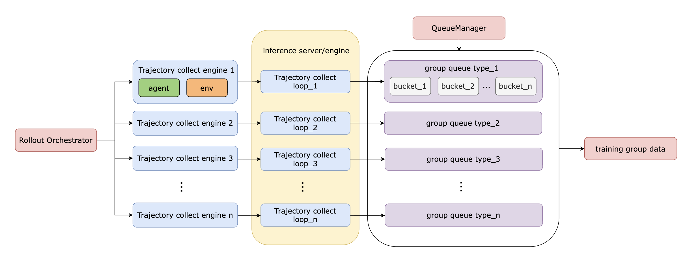
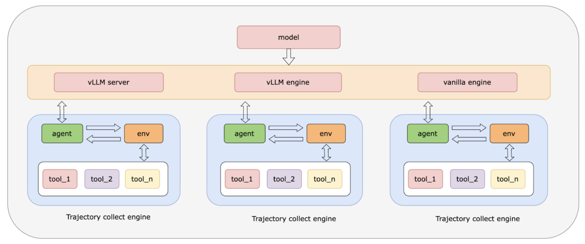
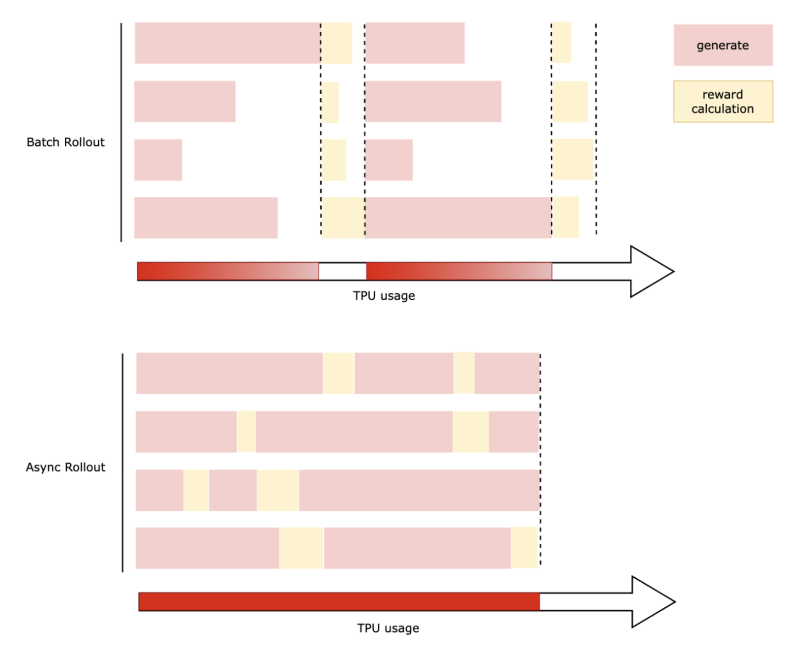

<!-- DO NOT REMOVE! Placeholder for TOC. -->

# Agentic RL

## Architecture



## Core Components

The framework consists of several key components:

*   **Agent**: Interacts with the environment by generating actions based on
    observations and conversation history.
*   **Environment**: Represents the task or problem to be solved, processes
    agent actions, and returns observations, rewards, and termination signals.
*   **Tool**: A reusable component that provides specific functionalities (e.g.,
    calculation, search) that an agent can invoke.
*   **Parser**: Translates between natural language model responses and
    structured data like tool calls, and formats conversation history into
    model-specific input formats.
*   **TrajectoryCollectEngine**: Manages the interaction loop for a single
    agent-environment pair to produce a complete trajectory.
*   **RolloutOrchestrator**: Manages multiple `TrajectoryCollectEngine`
    instances for parallel trajectory collection.

### Agents

Agents inherit from `ConversationAgentBase`, which provides common functionality
for maintaining conversation history (`chat_completions`) and recording
interaction steps in a `Trajectory`.

*   **`ModelAgent`**: A simple agent for single-turn tasks where the model's
    response is treated as the final answer.
*   **`ToolAgent`**: A more complex agent that can parse model responses to
    detect and invoke tool calls. It uses a `ToolManager` to manage available
    tools and a `ToolParser` (e.g., `QwenToolParser`, `GeminiToolParser`) to
    understand model outputs and format tool schemas for the model prompt.

### Environments

Environments inherit from `BaseTaskEnv`, which handles episode lifecycle
management like `max_steps`.

*   **`TaskEnvironment`**: Designed for single-turn tasks. The environment
    terminates after the first agent action and computes a reward based on the
    final response using a provided `reward_fn`.
*   **`ToolEnvironment`**: Designed for multi-turn, tool-using tasks. It
    receives actions from the `ToolAgent`, and if they are tool calls, it uses
    its internal `ToolManager` to execute them via `execute_calls`. The results
    of tool execution are returned to the agent as a new observation in
    `{"tool_outputs": ...}` format. The episode terminates when the agent
    invokes a special `finish` function or `max_steps` is reached, at which
    point `reward_fn` is called on the final answer.

### Tool Integration

Tools inherit from `BaseTool` and must implement `get_json_schema()` to define
their interface (parameters, description) and either `apply()` (synchronous) or
`apply_async()` (asynchronous) to define their logic. The `ToolManager`
discovers, registers, and executes tools by name. It can execute multiple tool
calls in parallel for efficiency.

### Agent/Environment interaction



--------------------------------------------------------------------------------

## Key Features and Optimizations

### Multi-turn Tool Use

Tunix fully supports multi-turn interactions involving tool use. The typical
flow is:

1.  The `ToolAgent` sends the conversation history (including user query and
    prior tool results) to the LLM.

2.  The LLM responds with a tool call, e.g., `calculator(a=1, b=1)`.

3.  The `ToolAgent` uses its `ToolParser` to parse this into an `Action` object.

4.  The `ToolEnvironment` receives this action, uses its `ToolManager` to
    execute `calculator`, and receives the result "2".

5.  The `ToolEnvironment` returns an observation like `{"tool_outputs":
    {"call_id_123": "Tool returned result: 2"}}`, reward=1, and done=False.

6.  The `ToolAgent` adds the tool result to its history as a `role: tool`
    message.

7.  The loop continues until the agent calls `finish(answer=...)` or `max_steps`
    is reached.

### Asynchronous Rollouts

To accelerate trajectory collection, Tunix supports asynchronous rollouts via
the `RolloutOrchestrator`. It leverages Python's `asyncio` to manage multiple
concurrent agent-environment interactions using `TrajectoryCollectEngine`
instances, with parallelism controlled by `max_concurrency`. The
`run_producers_from_stream` method manages a pool of workers that draw
agent-environment pairs from a stream, run full episodes via `collect()`, and
queue the resulting trajectories. The `yield_batches` method allows a consumer
(like an RL learner) to receive trajectories as they are generated. This
parallel execution significantly speeds up data collection, especially when
interacting with external models or tools with high latency.

Furthermore, Tunix provides a `RolloutSyncLock` to manage concurrency between
rollouts and model weight synchronization in distributed training setups. This
lock ensures that rollouts (`acquire_rollout`) are temporarily paused when a
weight sync (`acquire_weight_sync`) is requested, preventing agents from
generating trajectories with stale parameters.



### Trajectory Batching and Grouping

Tunix supports batching of agentic trajectories through the `GroupQueueManager`.
This component, used within the `RolloutOrchestrator`, collects `TrajectoryItem`
instances into buckets based on a configurable `group_key` (e.g., prompt ID via
`env.task["group_id"]`) and `episode_id`. Once a bucket reaches a predefined
`num_generations` (as in GRPO), it is marked as a "ready group"
and made available for downstream processing by `yield_batches`. This mechanism
is essential for algorithms like GRPO which require multiple trajectory samples
for each prompt, and improves efficiency by yielding full groups of trajectories
in batches. The `max_open_buckets` parameter can be used to limit memory usage
by controlling the number of groups that can be populated simultaneously.

### Dynamic Sampling (DAPO)

With GRPO-style advantages, a group whose `num_generations` samples all receive
the same reward has all-zero advantages and contributes no gradient. Dynamic
sampling drops such groups and admits a replacement prompt in their place, so
every global step still trains on `batch_size` informative groups. It is opt-in
on `AgenticRLConfig` (`agentic_grpo_config` in the CLI):

```yaml
agentic_grpo_config:
  off_policy_steps: 1
  group_filters: ["zero_variance"]
  max_in_flight_groups: 24  # batch_size=16
  max_consecutive_filtered_groups: 256
```

*   `group_filters`: `"zero_variance"` drops groups whose advantages are all
    zero; `"drop_failed"` drops groups with a broken episode (`FAILED`,
    `ENV_TIMEOUT` or `CANCELLED`). The learner checks the filters right after
    computing advantages, before the reference and actor log-probability passes,
    and the `DispatchWindow` admits exactly one replacement prompt per dropped
    group within the `off_policy_steps` staleness window.
*   `max_in_flight_groups`: optional cap on the prompt groups admitted ahead of
    the trainer, between `batch_size` and the default `(off_policy_steps + 1) *
    batch_size`.
*   `max_consecutive_filtered_groups`: raises `DynamicSamplingStalledError` when
    this many groups in a row are dropped, i.e. the data no longer yields
    trainable groups. `-1` (default) disables the guard.

Reward metrics cover every scored group, including dropped ones;
`dynamic_sampling/dropped_groups/<filter>` counts the dropped groups and
`policy/staleness_steps` reports how many weight syncs behind the trainer a
group was when it was scored. Prompts are admitted one at a time rather than
by batch, so kept groups stream to the trainer as each mini-batch fills and any
trailing partial micro-batch at the end of the dataset is dropped.
