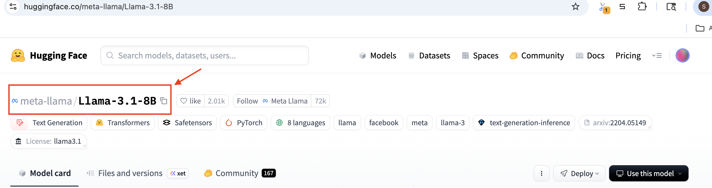
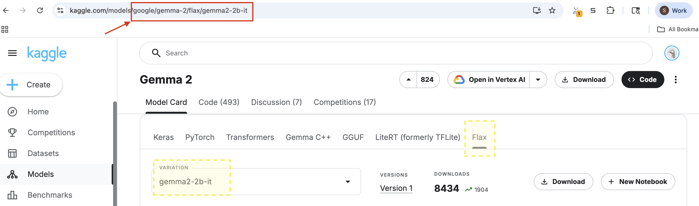

<!-- DO NOT REMOVE! Placeholder for TOC. -->

# Launching Jobs

Tunix supports several ways to launch training jobs, depending on your workflow:

*   **[Tunix CLI](#tunix-cli)**: The default choice. A simple CLI launching tool with comprehensive configuration options.
*   **[Interactive and Custom Launch](#interactive-and-custom-launch)**: While the Tunix CLI is preferred for simplicity, this approach provides full control. This is ideal for:

    *   **Early experimentation**: Getting familiar with the framework.
    *   **Advanced customization**: Complex cases requiring flexibility beyond the CLI.

## Tunix CLI

Tunix offers a configurable CLI to launch SFT and RL job directly from the command line. There a number of knobs and parameters allowing full customization of the job (described below), as well as a number of pre-defined examples to get you started.

### Configuration Hierarchy

You can tune CLI parameters across four configuration sources. Configurations
are merged in the following order of precedence (later sources override earlier
ones):

1.  **Base Config File** (Lowest Priority):
    The default settings found in `base_config.yaml` (or
    `base_agentic_config.yaml` for agentic RL workflows), passed as the first
    positional argument.

2.  **Config File Override**:
    An optional secondary config file specified via the `override_config_file` argument (e.g., `override_config_file=/path/to/override.yaml`). Values here override the base config.
    *(See an [example config](https://github.com/google/tunix/blob/main/examples/rl/grpo/gsm8k/configs/gemma2_2b.yaml)).*

3.  **Environment Variables (`T_<KEY>`)**:
    Environment variables prefixed with `T_` (including entries loaded from
    `.env`) override keys in the base config (for example, `T_BATCH_SIZE=32`).
    Note: setting the same parameter via both a `T_` environment variable and an
    `override_config_file` or CLI argument raises a `ValueError` to prevent
    ambiguous overrides.

4.  **CLI Arguments** (Highest Priority):
    Individual positional `key=value` pairs provided on the command line
    (without `--` prefixes). These override values from both the base config and
    `override_config_file`.

> **Note (`replace_keys` behavior):** By default (`merge_replace_keys=False`),
> overriding top-level dictionary sections in `replace_keys` (`lora_config`,
> `training_config`, `optimizer_config`, `profiler_options`,
> `rl_training_config`) as a mapping replaces that section wholesale rather than
> deep-merging all base keys; use dotted `section.key=value` overrides (or
> enable `merge_replace_keys=True` in custom entry points) when overriding
> individual nested fields.


### Example CLI Scripts

This collection includes command-line interface (CLI) scripts designed to handle various tasks.

> NOTE: 🔑 Required Credentials
>
> Before running the scripts, please ensure you have the following environment variables configured to access the necessary model repositories:
>
> *   **Hugging Face Access:**
>     *   `HF_TOKEN`: Required to authenticate and download models from Hugging Face.
>
> *   **Kaggle Access:**
>     *   `KAGGLE_USERNAME`: Your Kaggle username.
>     *   `KAGGLE_KEY`: Your Kaggle API key.

<section class="zippy">

#### Guide to Setup Credential

 TL;DR: This is a guide that covers how to get your keys, authorize them for restricted access, and save them permanently in a `.env` file.

##### Hugging Face (Token & Access)

**Step A: Generate the Token**

1.  Log in to [Hugging Face](https://huggingface.co/).
2.  Click your **Profile Picture** > **Settings** > **Access Tokens**.
3.  Click **Create new token**.
    *   **Name:** `CLI-Access`
    *   **Permissions:** **Read** (sufficient for downloading).
4.  **Copy** the token string (starts with `hf_`).

**Step B: Authorize Restricted Models (Critical)**

*Your token will fail if you skip this.*

1.  Go to the specific model page (e.g., [`meta-llama/Llama-3.2-1B`](https://huggingface.co/meta-llama/Llama-3.2-1B)).
2.  Find the **"Access this model"** banner at the top.
3.  Review the license and click **Agree and access repository**.
4.  Wait for permissions to sync to your token.


##### Kaggle (Key & Access)

**Step A: Generate the API Key**

1. Log in to [Kaggle](https://www.kaggle.com/).
2. Click your **Profile Picture** > **Settings**.
3. Scroll to the **API** section and click **Create New Token**.
4. Open the downloaded `kaggle.json` file to find your username and key.

**Step B: Authorize Access (Critical)**

1. Go to the specific **Models** page on Kaggle (e.g., [`gemma model family`](https://www.kaggle.com/models/google/gemma)).
2. Click the **Request Access** tab.
3. Review and Sign **Consent Form**.


##### Create the `.env` File

Instead of typing `export` every time, we will save these credentials in a file that sits in your project folder.

1. Create a new file in your project root named `.env` (no filename, just the extension).
2. Paste the following content into it, replacing the placeholders with your actual keys:

  ```bash
  # .env

  # Hugging Face Access
  HF_TOKEN=hf_12345exampletokenstring

  # Kaggle Access
  KAGGLE_USERNAME=your_kaggle_username
  KAGGLE_KEY=example_kaggle_key

  ```

>**Security Warning:** If you are using Git, you **must** add `.env` to your `.gitignore` file immediately. This prevents you from accidentally uploading your passwords to GitHub.

  </section>

*   **Supervised Fine Tuning**

    *Refer to the [hardware requirement](https://github.com/google/tunix/blob/main/examples/sft/mtnt/README.md) before proceeding.*

    *   **Peft Training on MTNT dataset** ([Source Folder](https://github.com/google/tunix/tree/main/examples/sft/mtnt))

        | Model Variant     | Script Name             | Link                                                                                                                             |
        | :---------------- | :---------------------- | :------------------------------------------------------------------------------------------------------------------------------- |
        | **Gemma 2B**      | `run_gemma_2b.sh`       | [View Script](https://github.com/google/tunix/blob/main/examples/sft/mtnt/run_gemma_2b.sh)       |
        | **Gemma 2 2B**    | `run_gemma2_2b.sh`      | [View Script](https://github.com/google/tunix/blob/main/examples/sft/mtnt/run_gemma2_2b.sh)      |
        | **Gemma 3 4B**    | `run_gemma3_4b.sh`      | [View Script](https://github.com/google/tunix/blob/main/examples/sft/mtnt/run_gemma3_4b.sh)      |
        | **Llama 3.2 3B**  | `run_llama3.2_3b.sh`    | [View Script](https://github.com/google/tunix/blob/main/examples/sft/mtnt/run_llama3.2_3b.sh)    |
        | **Qwen 2.5 0.5B** | `run_qwen2.5_0.5b.sh`   | [View Script](https://github.com/google/tunix/blob/main/examples/sft/mtnt/run_qwen2.5_0.5b.sh)   |


*   **Reinforcement Learning**

    *Refer to the [hardware requirement](https://github.com/google/tunix/blob/main/examples/rl/README.md) before proceeding.*

    *   **GRPO Training on GSM8K dataset** ([Source Folder](https://github.com/google/tunix/tree/main/examples/rl/grpo/gsm8k/))

        | Model Variant     | Script Name             | Link                                                                                                                             |
        | :---------------- | :---------------------- | :------------------------------------------------------------------------------------------------------------------------------- |
        | **Gemma 7B**      | `run_gemma_7b.sh`       | [View Script](https://github.com/google/tunix/blob/main/examples/rl/grpo/gsm8k/run_gemma_7b.sh)       |
        | **Gemma 2 2B**    | `run_gemma2_2b.sh`      | [View Script](https://github.com/google/tunix/blob/main/examples/rl/grpo/gsm8k/run_gemma2_2b.sh)      |
        | **Gemma 3 1B**    | `run_gemma3_1b.sh`      | [View Script](https://github.com/google/tunix/blob/main/examples/rl/grpo/gsm8k/run_gemma3_1b.sh)      |
        | **Gemma 3 4B**    | `run_gemma3_4b.sh`      | [View Script](https://github.com/google/tunix/blob/main/examples/rl/grpo/gsm8k/run_gemma3_4b.sh)      |
        | **Gemma 3 12B**   | `run_gemma3_12b.sh`     | [View Script](https://github.com/google/tunix/blob/main/examples/rl/grpo/gsm8k/run_gemma3_12b.sh)     |
        | **Llama 3.1 8B**  | `run_llama3.1_8b.sh`    | [View Script](https://github.com/google/tunix/blob/main/examples/rl/grpo/gsm8k/run_llama3.1_8b.sh)    |
        | **Llama 3.2 1B**  | `run_llama3.2_1b.sh`    | [View Script](https://github.com/google/tunix/blob/main/examples/rl/grpo/gsm8k/run_llama3.2_1b.sh)    |
        | **Qwen 3 0.6B**   | `run_qwen3.sh`          | [View Script](https://github.com/google/tunix/blob/main/examples/rl/grpo/gsm8k/run_qwen3.sh)          |
        | **Qwen 3 (Simple Reward)** | `run_qwen3_simplereward.sh` | [View Script](https://github.com/google/tunix/blob/main/examples/rl/grpo/gsm8k/run_qwen3_simplereward.sh) |
        | **Qwen 3 (vLLM Disagg)**   | `run_qwen3_vllm_disagg.sh`  | [View Script](https://github.com/google/tunix/blob/main/examples/rl/grpo/gsm8k/run_qwen3_vllm_disagg.sh)  |
        | **Qwen 3 8B (Disagg)**     | `run_qwen3_8b_disagg.sh`    | [View Script](https://github.com/google/tunix/blob/main/examples/rl/grpo/gsm8k/run_qwen3_8b_disagg.sh)    |
        | **Qwen 3 8B (MaxText Disagg)** | `run_qwen3_8b_disagg_maxtext.sh` | [View Script](https://github.com/google/tunix/blob/main/examples/rl/grpo/gsm8k/run_qwen3_8b_disagg_maxtext.sh) |

    *   **PPO Training on GSM8K dataset** ([Source Folder](https://github.com/google/tunix/tree/main/examples/rl/ppo/gsm8k/))

        | Model Variant     | Script Name             | Link                                                                                                                             |
        | :---------------- | :---------------------- | :------------------------------------------------------------------------------------------------------------------------------- |
        | **Gemma 2B**      | `run_gemma_2b.sh`       | [View Script](https://github.com/google/tunix/blob/main/examples/rl/ppo/gsm8k/run_gemma_2b.sh)       |
        | **Gemma 2 2B**    | `run_gemma2_2b.sh`      | [View Script](https://github.com/google/tunix/blob/main/examples/rl/ppo/gsm8k/run_gemma2_2b.sh)      |
        | **Gemma 3 1B**    | `run_gemma3_1b.sh`      | [View Script](https://github.com/google/tunix/blob/main/examples/rl/ppo/gsm8k/run_gemma3_1b.sh)      |
        | **Llama 3.1 8B**  | `run_llama3.1_8b.sh`    | [View Script](https://github.com/google/tunix/blob/main/examples/rl/ppo/gsm8k/run_llama3.1_8b.sh)    |
        | **Qwen 3 1.7B**   | `run_qwen3_1.7b.sh`     | [View Script](https://github.com/google/tunix/blob/main/examples/rl/ppo/gsm8k/run_qwen3_1.7b.sh)     |

    *   **Agentic RL Launch Scripts**

        | Task / Benchmark  | Script Name             | Link                                                                                                                             |
        | :---------------- | :---------------------- | :------------------------------------------------------------------------------------------------------------------------------- |
        | **FrozenLake (Gemma 4 E2B)** | `run_gemma4_e2b.sh` | [View Script](https://github.com/google/tunix/blob/main/examples/frozenlake/run_gemma4_e2b.sh) |
        | **DeepScaleR (Disaggregated)** | `run_deepscaler_disagg_v5p16.sh` | [View Script](https://github.com/google/tunix/blob/main/examples/deepscaler/run_deepscaler_disagg_v5p16.sh) |
        | **DeepSWE (Disaggregated)** | `run_deepswe_disagg_v5p_32.sh` | [View Script](https://github.com/google/tunix/blob/main/examples/deepswe/run_deepswe_disagg_v5p_32.sh) |


### CLI Scripts Overview

CLI Core code and CLI example launch scripts reside separately. This section provides a high level overview of the CLI structure.

* [CLI Core](https://github.com/google/tunix/tree/main/tunix/cli)
  * `base_config.yaml`: Base configuration schema for standard SFT, GRPO, and PPO CLI jobs.

  * `base_agentic_config.yaml`: Base configuration schema for agentic RL CLI jobs.

  * `base_rl_pipeline.py`: Shared RL pipeline builder handling role meshes (`same_mesh_as`), `rl_training_config`, and performance tracing setup.

  * `peft_main.py`: Main entry point to trigger Parameter-Efficient Fine-Tuning (PEFT) Trainer from the CLI configs.

  * `grpo_main.py`: Main entry point to trigger Group Relative Policy Optimization (GRPO) Trainer from the CLI configs.

  * `grpo_vllm_main.py`: Entry point for GRPO / Agentic GRPO workflows backed by vLLM rollout.

  * `ppo_main.py`: Main entry point to trigger Proximal Policy Optimization (PPO) Trainer from the CLI configs.

  * `config.py`: Logic to read, validate, and merge configs from YAML files, `T_<KEY>` environment variables, and CLI arguments.

  * `reward_fn/`: Predefined reward functions for reinforcement learning jobs (`gsm8k.py` on [gsm8k dataset](https://www.tensorflow.org/datasets/catalog/gsm8k), `gsm8k_verl.py` compatible with [verl](https://github.com/google/tunix/blob/main/examples/rl/grpo/gsm8k/verl_compatible/README.md), and `simple_math.py`).

  * `recipes/` & `utils/`: Dataset helpers (`deepscaler_data.py`, `utils/data.py`) and model loading helpers (`utils/model.py`).

* [CLI Examples](https://github.com/google/tunix/tree/main/examples)

  * `sft/..`: SFT CLI shell scripts and YAML configs.

  * `rl/..`: GRPO and PPO CLI shell scripts and YAML configs.

  * `frozenlake/`, `deepscaler/`, `deepswe/`: Agentic RL launch scripts and configs.


### Usage


#### Setup Cloud VM Environment

**TL;DR:** To automate the setup process for a single host, run the provided shell script matching your hardware accelerator.

**Automated Setup:**

*   **For TPU:**

    ```shell
    source scripts/setup_cli_tpu_single_host.sh
    ```

*   **For GPU:**

    ```shell
    source scripts/setup_cli_gpu_single_host.sh
    ```

<section class="zippy">

**Manual Setup (Detailed Breakdown)**

The following steps explain the environment setup process performed by the scripts above. You may skip this if you ran one of the automated scripts.

*   **1. Create a project specific environment.**

    ```shell
    python3 -m venv .venv
    # Or simply `python -m venv .venv` depending on your system configuration.
    ```

*   **2. Activate the Environment**

    ```shell
    source .venv/bin/activate
    ```

*   **3. Install Tunix dependency**

    Make sure you have an updated pip version installed:

    ```shell
    pip install --upgrade pip
    ```

    *   **Option A: TPU Only**
        If you only require TPU, install with `[prod]` extra:

        ```shell
        pip install -e .[prod]
        ```

    *   **Option B: Other Accelerators (e.g., GPU)**
        First, install the core Tunix dependency:

        ```shell
        pip install -e .
        ```

        Then, install your accelerator-specific dependency separately, for example:

        ```shell
        # Example for GPU
        pip install jax[gpu]
        ```

</section>

### Config Explanation

This section provides a detailed explanation of the configuration parameters available in `base_config.yaml`. These parameters allow you to customize model selection, training dynamics, hardware utilization (mesh), and reinforcement learning specific settings.


#### Model Configuration (`model_config`)

These parameters define the base model, where to download it from, and how to shard it across TPUs/GPUs. Note that in RL configs, `actor_model_config`, `reference_model_config`, and `rollout_model_config` inherit from `model_config` by default, and `critic_model_config` (set to `null` by default) configures the critic/value model in PPO.

* **`model_name`**: The unique full name identifier of the model. This
    corresponds to the full name and should match exactly with the model name
    used in Hugging Face or Kaggle. It is typically all lowercase and formatted
    as `<model-family>-<model-version>`.
    *   *Example*: `gemma-2b`, `llama-3.1-8b`, `gemma2-2b-it`.
    Refer to [models documentation](models.md#naming-conventions) for model naming.

* **`model_source`**: The source repository for the model. Options: `"huggingface"`, `"kaggle"`, `"gcs"`, `"maxtext"`, or empty string `""` for local paths.
* **`model_id`**: Model identifier (case sensitive) used by Tunix to determine model architecture/configuration, and to download weights when `model_source` is `"huggingface"` (e.g., Hugging Face Hub ID `"meta-llama/Llama-3.1-8B"` or Tunix config ID `"gemma2_2b_it"`).
  * *Example for Hugging Face*: `meta-llama/Llama-3.1-8B` is extracted as shown below:

    

* **`model_path`**: Path or source handle for non-Hugging Face sources:
  * **Kaggle (`model_source: "kaggle"`)**: Kaggle Hub model handle, e.g., `"google/gemma-2/flax/gemma2-2b-it"`, extracted as shown below:

    

  * **GCS / MaxText / Local**: Direct GCS bucket URI (`"gs://..."`), MaxText checkpoint path, or local filesystem directory.
* **`model_download_path`**: Local directory where downloaded checkpoints will be cached (e.g., `"/tmp/models"`).
* **`rng_seed`**: Integer seed for initializing the `nnx.Rngs` state to manage randomness (e.g., `0`).
* **`model_display`**: Boolean flag. If set to `true`, prints the model structure/summary.
* **`intermediate_ckpt_dir`**: Directory for temporary storage when converting specific formats like Kaggle Gemma/Gemma2 to NNX (e.g., `"/tmp/intermediate_ckpt/"`).
* **`lora_config`**: Configuration for Low-Rank Adaptation (LoRA).
  * `module_path`: Regex identifying layers to adapt (e.g., `".*q_einsum|.*kv_einsum|.*gate_proj..."`). Refer to [Lora](performance.md#peft-with-lora) for more details.
  * `rank`: The rank of the low-rank approximation (e.g., `16`).
  * `alpha`: Scaling factor for LoRA weights (e.g., `2.0`).
  * `weight_qtype`: Quantization type for the weights (e.g., `"nf4"`).
  * `tile_size`: Tile size for efficient computation (e.g., `256`).


* **`mesh`**: Defines the hardware mesh layout for distributed training (set `mesh: null` on a role config when sharing another role's mesh via `same_mesh_as`).
  * `shape`: Tuple string defining mesh dimensions (e.g., `"(2,2)"` for a 2x2 grid).
  * `axis_names`: Names for mesh axes, often used for parallelism strategies (e.g., `"('fsdp','tp')"` for Fully Sharded Data Parallelism and Tensor Parallelism).
  * `allocation_policy`: Device allocation policy (`"COMPACT"` or `"PERFORMANCE"`).
* **`same_mesh_as`**: *(RL role model configs only)* Shares another active role's mesh (for example, setting `mesh: null` and `same_mesh_as: "actor"` under `reference_model_config`, `rollout_model_config`, or `critic_model_config` for colocated execution).


#### Tokenizer Configuration (`tokenizer_config`)

* **`tokenizer_path`**: Path or ID of the tokenizer. Usually matches `model_id`.

* **`tokenizer_type`**: The library to use for tokenization. Options: `"huggingface"`, `"sentencepiece"`.

* **`add_bos`** / **`add_eos`**: Boolean. Whether to automatically prepend Beginning of Sentence (BOS) or append End of Sentence (EOS) tokens.


#### Dataset Configuration

* **`dataset_name`**: The identifier for the dataset (e.g., `"Helsinki-NLP/opus-100"` for SFT or `"gsm8k"` for RL).

* **`batch_size`**: Global batch size per training step.

* **`max_target_length`**: Maximum length of the target sequence (in tokens).

* **`num_train_epochs`**: Number of complete passes through the training dataset.

* **`tfds_download`**: Boolean. Controls download behavior for TensorFlow Datasets.


#### Optimizer Configuration (`optimizer_config`)

Controls the gradient descent algorithm and learning rate scheduling. Tunix uses [optax](https://optax.readthedocs.io/en/latest/getting_started.html) for optimizers.

* **`opt_type`**: The optimizer algorithm to use (e.g., `"adamw"`). Refer to [optax.optimizer](https://optax.readthedocs.io/en/latest/api/optimizers.html#optimizers) for available optimizers.

* **`learning_rate`**: A global scaling factor, either fixed or evolving along iterations with a scheduler if `schedule_type` is set.

* **`schedule_type`**: The learning rate schedule function (e.g., `"warmup_cosine_decay_schedule"`). Refer to [optax.schedule](https://optax.readthedocs.io/en/latest/api/optimizer_schedules.html) for available schedulers.

* **`warmup_steps`**: Number of steps to linearly increase the learning rate from `init_value` to `peak_value`.

* **`decay_steps`**: Number of steps for the decay phase of the schedule.

* **`opt_chain_type`** & **`chain_kwargs`**: Optional gradient transformation chained ahead of `opt_type`. To enable global-norm gradient clipping in the CLI, configure:
  ```yaml
  opt_chain_type: "clip_by_global_norm"
  chain_kwargs:
    max_norm: 1.0
  ```

> **Warning:** Although `max_grad_norm` appears in legacy `base_config.yaml` templates, `create_optimizer` filters optimizer kwargs against `inspect.signature(optax.<opt_type>)`, so `max_grad_norm` is currently a **no-op** unless `opt_chain_type: "clip_by_global_norm"` and `chain_kwargs.max_norm` are configured.

#### Training Configuration (`training_config` for SFT, `rl_training_config` for RL)

General settings for the training loop, logging, and checkpointing.

* **SFT (`peft_main.py`)** reads top-level **`training_config`** and **`optimizer_config`**.
* **RL (`grpo_main.py`, `grpo_vllm_main.py`, `ppo_main.py`)** reads **`rl_training_config`**, which inherits defaults from `training_config` via YAML anchor (`<<: *base_training_config`) and adds:
  * **`actor_optimizer_config`** & **`critic_optimizer_config`**: Per-role optimizer dictionaries (same schema as `optimizer_config`).
  * **`mini_batch_size`**, **`train_micro_batch_size`**, **`rollout_micro_batch_size`**, **`compute_logps_micro_batch_size`**: RL batching and micro-batching knobs (for RL, `gradient_accumulation_steps` must remain `null` and is derived automatically from `mini_batch_size // train_micro_batch_size`).

> **Warning (RL CLI Overrides):** Because YAML `<<:` anchors resolve when `base_config.yaml` is parsed—before CLI overrides are applied—RL jobs **must** override `rl_training_config.*` (for example, `rl_training_config.max_steps=100` and `rl_training_config.actor_optimizer_config.learning_rate=3e-6`). Passing `training_config.*` or top-level `optimizer_config.*` to `grpo_main.py` or `ppo_main.py` has no effect.

Common fields in `training_config` / `rl_training_config`:

* **`max_steps`**: Total number of training steps to run.

* **`eval_every_n_steps`**: Frequency of running evaluation steps.

* **`gradient_accumulation_steps`**: Number of steps to accumulate gradients before performing a parameter update in SFT (must be `null` in `rl_training_config`).

* **`checkpointing_options`**:
  * `max_to_keep`: Number of recent checkpoints to retain.
  * `save_interval_steps`: How often to save a checkpoint.
  * `enable_async_checkpointing`: Boolean to toggle asynchronous checkpointing execution.
  * `timeout_secs`: Maximum time permitted for asynchronous writes natively.


* **`metrics_logging_options`**: Settings for logging. Includes project name, run name, and flush frequency.

* **`data_sharding_axis`**: Specifies which mesh axis is used for data sharding (e.g., `["fsdp"]`).


#### GRPO Configuration (`grpo_config`, `rollout_config`)

Specific parameters for Group Relative Policy Optimization (GRPO).

* **`num_generations`**: (GRPO specific) The number of responses generated per prompt in a single step (corresponds to $G$ in the paper).

* **`beta`**: Coefficient for the KL divergence penalty. Keeps the trained model close to the reference model.

* **`epsilon`**: Clipping parameter for the loss function (similar to PPO) to ensure stable updates.

* **`temperature`**: Sampling temperature for rollouts. Higher values (e.g., 0.9) encourage diversity, which is critical for GRPO.

* **`total_generation_steps`**: Maximum tokens to generate during the rollout phase.

* **`reward_functions`**: List of python file paths containing the reward logic (e.g., checking math answers for GSM8K).


#### PPO Configuration (`ppo_config`, `rollout_config`)

Specific parameters for Proximal Policy Optimization (PPO).

* **`num_iterations`**: (PPO specific) The number of iterations per batch (corresponds to $\mu$ in the paper).

* **`gae_lambda`**: The lambda parameter (`ppo_config.gae_lambda`) for Generalized Advantage Estimation (GAE).

* **`gamma`**: The discount factor for future rewards in GAE.

* **`beta`**: Coefficient for the KL divergence penalty. Keeps the trained model close to the reference model.

* **`epsilon`**: Clipping parameter for the loss function to ensure stable updates.

* **`reward_functions`**: List of python file paths containing the reward logic (e.g., checking math answers for GSM8K).

## Interactive and Custom Launch

For interactive development or custom cluster setup, refer to our notebooks, examples, and guides, which demonstrate how to build the cluster and launch jobs programmatically:

*   **[Quick Start Guides](quickstart.md)**: Step-by-step guides for SFT, RL, Agentic workflows, and more.
*   **[Examples & Colabs](examples.md)**: A comprehensive list of interactive notebooks and scripts.

These resources are an excellent starting point for learning Tunix core concepts. Additionally, they demonstrate how to use Tunix in more complex scenarios that require full control. However, note that the **[Tunix CLI](#tunix-cli)** is recommended option for most standard workflows due to its simplicity.
