# Tunix OPD Design Document

| Item | Details |
| --- | --- |
| Name | On-Policy Distillation |
| Status | Design review draft; core implementation complete |
| Document version | 1.0 |
| Last updated | October 29, 2026 |
| Scope | Text sampled-token OPD in `tunix/dist_rl` |
| Validation status | CPU numerical and local training validation passed; real-service and accelerator acceptance tests remain pending |

## 1 Summary

OPD obtains per-token logprobs from a frozen teacher on the student's original trajectories. It converts the difference between teacher and behavior-student scores into fixed token advantages, then updates the student through the existing GRPO loss, batch assembler, trainer, and weight synchronization pipeline.

The first version uses an external teacher scoring service. Asynchronous scoring and advantage composition run in the critique stage. The teacher scores token IDs already generated by the student. Pure OPD and task GRPO with OPD share one implementation, controlled by the task-advantage and distillation coefficients. The teacher and reference policy remain independent roles.

The design requires scoring and training to use the same token trajectory, explicit semantics for behavior and training probabilities, and continuity of the distillation target when resuming a checkpoint.

## 2 Background and Requirements

The existing text RL pipeline provides trajectory collection, within-group reward normalization, per-token advantages, padding and packing, policy loss, actor/reference scoring, and weight synchronization. OPD adds teacher scoring and signal composition between these components within the same training runtime.

### 2.1 Goals

1. Support text sampled-token distillation from a frozen external teacher, for both pure OPD and task RL mixed with OPD.
2. Preserve sampled token IDs, behavior logprobs, policy versions, and action masks to establish a verifiable alignment contract across the pipeline.
3. Reuse the existing training loss and batch data path so that padding and packing preserve the OPD signal.
4. Fail explicitly on missing scores, changed context, altered sampling distributions, and incompatible resume targets.
5. Validate correctness with an independent mathematical oracle, actual local training, and negative controls.

### 2.2 Initial Scope

| Dimension | Supported scope |
| --- | --- |
| Orchestration entry points | `StandardRLProgram` and `GRPOAdapter` |
| Inputs and outputs | Text trajectories; the student generates text tokens |
| Teacher deployment | External SGLang `/generate` scoring service |
| Teacher objective | Frozen teacher with a sampled-token reverse-KL signal |
| Student sampling | Temperature 1, top-p 1, top-k disabled, and no additional distribution modifications |
| Group semantics | At least two valid responses per prompt; existing GRPO validity rules remain in effect |
| Policy freshness | `max_staleness=0`, with no in-flight weight updates during sampling |
| Batching | Teacher scoring before batch assembly; training through the existing padded and packed data paths |
| Initial execution recipe | Qwen3-0.6B, GSM8K, padded batches, the native trainer, in-process vLLM, and Raiden |

### 2.3 Non-Goals

The first version does not include a dedicated G=1 pure-distillation entry point, top-k or full-vocabulary distribution distillation, multi-teacher routing, mappings between different token-ID semantics, multimodal OPD, nonzero policy lag, local teacher weight switching, or a new training-service runtime.

Observations and template suffixes in text tool trajectories follow the existing token and mask contracts. Learning quality and operational stability on standard multi-turn tasks still require acceptance testing for each recipe.

## 3 Mathematical Definition

### 3.1 Notation

| Symbol | Definition |
| --- | --- |
| `s_t` | The original prompt and complete token prefix before the current action, including tool results and other context |
| `a_t` | The token actually generated by the student |
| `π_b` | The behavior student policy that generated the trajectory |
| `π_θ` | The current student policy being trained |
| `q` | The frozen teacher policy |
| `ℓ_b,t` | The recorded behavior score `log π_b(a_t ∣ s_t)` |
| `ℓ_T,t` | The teacher score `log q(a_t ∣ s_t)` on the same token prefix |
| `M_t` | The action/loss mask; 1 only for valid student actions |
| `A_task,t` | The task advantage computed by the existing GRPO adapter and expanded to token positions |
| `λ`, `α` | The OPD and task-advantage coefficients; both finite and nonnegative |

### 3.2 Distillation Signal and Composition Order

```text
d_t  = stop_gradient(ℓ_b,t − ℓ_T,t)
A'_t = M_t × [α × A_task,t − λ × d_t]
```

`d_t` is the sampled-token signal from the behavior student to the teacher. An individual token's `d_t` can be negative. At a fixed state, `E_{a∼π_b}[d_t] = KL(π_b || q)` is nonnegative. Taking the expectation of the fixed `d_t` under the updated `π_θ` generally does not produce `KL(π_θ || q)`.

Task rewards first pass through the existing GRPO group computation, and the resulting advantages are then multiplied by `α`. Scaling raw rewards first can cause a positive scale factor to cancel during normalization. OPD is added after task-advantage computation, with no additional whitening of the combined signal.

| Configuration | Behavior |
| --- | --- |
| `α=0, λ>0` | Pure OPD; raw task rewards remain available for logging and evaluation |
| `α>0, λ>0` | Task GRPO mixed with OPD |
| `α>0, λ=0` | Retain only the scaled task advantage and skip teacher requests |
| `α=0, λ=0` | The policy-gradient signal is zero; independently configured reference regularization or optimizer weight decay can still apply |

### 3.3 Relationship to the Policy Loss

The combined `A'` enters the existing clipped policy surrogate. The basic standard-GRPO path, without dual clipping or additional sampler corrections, is:

```text
ρ_t(θ) = exp(log π_θ(a_t | s_t) − stop_gradient(ℓ_b,t))
L_PG   = −Reduce_M[min(ρ_t × A'_t, clip(ρ_t, 1−ε, 1+ε_high) × A'_t)]
L      = L_PG + β × L_reference
```

`Reduce_M` follows the existing loss aggregation configuration. Teacher scores, behavior scores, and combined advantages are fixed data; gradients flow only through the current student. `β` controls independent reference regularization, while `λ` controls teacher guidance.

If subsequent sampler/trainer agreement applies IS/RS corrections or replaces the old-logprob baseline used by the policy ratio, the existing loss handles those changes according to its contract. Recomputing that baseline does not change the OPD guidance already fixed in the critique stage.

For this basic path, hold the rollout state distribution and reduction weights fixed, use complete action support, and evaluate at `θ=θ_b`. If clipping does not change the gradient and no additional action-dependent filtering is applied, the exact expectation over actions gives a distillation-component gradient equal to `λ` times the per-state `KL(π_θ || q)` gradient under the same weights. This statement excludes derivatives of the sequence-prefix distribution with respect to the parameters. It also does not imply that repeated clipped updates are strictly equivalent to optimizing full-sequence KL.

## 4 System Architecture

```mermaid
flowchart LR
  D[Dataset] --> R[Student rollout]
  R --> Q[Raw trajectory group]
  Q --> A[Task reward and base payload]
  A --> T[Async teacher scoring]
  T --> O[Detached OPD advantage]
  O --> S[ScoredGroup]
  S --> B[Padding or packing]
  B --> C[Actor and optional reference scoring]
  C --> L[Existing GRPO loss and optimizer]
  L --> K[Checkpoint with OPD manifest]
  K --> W[Weight synchronization]
  W --> R
```



### 4.1 Component Responsibilities

| Component | Responsibility |
| --- | --- |
| `TeacherScorer` | Asynchronous scoring interface; accepts unpadded, unpacked trajectories and returns completion-aligned scores |
| `SGLangTeacherScorer` | Tokenizer compatibility checks, HTTP requests, concurrency and deadlines, and returned token/score validation |
| `apply_opd_to_payloads` | Pure function that composes token advantages and returns metric statistics without mutating its inputs |
| `StandardRLProgram` | Runtime validation, scorer invocation, queueing, assembly, training, checkpointing, and policy synchronization |
| Batch assembler | Apply a consistent layout to tokens, advantages, old/reference scores, loss masks, and segment metadata |
| Trainer and inference workers | Preserve attention validity and packed segments/positions for actor/reference scoring and training |
| `identity` module | Build the OPD manifest and validate target continuity on resume |

After advantage composition, the teacher logprob vector is no longer transmitted as a separate training field. Training uses the existing `advantages` channel. The first version retains aggregate statistics and does not persist per-token teacher scores for auditing.

### 4.2 Data Flow for One Update

1. The program validates OPD configuration and enforces `return_logprobs=True` and `require_unfiltered=True`.
2. Rollout generates trajectories from the synchronized student and records raw token IDs, behavior logprobs, action masks, and policy versions.
3. Critique computes raw task rewards first. Pure OPD passes zero rewards to the task-advantage estimator while retaining the original scores for logging.
4. The adapter creates unbatched payloads and preserves the existing masks for failed trajectories and invalid groups.
5. Valid trajectories are checked against assembler length budgets before teacher scoring. Fully masked trajectories do not issue requests.
6. Fixed token advantages are composed, and the complete `ScoredGroup` is queued.
7. The training stage assembles microbatches, establishes explicit attention validity, performs optional reference and actor-agreement scoring, and invokes the existing loss and optimizer.
8. Checkpoint metadata is saved at existing recoverable batch boundaries, and updated student weights are synchronized for the next round.

Asynchronous HTTP scoring runs in the critique stage, and a group is queued only after its scoring completes. Pipeline stages overlap subject to strict policy-freshness constraints. An asynchronous scorer does not permit nonzero policy lag.

## 5 Interfaces and Data Contracts

### 5.1 Public Python Interface

```python
@dataclass(frozen=True, kw_only=True)
class OnPolicyDistillationConfig:
    coefficient: float = 1.0
    task_reward_coefficient: float = 0.0

class TeacherScorer(Protocol):
    async def score(
        self, payloads: Sequence[RLTrainerPayload]
    ) -> Sequence[np.ndarray]: ...

class StandardRLProgram:
    # Only the required entry argument and OPD options are shown.
    # Other existing arguments are omitted.
    def __init__(
        self,
        algo: AlgorithmAdapter,
        *,
        opd_config: OnPolicyDistillationConfig | None = None,
        teacher_scorer: TeacherScorer | None = None,
        opd_teacher_identity: TeacherIdentity | None = None,
    ): ...
```

A positive `coefficient` requires a scorer and actual weight synchronization. A scorer or teacher identity cannot be supplied without an OPD configuration. With the configuration set to `None`, the existing RL path does not construct teacher resources.

### 5.2 Data Before Batch Assembly

For trajectory `i`, let `P_i` be the prompt length and `C_i` the completion length. The completion includes subsequent student actions, tool observations, and template suffixes.

| Field | Shape | Contract |
| --- | --- | --- |
| `prompt_ids` | `[P_i]` | Original integer token IDs; a trajectory with active scoring positions must have at least one prompt token |
| `prompt_mask` | `[P_i]` | All ones for an actively scored trajectory; the input is unpadded |
| `completion_ids` | `[C_i]` | Original trajectory token IDs with their order and context preserved |
| `completion_mask` | `[C_i]` | The teacher adapter requires a binary action mask |
| `old_per_token_logps` | `[C_i]` | Behavior scores for the actual generated actions; active positions must be finite |
| `advantages` | `[C_i]` | Task advantages before composition; fixed `A'` afterward |
| Scorer result | One `[C_i]` fp32 vector per trajectory | Aligned with completion positions; active scores must be finite, and unsupervised positions return zero |

The scorer must return one result per payload. Fully masked trajectories may skip teacher requests and vocabulary checks so that they do not prevent healthy trajectories from being scored. OPD must not reactivate their loss masks.

### 5.3 Teacher Scoring Protocol and Position Alignment

For a trajectory with active scoring positions, send the complete original token sequence:

```json
{
  "input_ids": [1, 4, 5, 6],
  "sampling_params": {
    "temperature": 1.0,
    "max_new_tokens": 0,
    "skip_special_tokens": false
  },
  "return_logprob": true,
  "logprob_start_len": 0
}
```

Read each `[logprob, token_id, ...]` row in `meta_info.input_token_logprobs`. The response must contain exactly `P_i+C_i` rows, and token IDs must match the corresponding submitted positions. The first input token may use the protocol's initial placeholder.

Completion position `j` uses input-score row `P_i+j`, with zero-based indexing. This row already represents the current token's conditional score given its prefix; no additional causal shift is applied. For example, if the prompt above is `[1,4]`, completion tokens `[5,6]` use rows 2 and 3. The first response token and any EOS actually generated follow the same rule.

Every returned row is checked for structure and token-ID alignment. Only active action scores must be finite and representable in fp32. Missing or nonfinite scores for prompt or unsupervised completion positions do not become training signals, while their tokens remain in the teacher's context.

### 5.4 Tokenizer Compatibility

Student and teacher tokenizers must have compatible fast backends. Initialization compares the complete vocabulary mapping, added-token semantics, special tokens and IDs, and the backend model, decoder, normalizer, pre-tokenizer, and post-processor. Mutable runtime padding and truncation settings are excluded from this comparison.

The teacher receives the student's input IDs directly, without reapplying a chat template or decoding and retokenizing. Different model architectures may share the same token-ID semantics; matching vocabulary sizes alone is insufficient. The caller must ensure that the supplied teacher tokenizer corresponds to the checkpoint actually served.

## 6 Correctness Constraints

### 6.1 Sampling Probability Space

OPD requires sampling from the full student distribution at temperature one. The program validates configuration and per-prompt overrides, and forwards a `require_unfiltered=True` contract that overrides cannot disable. The sampler then validates the effective parameters.

The principal allowed settings are T=1, top-p=1, and disabled top-k. Nonzero min-p, nondefault repetition/presence/frequency penalties, minimum-token EOS suppression, token bans, logit bias, constrained decoding, best-of selection, beam search, and custom logits processors are rejected. A native backend's internal `top_k=None`, when it denotes disabled filtering, is normalized before validation.

In-process vLLM starts OPD requests from neutral `SamplingParams` and validates the final parameters after configuration overrides. This prevents implicit filtering inherited from model generation config. Async vLLM validates the final sampling parameters and engine-level logits processors. Native vanilla validates the worker's static configuration actually used by JIT decoding. Ordinary sampling retains its existing defaults.

When behavior logprobs are requested, missing, misaligned, or nonfinite scores must cause failure. Scores are selected from candidate dictionaries by the actual generated token ID, independent of dictionary order. A valid zero logprob remains valid.

### 6.2 Loss Masks and Attention Validity

| Token type | OPD loss | Attention context |
| --- | --- | --- |
| Prompt | Excluded | Retained |
| Valid student actions, including generated EOS | Included | Retained |
| Tool observations and template suffixes | Excluded | Retained |
| Padding | Excluded | Excluded |
| Failed trajectories or invalid groups | Excluded | Must not be reactivated as valid training samples by OPD |

Padded batches use actual lengths to construct `completion_attention_mask`. This mask is concatenated with `prompt_mask` to form the complete `token_mask` passed to actor/reference scoring and the actual loss. Token validity cannot be inferred from `token_id != pad_id`, because EOS and padding may share an ID.

Packed batches use `segment_ids` and reset `segment_positions`, without also supplying the padded `token_mask`. These fields must survive reference chunking and actor microbatch slicing to prevent context from leaking across trajectories.

Passing these fields through the pipeline still depends on the model and attention backend consuming segment metadata correctly. Before enabling a packed recipe, that model must pass a packed/unpacked score and gradient comparison. CPU data-path tests do not establish support in every model kernel.

### 6.3 Length and Validity

When `λ>0` and active actions exist, lengths are checked before teacher scoring. The padded path requires `P_i≤max_prompt_length` and `C_i≤max_response_length`; the packed path requires `P_i+C_i≤max_packed_len`. An active trajectory exceeding these budgets fails, preventing silent truncation of scored context before training.

The existing GRPO path continues to enforce G≥2 and valid-group rules. OPD cannot bypass these checks when only one response is valid or when the entire group has no active actions.

## 7 Configuration and Deployment

| Configuration | Default | Meaning |
| --- | --- | --- |
| `--opd_teacher_url` | Empty | Empty disables OPD; otherwise, the teacher base URL or complete `/generate` URL |
| `--opd_teacher_tokenizer_path` | Empty | Required when OPD is enabled; tokenizer path or ID accessible to the control plane |
| `--opd_teacher_revision` | Empty | Caller-declared identity of the frozen weights; required for positive-coefficient resume |
| `--opd_coefficient` | `1.0` | `λ`, finite and nonnegative |
| `--opd_task_reward_coefficient` | `0.0` | `α`, applied to the computed task advantage |
| `--opd_teacher_timeout_seconds` | `60.0` | Per-request deadline including queueing and complete response-body reads |
| `--opd_max_concurrency` | `8` | Maximum concurrent requests for the same scorer |

The launcher forwards these settings through the corresponding `OPD_*` environment variables. The teacher can run on a separate GPU service. The control plane loads its tokenizer, not its model weights.

The GSM8K entry point requires actual Raiden weight synchronization when `λ>0`. All enabled OPD runs require `USE_ROLLOUT_LOGPS=true`, `MAX_STALENESS=0`, and `IN_FLIGHT_WEIGHT_UPDATES=false`. The last setting must also match the actual worker configuration. The initial recipe uses beta=0 to isolate acceptance testing from the independent reference term.

Setting `λ=0` skips teacher scoring requests. The current CLI still requires tokenizer arguments and constructs a scorer whenever OPD is enabled. Use an empty teacher URL to disable OPD entirely.

## 8 Checkpointing and Resume

### 8.1 Manifest

OPD adds `opd_manifest` to the existing checkpoint metadata. The following is an example value for that field, including an explicit per-turn token budget:

```json
{
  "schema_version": 1,
  "estimator": "sampled_token_reverse_kl",
  "coefficient": 1.0,
  "task_reward_coefficient": 0.0,
  "sampling": {
    "max_generation_steps": 128,
    "temperature": 1.0,
    "top_p": 1.0,
    "top_k": 0,
    "return_logprobs": true,
    "require_unfiltered": true
  },
  "teacher": {
    "declared_revision": "sha256:immutable-checkpoint-digest",
    "tokenizer_fingerprint": "sha256-of-tokenizer-semantics"
  }
}
```

`sampling` contains the program's resolved `GenerationArgs`, excluding fields set to `None`. Disabled top-k values -1 and 0 are canonicalized to 0. This is not a complete experiment snapshot: it excludes the full worker configuration, dataset identity, per-prompt overrides, and other training hyperparameters. When `λ=0`, `teacher` is null.

### 8.2 Resume Rules

| Resume combination | Handling |
| --- | --- |
| Ordinary RL checkpoint → ordinary RL | Preserve existing compatibility behavior |
| Existing checkpoint without an OPD manifest → OPD | Reject if the engine reports a restored step greater than zero; target identity is unknown |
| OPD checkpoint → OPD disabled | Reject to prevent a silent objective change |
| Changed manifest schema, coefficients, sampling contract, or teacher declaration | Reject and report the changed fields |
| Positive coefficient without a declared revision or tokenizer fingerprint | Allow a fresh run with a warning, but reject resume |
| `λ=0` with a matching manifest | Allow resume without teacher identity |

Validation currently runs after the engine restores the checkpoint and optionally resynchronizes weights, but before any program stages, new scoring, or sampling start. It does not guarantee rejection before weights are loaded. A changed distillation target requires a fresh run. Warm-starting from existing weights requires an explicit workflow separate from resume.

The endpoint URL is not a model identity, so the same frozen teacher can move to a different service address. The revision is a caller declaration, and the tokenizer fingerprint describes local tokenizer semantics. Neither proves which weights the remote service currently holds. Deployment must pin the actual model version.

## 9 Failure Handling and Resource Management

| Condition | Handling |
| --- | --- |
| Incompatible configuration or tokenizer | Fail during initialization |
| Prompt override changes the distribution or disables the sampling contract | Fail before dispatch |
| Effective sampler configuration changes the probability space | Fail at the sampler boundary before generation |
| Active trajectory exceeds assembler budgets | Fail before requesting teacher scores |
| HTTP failure, missing fields, misalignment, or invalid active scores | Fail scoring; do not queue the group as trainable |
| Teacher request deadline exceeded | Cancel the request; terminate the run through stage error propagation |
| Fully masked trajectory or `λ=0` | Skip teacher requests and produce a zero OPD component |
| Incompatible resume target | Fail before program stages start |

The first version does not retry teacher errors automatically, fill missing scores with zeros, or fall back to task-only RL. The program cancels the relevant stages. Existing checkpoints and commit boundaries provide recovery; no additional distributed exactly-once guarantee is made.

The HTTP scorer reuses an asynchronous client within each group and limits concurrency with a shared semaphore. The deadline starts before waiting for a slot and covers connection establishment and the complete response body. A group error or cancellation cancels and awaits the remaining requests, preventing orphaned scoring tasks.

## 10 Performance and Observability

The teacher processes `P_i+C_i` tokens per trajectory, and the scorer returns scalar logprobs aligned with the completion. Transfer volume is linear in token length. Advantage composition is a linear host-side operation. Training adds neither vocabulary-sized tensors nor a copy of the teacher's parameters.

The primary additional costs are teacher prefill, network transfer, and critique-stage waiting. The initial client issues one request per trajectory with bounded concurrency; the teacher service may batch or cache internally. Explicit client batching, scoring across groups, prefix-reuse policies, and score caching are future optimizations to prioritize using measured component timings.

| Metric | Definition |
| --- | --- |
| `opd/reverse_kl` | Weighted mean of `ℓ_b−ℓ_T` over active OPD tokens; may be negative |
| `opd/teacher_logprob` | Mean teacher logprob over the same active tokens |
| `opd/student_logprob` | Mean behavior-student logprob over the same active tokens |
| `opd/token_count` | Number of active tokens included in OPD score statistics; zero when the OPD coefficient is zero |
| `opd/scoring_time_seconds` | Group-level scoring and signal-processing time, accumulated under the existing aggregation rules |

Means are reduced across groups as `(sum, token_count)`, so short and long responses do not receive equal statistical weight. These statistics are produced during critique and may precede additional training-side IS/RS or error masking. They are neither full-vocabulary KL nor a separate count of the tokens ultimately accepted for training.

Raw task rewards, response lengths, valid-group metrics, and sampler/trainer agreement metrics remain available. Before scaling training, measure rollout, teacher, assembly, training, and synchronization costs separately.

## 11 Data Access and Security

The teacher service receives the complete prompt and trajectory, including tool results. Deployment must place that service within the appropriate data-access boundary and use controlled networking with suitable HTTPS or proxy configuration.

The current scorer has no dedicated authentication configuration or remote checkpoint attestation. Credentials should be managed by deployment infrastructure and kept out of endpoint URLs that may be logged. New OPD metrics record only aggregate statistics and add no persistent per-token teacher scores. Existing trajectory logging may still store raw inputs, outputs, and token IDs; deployment must manage its access and retention separately.

## 12 Validation and Acceptance

### 12.1 Validation Layers

| Layer | Method | Acceptance criterion |
| --- | --- | --- |
| Mathematics | Nonuniform distributions over three states and three actions; exact frequency enumeration against independent dense-objective gradients | Matching padded/packed gradients, λ/α scaling, and mixed objectives; zero distillation component at λ=0; zero policy gradient when λ=α=β=0 and no other objective applies |
| Protocol | Local HTTP server checking original IDs, response spans, the first token, EOS, malformed responses, concurrency, and deadlines | Explicit failure on misalignment; unsupervised positions do not enter the signal |
| Training loop | Complete program, actual trainer/loss/optimizer, two updates, and an independent NumPy parameter oracle | Correct updates at each step, unchanged teacher, and sampling from synchronized weights in the next round |
| Negative control | Correct token IDs with deliberately shifted teacher scores | Independent update oracle detects the error |
| Runtime contracts | Model sampling-default contamination, worker configuration mismatches, and manifest changes | Incompatible behavior is rejected at the corresponding boundary |
| External runtime | Real SGLang, vLLM, Raiden, and a TPU recipe | Working scoring, synchronization, two sampling rounds, and resume from disk |
| Learning quality | Fixed evaluation split comparing the initial student, pure OPD, GRPO, and mixed training | Quality, response length, and cost meet task-specific criteria defined in advance |

### 12.2 Current Evidence

The combined CPU regression run on October 29, 2026 passed 775 tests and 286 subtests, with 6 tests skipped. For the nonuniform distributions, the maximum absolute gradient difference between the actual loss and the independent dense objective was approximately `3e-8`.

In a local two-update small-model run, mean dense reverse-KL decreased from `0.149617002` to `0.147754008`. Each parameter update matched the independent NumPy oracle. The fixed fixture covered sampled EOS, a tool token with ID 0, variable response lengths, and padding. The negative control with shifted scores produced a detectable maximum parameter-update error of approximately `0.059`.

This loop used a local NumPy teacher HTTP service, a controlled sampler, and NNX state copying in place of distributed transfer. Real services, accelerators, resume from disk, and pretrained-model quality remain separate acceptance requirements in the table above.

## 13 Rollout and Compatibility

OPD is disabled by default. Initial deployment should use a short text recipe with fixed teacher/tokenizer identities, full-distribution sampling, beta=0, zero staleness, and two rounds of actual synchronization. After runtime acceptance passes, compare learning outcomes on a fixed evaluation set.

On failure, stop the OPD run, correct the configuration or service, and resume from a checkpoint with a matching manifest. Switching teachers, changing distillation coefficients, or disabling OPD should be managed as a new training run. Ordinary RL checkpoint metadata receives no OPD field, and ordinary sampling preserves model defaults.

G=1, candidate-distribution distillation, multiple teachers, nonzero lag, and multimodal inputs each require an extended data and objective contract, independent oracles, and recipe acceptance tests. Support must not be claimed merely by relaxing existing validation.

## 14 Design Tradeoffs

| Option | Decision and rationale | Cost |
| --- | --- | --- |
| Compose advantages during critique | Reuse the existing loss, assembler, and training data path while fixing score semantics | Future per-token auditing needs an additional storage interface |
| Add teacher tensors and a dedicated loss | Not selected initially; expands RPC, packing, and training interfaces | No full-vocabulary objective or teacher access inside the loss |
| Independent external teacher | Decouple teacher resources from student training and retain an independent reference role | Network latency, service availability, and deployment identity management |
| Reuse the reference role as teacher | Not selected initially; reference regularization and teacher changes require independent configuration | An additional external service dependency |
| Full-distribution sampling | Give behavior, teacher, and trainer scores explicit semantics | Filtered sampling is unsupported initially; extensions must distinguish support from full-policy scores |
| Retain G≥2 | Reuse existing valid-group rules and limit the initial change surface | Pure OPD cannot yet reduce generation cost to one response per prompt |
| Terminate on scoring errors | Preserve the objective and prevent invalid supervision or silent fallback | Transient teacher failures interrupt training; bounded retries may be designed later |

## 15 Open Design Questions

| Question | Current boundary | Trigger for further design |
| --- | --- | --- |
| Remote teacher identity verification | Deployment pins weights and declares a revision | Automated releases or replicated teachers require a server identity and version handshake |
| Complete experiment identity on resume | The manifest covers OPD declarations and global generation configuration only | Before long runs, extend experiment records to include datasets, rewards, reference policies, and the runtime environment |
| Teacher batching, caching, and retries | Bounded per-trajectory requests; errors terminate the run | If teacher cost or transient failures become a measured bottleneck, define cache keys, retry boundaries, and version consistency |
| G=1 and richer distillation objectives | Preserve the current adapter's valid-group semantics | Explicit generation-cost or supervision-density requirements justify separate estimators, data fields, and oracles |

## 16 Implementation Entry Points

| Module | Location |
| --- | --- |
| OPD configuration and signal composition | [on_policy.py](../tunix/dist_rl/distillation/on_policy.py) |
| Teacher scoring and tokenizer checks | [teacher.py](../tunix/dist_rl/distillation/teacher.py) |
| Manifest and resume rules | [identity.py](../tunix/dist_rl/distillation/identity.py) |
| Orchestration integration | [rl_program.py](../tunix/dist_rl/orchestrator/rl_program.py) |
| Sampling-distribution constraints | [generate/utils.py](../tunix/generate/utils.py) |
| Core training loss | [algo_core.py](../tunix/rl/algo_core.py) |
| Mathematical oracle | [opd_gradient_test.py](../tests/dist_rl/distillation/opd_gradient_test.py) |
| Training loop and negative controls | [opd_training_test.py](../tests/dist_rl/distillation/opd_training_test.py) |
| Checkpoint integration validation | [opd_checkpoint_identity_test.py](../tests/dist_rl/orchestrator/opd_checkpoint_identity_test.py) |
| Initial execution recipe | [run_gsm8k_opd_qwen3_0p6b.sh](../tunix/dist_rl/examples/recipes/run_gsm8k_opd_qwen3_0p6b.sh) |
