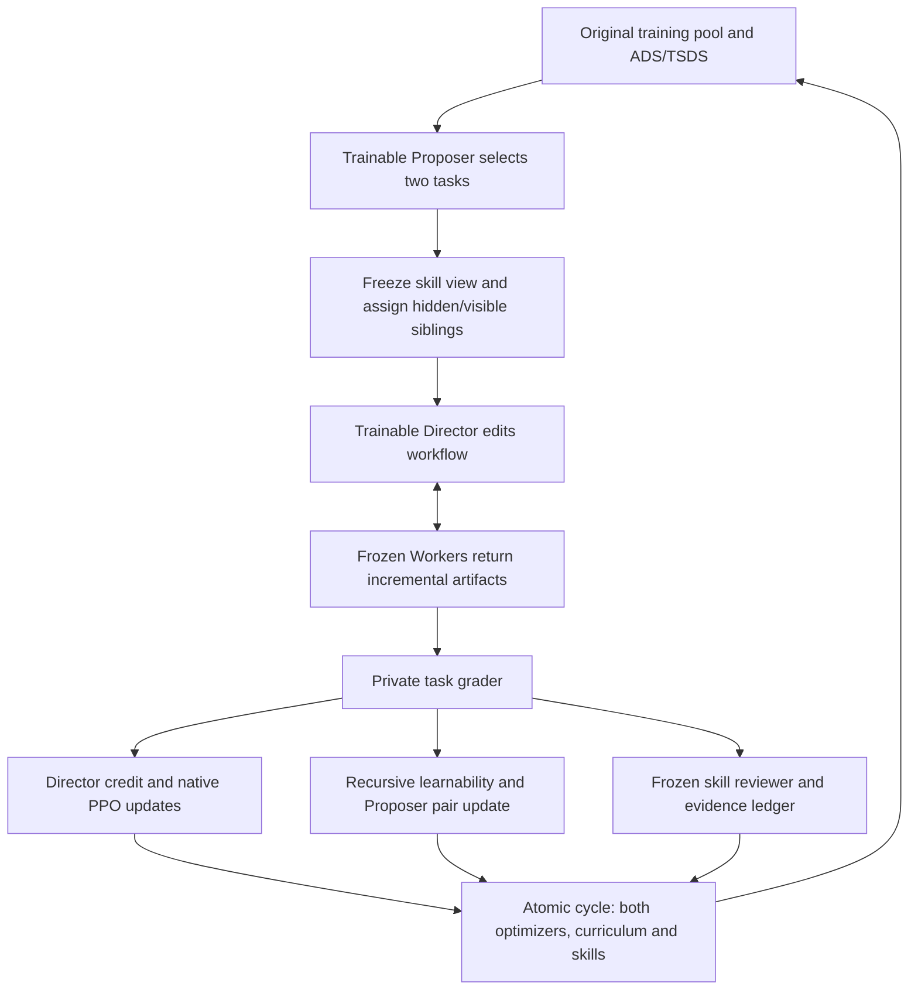
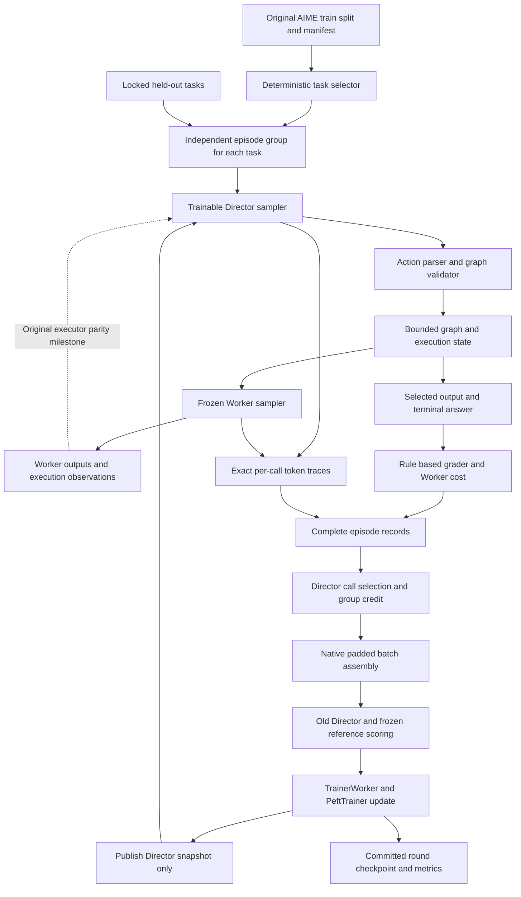
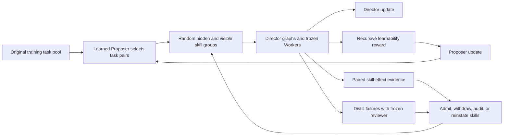

# R²Orch Math on `dist_rl`

**Status:** runnable Director and alternating RSI math adaptations; local
acceptance is separate from pretrained-model benchmark acceptance.
**Initial recipe:** Qwen3-4B, trainable Director, frozen Workers, original AIME splits.
**Reference:** R²Orch v2 and source revision
`12ceb7563aa50439687f21ba5da60ad74a75eb89`.

### Local acceptance record

- The November 15 combined regression run passed **450 tests and 116 subtests**,
  with one real-container integration check skipped. The pinned upstream
  checkout and local Qwen tokenizer were enabled. A later binary-KL file run
  passed ten tests, and the local HTTP OPD suite passed three tests separately.
  See the [validation record](swarm_training_validation.md#recipe-series-local-validation-november-15-2026)
  for commands, artifacts and acceptance limits.
- The Director CPU CLI completed two collection rounds and four native
  optimizer updates. Actor parameter delta L2 was `0.03142165`; frozen
  Worker/reference parameters were unchanged; maximum sampler/actor logprob
  error was `5.96e-8`. These are fixture diagnostics, not math benchmark results.
- Interrupted and uninterrupted CPU runs produce matching parameters and
  histories. Evaluation-only restoration performs no parameter update.
- Original data import was exercised on all four pinned splits: 947 / 30 / 30 /
  128 records, including source-byte and output hashes.
- The subsequent implementation adds incremental worker execution, an
  alternating learned-Proposer/Director driver, a frozen skill reviewer, atomic
  two-learner cycle recovery, and a separate collective repair/CISPO recipe.
- Pretrained training of these new recipes has **not** been run in this local
  acceptance. Earlier Dr. MAS TPU results belong to the separate recipe.

Reproduce the local suite with:

```bash
TUNIX_R2ORCH_SOURCE=/path/to/pinned/R2Orch \
TUNIX_SWARM_QWEN_TOKENIZER=/path/to/pinned/Qwen3-4B-tokenizer \
python -m pytest tests/dist_rl/swarm -q
```

See [the recipe](../examples/r2orch_math/README.md) for runnable commands and
[the publication plan](swarm_blog_plan.md) for the small-model experiment and
user-facing framework story.

### Implementation boundary

The first implementation provides a Director-only CPU training loop and a
Qwen3-4B launch path, source-split data preparation, selected-policy credit, and
separate frozen Worker/reference snapshots. The Qwen profiles execute the pinned
original GraphDirector, GraphCanvas, Worker executor and submission controller
through a native Tunix transport. Relation decisions retain their original
off/on token support in sampling, old/reference scoring and training. Their KL
is exact categorical `KL(current || reference)`; ordinary text uses k3 capped at
10 as in the paper's launcher. The three original AIME tools run through an explicitly
pinned container adapter with no host-execution fallback. Container execution
itself has not been validated on this CPU host; adapter contracts are tested.

The compact incremental executor remains a separate CPU fixture. Both Qwen
profiles use native sampling and rank-64/alpha-64 LoRA adapters with the paper
launcher's explicit zero-dropout override. The static TOML default is 0.05;
the launch script takes precedence. The source's append-only Director context,
two PPO minibatches, KL-reference stride, AdamW and scheduling settings are
represented explicitly rather than inferred from generic GRPO defaults.
Qwen3.5-9B has a pinned loading/configuration path, but no pretrained numerical
or benchmark acceptance here. These execution/backend differences are explicit.

`examples/r2orch_math/selfplay.py` integrates the categorical Proposer loss,
source ADS/TSDS curriculum, hidden/visible skill assignments, recursive
learnability, frozen review and evidence-based skill retirement. The Qwen path
uses pinned source modules and data; the CPU path uses a deterministic fixture.
Both learner checkpoints and outer state are committed together. Passing local
tests establishes a runnable training loop, not the original paper's results.
The source PATS reviewer executes REVISE followed by DISTILL with the original
prompt packing, evidence aliases, edit rules, deduplication and capacity checks.
Rewritten/deleted versions are archived separately from statistically retired
versions, so an audit cannot accidentally restore a deleted version.



## 1. Objective and scope

Train a Director to construct a useful multi-agent workflow for a mathematics
problem. The Director chooses the agents, their instructions, information flow,
and output agent. Frozen Workers execute the resulting workflow. Only the
Director's sampled actions participate in its policy update.

The first milestone adapts the method to Tunix's verified Qwen3-4B training path.
It is not a claim to reproduce the original model's benchmark numbers. Full
reproduction additionally requires the original backbone and adapters, the
Proposer and skill loop, executor semantics, tool environments, and evaluation
protocol. These are explicit milestones, not features implicitly supplied by a
Director-only run.

R²Orch already provides the proposed recursive self-improvement (RSI) method:
learned task selection, learning with and without retrieved skills, and evidence
based skill withdrawal. This design adopts that published method. Avalon/RLCR is
a subsequent, different recipe with shared trainable agent weights and collective
rewards. [R²Orch paper](https://arxiv.org/abs/2610.22740v2)

## 2. Existing foundation

The Dr. MAS recipe demonstrates a shared Qwen3-4B policy in a fixed
Solver–Verifier workflow. `SwarmRLProgram` collects complete groups, constructs
call rows, runs the native batch assembler, performs training through
`TrainerWorker`/`PeftTrainer`, and publishes the updated rollout policy.

Reuse those training components. Keep generic policy identity, trace validation,
credit selection, and optimizer boundaries in `tunix/dist_rl`; keep graph
actions, math prompts, datasets, and experiment settings in `examples/r2orch_math`.
No second optimizer stack or separate top-level swarm framework is needed.

Three assumptions in the Dr. MAS implementation motivate the new interfaces:

1. A collection round currently contains one shared policy/version. The new
   round has a changing Director and a fixed Worker snapshot.
2. Every recorded call currently becomes a training row. Worker calls must stay
   in the episode record without entering the Director's loss.
3. Dr. MAS role normalization and its loss settings are recipe specific.
   R²Orch needs independent credit construction and algorithm configuration.

The validated Qwen path uses float32 reference attention and explicit
sampler/trainer importance correction. Preserve that path until alternative
precision and attention kernels pass gradient comparisons. See
[existing validation](swarm_training_validation.md).

## 3. Components and data flow

This diagram describes the full reference target. The Worker-to-Director feedback
edge is not yet present in the compact final-DAG executor; its implemented scope
is stated above and in the recipe's parity table.



Evaluation follows the collection and grading path without calling the trainer.
Reference scoring uses the same prompt/completion IDs as the sampled Director
call. Ground-truth answers are available only to the grader, never to the
Director, Workers, graph state, or tool observations.

## 4. Policy ownership and trace contracts

| Logical policy | Parameters | Update destination | Lifetime |
| --- | --- | --- | --- |
| Director actor | Trainable Qwen3-4B | Director optimizer | Changes at committed updates |
| Director rollout | Published actor snapshot | Weight publication only | Fixed for a collection round |
| Director reference | Initial Director checkpoint | None | Fixed for the run |
| Workers | Pinned Qwen3-4B checkpoint | None | Fixed for the run |

The reference and Worker may originate from the same checkpoint. They must not
alias donated or mutable actor buffers. Weight synchronization must target only
the Director rollout model. Frozen Worker responses can affect the Director's
future input, but cannot produce Worker parameter gradients.

`PolicyBinding` identifies a policy and whether it is trainable. A `LearningPlan`
selects the one policy updated by this program and validates every recorded
policy against the collection snapshot. Require one version per **policy** in
an episode; different policies may have different versions. Unknown policies,
stale Director calls, or an unexpected Worker version fail before training.

Retain `CallTrace` as the record of exact sampled prompt IDs, completion IDs,
behavior log probabilities, role, policy identity/version, and token mask.
Policy-level exclusion is separate from token-level masking: a valid Worker
trace is excluded by the learning plan, not represented as a fake zero-token
training sample. Prompt text and worker observations remain attention context;
only sampled Director action tokens are active loss positions. Padding never
contributes, and a real EOS equal to `pad_id` remains active.

Extend episode metadata with a scaffold condition, correctness, Worker token
cost, terminal reason, graph identity, and source/data hashes. In Director-only
training all episodes have the same empty-scaffold condition. This preserves
the grouping contract needed by the later hidden/visible skill experiment.

## 5. Graph execution

The source action vocabulary is `AddAgent`, `SetPrompt`, `SetModel`, `SetLayer`,
`ConsiderRelation`, `DeleteAgent`, `SetOutput`, and `Finish`. Each response must
decode to one legal edit. Graph validation checks node references, configured
model routes, layer constraints, relation semantics, and a valid output agent.
Bound graph size, edit count, context size, Worker output length, and total
episode compute before dispatching work.

Workers receive the problem, their assigned instructions, and allowed upstream
outputs. Execution observations return to the Director for subsequent edits.
An invalid edit becomes a bounded observation rather than an unbounded retry;
exhausted budgets terminate the episode with a recorded outcome. Infrastructure
failures are distinguished from model mistakes and must not silently become
incorrect-answer rewards.

The official executor includes same-layer parallelism, bidirectional relation
handling, intermediate execution feedback, and AIME Python tools. These semantics
must be checked against the pinned executor before declaring parity. An executor
that only runs a final DAG, or emits relation choices as ordinary free-form JSON,
is a documented adaptation: the source has specialized finite-support relation
decisions. [Graph source](https://github.com/beita6969/R2Orch/blob/12ceb7563aa50439687f21ba5da60ad74a75eb89/src/r2orch/graph.py),
[executor source](https://github.com/beita6969/R2Orch/blob/12ceb7563aa50439687f21ba5da60ad74a75eb89/src/r2orch/runtime.py)

## 6. Data and evaluation isolation

Use the original mathematical subset, preserving IDs and source split membership:

| Split | Records | Purpose |
| --- | --- | --- |
| AIME training | 947 | Training and, later, Proposer selection |
| AIME held-out | 30 | Development and checkpoint selection |
| AIME 2026 | 30 | Locked final in-distribution evaluation |
| MATH-Hard | 128 | Locked generalization evaluation |

Preparation reads the pinned upstream files, selects the AIME records from the
mixed training pool, validates schemas, and writes a manifest with revision,
counts, hashes, and split overlap checks. Tests must never enter task selection
or skill distillation. Prior AIME years occur in training; the old Dr. MAS
AIME'24/'25 evaluation split must not be reused as a held-out test for this recipe.
The upstream repository supplies the MATH-Hard data but not its scorer, so that
evaluation requires a separately validated mathematical equivalence checker.
[Data source](https://github.com/beita6969/R2Orch/tree/12ceb7563aa50439687f21ba5da60ad74a75eb89/data/r2orch)

Store model/tokenizer revisions alongside the data manifest. A checkpoint
previously trained on Dr. MAS data is an additional initialization experiment;
it does not substitute for the base-model reproduction run.

## 7. Director credit and objective

For episode `i`, construct the Director reward

```text
u_i = correctness_i - lambda_cost * normalized_worker_cost_i
```

Cost includes Worker input and output tokens with separately configured weights.
Keep raw correctness as a separate field. The later Proposer reward and skill
ledger must consume correctness, not cost-adjusted reward.

Group episodes by `(task_id, scaffold_condition)`. Subtract each group's mean
reward; exclude singleton groups. Apply the source's deterministic low-signal
selection before whitening, then compute a batch-wide mean and unbiased variance
weighted by the number of active Director tokens. Broadcast the resulting
episode advantage to its Director calls. This is different from dividing by
the reward standard deviation of each task or normalizing separately by role.
[Credit reference](https://github.com/beita6969/R2Orch/blob/12ceb7563aa50439687f21ba5da60ad74a75eb89/src/r2orch/director_update.py)

For an ordinary sampled action token, the source objective is:

```text
rho = exp(current_logp - old_actor_logp)
w = stop_gradient(min(exp(old_actor_logp - behavior_logp), tis_cap))
pg = w * max(-A * rho, -A * clip(rho, 1 - clip_low, 1 + clip_high))
d = reference_logp - current_logp
kl = min(exp(clip(d, -20, 20)) - clip(d, -20, 20) - 1, 10)
loss = active_token_mean(pg + beta * reference_weight * kl)
```

The source bounds log ratios numerically. Binary relation actions use exact
categorical KL over off/on; their KL is not capped at 10. The implementation
matches that distinction. Reference cadence is ranked independently within
each scaffold condition, offset by the source role-update step: selected
samples receive weight 4, others 0. In a normal self-play cycle the Proposer
updates before the Director; skipped Proposer updates do not advance that
counter. Actor-old scores are frozen before any update;
the immutable reference supplies the KL anchor. Importance weights multiply the
policy-gradient term, not the KL term. A KL-only batch is still a valid update
when policy advantages are zero. [Loss reference](https://github.com/beita6969/R2Orch/blob/12ceb7563aa50439687f21ba5da60ad74a75eb89/src/r2orch/training.py)

Use an explicit algorithm configuration rather than the Dr. MAS defaults.
Initial source-aligned targets are five siblings, clip widths `0.2/0.28`,
importance cap `2`, KL coefficient `0.005`, and cost coefficient `0.005`.
The official configuration uses two PPO minibatches and rank-64 LoRA on
Qwen3.5-9B. The included native profiles retain the paper launcher's zero
dropout, seven projection targets, AdamW weight decay 0.01, gradient norm cap 1,
ten-step warmup and cosine schedule. The scheduler horizon is explicit and
checkpointed independently for the two learners. A one-update full-parameter
Qwen3-4B run would change those choices and
must record them in its run manifest. Learning rate and batch size are explicit
recipe settings, not inherited silently from `swarm_math`.
[Configuration reference](https://github.com/beita6969/R2Orch/blob/12ceb7563aa50439687f21ba5da60ad74a75eb89/configs/r2orch.toml)

## 8. End-to-end round and recovery

1. Load the committed actor/optimizer state, Director policy version, frozen
   checkpoint identities, data manifest, deterministic task cursor, and seeds.
2. Publish the Director once, then collect complete sibling groups against that
   fixed snapshot. Record every call, graph edit, terminal state, and cost.
3. Grade completed episodes, validate trace and policy provenance, and build
   Director-only credit. A malformed or incomplete collection cannot update.
4. Assemble variable call rows with the native padding and attention-mask
   machinery. Score all old-actor and reference log probabilities before the
   optimizer advances. Verify token alignment and finite active scores.
5. Accumulate gradients through `TrainerWorker`; apply optimizer steps at the
   declared PPO boundaries. Publish only after successful completion.
6. Evaluate on the held-out split at the configured interval and write traces,
   accuracy, cost, invalid-action rate, graph-size distribution, and gradient
   metrics. Final tests run only for the frozen evaluation protocol.
7. Commit a checkpoint manifest only after model and optimizer checkpoint writes
   complete. On interruption, resume from the last committed boundary and
   recollect unfinished groups using the recorded seeds.

Never treat `round`, `optimizer_step`, and `policy_version` as interchangeable:
filtered batches may make no update, and the original PPO recipe may make two.
Reference/Worker identities are checked on restore, and a mismatched data or
objective manifest fails rather than continuing a different experiment.

For the initial local transport, complete-round replay is sufficient. Exactly-once
distributed episode RPC, in-flight checkpointing, and multi-service recovery
remain separate distributed-system work.

## 9. Interface changes

| Surface | Change | Compatibility requirement |
| --- | --- | --- |
| `swarm/trace.py` | Per-policy version consistency; optional episode condition/metadata | Existing shared-policy traces remain valid |
| `swarm/policy.py` | Policy bindings and learning-plan validation | One selected trainable policy in the initial implementation |
| Director credit builder | Selected calls, source grouping/whitening, audit fields | Preserve Dr. MAS credit implementation |
| `SwarmRLProgram` | Inject credit construction, learning plan, and algorithm configuration | Default behavior remains the current Dr. MAS path |
| Engine scoring | Frozen reference scores for selected Director calls | Exact payload token shapes; no reference weight publication |
| Recipe collector | Graph workflow, separate Director/Worker runtimes | No ground-truth leakage and no hidden Worker updates |
| Checkpoint metadata | Bind policies, data, algorithm, and collection cursor | Reject incompatible resumes |

Recipe files live under `examples/r2orch_math`; numerical and integration tests
live under `tests/dist_rl/swarm`. Runtime transport stays swappable behind the
engine/sampler interfaces.

### User-defined swarms

The public `tunix.dist_rl.swarm.api.SwarmSpec` separates a role-to-policy map,
an asynchronous workflow, the `LearningPlan`, and execution limits. The workflow
receives a `SwarmSession` and public task prompt; it calls
`session.generate(role, prompt)` and returns its final text or `SwarmOutput`.
The session records exact token traces, enforces call/concurrency/time budgets,
and routes each role to the policy snapshot declared by the plan. A separate
`grade(final_text)` callback owns private answers and is invoked after the
workflow completes.

Users can therefore express a fixed Solver–Verifier chain, a learned Director
with frozen Workers, or another bounded asynchronous workflow without
implementing token provenance or training-row filtering. The algorithm and
credit builder are independent choices at the training-program boundary. This
API supplies a workflow boundary; it does not automatically supply graph
learning, correct reward design, or a proven multi-agent recipe.

## 10. Validation and acceptance

| Level | Required evidence |
| --- | --- |
| Data | Exact pinned counts and hashes; no normalized-question overlap; test IDs excluded from training and skill inputs |
| Workflow | Legal/illegal edits; missing output; cycles/layer violations; bounded retries; budget exhaustion; frozen route enforcement; worker feedback and source action parity fixtures |
| Credit | Independent source comparison for unequal call lengths, mixed outcomes, singleton conditions, filtering, constant rewards, and token-weighted whitening |
| Log probabilities | Sampled-token next-token alignment; exact prompt provenance; padding/EOS/context masks; old actor vs behavior vs immutable reference distinguished |
| Gradients | Compare loss and parameter gradients with an independent float32 objective; exercise both clip sides, nonzero KL and off-policy importance weights |
| Freeze boundary | Director changes after an update; Worker and reference parameters are bitwise unchanged; only Director rollout receives the published version |
| Minimal train loop | At least two real optimizer updates through native `PeftTrainer`; finite gradients; actor-old snapshot stable within update; no fake optimizer or fixed reward passing as model validation |
| Resume | Interrupted and uninterrupted runs agree on selected tasks, policy versions, optimizer state, and frozen identities |
| Hardware | Small real Qwen3-4B run on the target mesh before a longer run; repeat gradient checks when changing precision, attention kernel, or sharding |
| Scientific result | Multiple seeds; fixed compute budgets; held-out checkpoint selection; locked final test; accuracy and cost curves with uncertainty |

Compare the trained Director against a single frozen Worker, a fixed
Solver–Verifier graph, and the untrained Director using the same Worker snapshot.
Report total Director plus Worker tokens, number of Worker calls, and elapsed
time alongside accuracy. Thirty AIME test questions do not support a strong
claim from a small score difference alone; preserve per-question outcomes and
report sampling uncertainty. CPU fixtures establish numerical correctness, not
Qwen benchmark improvement.

Local RSI/Proposer validation on 2026-11-14 passed 27 tests in
`r2orch_rsi_test.py` and `proposer_loss_test.py`, including two real native
optimizer updates against an independent PyTorch gradient oracle. An additional
comparison evaluated all 32 binary hidden/visible outcome patterns under three
priors and three compute factors against the pinned source estimator: all 288
cases matched within `1e-12`. This evidence covers the mathematical primitives
and isolated Proposer learner, not an alternating Qwen RSI run.

On November 15, the focused RSI suite passed **44 tests** with the pinned source
and Qwen tokenizer enabled. It covers two actual native learners, source
ADS/TSDS candidate prompts, the 288-case recursive-reward comparison, posterior
and Thompson/audit sampling parity, original PATS REVISE/DISTILL edits, and
bitwise CPU interruption/resume equivalence. Fault injection after the Director
update, after only one learner checkpoint, and before commit leaves the previous
cycle authoritative. Locked-test evaluation restores without optimization.
The source minimum-pair gate is covered separately: a skipped Proposer remains
at optimizer step zero while curriculum, Director and global role state advance
through two durable cycles.

## 11. RSI and complete R²Orch reproduction

The alternating driver follows the original inner/outer loops:



Use the original three-hidden/two-visible randomized groups, removing only the
candidate skill from the hidden arm. Select tasks using the source's candidate
lists and paired Proposer objective. Compute learnability from raw correctness
with shrinkage, the assisted-task discount, constant-outcome penalty, and compute
factor. Keep the skill ledger's Bayesian-bootstrap evidence, observation window,
withdrawal threshold, and reinstatement audit. A task selector heuristic or a
success-rate-only skill deletion rule is an ablation, not the published RSI.
[Proposer objective](https://github.com/beita6969/R2Orch/blob/12ceb7563aa50439687f21ba5da60ad74a75eb89/src/r2orch/proposer_reward.py),
[skill ledger](https://github.com/beita6969/R2Orch/blob/12ceb7563aa50439687f21ba5da60ad74a75eb89/src/r2orch/skill_ledger.py)

`examples/r2orch_math/rsi.py` implements recursive learnability, batch-normalized
pair advantages, deterministic hidden/visible assignment, restricted distinct
label sampling, and a versioned skill evidence ledger. The candidate-list
adapter consumes ADS and similarity rankings; it does not compute those
rankings. Ledger snapshots preserve content hashes, raw arm outcomes, and
idempotent evidence identity. Its local random stream is deterministic but is
not a claim of bitwise equivalence to the upstream ledger's complete persisted
state. Posterior, audit and Thompson generators use the source purpose names;
versioned content keys remain local to this integration.

`tunix/dist_rl/swarm/proposer_loss.py` provides the native
`r2orch_proposer_pair` loss. A row holds the candidate labels as independent
one-token completions at the same prompt position. It normalizes over that
finite label set, applies the opposite-sign pair advantages, clips a favorable
reference-relative odds gap, and adds exact `KL(current || reference)` over all
labels. The host validates distinct labels, active candidate masks, normalized
reference probabilities, and a single balanced advantage pair. This payload
must bypass the autoregressive GRPO input builder. Independent PyTorch gradient
checks and two real native optimizer steps verify this learner in isolation.

Checkpoint the two learners, task-selection state,
skill content/version hashes, evidence ledger, and deterministic arm plans as
one committed cycle; serving snapshots are reconstructed from committed weights.
Replaying a cycle must not duplicate evidence or update one
learner twice. Keep training-time skills absent from the final zero-skill
deployment evaluation, and include skill-visible/skill-hidden ablations.

The implemented `CycleCheckpoint` writes two immutable native checkpoints,
waits for both writes, then fsyncs the ledger and complete outer state before
atomically replacing `CURRENT.json`. No per-learner "latest" lookup chooses a
resume boundary. This also supports a zero-update Director cycle. The outer
state includes ADS/TSDS reservations and RNG, prior/compute estimates, review
evidence and policy versions. `--mode eval --resume` accepts a locked test split
without changing either optimizer or the committed cycle; training resume
keeps the development split fixed.

`skill_review.py` reuses pinned `pats_refiner` and `pats.apply_operations` for
the two editor stages. It retains at most one previous cycle of public process
evidence, targets the surviving card with the lowest posterior mean for REVISE,
and uses all-failed task groups for DISTILL. The source edit checker enforces
distinct-task evidence, complete card fields, static content boundaries,
deduplication and scaffold token/count limits. The frozen reviewer has its own
native sampler and cycle RNG. It uses exact greedy decoding at temperature zero,
matching the source; native sampling supports this through its greedy branch.

Full reproduction additionally requires pretrained Qwen3.5-9B and
isolated-tool acceptance, all six training domains and twelve
evaluation domains, and matched run/evaluation settings. Mathematical-subset
success is a milestone toward that target. No benchmark parity is asserted
without the corresponding measured runs.

## 12. Subsequent Avalon/RLCR recipe

Avalon uses shared trainable agents, collective rewards, communication, and
deadline-driven anytime returns. Its report uses CISPO for most environments
and GKPO for a subset; substituting the Director's PPO loss is not algorithmic
reproduction. The report describes a 120B model and an internal training stack,
with many in-house environments. Public descriptions alone do not provide a
complete runnable reproduction package. [Avalon report](https://www.gr.inc/avalonm1.pdf)

`examples/swarm_repair` implements a bounded public JSON-module repair
environment, shared policy, concurrent team runtime, mailboxes, shared workspace
and anytime snapshots. It trains with CISPO and collective credit and evaluates
single agents, independent attempts, fixed teams and dynamic teams. This is a
small-model adaptation, not an original environment reproduction. Completed
sampling calls are retained at a deadline; partial streaming tokens and remote
kernel preemption are not implemented. Whole no-token comparison groups are
explicitly retried or rejected. An `asyncio.gather` over independent episodes is
not within-team parallelism. [RLCR motivation](https://www.gr.inc/blog/how-to-train-a-swarm)

The policy-binding and trace contracts above are shared infrastructure. Credit
assignment, loss, runtime, and environment remain recipe-specific, so neither a
central Director nor a fixed Solver–Verifier topology becomes a framework-wide
requirement.
