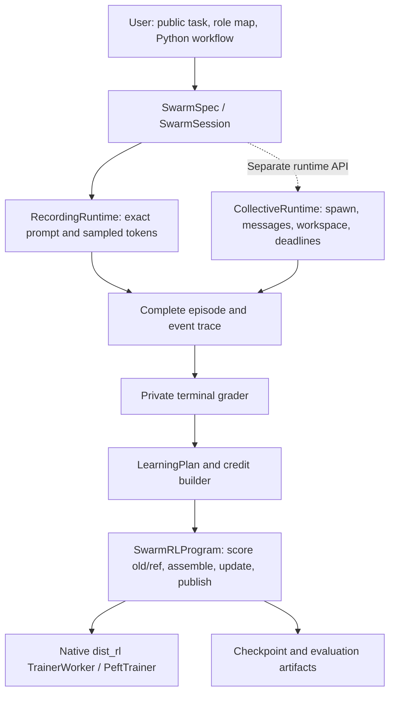

# Training small-model swarms with Tunix

Status: runnable recipe series with local numerical acceptance; pretrained
results for the new Director, RSI and collective recipes remain unmeasured.
Dr. MAS has a separate [TPU validation record](swarm_training_validation.md).
See [R2Orch design](r2orch_design.md) for algorithm and acceptance boundaries.

## Runnable sequence

| Recipe | Entry point | Trainable policy | Evaluation |
| --- | --- | --- | --- |
| Dr. MAS math | `examples.swarm_math.train` | Shared Solver/Verifier | Original mathematical benchmark suites |
| Director math | `examples.r2orch_math.train` | Director; Workers frozen | Original AIME development/test splits |
| Recursive self-improvement | `examples.r2orch_math.selfplay` | Alternating Proposer and Director; Workers/reviewer frozen | Zero-skill AIME, skill ledger and selection diagnostics |
| Collective repair | `examples.swarm_repair.train` | Shared policy for all members, CISPO | Single, independent, fixed and learned teams on disjoint repair families |

Run the CPU profiles first, then the pinned Qwen3-4B profiles on accelerators.
CPU policies exercise real optimizer updates and lifecycle behavior; they do not
measure pretrained reasoning or demonstrate a benefit from collaboration.
The [math recipe](../examples/r2orch_math/README.md) and
[repair recipe](../examples/swarm_repair/README.md) contain commands.

## Publication thesis

Working title: **From fixed teams to learned collaboration: training swarms with
Tunix**.

The central question is whether a small shared model can learn useful division
of work under a fixed inference budget. The framework contribution is a compact
user-facing contract that accommodates shared-policy teams, a learned Director
with frozen Workers, and concurrent teams with a shared reward.

Dr. MAS provides the existing training baseline. R2Orch provides a public
reference for learned orchestration and RSI. Avalon motivates parallel execution,
communication and deadline-aware evaluation. These are three different
experiments; do not present their measurements as a controlled comparison.

## What a small Avalon-style experiment can establish

The [Avalon report](https://www.gr.inc/avalonm1.pdf) studies a 120B-parameter model
with 12B active parameters. It uses shared-policy organizations, collective
advantages and deadlines; its environment suite and training infrastructure
are not a turnkey public replication package. The report does not establish
that a 4B or 8B model can reproduce its outcomes. Its limitations discuss the
variance of long-horizon, multi-agent, multi-environment training.

Our hypothesis: reducing task difficulty, team size and horizon can retain a
useful collective learning signal at small model sizes. This must be tested.
Keep shared weights, genuine concurrency, communication, team reward and a
real deadline; change task scale explicitly. Do not claim the original model,
benchmark scores, speedup or emergent organizational hierarchy was reproduced.

| Stage | Proposed model/team | Admission gate |
| --- | --- | --- |
| Mechanics | Tiny CPU policy; 2 agents | Exact trace, credit, gradient, cancellation and update tests |
| Capability pilot | Qwen3-4B; 1/2 agents | Can solve individual subtasks and follow the action protocol |
| Collective training | Qwen3-4B; up to 4 agents | Nonzero between-team reward variance; measurable concurrent execution |
| Scale check | Qwen3-8B; same task split and agent budgets | Repeat the controlled comparison; treat model integration as a separate gate |

Profile single-agent runtimes on development tasks to choose several short
deadline budgets; freeze those budgets before testing. Avoid copying the
original multi-hour horizons into the first experiment. If 4B fails individual
subtasks, simplify the task or improve the base capability before interpreting
team failure as a coordination result.

## Recommended showcase: small multi-file repair

The first implemented environment uses deterministic JSON modules in a bounded
arithmetic/list repair language. Agents repair several modules, exchange
messages and commit a shared solution. A fixed interpreter scores seeded hidden
functional tests; it does not execute generated Python. Training, development
and test sets use disjoint operation families. This is a public synthetic task,
not an Avalon benchmark or a substitute for real repository repair results.

Each team receives identical faulty module contents and a public specification.
Hidden tests are available only to the terminal evaluator. An anytime submission
captures the current module map; the deadline scores the latest committed
snapshot, including unsuccessful and timed-out runs. The reward is binary
success on all hidden tests, fixed across methods. Hidden scores are never returned
after intermediate submissions.

General Python repository repair remains a later environment adapter and needs
an isolated execution service. Native in-process JAX decoding is synchronous
while a compiled call runs: the local deadline stops admission/late effects,
but it cannot preempt an in-flight device kernel or preserve partial streamed
tokens. Remote cancellable generation is required for production latency claims.

Use AIME for the R2Orch reproduction track. AIME alone is a weak showcase for
parallel speedup: many problems are not naturally divisible and independent
sampling is a strong alternative. The repair task directly tests the intended
parallel capability without replacing the original R2Orch math split.

## Controlled comparisons

| System | Purpose |
| --- | --- |
| Single agent | Sequential baseline, including a larger inference budget |
| Independent parallel attempts | Tests whether collaboration beats simple sampling; fixed reference-free selection rule |
| Fixed parallel team | Separates the runtime benefit from learned coordination |
| Untrained dynamic team | Measures the contribution of collective training |
| Trained shared-policy team | Proposed method |

Hold model initialization, training-task exposure, tools, test split and scorer
constant. Report both training compute and inference compute. Run two comparison
families: matched total generated-token budget, and matched hardware allocation
plus wall-clock deadline. Include prompt tokens, tool execution and orchestration
overhead in the resource breakdown. Report multiple seeds and paired uncertainty
across tasks; choose checkpoints on development data only.

Required ablations: communication disabled; deadline removed while retaining a
token cap; identical workflow executed sequentially; and alternative team sizes.
All baselines must include failures and timeouts. An oracle best-of-N selected
using hidden tests is an upper bound, not a deployable competitor.

The repair recipe uses CISPO with a detached importance ratio capped at 5,
collective group advantages and token-mean reduction. Constant-reward groups
are excluded before reduction. The independent PyTorch gradient oracle checks
all parameters, including upper-capped positive tokens, whose gradients remain
active. A Team-GRPO comparison can be added as an objective ablation.

## Figures worth publishing

1. Quality versus total inference tokens, with all baselines.
2. Quality versus wall-clock deadline on fixed hardware.
3. A task execution timeline showing real overlapping calls, tools and messages.
4. Communication/deadline ablations with confidence intervals.
5. A small code example defining a custom swarm and swapping its learning plan.

Message counts and the number of spawned agents are diagnostics, not evidence
of useful collaboration. The main result must improve quality at matched cost
or reduce cost/latency at matched quality. Null results are informative if the
controls distinguish model capability, coordination and scheduling overhead.

## Framework organization



Keep framework contracts in `tunix/dist_rl/swarm/` and training orchestration in
`tunix/dist_rl/orchestrator/`. Keep task prompts, tools, graders, data preparation
and hyperparameters in `examples/<recipe>/`. Do not create a second distributed
trainer, or add paper-specific role names to the engine.

The public API should ask users for four things: roles mapped to policies, an
async Python workflow, a terminal grader, and an explicit learning plan. The
framework owns token provenance, bounded concurrency, policy-version checks and
batch assembly. Credit remains a plug-in because role normalization, Director
whitening and collective advantages are different objectives.

For example, a user-defined Solver/Verifier workflow is ordinary async Python:

```python
from tunix.dist_rl.swarm.api import SwarmSpec
from tunix.dist_rl.swarm.policy import LearningPlan, PolicyBinding

async def solve_and_review(session, problem):
    solution = await session.generate("solver", problem)
    review = await session.generate(
        "verifier", f"Problem: {problem}\nCheck the solution and return the final answer:\n{solution.text}"
    )
    return review.text

spec = SwarmSpec(
    roles={"solver": "shared", "verifier": "shared"},
    workflow=solve_and_review,
    learning_plan=LearningPlan(
        bindings=(PolicyBinding(policy_id="shared", trainable=True),),
        learner_policy_id="shared",
    ),
    max_calls=2,
)
```

The collector invokes `spec.run(...)` with a public prompt, policy version,
runtime factory and private terminal grader. Its `SwarmEpisode` feeds the
existing `SwarmRLProgram`. The runtime factory binds already-initialized samplers
and tokenizers; it does not reload a model for every call. For Director-only
learning, declare a trainable Director binding and a frozen Worker binding and
select the Director credit builder. For parallel workflows, await concurrent
`session.generate(...)` calls; the session enforces call/concurrency budgets and
records distinct request IDs. Dynamic hire/message/anytime operations use the
separate `CollectiveRuntime`; they are not yet unified into this basic session.

Organize each recipe consistently:

```text
examples/<recipe>/
  workflow.py       # roles, prompts, graph/control flow; no optimizer code
  prepare_data.py   # pinned splits and manifest
  grading.py        # private answer checking or isolated environment scorer
  train.py          # model/runtime wiring and program lifecycle
  configs/          # explicit train/eval/resource settings
  README.md         # runnable commands, claims and validation limits
tunix/dist_rl/swarm/
  api.py            # SwarmSpec and bounded SwarmSession
  runtime.py        # exact sampling provenance
  trace.py          # immutable calls and episodes
  policy.py         # update ownership and frozen versions
  director_credit.py # Director-specific credit plugin
  collective.py     # concurrent shared-policy runtime
```

The RSI driver alternates a separate Proposer learner and Director, uses frozen
per-cycle skill views, and commits both optimizers, curriculum and skill evidence
through one cycle manifest. The original
[R2Orch recipe](https://github.com/beita6969/R2Orch) supplies the algorithmic
reference. The compact math executor and source executor still have documented
differences; the driver is not a claim of complete original reproduction.

## Delivery and claims checklist

- Publish the exact source/model/data revisions and all adaptation choices.
- Preserve the original AIME train/dev/test boundaries for R2Orch.
- Complete numerical tests and real optimizer smoke tests before TPU runs.
- Run pretrained-model training and frozen-weight checks on accelerators.
- Validate remote cancellation and accelerator scheduling before a latency claim.
- Lock final tests and run matched-budget baselines before writing results.
- Label unimplemented interfaces and unrun experiments explicitly.
