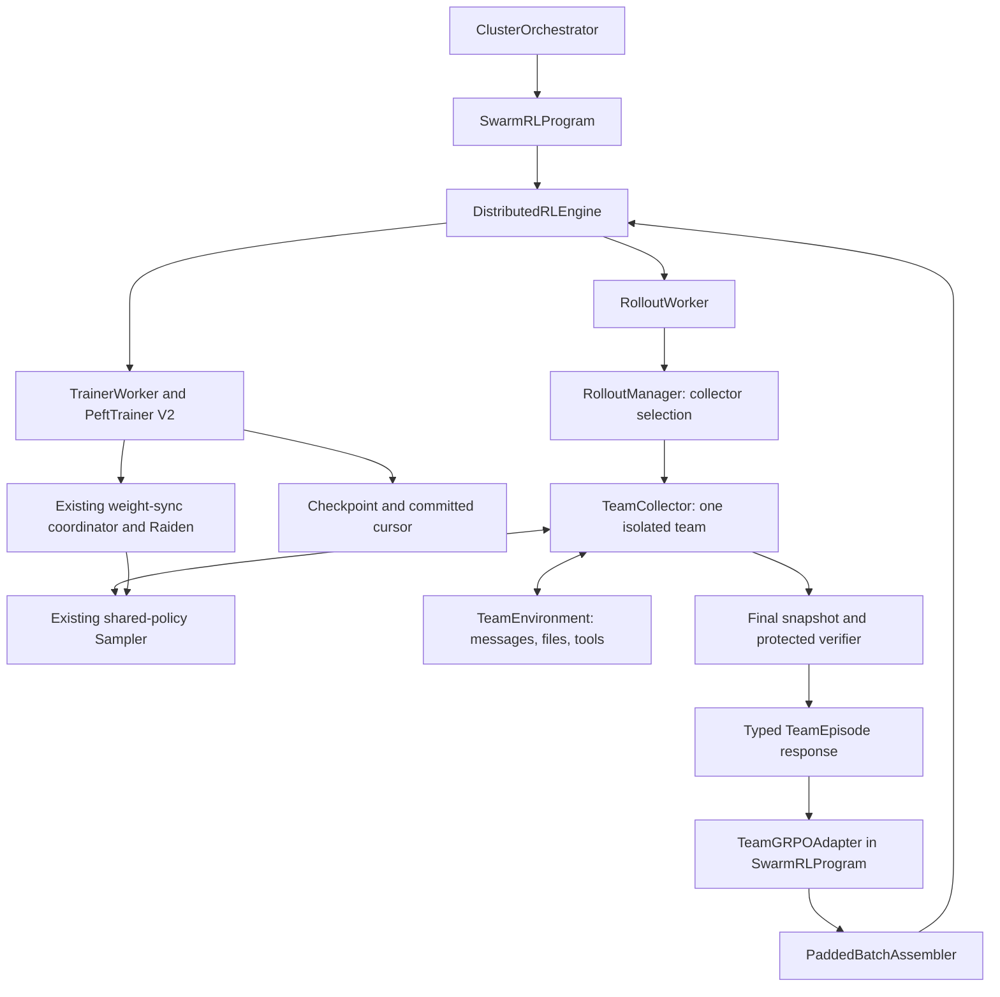
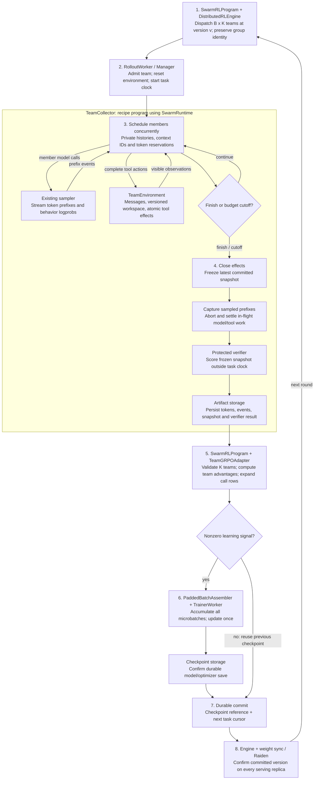
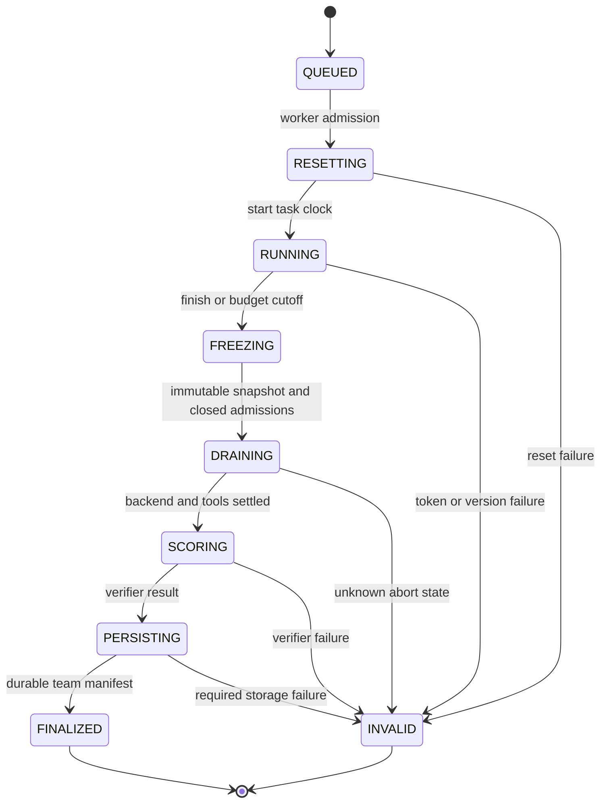

# Tunix Swarm-Repair: Advanced Recipe Design

| Item | Decision |
| --- | --- |
| Status | Engineering design draft for review; implementation has not started |
| Version | 1.3 |
| Audience | Engineering leads, implementers, and reviewers |
| Parent design | [Distributed Swarm Training](swarm_training_design.md) |
| Updated | November 10, 2026 |
| Baseline | `haoyu-next` at `bcd4b0cef` |
| Implementation scope | Extend `tunix/dist_rl` |
| Target recipe | Swarm-Repair: shared-policy, time-budgeted collaborative code repair |

**Implementation context:** the first local shared-policy math slice is now [CPU-validated](swarm_training_validation.md). Swarm-Repair itself remains unimplemented; the system below is its target design.

**Document authority:** the [common system design](swarm_training_design.md) defines framework interfaces and the first Dr. MAS math recipe. This document defines the later Swarm-Repair specialization. Shared weights, collective credit, workspace tools, dynamic membership, physical deadlines, and fixed team-capacity reduction below apply to this recipe only. New interfaces are proposed additions; implementation and accelerator acceptance remain pending.

**Delivery order:** shared-policy math correctness and held-out results → frozen-worker orchestration → this dynamic parallel recipe → optional independent-policy, distillation, counterfactual, and RSI extensions. The [internal overview](swarm_training_overview.md) summarizes the complete program.

Review order: [architecture](#3-placement-in-the-existing-dist-architecture), [E2E flow](#4-end-to-end-flow), [runtime protocol](#5-rollout-protocol-and-team-execution), [learning](#6-team-learning-and-trainer-integration), and [recovery](#7-checkpoint-retry-and-failure-semantics).

## 1. Target Capability

Deliver a complete swarm recipe on the existing distributed RL stack: one shared policy learns to delegate, communicate, edit a shared workspace, and combine work from concurrent agents. Teams receive task-level rewards, and every member's generated actions contribute to the same policy update.

The method inspiration is [How to Train a Swarm](https://www.gr.inc/blog/how-to-train-a-swarm) and [Avalon-M1 / RLCR](https://www.gr.inc/avalonm1.pdf). RLCR uses shared parameters and collective advantages; most reported environments use CISPO. This design selects **Team-GRPO** to reuse Tunix's existing policy-loss machinery, with explicit team grouping and loss reduction. It targets comparable swarm functionality rather than numerical reproduction of that recipe.

The completed recipe includes all of the following:

| ID | Capability | Required behavior |
| --- | --- | --- |
| FR-1 | Shared-policy learning | Coordinator and workers share one checkpoint; all roles contribute gradients |
| FR-2 | Adaptive team | Coordinator can spawn and retire workers within a fixed member cap |
| FR-3 | Concurrent execution | Independent agents issue overlapping model/tool calls through the rollout worker |
| FR-4 | Collaboration | Private histories, explicit messages, and a versioned shared filesystem |
| FR-5 | Collective reward | One verified score and one group-relative advantage per team episode |
| FR-6 | Anytime task scoring | Score the committed artifact at termination, including useful partial progress |
| FR-7 | Physical time budget | Enforce a team deadline; preserve eligible interrupted generation prefixes |
| FR-8 | Complete distributed recipe | Train, synchronize, checkpoint, restore, and evaluate using the existing dist workers |

Token-budget-only execution is an intermediate integration profile. The final time-budgeted recipe must pass the cutoff and interrupted-prefix gates below. Separate role models, teacher distillation, and mid-episode recovery are outside this design.

### 1.1 Nonfunctional Requirements

| ID | Requirement | Required property |
| --- | --- | --- |
| NFR-1 | Data integrity | Preserve exact contexts, action ownership, finite behavior logprobs, and snapshot/verifier identity |
| NFR-2 | Policy consistency | Zero policy staleness within a round; all compared teams use an equivalent serving profile |
| NFR-3 | Recoverability | Restore a published model/optimizer/cursor boundary; do not consume one group in two committed updates |
| NFR-4 | Bounded execution | Bound queues, memory, tool work, and every lifecycle stage; quarantine unknown backend state |
| NFR-5 | Reproducibility | Pin inputs/configuration and retain inspectable artifacts; asynchronous timing is not promised to replay bit for bit |
| NFR-6 | Compatibility | Ordinary GRPO/OPD behavior remains unchanged when team fields are absent |

### 1.2 Scope and Terminology

This recipe implementation has one active control-plane owner and one rollout owner per team. Independent role models, cross-replica intra-team routing, nonzero policy lag, and mid-episode restore are excluded. The delivery boundary is the complete time-budgeted recipe, not merely a token-budget smoke run.

| Term | Meaning |
| --- | --- |
| Agent | One role/history and action loop; shares policy parameters with other team members |
| Call | One model invocation with an immutable prompt and a sampled continuation |
| Team episode | One isolated attempt at a task, from reset through cutoff, verification, and finalization |
| Task group | K independent team episodes compared for one task/reset and common budgets |
| Collection round | B task groups collected under one behavior version before a possible optimizer update |
| Optimizer update | One application of accumulated gradients; skipped when the whole round has zero learning signal |
| Serving profile | Model/dtype, mesh, scheduler/concurrency, and tool CPU limits under which a team executes |

## 2. Recipe: Swarm-Repair

### 2.1 Environment

Use small Python repositories with executable specifications, visible tests, and protected reward tests. Tasks include interacting bugs across files and interface boundaries, so integration and communication can matter. Begin with validated fixtures and deterministic bug mutations; split train/development/test by project and mutation family before generating tasks.

Each team receives an isolated copy of the same initial repository. The coordinator starts alone and can create up to three workers. A worker receives a task description and has the same editing and testing capabilities as the coordinator. All members use the same dense Qwen3-8B policy, tokenizer, and tool format. Only the coordinator can finish the team; workers can finish assignments or be retired.

Tools: `spawn_worker`, `retire_worker`, `send_message`, `read_messages`, `list_files`, `read_file`, `apply_patch`, `run_public_tests`, `wait`, and `finish`. Roles and assignments are policy choices; the runtime supplies concurrency and resource limits.

At completion or budget exhaustion, freeze the shared workspace and run the protected verifier outside the writable repository:

$$
R(S)=\sum_{j=1}^{J}w_j\mathbf{1}[\text{protected test }j\text{ passes on }S],
\qquad w_j\ge0,\quad\sum_jw_j=1.
$$

Weights are fixed per task and balanced across behavioral requirements. Reward depends on the latest committed snapshot, not historical best performance. A final answer is unnecessary for receiving credit. Syntax errors, wrong patches, and failing tests are valid low-reward outcomes. Grader corruption or service failure is an infrastructure error.

Initially score only the final snapshot during training. Evaluate frozen intermediate snapshots offline to obtain progress curves. Visible tests provide tool feedback; protected test contents remain inaccessible. Do not sum repeated snapshot scores or add hand-designed rewards for messaging, spawning, or apparent parallelism.

### 2.2 Initial Profile

These are proposed defaults; the recipe implementation must resolve immutable revisions and validate the accelerator profile before launch.

| Parameter | Starting setting |
| --- | --- |
| Policy | Qwen3-8B; pinned model/tokenizer revisions and template digest |
| Team | One coordinator initially; at most four live agents total |
| Team concurrency | One active generation per agent; up to four concurrent calls |
| Serving admission | Initially one active team per rollout replica; multiple replicas can serve different teams |
| Group / update | K = 4 independent teams per task; B = 2 tasks per optimizer update |
| Team budget | 8,192 total generated tokens; at most 32 calls |
| Per-call limits | 512 generated tokens; at most 8,192 prompt-plus-response tokens |
| Deadline | Proposed 180 seconds; calibrate on development tasks and freeze before held-out evaluation |
| Sampling | Temperature 1; top-p 1; top-k disabled; return sampled-token logprobs |
| Training | One fresh batch per optimizer update; GRPO clip 0.2; zero policy staleness |
| Additional losses | Reference KL, entropy bonus, and OPD disabled initially |
| Batching | Padded call rows; packing follows correctness acceptance |

Use the native Qwen3 trainer and compatible in-process vLLM/Raiden path as the starting deployment. The current sampler completion API needs a streaming/cancellation extension for physical deadlines. Reuse its policy state and serving engine rather than launching an independent inference stack.

Fix optimizer settings, precision, mesh, fixture image, task split, and backend versions in the recipe manifest after a short development calibration. Calibrate task difficulty so the base model produces both successes and failures and can use the tools. If a tool-format warmup is required, version its data and include that initialization in every experimental baseline.

## 3. Placement in the Existing Dist Architecture



**The control plane schedules complete team episodes. Agent-level scheduling lives inside a rollout worker.** Implement this through the parent design's `SwarmProgram`, `SwarmRuntime`, `PolicyBinding`, immutable episode/call traces, `CreditAssigner`, and `LearningPlan`. `TeamCollector` below names this recipe's executor specialization; its lifecycle uses the common swarm collector. `TeamGRPOAdapter` is a recipe learning adapter, not the only framework learning path. Each team stays on one rollout worker for its entire episode and uses that worker's sampler. This keeps file/message ordering local, avoids one control-plane RPC per agent turn, and reuses existing worker admission, health reporting, and policy synchronization.

`SwarmRLProgram` implements the existing `RLProgram` interface and runs through `ClusterOrchestrator.run(program)`. It owns task groups, reward-to-advantage conversion, trainer batches, and committed training progress. It does not own model serving, training meshes, or a separate synchronization service.

### 3.1 Existing Components and Changes

| Existing component | Integration |
| --- | --- |
| [ClusterOrchestrator](../tunix/dist_rl/orchestrator/orchestrator.py) | Reuse worker registration, bring-up, monitoring, and `run(RLProgram)` |
| [Engine interface](../tunix/dist_rl/orchestrator/rl_engine_interface.py) / [DistributedRLEngine](../tunix/dist_rl/orchestrator/distributed_rl_engine.py) | Add typed team dispatch/poll methods using the existing rollout session and routing; reuse train/sync/save/restore methods |
| [RolloutWorker](../tunix/dist_rl/worker/rollout_worker.py) | Reuse the worker and sampler; add conversion of team results into a typed response |
| [RolloutManager](../tunix/dist_rl/rollout/manager.py) | Replace hard-coded collector construction with explicit single-agent/team collector selection; track and drain both |
| [Sampler protocol](../tunix/dist_rl/rollout/sampler.py) / [in-process vLLM](../tunix/dist_rl/rollout/inprocess_vllm_sampler.py) | Reuse token-ID sampling, concurrency, and policy state; add prefix streaming and request abort |
| [StandardRLProgram](../tunix/dist_rl/orchestrator/rl_program.py) | Keep ordinary trajectory behavior; implement `SwarmRLProgram` alongside it because team-to-call expansion changes group cardinality |
| [GRPOConfig](../tunix/rl/algorithm_config.py) and [payload builder](../tunix/dist_rl/orchestrator/payload_builder.py) | Reuse the advantage estimator and policy loss; add team-level scoring and one-to-many payload construction |
| [Payloads](../tunix/dist_rl/common/datatypes.py) / [batch assembly](../tunix/dist_rl/orchestrator/batch_assembly.py) | Preserve original token/mask arrays; add explicit per-row loss-denominator contributions |
| [TrainerWorker](../tunix/dist_rl/worker/trainer_worker.py) / [native trainer](../tunix/dist_rl/train/peft_trainer_v2.py) | Reuse forward/backward, denominator-aware accumulation, optimizer update, and checkpointing |
| [Weight synchronization](../tunix/dist_rl/weight_sync) | Reuse policy transfer and barriers; prohibit synchronization while a training team is active |
| [Trajectory storage](../tunix/dist_rl/trajectory) | Extend schemas with team/agent/call lineage and shared-artifact references |

The current manager can advance a request to a newer sampler version. Team mode must instead reject version mismatch. The current collector also treats generic timeout/cancellation as invalid: normal team deadline termination requires its own valid outcome.

### 3.2 Recipe Modules and Common Integration

All paths below are proposed additions within `dist_rl`.

| Path | Responsibility |
| --- | --- |
| `swarm/trace.py` | Shared transport DTOs without dependencies on collector/trainer implementations |
| `rollout/swarm_collector.py` + recipe `SwarmProgram` | Common collector lifecycle; recipe agent loops, spawn/retire, budgets and deadline |
| `examples/swarm_repair/environment.py` | Recipe message broker, versioned workspace, tools, freeze/score boundary |
| `orchestrator/swarm_program.py` | Task-group rounds and training/checkpoint lifecycle |
| `orchestrator/team_grpo_adapter.py` | Collective advantages, per-call payloads, reduction accounting |
| `examples/swarm_repair/` | Task fixtures, prompts, configs, launchers, evaluation, and run guide |

### 3.3 Process and Resource Topology

| Process / resource | Owns | Does not own |
| --- | --- | --- |
| CPU control-plane process | `ClusterOrchestrator`, registry, `DistributedRLEngine`, `SwarmRLProgram`, pending groups and committed cursor | Agent conversations, mutable workspaces, model parameters |
| Rollout worker CPU process | `RolloutManager`, local collectors, message/file ordering, sampler adapter, token-prefix buffers | Reward normalization or optimizer state |
| Rollout accelerator replica | Shared policy weights, inference KV state, concurrent request execution | Cross-team communication or training gradients |
| Tool / verifier subprocesses | Bounded tests against an explicitly identified snapshot | Direct writes to the live shared workspace or authoritative event ordering |
| Trainer worker and accelerator mesh | Actor parameters, optimizer, gradient accumulation, native loss computation | Tool/environment execution |
| Shared artifact/checkpoint storage | Immutable task assets, event/token files, workspace snapshots, checkpoints, commit/evaluation manifests | A live task queue or an implicit transaction coordinator |

A rollout worker owns one active team in the initial profile. Multiple replicas serve independent teams; each replica can continuously batch up to four members of its current team. Agents are logical policy instances, not separately loaded models. A model replica may itself span multiple accelerator devices according to the existing sampler configuration.

Keep trainer and rollout allocations separate initially so environment scheduling does not compete with optimizer execution for the same model buffers. Use the existing remote-execution and worker launch mechanisms. The new control-plane program registers one `ACTOR` trainer role and the existing `ROLLOUT` role pool; no new worker role is required. Replica counts and trainer/rollout meshes are deployment overlays, not hard-coded into the algorithm.

This initial topology batches a team's agents on one model replica; it does not distribute one team's calls across independently loaded replicas. It establishes bounded swarm functionality with local state ownership. Measure actual decode/tool overlap and latency rather than assuming an agent count translates into the same speedup. Serving one team across multiple rollout owners would require a separate shared-state/routing design.

The first deadline-training pool must be homogeneous: every team compared within a task group uses the same serving-profile digest, including model/dtype, replica mesh, scheduler settings, member concurrency, and tool CPU limits. Validate this at worker startup and team finalization. The current sticky-hash router does not enforce capacity equivalence or load balancing by itself. A deployment change that alters the profile requires revalidation before another comparison group.

### 3.4 Architectural Invariants

1. A team has one owner, one behavior policy version, and an isolated environment attempt.
2. The controller accepts each token/tool event at most once; committed events define observations and artifacts.
3. Group-relative reward statistics are computed over K teams before expanding calls.
4. Training uses each call's sampled context and behavior probabilities, with one action owner per token.
5. No new rollout round starts until its serving replicas acknowledge the selected policy version.
6. A durable training commit couples model/optimizer state with the consumed data cursor; an RPC acknowledgement alone is not a commit.

## 4. End-to-End Flow

### 4.1 Startup and Restore

1. The recipe launcher resolves model/tokenizer revisions, task manifests, prompts, tool schemas, verifier image, optimizer settings, and deployment configuration into a hashed run manifest.
2. Register trainer and rollout handles with `ClusterOrchestrator`. Run the existing `initialize → compile → start` lifecycle and verify worker descriptions.
3. Add swarm startup validation: positive budgets, K ≥ 2, compatible model/tokenizer/template digests, team concurrency, a writable artifact/checkpoint destination, supported sampling probabilities, and streaming/abort capability for deadline mode.
4. Configure `GRPOConfig` and `PaddedBatchAssembler` through `engine.configure_worker(algo_config=..., assembler=...)`. The recipe's `TeamGRPOAdapter` owns credit and call-row expansion in `SwarmRLProgram`; trainer loss/input wiring uses the shared function registry and `algo_core`. Dummy compilation payloads must include the new denominator tensor, old logprobs, and explicit attention masks with the same structure as real batches.
5. For a new run, establish policy version 0 and save an initial restorable model/optimizer checkpoint. For resume, read the last published training commit and select its exact checkpoint; do not infer the data cursor from the newest checkpoint directory.
6. Restore model/optimizer state and the run cursor, validate digests, synchronize the selected policy version, and verify acknowledgement from every participating rollout replica.
7. Start scheduling only after those checks. Evaluation-only startup follows the same pinning and synchronization path but never configures an optimizer update.

Existing startup validators assume ordinary trajectory batch geometry. Add a swarm validator that distinguishes task groups, team episodes, and variable call rows; do not require the number of call rows to be divisible by K. Retain relevant mesh, token-capacity, and microbatch constraints.

### 4.2 One Training Round



Within each team, the collector issues member calls concurrently; the execution subgraph shows the repeated sampling/tool cycle. Different teams can also run concurrently on different rollout replicas. The program buffers finalized groups but starts training only when the entire update is validated and its required artifacts are durable.

Task identity is independent of completion order. The planner chooses B task/reset specifications, constructs K team seeds for each, and records their expected request IDs. Completions enter that registry by group/team/attempt ID. Duplicate completions are ignored only if their content hashes agree; stale attempts and conflicting duplicates cannot enter training.

### 4.3 Concrete Data Example

Consider a task where parser and consumer modules disagree about an interface. The coordinator can assign one worker to the parser and another to the consumer while inspecting public test failures itself. Workers exchange the proposed interface through messages, patch against file versions, and ask the coordinator to run an integration test. Their histories remain separate even though they read shared files.

For an **illustrative**, unmeasured group with returns `[0, 0.25, 0.75, 1]`, the mean is `0.5` and the sample standard deviation is approximately `0.456435`. Using the existing estimator's additive epsilon, team advantages are approximately `[-1.095443, -0.547721, 0.547721, 1.095443]`. A team producing 14 calls still receives one advantage, just as a team producing 6 calls does. Workers do not become additional entries in that four-element reward vector.

With B = 2, K = 4, and `T_max = 8192`, the update denominator is 65,536. The call count and realized output length do not change it. Every eligible continuation token from the same team receives that team's advantage; received copies of messages have no direct action loss.

### 4.4 Evaluation and Shutdown

For baseline/final/eval-only modes, load the selected checkpoint, synchronize its policy, and run the same team executor against a fixed evaluation manifest. Save per-task snapshots, scores, budgets, and costs; bypass advantage construction and all trainer updates. Run single-agent, fixed-team, and adaptive-team modes through this same environment/tool boundary.

Graceful shutdown first stops new group admission. Either finish and commit the current complete round or explicitly abandon it and retain the previous commit. Abort outstanding generations, terminate tool process groups, flush event/artifact writers, and then release workers through the existing lifecycle. Never publish partially accumulated gradients as a checkpointed training boundary. An ungraceful stop follows the recovery rules in Section 7.

### 4.5 Control-Plane Pseudocode

The helpers below express the proposed program flow; they are not claims of existing method names. The engine training/synchronization calls use the current dist primitives.

```python
commit = load_or_initialize_committed_run()  # includes a durable step-0 checkpoint
await restore_exact_checkpoint_and_sync(commit)

while not run_limit_reached(commit):
    plan = plan_task_groups(commit.cursor, B, K, commit.policy_version)
    episodes = await collect_with_bounded_group_retry(plan)
    groups = validate_and_finalize_groups(episodes, plan)
    rows = build_team_training_rows(groups)
    updated = has_learning_signal(groups)

    if updated:
        batches = assemble_padded_microbatches(rows)
        for i, batch in enumerate(batches):
            await engine.train_step(
                batch,
                accumulate_gradients=True,
                apply_optimizer=(i == len(batches) - 1),
            )
        checkpoint = await force_save_and_verify_durable_checkpoint()
    else:
        checkpoint = commit.checkpoint

    candidate = build_next_commit(commit, plan, groups, checkpoint, updated)
    publish_commit_with_parent_fence(candidate, expected_parent=commit.id)
    commit = candidate
    if updated:
        await engine.sync_weights(policy_version=commit.policy_version)
    await verify_serving_fleet_version(commit.policy_version)
```

A collect failure never reaches training. A train/save failure never publishes a new cursor. A sync failure occurs after the commit and blocks further collection until recovery. Stop conditions bound both optimizer updates and collection rounds so repeated zero-variance groups cannot create an unbounded run.

## 5. Rollout Protocol and Team Execution

### 5.1 Request and Result

Extend `RolloutRequest` with an optional typed `team_spec`. An absent value keeps the existing collector path. In team mode, `prompt_id` identifies a task group and `group_index` identifies one of its K independent team attempts. Derive a unique team ID from run, update, group, and attempt; derive call IDs from team, agent, and call sequence.

Extend `RolloutResponse` with an optional `team_episode`, mutually exclusive with its existing trajectory payload. Add `dispatch_team_rollouts` and `poll_team_rollouts` to the engine, backed by the same worker `generate` RPC and rollout session. Preserve the team envelope through worker serialization and engine response conversion. A swarm program exclusively owns its dispatch/poll stream; a standard trajectory consumer must reject a team envelope rather than flatten it.

| Record | Required contents |
| --- | --- |
| `TeamSpec` | Task/reset hashes, membership cap, tool config, token/call/deadline budgets, policy version, serving-profile digest, seed |
| `TeamEpisode` | Group/team/attempt IDs, behavior version, agent calls, outcome, event/artifact references, final score and verifier digest |
| `AgentCall` | Agent/call IDs, exact prompt and completion IDs, logprobs, positions, masks, sampling contract, visible-event cursor, timestamps |
| `TeamEvent` | Team sequence number, causal parents, actor, event type, monotonic offset, payload hash, commit result |

Keep calls as separate conversations. A team response cannot be represented by concatenating private agent histories into a single causal sequence.

#### Identity, Shapes, and Versioning

| Field | Meaning and validation |
| --- | --- |
| `run_id` / `schema_version` | Namespace and wire format; reject unsupported schema versions before execution |
| `group_id` | One task/reset comparison within a collection round; exactly K team slots |
| `team_index` / `attempt_id` | Stable slot in the group and a fresh infrastructure retry epoch |
| `team_id` / `request_id` | Run/round/group/slot/attempt-derived identities; never reuse an old execution identity for a new environment |
| `agent_id` / `call_id` | Team-local member identity and monotonically numbered calls; retired IDs are never reused |
| `policy_version` | Exact serving version for every call in the team; no automatic upgrade |
| `serving_profile_digest` | Hash of the comparable serving/tool allocation; must match for every team in a task group |
| `prompt_ids` / `completion_ids` | Unpadded int32 arrays of lengths P and C; P + C ≤ configured context cap |
| `old_logprobs` | Float32 array of length C, aligned one-to-one to accepted generated token IDs |
| `visible_event_seq` / `context_digest` | Immutable observation cursor and hash of exact serialized conditioning inputs |
| `snapshot_ref` / `artifact_digest` | Immutable final project state; verifier and returned score must reference this same artifact |

Persist token arrays in a compact binary format and events as versioned records. The finalized RPC response includes the bounded call arrays needed for training plus artifact references, so the control plane does not depend on a partially wired trajectory-store read path. Hashes identify both inline content and durable copies. A response is finalized only after required files and its team manifest are written and flushed.

Retain initial reset assets and committed file versions sufficient to reconstruct frozen snapshots. Existing trajectory entries can index each agent/call and carry team lineage; a separate immutable team manifest joins them. No SQL schema migration or exactly-once queue is required to make the first file-backed recipe functional.

#### Internal API Changes

These are proposed signatures; ordinary trajectory APIs remain valid.

```python
# DistributedRLEngine / AbstractRLEngine
async def dispatch_team_rollouts(requests: Sequence[RolloutRequest]) -> list[str]: ...
async def poll_team_rollouts(timeout_s: float) -> list[TeamResult]: ...
async def cancel_team_rollouts(team_ids: Sequence[str]) -> list[CancelReceipt]: ...

# RolloutWorker; generate remains the existing entry point
async def cancel_team(team_id: str, attempt_id: str) -> CancelReceipt: ...

# Optional streaming capability on the existing sampler adapter
def sample_stream(request: SamplingRequest) -> AsyncIterator[SamplingEvent]: ...
async def abort_request(request_id: str) -> AbortReceipt: ...
```

`TeamResult` is a discriminated success/error envelope carrying request/group/attempt identity. `SamplingEvent` carries a call ID, a stable token-index range, token IDs, aligned logprobs, and finish/error information. Accept contiguous, nonconflicting prefixes only; duplicate chunks must match already accepted content. `AbortReceipt` distinguishes settled, already completed, and unknown execution state. Only the first two allow resource reuse or a subsequent weight sync.

The engine wrappers preserve the existing `TaskSession` transport and remote `generate` method. They also keep a pending-request registry and reject a trajectory result in a team stream. Because current transport errors can arrive without a request ID, an unidentifiable error invalidates the entire uncommitted collection round rather than guessing which team failed.

### 5.2 Collector Lifecycle

Introduce a collector lifecycle contract covering `run_episode`, `pause`, `resume`, `cancel`, completion state, and resource cleanup. `TrajectoryCollectorEngine` remains the default; `TeamCollector` implements the same lifecycle for an entire team. Update manager result typing, completion queues, error conversion, and cleanup explicitly. Team KV migration and partial-rollout weight switching are disabled in the first recipe.

Add an enforced team-admission semaphore in the manager and per-team call quotas in the collector; the current manager's stored `max_concurrency` value alone does not enforce this admission policy. Queue a team before its task clock starts. Release its slot only after all backend requests and tool processes have settled, so timed-out work cannot overlap the next team's supposedly isolated serving allocation.

A team's detailed lifecycle is:



Member states are `IDLE`, `GENERATING`, `WAITING_TOOL`, `RETIRING`, and `RETIRED`. Spawn creates a new private history. Retirement closes that member's admissions and captures/settles its in-flight prefix at a member-specific cutoff. A retiring member counts against the member/concurrency cap until its backend and tools settle. Its late tool effects are rejected; its earlier sampled actions remain eligible. Agent IDs are never recycled.

At call admission, capture an immutable local context and visible-message cursor. New messages cannot modify an in-flight prompt. Message delivery is an environment event. Generated messages train on the sender side; received copies become context for the recipient.

File writes use expected versions and atomic patches. Conflicts return tool observations. Tests reference immutable workspace snapshot IDs. An event's commit order determines visibility; wall-clock arrival order alone does not. Tool processes run outside the async scheduling loop so one blocking test cannot serialize every agent.

#### Tool and Observation Semantics

Each completed continuation may request one structured tool action. A malformed or unknown action returns an ordinary error observation and consumes its generated tokens and call slot. The tool schema and parser are pinned run assets; the harness does not silently repair malformed actions.

| Tool family | Contract |
| --- | --- |
| Spawn / retire | Coordinator-only; enforce the live-member cap atomically; a spawn includes a bounded assignment; retirement preserves past calls |
| Send / read messages | Address team-local members; allocate message IDs and delivery sequence numbers; receiver reads are idempotent |
| Read / list files | Return a named workspace version with bounded output and explicit truncation markers |
| Apply patch | Compute candidate content in staging; check expected versions and cutoff; publish one new workspace-manifest version atomically |
| Public tests | Run an immutable snapshot in a subprocess; return snapshot ID, bounded output, and exit/timeout status |
| Wait | Suspend until a message/tool event or a bounded timeout; never block the whole collector event loop |
| Finish | Coordinator freezes the team; a worker marks its own assignment idle/completed |

Only the collector can publish live workspace mutations. Test processes receive read-only snapshots or private temporary copies, so a late subprocess cannot modify the frozen artifact. A multi-file patch commits as one manifest-pointer update, not independent writes whose intermediate state another agent might observe.

Before committing an action, check that the team/member is active, the attempt is current, the action is not duplicated, resource limits allow it, and the controller clock is before cutoff. The accepted event is its linearization point. Heavy patch preparation and test execution happen outside that critical section; final publication returns to it.

The scheduler wakes idle members on assignment/message delivery and observes at most one outstanding generation per member. A waiting coordinator does not prevent workers from progressing. All-waiting teams eventually receive a bounded wait timeout or the team deadline; an all-retired-worker team still allows the coordinator to continue. Call limits, tool concurrency, output bounds, and process timeouts prevent an invalid tool loop from consuming unlimited resources.

Each observation includes the task/role and assignment, visible messages, the latest completed tool result, live-member states, workspace version, remaining task time, and free/reserved token and call budgets. Those fields are environment context with zero direct policy loss. A token-only smoke profile explicitly marks time pressure disabled. No protected-test result is exposed before the episode's reward evaluation.

### 5.3 Budgets and Physical Deadline

The collector atomically reserves response-token capacity before dispatch and returns unused reservations when a call settles. Count tokens from every agent, including reasoning, communication, and malformed calls. Charge discarded backend-generated tokens against their reservation as well; abort receipts report accepted, discarded, and total generated counts. If the backend cannot determine consumed capacity, charge the full reservation rather than returning potentially spent tokens. A fully reserved quota waits for outstanding calls before declaring exhaustion.

Start the task clock after reset and worker admission, immediately before the first policy call. Charge all subsequent prefill, queuing, generation, tools, and communication against the team deadline. Record initial admission delay separately. Initially admit one active team per replica to reduce cross-team queue interference.

At cutoff:

1. Close admissions and freeze the mutation ledger at the latest committed workspace version.
2. Reject subsequent writes and message delivery; isolate or cancel outstanding tools.
3. Capture accepted generated prefixes and their logprobs, including unfinished calls; abort remaining generation.
4. Score the frozen snapshot, then finalize the team. Cleanup and grading cannot add task progress.

Use the collector's monotonic clock as the authority. Define token acceptance at timestamped stream events entering that collector, with stable per-call indices. A chunk received after cutoff is not accepted; unaccepted backend work is recorded as wasted computation. The sampler extension must expose prefix tokens/logprobs and an acknowledged request abort. `asyncio` task cancellation alone is insufficient because backend generation may continue.

The current final-response sampler interface does not provide this contract. Prefix-preserving streaming/abort is a required implementation item for the final recipe. Dropping interrupted calls or replacing a physical deadline with “finish the current turn” would change the training data and budget semantics.

Valid outcomes include `FINISHED`, `TOKEN_LIMIT`, `CALL_LIMIT`, `CONTEXT_LIMIT`, and `DEADLINE`. Keep their scores and actions even when unsuccessful. Lost token data, wrong policy versions, verifier faults, and worker crashes are infrastructure failures. Retry an invalid task group as a whole with a new attempt ID, within a fixed retry limit; never selectively replace valid low-scoring teams. Stop after persistent infrastructure failure.

### 5.4 Lifecycle Watchdogs

The task deadline bounds only active task execution. Every other phase also needs a finite operational timeout, supplied by the deployment profile and validated at startup. A poll returning no result is not proof that remote execution has stopped.

| Watchdog | Owner | Timeout result |
| --- | --- | --- |
| Team queue/admission | Program and manager | Cancel the queued attempt; no task clock or policy outcome has started |
| Reset | Collector | Infrastructure failure; release only after environment cleanup |
| Tool process | Environment | Candidate-code timeout is a normal tool/test result; kill its process group after bounded grace |
| Backend abort/settle | Collector and sampler | Unknown state is infrastructure failure; quarantine the replica and prohibit sync/reuse |
| Protected verifier | Collector | Candidate-code test timeout produces a failing test score; verifier/service failure invalidates the attempt |
| Persistence/flush | Worker | Incomplete required artifacts invalidate finalization |
| Whole remote request/round | Program | Cancel/fence overdue attempts; bounded retry or stop even if workers keep heartbeating |
| Checkpoint save / weight sync | Program and existing coordinator | Block commit/collection until durable state and fleet consistency are known |

Queue and whole-request limits must account for actual planned placement and queued waves, not only the 180-second task deadline. Bound a request by admission + reset + task + settle + verification + persistence + transport margins; bound a round across its finite retry epochs. The worker enforces local watchdogs while the program independently enforces the whole-request/round bound. `TaskSession.poll_completed` returning an empty batch does not reset those timers.

On watchdog expiry, close admissions and effects first, retain available diagnostic records, and request cleanup. A timed-out backend or storage RPC may still be running; do not reuse its resources or issue a duplicate mutation merely because the local await ended. If termination cannot be confirmed, stop or restart the responsible worker under the failure protocol in Section 7.

## 6. Team Learning and Trainer Integration

### 6.1 Advantage Unit

Collect K independent team episodes for the same task/reset, policy version, and budgets. The task state is identical; policy seeds differ. Compute advantages before expanding teams into training rows:

$$
\mu_q=\frac1K\sum_kR_{qk},\qquad
\sigma_q=\sqrt{\frac1{K-1}\sum_k(R_{qk}-\mu_q)^2},\qquad
A_{qk}=\frac{R_{qk}-\mu_q}{\sigma_q+10^{-6}}.
$$

Use the existing `grpo` estimator's sample standard deviation (`ddof=1`) and additive epsilon. Its inputs here are K team rewards with an all-valid team mask after group validation. Freeze one advantage per team and apply it to all eligible member tokens. Do not treat agents as GRPO completions or renormalize by role, call, or agent count. Constant-score groups contribute zero policy gradient. Require K complete, valid teams before a group enters training; if the entire update has zero advantages, skip the optimizer update.

`TeamGRPOAdapter` adds a team-specific payload method while reusing GRPO estimator/loss registration. Existing `StandardRLProgram.critique_stage` requires one payload per input trajectory; swarm teams instead expand into a variable number of call rows, so they use `SwarmRLProgram`'s group assembly path.

### 6.2 Token Ownership

Each `AgentCall` becomes one `RLTrainerPayload`: exact observed prompt, original sampled continuation, behavior logprobs, explicit attention/action masks, and the team's fixed advantage. Preserve next-token alignment, position IDs, tokenizer/template identity, and sampled EOS. Token equality with PAD/EOS does not determine validity.

| Tokens | Attention | Direct policy loss |
| --- | --- | --- |
| Current call's sampled tokens, including accepted unfinished prefixes | Valid | Team advantage |
| Role/task prompt, tool schema, previous outputs repeated in context | Valid | Zero |
| Received messages, file contents, tool results, harness separators | Valid | Zero |
| Padding | Invalid | Zero |

A sampled token has exactly one owning call row. Repeating it in another context does not create another action term. Train on the context actually seen at sampling time; never reconstruct it from the final shared workspace or re-tokenize a rendered transcript.

### 6.3 Objective and Global Reduction

Reuse the token-level clipped surrogate with immutable behavior logprobs and advantages:

The recipe explicitly selects `loss_algo="grpo"`, `advantage_estimator="grpo"`, `epsilon=epsilon_high=0.2`, `epsilon_c=None`, and `beta=0`. Sampler importance/rejection corrections and sequence-disagreement filtering are disabled initially. These settings and the team-capacity reducer must be explicit in the resolved configuration rather than inherited from ordinary GRPO defaults.

$$
r_t(\theta)=\exp(\log\pi_\theta(a_t\mid h_t)-\log\pi_b(a_t\mid h_t)),
\qquad
\ell_t=\min(r_tA,\operatorname{clip}(r_t,1-\eta,1+\eta)A),
$$

$$
L(\theta)=-\frac{1}{BKT_{\max}}\sum_{q,k,c,t}m_{qkct}\ell_{qkct}.
$$

`T_max` is the fixed team generated-token cap; `c` indexes calls across all team members. This chosen reduction keeps the gradient invariant to how actions are partitioned into calls and avoids weighting short turns more heavily. It is not a claim to reproduce the source recipe's reduction. Ratios are per token, not a product across the full team trajectory.

Add an optional per-row `loss_denominator` tensor to the training payload and carry it through `PaddedBatchAssembler`, the adapter's model-input mapping, and the loss function. Allocate each team's `T_max` denominator across its call rows; contributions across the update must sum to `B*K*T_max`. An accounting-only masked row handles an actionless team. Dummy padding contributes zero. These weights are accounting values, not advantage weights.

Return the unreduced surrogate sum and denominator through the existing weighted-loss path. The native trainer already accumulates numerator gradients and denominators across microbatches. Do not divide each microbatch by the full update denominator and then accumulate it again. Verify equivalent reduction across data shards; do not rely on default sequence-mean aggregation. Sampling temperature and filter semantics must match training probabilities.

### 6.4 Trainer RPC Boundary

Section 4 defines the round. Within its training stage, `SwarmRLProgram` is the sole issuer of trainer mutations and sends microbatches in a fixed order:

| Call | Required behavior |
| --- | --- |
| Intermediate `engine.train_step` | `accumulate_gradients=True`, `apply_optimizer=False`; accumulate numerator gradients and denominator only |
| Last `engine.train_step` | Apply exactly one update from all microbatches; report the actual resulting optimizer step |
| Zero-signal round | Do not invoke an optimizer update, including momentum or weight decay; retain the old checkpoint/version |
| Save | Request the exact updated model/optimizer state and verify persistence before cursor publication |
| Sync | Serve the committed policy only after every selected rollout worker acknowledges that version |

A team never spans policy versions. Drain every member and backend request before synchronization; pausing a Python collector is insufficient. Restore from the published checkpoint/cursor pair after an unknown training outcome, as defined in Section 7.

### 6.5 Payload Assembly and Numerical Contract

Set `use_rollout_logps=True` and preserve exact token continuity. Before training, rescore a diagnostic subset with the unchanged trainer weights and compare sampled-token probabilities. Freeze dtype/backend-specific numerical tolerances during acceptance and record mean/max differences and ratio distributions. Unexpected differences block acceptance rather than being hidden by stale-policy or filtering corrections.

For each team, allocate denominator contributions using `d_c = T_max / N_calls` for its N call rows; an actionless team uses one accounting row with denominator `T_max`. Carry those values unchanged through padding and microbatch slicing. A representation split must redistribute the original contribution, not allocate another team budget. Verify that their global sum is exactly the intended update denominator within floating-point tolerance.

The native loss must mask inactive positions before evaluating unsafe arithmetic so padded logprob placeholders cannot cause `0 * NaN`. Preserve the action mask separately from attention validity. The same explicit completion lengths used for training must be used for optional logprob diagnostics.

The assembler and model-input builder need tests for the new denominator tensor, including dummy compilation payloads. Return an unreduced loss numerator and additive denominator, not a mean of row means. Check how the configured JAX mesh reduces each quantity: replicated values cannot be counted once per replica while sharded values are counted once globally. The distributed gradient must match the single-device dense oracle under the same parameters and data.

Treat the optimizer update as indivisible. If any microbatch fails after partial accumulation or an update RPC has an unknown outcome, stop admitting work and restore the last committed model/optimizer state; do not blindly retry the last training RPC. Reset gradient accumulators as part of restore or worker reinitialization.

## 7. Checkpoint, Retry, and Failure Semantics

### 7.1 Three Progress Counters

| Counter | Advances when | Recovery source |
| --- | --- | --- |
| `collection_round` | A complete set of B task groups is committed, including an all-zero-advantage round | Published run commit |
| `optimizer_step` | The optimizer actually applies an update | Model/optimizer checkpoint |
| `policy_version` | A new parameter state is selected for serving | Checkpoint header plus published run commit |

A zero-advantage round consumes tasks but must not apply Adam momentum/weight decay, increment the optimizer step, or invent a new parameter version. It may publish a new cursor commit referencing the same model/optimizer checkpoint. This also handles a zero-signal first round by referencing the initial step-0 checkpoint.

The current engine restore path can infer policy version from a global step and treats step 0 as a fresh run. Add a swarm-aware restore branch that preserves explicit policy-version metadata and recognizes a valid initial checkpoint. Add an optional exact `step` selector to the public resume method, forwarding to the existing private restore primitive. `SwarmRLProgram` restores its collection cursor from the run commit, not from the method's integer step return.

### 7.2 Durable Commit Protocol

A run commit contains `commit_id`, parent commit hash, collection round, consumed group/attempt IDs, next dataset cursor, seed-schedule state, optimizer checkpoint reference/step, policy version, run-manifest digest, and finalized team-manifest references.

1. Flush team token/event files, snapshots, and verifier records; validate their hashes.
2. For a nonzero-signal update, save the complete model and optimizer at its actual optimizer step with immutable checkpoint metadata. For a zero-signal round, retain the previous checkpoint reference.
3. Verify checkpoint persistence, then write an immutable run commit referring to that checkpoint and the consumed data.
4. Atomically publish the commit pointer with the expected parent. A second controller with an incompatible parent cannot advance the same run.
5. Synchronize the committed policy version before the next collection round. A sync failure does not undo a durable training commit; recovery restores that commit and repairs the fleet before proceeding.

For the first recipe, require synchronous checkpointing and a forced save for each optimizer update. The current `save_checkpoint` RPC can acknowledge an initiated asynchronous save and does not return a durable checkpoint receipt. Propagate the save result/reference through the trainer/worker path and verify durable completion before publication. An asynchronous profile needs an explicit completion barrier and is deferred.

Use atomic rename and directory synchronization for a local/shared filesystem commit pointer. Hold an exclusive process-lifetime run lock on a filesystem with verified locking semantics; check the parent pointer while holding that lock. For object storage, publish immutable objects first and update the pointer with a generation/ETag precondition, while the launcher enforces a single active control-plane owner. The first recipe has no time-expiring leader lease or automatic controller failover: replacement starts only after the old owner is stopped. A pointer CAS alone would not fence stale optimizer RPCs. The trajectory writer's `flush()` helps persist traces; it is not a cross-store transaction.

Prevent retention from deleting the checkpoint referenced by the current or previous committed pointer, even when a newer uncommitted checkpoint exists. On restart, ignore orphan checkpoints/partial manifests and select the exact committed checkpoint. The initial and latest committed states must remain restorable.

Before reusing an optimizer-step storage key after rollback, handle orphan checkpoint directories explicitly. For example, an uncommitted save at step N can collide with recollection from committed step N−1 and its next save at N. First stop the old controller and settle or restart the trainer writer; verify the directory is unreferenced by every retained commit, move it to an orphan quarantine outside the active checkpoint namespace, and recreate/refresh the checkpoint manager before saving that step again. Never overwrite or quarantine a referenced checkpoint. Test this crash point with the actual checkpoint backend; `force=True` alone is not an overwrite policy.

### 7.3 Failure Handling

| Failure / interruption | Required action |
| --- | --- |
| Invalid action, wrong patch, test failure, candidate-code test timeout | Valid policy behavior; keep tokens and measured task score |
| Team deadline or token/call/context exhaustion | Freeze and score; retain eligible tokens and a valid budget outcome |
| Lost RPC reply but same remote execution remains identifiable | Poll/query the same execution; do not create a second environment |
| Token gap, nonfinite behavior score, policy mismatch, invalid snapshot | Reject the task group before training; cancel peers and retry with a fresh group-attempt epoch |
| Worker unreachable or completion error without identity | Abandon all affected/unknown pending groups; in the conservative profile retry the uncommitted collection round |
| Partial gradient accumulation or unknown optimizer RPC outcome | Restore the last committed model/optimizer and clear accumulators; recollect the round |
| Checkpoint saved but run commit not published | Treat checkpoint as orphaned; restore the previous published commit |
| Run commit published but sync fails | Keep commit; restore its policy and reestablish a consistent serving fleet |
| Unknown backend abort state or mixed-version serving fleet | Quarantine/restart affected workers; no reuse or new collection until consistency is proved |
| Control-plane crash during rollout | Discard unfinished attempts; reset environments and recollect from the committed cursor |

Disable automatic per-task redispatch in `TaskSession` for the swarm profile (`max_task_retries=0`). Poll retries that observe the same execution are allowed; scheduling a new team attempt is a program-level decision. Use at most two infrastructure retry epochs per collection round initially, then stop with recorded failures. Preserve all valid low-reward episodes when there is no infrastructure failure.

Before a retry, fence the old epoch, cancel healthy peers, and settle their backend/tool work. Unreachable owners cannot publish into the new attempt's namespace. Reject all late results from abandoned epochs. If the owner cannot confirm cleanup, quarantine that replica rather than overlapping a new team with unknown work.

Honor the existing weight-sync coordinator's failure states. An aborted sync can be retried only after destinations confirm a consistent old version. Partial publication, unknown transfer state, or a restart-required state blocks collection; the control-plane must not simply clear the error or increment a version. Multi-round native-trainer/Raiden acceptance is a prerequisite, not an assumption of this design.

## 8. Configuration, Capacity, and Observability

### 8.1 Configuration Ownership

| Configuration | Owner / lifecycle |
| --- | --- |
| Model/tokenizer/template, tool schema, verifier and task split | Immutable run manifest; validate on workers and resume |
| B, K, objective, fixed denominator, sampling distribution | Program/adapter configuration; frozen within the run |
| Team size, deadline, call/context/output limits | `TeamSpec`; identical for teams compared within a group |
| Replica count, mesh, precision, tool CPU slots, I/O destinations | Deployment overlay validated against registered worker capabilities |
| Evaluation seeds, budgets, baseline modes | Separate immutable evaluation manifest referring to a checkpoint |

The initial launch must reject unsupported strict-deadline capability, incompatible tokenizer/template hashes, missing old logprobs, disabled checkpointing, asynchronous saves without a completion barrier, team partial-rollout mode, and automatic single-task redispatch. Changing environment/reward/optimizer contracts creates a new run or an explicitly versioned experiment rather than silently continuing an old checkpoint.

### 8.2 Capacity and Backpressure

For the proposed B = 2, K = 4 profile, one update has eight team episodes, at most 256 call rows, and at most 65,536 generated action tokens. At 8,192 total tokens per call, the conservative upper bound is 2,097,152 row tokens before accounting for padding. Raw int32 token IDs alone can approach 8 MiB across an update; logprobs, masks, events, and artifacts add to that. These are analytic limits, not measured throughput or accelerator-memory claims.

Use bounded queues at team admission, generation admission, tool execution, finalized-group buffering, and artifact writing. Keep the first control-plane window to one collection round. Do not enqueue later-policy work while the current update is accumulating. With R rollout replicas and one active team per replica, no more than R teams and four times R member calls are active; group completion may require multiple waves.

Cap tool output, message sizes, event buffers, and local snapshot storage through the recipe configuration. Stream required records to storage and stop before accepting work whose records cannot be retained. Do not discard token prefixes or active histories to relieve memory pressure. Artifact-write failure invalidates the attempt; optional telemetry loss can be counted without discarding an otherwise complete training record.

Start with train microbatch size one and a small fixed set of padded length buckets, each with a configured compilation payload including all optional tensor fields. Select the bucket from the exact stored row length; never truncate a sampled context to fit. Profile prefill, repeated context, padding, compilation, and tool CPU separately before increasing concurrency or enabling packing.

Budget storage and write bandwidth for full parameter-plus-optimizer checkpoints, not just inference weights. Retain the initial checkpoint and the required committed recovery states, and measure synchronous save cost per update. Saving every optimizer update is a deliberate first-profile durability/throughput trade-off; relaxing that schedule requires an explicit rollback-window and cursor-commit policy.

### 8.3 Metrics and Traceability

| Scope | Required metrics |
| --- | --- |
| Fleet / round | Healthy replicas and their policy versions; dispatch, queue, rollout, scoring, assembly, train, save, and sync times |
| Team | Reward/outcome, live/spawned members, generated/input tokens, active calls, message count, patch conflicts, deadline/cancellation waste |
| Training | Reward variance, zero-advantage groups, valid/retried groups, action-token count, denominator sum, loss, gradient norm, clip fraction, optimizer step |
| Artifacts / recovery | Write/flush failures, committed cursor, checkpoint reference, orphan attempts/checkpoints, rejected stale/duplicate responses |

Record `run → collection round → group → attempt → team → agent → call → event` lineage. A reviewer should be able to move from one reward or gradient-bearing row to the exact context, sampler response, workspace snapshot, and verifier result that produced it. Keep raw per-task measurements alongside aggregates.

Report task time from first admitted call to freeze, backend cleanup time, grading time, initial queue delay, and total end-to-end latency separately. Include repeated input processing and accelerator allocation/cost when comparing teams with a single agent. A token-budget metric alone cannot demonstrate wall-clock efficiency.

## 9. Implementation Plan and Acceptance

These are recipe-local gates, after the common design's first math result and frozen-worker generality gates. Reuse the common runtime, traces, learning-plan interface, commit machinery and collector lifecycle; the work below adds Swarm-Repair-specific behavior.

`examples/swarm_repair/` must provide pinned configs and launchers using the existing dist worker setup, plus four entry modes: baseline evaluation, training, resume, and evaluation of a saved checkpoint. Persist the resolved manifest, team traces, final patches/snapshot hashes, verifier outcomes, checkpoint references, and per-task evaluation tables.

| Stage | Required output / exit gate |
| --- | --- |
| 1. Environment and inference | Stable resets/verifier; single-agent baseline; multi-agent communication and concurrent generation with reproducible artifacts |
| 2. Team learning | Team DTOs and adapter; numerical gradient oracle; mask/group/reduction tests; two actual local optimizer updates |
| 3. Distributed loop | Two accelerator collect/train/sync rounds; round two uses updated weights; checkpoint/resume preserves the next group cursor |
| 4. Time-budgeted swarm | Prefix-preserving sampler abort; no post-cutoff effects; valid deadline episodes and unfinished-call prefixes reach training |
| 5. Recipe acceptance | Dynamic 1–4-agent execution, complete train/eval/resume commands, held-out comparisons, uncertainty and cost reporting |

Stages 1–3 may use token-budgeted smoke runs. Stages 4–5 are required before calling the final recipe complete.

Correctness checks must include an independent tiny shared-policy gradient oracle with unequal agent/call lengths; team-versus-agent grouping; first-token and EOS alignment; sender/receiver duplication; zero-variance groups; malformed tools; file conflicts; budget exhaustion; infrastructure faults; microbatch/shard reduction invariance; and cutoff races with real backend cancellation. No-action/zero-advantage controls must avoid an optimizer update. A trace with overlapping calls alone does not establish backend parallel execution; validate serving overlap as well.

For held-out evaluation, compare the same initialization and task manifest across: single-agent RL, shared-policy team RL, independent parallel attempts with visible-test-based selection, fixed-size teams, and adaptive teams. Include frozen-policy controls and messaging/workspace ablations. Match the declared training-compute budget and report actual training tokens, optimizer updates, and accelerator time; equal update counts alone do not match the cost of variable-length teams. Evaluate each trained checkpoint in both single-agent and team modes so additional RL is distinguishable from team training.

Use paired task-level comparisons, at least three training seeds for the main study, and a held-out task count selected before final evaluation; a 100-task pilot is a starting point. Report reward/success, quality versus time, latency distributions, generated and repeated input tokens, tool time, serving/accelerator cost, wasted canceled work, and failure rate. Keep unsuccessful/capped episodes in aggregates and bootstrap differences by task. Run token-matched and wall-clock-matched comparisons separately, accounting for selection and coordinator overhead.

The resulting artifacts support a reproducible account of whether team training improves useful collaboration. Performance gains are experimental outcomes, not prerequisites that the implementation can assume.

### 9.1 Change Sequence and Regression Boundary

| Change | Main files / dependency | Review criterion |
| --- | --- | --- |
| Transport and collector selection | `swarm/trace.py`, `common/datatypes.py`, rollout manager/worker, engine interface/router | Standard single-agent requests preserve their existing result shape and lifecycle; team envelopes survive serialization |
| Team runtime and environment | Team collector, sampler streaming/abort, workspace/message/tool adapters | Concurrent requests, snapshot consistency, quotas, and cutoff behavior pass independently of RL |
| Team training path | Team adapter, payload/assembler/model-input extensions, loss reduction, swarm program | Full-update gradient oracle and microbatch/device equivalence pass |
| Commit and recovery | Checkpoint receipt/restore selector, explicit policy metadata, run-commit storage | Crash injection before/after update, save, publication, and sync recovers the declared state |
| Complete recipe | Fixtures, pinned config, launch/eval/resume entry modes | Two real distributed rounds, a restore, and controlled held-out evaluation produce auditable artifacts |

Add new fields as optional defaults and select team mode explicitly. Ordinary GRPO and OPD retain their current trajectory path and loss behavior when team fields are absent. Run their affected DTO, assembler, program, and checkpoint regression checks alongside the swarm-specific suite. A new sampler streaming capability must not change existing completion-only calls.

### 9.2 Requirements-to-Verification Map

| Requirement | Verification evidence |
| --- | --- |
| FR-1, FR-5; NFR-1 | Independent team-gradient oracle, existing-estimator agreement, token ownership, row/denominator invariance |
| FR-2, FR-3, FR-4 | Spawn/retire limits, real serving overlap, message visibility, patch-conflict and snapshot tests |
| FR-6, FR-7; NFR-4 | Partial-progress scoring, valid budget outcomes, real prefix/abort acceptance, lifecycle watchdog injection |
| FR-8; NFR-2, NFR-3 | Two distributed collect/train/sync rounds, serving-profile validation, exact checkpoint/cursor restoration, crash-point tests |
| NFR-5 | Resolved immutable manifests, raw task artifacts, repeatable evaluation entry modes |
| NFR-6 | Existing trajectory/GRPO/OPD DTO, assembly, loss, program, and checkpoint regression checks |

The documented estimator example can be verified against existing source before implementation. All new-runtime and training acceptance items remain pending until executable evidence is attached to the implementation review.

## 10. Design Decisions and Alternatives

| Decision | Rationale | Alternative and trade-off |
| --- | --- | --- |
| Team-local rollout ownership | Reuses the worker/sampler lifecycle and keeps message/file ordering local | Controller-per-call or multi-owner teams add RPCs and distributed state; consider only after the bounded recipe |
| Shared policy with Team-GRPO | Uses existing actor training and advantage/loss machinery | Independent role policies or CISPO need additional objective/policy lifecycle validation |
| Fixed team-capacity reduction | Call count and turn splitting do not alter team weight | Per-call means favor short turns; realized-token means introduce length-dependent scaling |
| Synchronous policy rounds | Gives one behavior version and a simple commit boundary | Overlapped stale rollouts may improve utilization but require explicit off-policy semantics |
| Prefix-preserving physical cutoff | Keeps observed action prefixes and the scored artifact consistent with the task boundary | Turn-boundary caps are simpler but allow time overshoot and change the environment |
| Synchronous per-update checkpoint | Provides a precise rollback boundary for the initial recipe | Async/periodic saves reduce overhead but require durable-completion and replay-window protocols |

## 11. Risks and Open Measurements

| Item | Mitigation or decision needed | Exit gate |
| --- | --- | --- |
| Base policy cannot explore tools or useful teamwork | Calibrate fixture difficulty and any declared format warmup; inspect zero-variance groups | Environment/inference acceptance |
| Tasks reward independent search rather than coordination | Include dependency-heavy repairs and independent-attempt/message/workspace controls | Recipe evaluation |
| Backend cannot preserve prefixes or settle aborts | Extend and validate the selected native-compatible sampler; deadline mode stays unsupported until then | Physical-deadline acceptance |
| Throughput or memory limits | Measure native-trainer meshes, repeated prefill, padding, team concurrency, and synchronous save cost | Distributed acceptance |
| Hardware placement distorts relative rewards | Homogeneous serving profile, frozen concurrency/tool limits, recorded digest and queue metrics | Startup and group validation |
| Recovery reuses the wrong model or storage key | Commit-selected restore, explicit counters, orphan quarantine, retention and crash-injection tests | Recovery acceptance |

Before a long run, freeze immutable model/tool assets, optimizer settings, feasible deployment meshes, stream-chunk granularity, abort-settle and lifecycle timeouts, verifier CPU limits, fixture difficulty, and the deadline/evaluation grid. These measurements may change numeric defaults. Changing objective, observation, event, or commit semantics requires a design revision.

## 12. References

- [How to Train a Swarm](https://www.gr.inc/blog/how-to-train-a-swarm): method motivation and collaboration incentives.
- [Avalon-M1 / RLCR report](https://www.gr.inc/avalonm1.pdf): shared-policy collective-reward method reference.
- [Tunix distributed RL source](../tunix/dist_rl/): inspected baseline; specific integration files are linked in Section 3.1.
- [Common system design](swarm_training_design.md): authoritative common contracts and first-recipe delivery gates.
- [Internal overview](swarm_training_overview.md): concise program summary.
