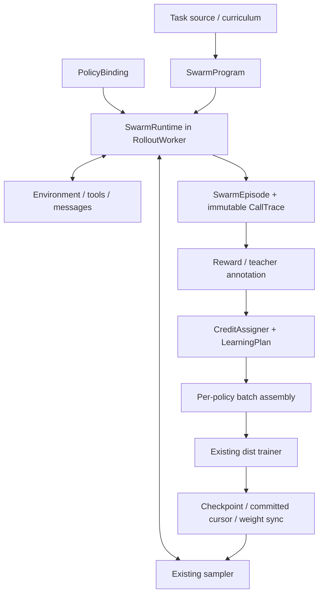
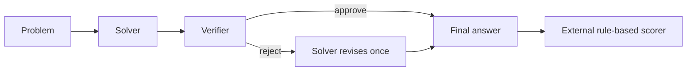
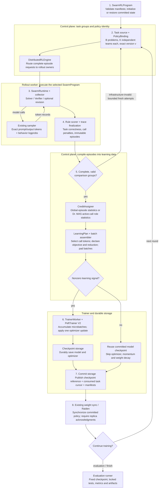

# Tunix Distributed Swarm Training: System Design

| Item | Decision |
| --- | --- |
| Status | Local shared-policy slice implemented and CPU-validated; distributed transport and 4B results pending |
| Version | 2.1 |
| Updated | November 11, 2026 |
| Implementation scope | Extend `tunix/dist_rl` |
| First recipe | Dr. MAS shared-policy math with Qwen3-4B |
| Later recipe | Avalon-inspired dynamic parallel Swarm-Repair |
| Review entry points | [One-pager](swarm_training_onepager.md), [English overview](swarm_training_overview.md), [Chinese overview](swarm_training_overview_zh.md) |

This document is authoritative for the common framework and first recipe. The [Swarm-Repair design](swarm_rlcr_design.md) specifies an optional later specialization. The first implementation is a local-transport slice: immutable call traces, Solver–Verifier execution, role/episode credit, native training and weight publication. The broader contracts and distributed lifecycle below remain target design unless listed as implemented. See the [recipe and directory rationale](../examples/swarm_math/README.md) and [validation evidence](swarm_training_validation.md). Recipe values copied from references are distinguished from deployment settings that require measurement.

## 1. Goals and Scope

Deliver a reusable multi-agent training path on the existing distributed RL stack and one independently evaluable recipe. The framework must express conditional workflows, shared parameters, and role-dependent learning without requiring dynamic membership, a shared filesystem, or physical deadlines for every task.

Three dimensions are independent:

| Dimension | Defines | Examples |
| --- | --- | --- |
| Interaction | Which agent acts, what it observes, and when | Conditional Solver–Verifier, parallel workers, bidding, dynamic membership |
| Parameter binding | Which policy serves a role and which parameters update | Shared policy, independent role policies, frozen workers |
| Learning | Reward assignment, comparison sets, objectives, and reduction | Collective credit, role normalization, OPD, counterfactual preferences |

V0 implements one shared trainable policy, two fixed roles, conditional execution, padded call batches, synchronous zero-lag rounds, and rule-based scoring. It supports a global-normalization baseline and reference-aligned Dr. MAS normalization. Multi-policy training, frozen external workers, dynamic parallelism, streaming deadline termination, OPD integration, and RSI are subsequent gates; declaring an interface does not establish those capabilities.

Acceptance has two separate outcomes: numerical/system correctness and measured task quality. Improved quality or gradient stability is an experimental result, not an assumed property of the port.

## 2. Architecture and Placement

The control plane dispatches complete team attempts. One rollout owner holds an episode's runtime state; agent scheduling remains local initially. This avoids a control-plane RPC for every turn. A learned central orchestrator is optional application behavior; centralized infrastructure scheduling does not impose one on the swarm.

`SwarmProgram` describes episode interaction. `SwarmRLProgram`, a distinct name, implements the existing training-loop `RLProgram` and owns rounds, comparison groups, learning, checkpoint commits, and evaluation.

| Existing component | Change or reuse |
| --- | --- |
| [ClusterOrchestrator](../tunix/dist_rl/orchestrator/orchestrator.py) | Run `SwarmRLProgram`; retain worker bring-up, registry, monitoring, and shutdown |
| [Engine interface](../tunix/dist_rl/orchestrator/rl_engine_interface.py), [distributed engine](../tunix/dist_rl/orchestrator/distributed_rl_engine.py) | Add typed episode dispatch/poll through existing sessions; retain train/save/restore/sync |
| [RolloutManager](../tunix/dist_rl/rollout/manager.py), [RolloutWorker](../tunix/dist_rl/worker/rollout_worker.py) | Replace hard-coded collector construction with explicit collector selection and common drain/close lifecycle |
| [Sampler](../tunix/dist_rl/rollout/sampler.py) | Reuse exact token sampling and behavior scores; request advanced capabilities only when a recipe needs them |
| [StandardRLProgram](../tunix/dist_rl/orchestrator/rl_program.py) | Preserve ordinary trajectory processing; add a sibling program for one episode expanding into several calls |
| [AlgorithmConfig](../tunix/rl/algorithm_config.py), [payload builder](../tunix/dist_rl/orchestrator/payload_builder.py), and [loss wiring](../tunix/rl/algo_core.py) | Reuse token loss infrastructure; introduce explicit episode credit and batch compilation |
| [Payloads](../tunix/dist_rl/common/datatypes.py), [batch assembly](../tunix/dist_rl/orchestrator/batch_assembly.py) | Carry lineage, masks, credit, and explicit reduction contributions through padding and microbatching |
| [TrainerWorker](../tunix/dist_rl/worker/trainer_worker.py), [PeftTrainer V2](../tunix/dist_rl/train/peft_trainer_v2.py) | Reuse forward/backward, optimizer, and accumulation; validate reference loss equivalence |
| [Weight sync](../tunix/dist_rl/weight_sync), [trajectory storage](../tunix/dist_rl/trajectory) | Reuse transport/storage foundations with exact episode and checkpoint identity |

Current constraints matter: `StandardRLProgram` checks one payload per input trajectory; the manager constructs a specific collector; the distributed engine maintains one policy version and its sync implementation ignores role selectors. V0 fits the single-policy engine. Independent policy training requires actual engine and lifecycle changes, not just an additional role field.

Module boundaries and current implementation:

| Module | Responsibility |
| --- | --- |
| `swarm/trace.py` | Implemented immutable call/episode records; extend these for later transport contracts |
| `swarm/runtime.py` | Implemented sampling recorder; broader bounded tools/spawn/cancellation services remain planned |
| `swarm/credit.py` | Implemented role/episode credit and native trainer payloads; multi-policy learning plans remain planned |
| `swarm/local_engine.py` | Implemented local adapter to existing TrainerWorker; no second optimizer or loss stack |
| `orchestrator/swarm_program.py` | Implemented synchronous collect/score/train/publish loop with variable call cardinality |
| `rollout/swarm_collector.py` | Planned worker lifecycle and distributed episode transport adapter |
| `examples/swarm_math/` | Implemented pinned prompts/grader, data preparation, configs, local launcher and evaluation |

Keep the reusable contracts inside `dist_rl/swarm/` and task-specific choices in the example. Do not create a separate top-level swarm training framework. The current launcher owns local evaluation and final checkpoint writing. Durable round commits, cursor resume, remote worker selection and Raiden acceptance are still pending; the architecture diagram describes that target distributed path.

## 3. Common Contracts

### 3.1 Execution

`SwarmProgram.run(task, runtime, bindings)` is an asynchronous episode program. Fixed workflows can use a state machine; dynamic programs can run coroutines. A static DAG is an optional frontend, not the universal execution model.

`SwarmRuntime` supplies model calls, optional tools/messages/spawn/join, cancellation, budgets, and event recording. A recipe declares required capabilities before dispatch. Math requires completion calls and scoring; Swarm-Repair additionally requires shared artifacts, dynamic membership, prefix capture, and confirmed backend abort; counterfactual methods require snapshot/fork/restore. Unsupported capabilities fail startup.

An external harness adapter must retain server-side exact tokens, scores, role/policy identity, and request lineage. A text transcript alone is insufficient for policy training. Environment ground truth and protected graders are unavailable to actors. A model verifier's judgment is an observation/control action, not authoritative task correctness.

### 3.2 Policy Binding

`agent_id` identifies a concrete member, `role_id` identifies a semantic function, and `policy_id` identifies a parameter/optimizer identity. Roles can share a policy while retaining different credit statistics. Dynamic member IDs must not accidentally replace the semantic grouping required by a recipe.

A binding records policy identity, model/tokenizer/template revisions, trainable status, and endpoint. V0 validates that both roles resolve to the same shared checkpoint and compatible settings. Later independent policies can use different tokenizers, provided every call is scored and trained under its own policy's token contract.

Frozen-policy outputs remain recorded and can become observations for other agents; they produce no optimizer payload for that frozen policy. A future multi-policy registry needs per-policy routing, versions, optimizer state, and an explicit joint or alternating update schedule. An episode records a version bundle, and a committed checkpoint bundle must restore all participating policy states consistently.

### 3.3 Episode and Call Trace

| Record | Required fields |
| --- | --- |
| Episode identity | Schema version, run/round/task/group/attempt/episode IDs, reset/config digests |
| Policy identity | Binding manifest and behavior policy version or version bundle |
| Call identity | Call/agent/role/policy IDs, request ID, parent and causal event links |
| Model inputs | Exact prompt token IDs, attention/position/segment information needed to reproduce scoring, template identity |
| Sampled actions | Output token IDs, aligned behavior logprobs, action ownership mask, sampling contract, stop reason |
| Observations | References to actor-visible messages/tool outputs/artifact versions |
| Outcome | Raw task score, per-call penalties or annotations, termination reason, verifier identity, artifacts |

Call records are immutable after finalization; annotations refer to them by ID. Each action token has one generating owner. Received messages, tool outputs, prompt tokens, and repeated history have zero direct action loss in the receiving call. Never synthesize a globally interleaved conversation that no actor actually observed.

Teacher-only hindsight or error feedback is stored separately from actor-visible context. OPD later scores the same sampled student tokens with explicitly declared teacher conditioning; it must not rewrite the student's original training context.

Episode outcome and transport status are distinct. Wrong answers and valid budget termination remain policy outcomes. Missing token records, corrupted snapshots, and failed graders are infrastructure failures. Absence of a conditionally skipped role is valid; do not invent a zero-reward call for it.

### 3.4 Credit and Learning

`CreditAssigner` returns learning signals plus their statistical lineage. `LearningPlan` specifies selected policies/calls, objective, normalization scope, update ordering, and loss reduction.

| Independent setting | Examples |
| --- | --- |
| Credit scope | Episode, role, action, token |
| Comparison set | Same task/reset and K independent team attempts |
| Statistical unit | One episode or each active call |
| Normalization partition | Task group, task plus role, other explicitly defined key |
| Loss weighting | Token, call, role, episode, fixed team capacity |
| Objective | GRPO/PPO, sampled-token OPD, SFT or preference objectives |

A collective method computes team credit before expanding episodes into calls. A role method may require active-call statistics before payload construction. These are different algorithms. Preserve raw rewards and call multiplicities so both can be implemented without reconstructing them from padded rows.

The trainer receives token data, fixed credit/masks, and declared reduction contributions. It does not interpret interaction topology. It must accumulate unreduced numerators and the correct denominator across microbatches/devices. Changing padding or splitting a call must not silently change objective weights. The fixed team-capacity denominator in Swarm-Repair is recipe-specific and is not imposed on Dr. MAS.

## 4. First Recipe: Shared-Policy Math

Reference: [Dr. MAS paper](https://arxiv.org/abs/2602.08847), [official code](https://github.com/langfengQ/DrMAS), [math launcher](https://github.com/langfengQ/DrMAS/blob/master/examples/drmas_trainer/run_math.sh).

Port the reference conditional workflow: `max_loop_num=2` yields at most three calls because the last Solver output is not followed by another Verifier call. Pin prompts, action parsing, invalid-action handling, and final-answer selection, not only role names.

| Setting | Reference starting profile |
| --- | --- |
| Model | `Qwen/Qwen3-4B`; resolve immutable model/tokenizer revisions |
| Binding | Solver and Verifier share one trainable policy; explicitly enable sharing |
| Sampling group | K=8 independent team episodes per problem |
| Task batch | 32 problems per collection batch in the reference; validate Tunix capacity |
| Learning rate | `1e-6` |
| Context limits | Reference prompt 8,192 / response 4,096 tokens; reject unsupported geometry before training |
| Thinking | Disabled using the pinned chat template |
| Reward | Rule-based correctness plus reference per-call invalid-action penalty, coefficient 0.1 |
| Extra losses | No reference KL or entropy bonus in the starting script |
| Execution | Synchronous fresh-data rounds, zero policy lag, padded rows |

The source script defaults to non-sharing; shared-policy mode is an explicitly supported source configuration. The reported shared-4B run is approximately 4×H100 for 35 hours. Tunix mesh, precision, memory, sampling probabilities, optimizer details, and actual throughput must be resolved from a pinned reference and measured deployment. Do not treat that hardware figure as a Tunix requirement or guarantee. If sampling/objective settings must change, record an adaptation and retain a matching control rather than calling it numerical reproduction.

### 4.1 Reference Statistics

The source [advantage implementation](https://github.com/langfengQ/DrMAS/blob/master/verl/trainer/ppo/core_algos.py) and [trainer grouping](https://github.com/langfengQ/DrMAS/blob/master/verl/trainer/ppo/ray_trainer.py) define the port:

- Agent-wise mode groups by task UID and semantic agent label, using every active call's reward in that partition's mean/std. Repeated Solver calls contribute repeated observations.
- The reference global baseline first averages call rewards within each episode, then computes group statistics across episodes. Do not silently substitute a global pool of all call rows.
- Match reward aggregation, standard-deviation convention, epsilon, singleton/zero-variance handling, masks, and loss reduction against the pinned implementation. Tunix's existing GRPO defaults are not sufficient evidence of equivalence.
- Missing roles produce no calls or artificial rewards. Per-call invalid-action penalties remain attached to the original call.

If role sample sets and rewards coincide, role statistics can coincide. Improvement over global normalization is not guaranteed. Conditional call frequency and action penalties are material to the comparison.

### 4.2 Data and Evaluation

Start from the reference [data preprocessing](https://github.com/langfengQ/DrMAS/blob/master/examples/data_preprocess/drmas_math.py), including its public math training source. Record dataset revisions and deduplicate train/development/test inputs. Reserve development data from training; do not use the script's benchmark-derived `test_sampled` set to tune or choose checkpoints for the final claim.

Use locked MATH500 as the initial primary test. Additional AIME, AMC, Minerva, and OlympiadBench evaluations can follow with their own fixed manifests. Pin extraction and mathematical equivalence rules. Keep labels in the scorer, outside actor observations.

Evaluate initial untrained teams, the same workflow with global-normalization RL, Dr. MAS RL, and single-agent RL from the same initialization. Compare equal total generated-token budgets and disclose training compute. For avg@16/pass@16, one sample is a complete team episode, not an individual member answer. Also report cost, latency, calls, rejection rate, correction/regression rate, failures, and seed uncertainty. Never use a correctness oracle to select the deployed team's answer.

## 5. End-to-End Round

1. **Startup:** resolve model/data/prompt/source/config identities; validate bindings, capabilities, token geometry, and trainer reduction; restore an exact committed state or save an initial checkpoint. Run a frozen evaluation before learning.
2. **Collection:** dispatch B tasks with K independent attempts per task. Group members use the same problem/reset, serving profile, budget, and policy version. V0 admits one active episode per rollout owner initially; measure capacity before increasing concurrency.
3. **Execution:** run Solver, Verifier, and optional revision. Record exact call-level inputs/outputs/scores. Normal early completion is valid. Do not auto-upgrade requests to a newer sampler version.
4. **Scoring:** apply the external correctness scorer and pinned call penalties; seal the trace. Training and evaluation use the same workflow and final-answer rules.
5. **Learning:** validate complete comparison groups, compute the selected reference normalization, then compile variable call rows. A skipped role does not make the group incomplete. Separate infrastructure-invalid episodes from valid low rewards.
6. **Update:** use one fresh-data update plan initially. Validate microbatch totals and masks. If the entire round has zero learning signal, skip optimizer execution, including momentum/weight decay, but commit data consumption.
7. **Commit and sync:** save model/optimizer durably, publish the matching cursor and recipe identity, then synchronize the committed version and verify acknowledgment. No episode may straddle a weight update.
8. **Evaluation/shutdown:** evaluate a fixed checkpoint without mutation; drain model/tool work and persist results before exit.

## 6. Failure, Recovery, and Resource Semantics

Maintain separate `collection_round`, `optimizer_step`, and `policy_version` counters. A commit manifest includes the exact checkpoint reference, consumed task cursor, policy/binding identity, algorithm/reduction config, data/prompt/scorer versions, and evaluation lineage. A zero-signal round can reference the preceding model checkpoint while advancing the task cursor.

Use one active control-plane owner initially. Automatic TaskSession redispatch is disabled for stateful episodes; bounded program-level retries use fresh attempt IDs and preserve group identity. Polling an existing attempt does not start a new one. Retry incomplete infrastructure groups conservatively; do not filter policy mistakes into successful groups. Record all discarded attempts and retry costs.

Unknown optimizer RPC outcomes require restoring the last committed model and optimizer and clearing accumulators before recollection. Never blindly repeat a potentially completed update. Restore the exact committed checkpoint, not the newest directory. Require durable save completion rather than acknowledgment that an async save began. Step-zero checkpoints and explicit policy metadata must be recognized.

Uncommitted checkpoint directories can collide with the next attempt's step. Settle the old writer, verify the directory is unreferenced, quarantine it outside the active checkpoint namespace, and refresh checkpoint-manager state before reuse. Never overwrite a published checkpoint. The detailed [Swarm-Repair recovery discussion](swarm_rlcr_design.md#7-checkpoint-retry-and-failure-semantics) applies as a shared implementation requirement where relevant.

Bound pending groups, queued calls, maximum prompt/output size, artifact retention, and all reset/request/scoring/save/sync stages. Distinguish normal recipe termination from infrastructure watchdog expiry. V0 does not require prefix-preserving deadline cancellation; a later recipe that trains interrupted prefixes must add streaming capture, backend abort acknowledgment, and a freeze boundary before claiming that capability.

## 7. Extending to Different Swarms

| Method family | Interaction program | Binding | Learning / additional capability |
| --- | --- | --- | --- |
| Dr. MAS | Conditional role workflow | Shared or separate | Active-call role statistics |
| MAGRPO / MAPoRL | Collaborative generation or discussion | Recipe-defined | Cooperative credit; preserve each source's actual objective |
| Avalon / RLCR | Dynamic membership, messages, shared workspace | Shared trainable policy | Collective credit; anytime scores, deadlines, streaming abort |
| PARL | Learned orchestrator schedules workers | Trainable orchestrator, frozen workers | Select orchestrator actions for updates |
| MPT | Decentralized bids select one acting member per round | Independent policies in source | Action/bid objectives; counterfactual environment fork/restore |
| MALT | Role pipeline with sampled search tree | Role-conditioned policies | Offline training-data/preferences path; not forced into online GRPO |
| MAS-OPD | Student team interaction | Student/teacher separation | Call-level teacher annotations with explicit teacher-only context |
| R²Orch / RSI | Outer task/skill loop plus episode workflow | Director/Proposer update; workers frozen in R²Orch | Versioned curriculum, skill visibility, alternating update plans |

This table describes intended extension points, not completed Tunix support or verified full reproductions. In particular, MAGRPO's simplified paper objective omits importance sampling/clipping, and RLCR primarily uses CISPO; neither is automatically equivalent to native clipped GRPO.

For frozen-worker orchestration, first add frozen endpoint routing and trace/loss selection without multiple trainable optimizers. Independently trained policies later require per-policy trainer ownership, version bundles, synchronization and atomic recovery. Counterfactual data adds parent/branch IDs and environment snapshot identity. RSI task generation and skill evolution stay outside the episode collector and publish versioned task/skill manifests.

Swarm-Repair keeps its own tools, shared filesystem, latest-snapshot reward, team-capacity loss denominator, physical deadline, and streaming cancellation requirements in the [specialization design](swarm_rlcr_design.md). Those are not prerequisites for math or general framework invariants.

## 8. Delivery Gates and Verification

| Gate | Deliverable | Required evidence |
| --- | --- | --- |
| G1: Numerical contracts | Shared binding, conditional program, trace and Dr. MAS/global adapters | Independent reference advantages/loss/gradients on nonuniform rewards, unequal calls, skipped roles, invalid actions, zero variance, and all-masked rows |
| G2: Distributed closure | Math rollout/train/sync/checkpoint/resume | Two real accelerator rounds; second rollout uses new weights; exact restore reproduces committed state; ordinary GRPO/OPD regressions pass |
| G3: First result | Pinned complete math recipe | Initial/global/role/single-agent controls on locked test; matched budgets, seed uncertainty, raw traces, checkpoints, per-task outcomes and costs |
| G4: Generality | Trainable orchestrator with frozen workers | Different interaction and binding through the same runtime/trainer; frozen parameters unchanged |
| G5: Dynamic parallel recipe | Avalon-inspired Swarm-Repair | Workspace/message correctness, dynamic membership, valid interrupted prefixes, no late effects, real overlap and matched-budget quality/latency results |
| G6: Optional extensions | Independent policies, swarm OPD, forks, RSI | Each capability has its own objective, recovery, and evaluation acceptance |

Numerical tests compare to a pinned external reference or independently computed oracle, not duplicated implementation logic. Verify padded/unpadded and microbatch/device equivalence for the declared objective. Real quality reports must preserve negative findings and distinguish a smoke run from convergence evidence.

Required recipe entry modes: baseline evaluation, training, exact resume, and saved-checkpoint evaluation. Persist resolved manifests, data split hashes, reference commit, prompt/scorer identities, raw and annotated traces, reduction definitions, per-role reward/advantage/gradient diagnostics, phase timings, checkpoint/commit references, and final per-task scores.

Open measurements before launch: Qwen3-4B native trainer/sampler compatibility, template/token score parity, actual sampling probability contract, accelerator mesh/precision, loss reduction equivalence, capacity, runtime cost, and whether the original task difficulty produces useful reward variance. A port with changed sampling, reward, or objective settings must disclose those changes.

## 9. References

- [Dr. MAS paper](https://arxiv.org/abs/2602.08847), [code](https://github.com/langfengQ/DrMAS), [math workflow](https://github.com/langfengQ/DrMAS/blob/master/agent_system/agent/orchestra/math/README.md): first recipe and reference statistics.
- [MARTI](https://github.com/TsinghuaC3I/MARTI): interaction/reward/trainer separation.
- [Agent Lightning architecture](https://github.com/microsoft/agent-lightning/blob/main/docs/05-basics.md): model endpoint capture and harness separation.
- [Avalon blog](https://www.gr.inc/blog/how-to-train-a-swarm), [report](https://www.gr.inc/avalonm1.pdf): advanced collective parallelism reference.
- [MAGRPO](https://arxiv.org/abs/2508.04652), [CoMLRL](https://github.com/OpenMLRL/CoMLRL), [MAPoRL](https://arxiv.org/abs/2502.18439), [MALT](https://arxiv.org/abs/2412.01928): alternative objectives/data pipelines.
- [PARL](https://www.kimi.com/en/blog/kimi-k2-5), [MPT](https://github.com/Embodied-Minds-Lab/MPT), [R²Orch](https://github.com/beita6969/R2Orch), [MAS-OPD](https://arxiv.org/abs/2609.34234): binding, branching, curriculum, and teacher extensions.
