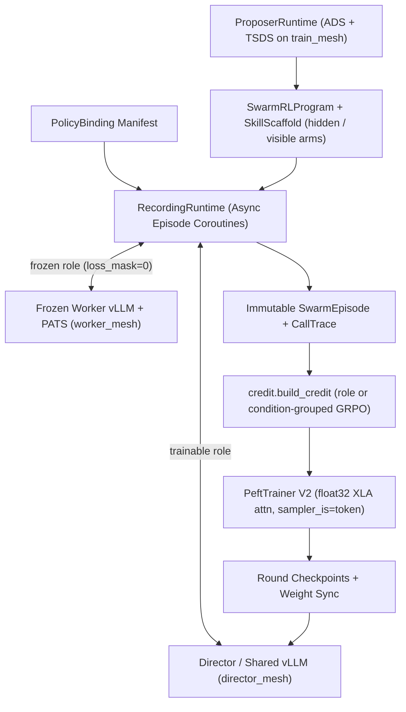
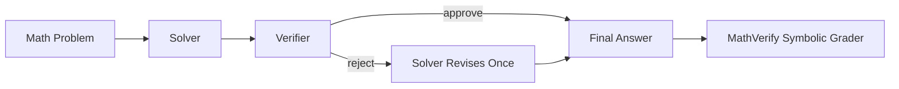
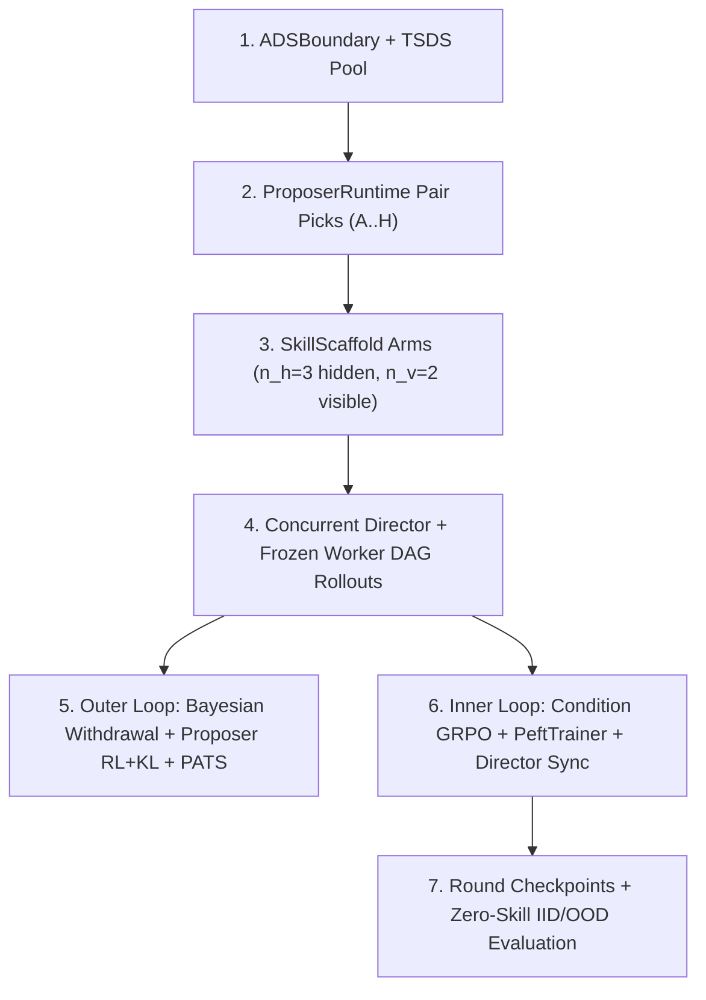

# Tunix Distributed Swarm Training: System Design

| **Item** | **Decision** |
| --- | --- |
| Status | Dr. MAS and R²Orch graph training have TPU v5p records. The Director/RSI math and collective repair examples have CPU training and recovery records. |
| Version | 3.0 |
| Updated | November 19, 2026 |
| Implementation scope | `tunix/dist_rl/swarm/` and `tunix/dist_rl/orchestrator/swarm_program.py` |
| TPU-tested recipes | [Dr. MAS shared-policy math](../examples/swarm_math/README.md) and [R²Orch Graph Director, frozen Workers and recursive self-play](../examples/swarm_r2orch/README.md) |
| CPU-tested recipes | [Director and alternating RSI math](../examples/r2orch_math/README.md) and [collective repair with CISPO](../examples/swarm_repair/README.md) |
| Review entry points | [One-pager](swarm_training_onepager.md), [English overview](swarm_training_overview.md), [Chinese overview](swarm_training_overview_zh.md), [Validation record](swarm_training_validation.md) |

The [Director/RSI design](r2orch_design.md) describes selected-policy and alternating updates. `SwarmSpec` and `SwarmSession` let users supply an async workflow, role bindings and a private grader. `CollectiveRuntime` handles dynamic spawning, mailboxes, workspace and anytime commitment in the local repair example. Its current objective is CISPO with token-mean reduction. The [distributed Swarm-Repair design](swarm_rlcr_design.md) proposes a Team-GRPO variant with a fixed-capacity reduction and remote prefix-preserving cancellation.

## 1. Goals and Scope

Deliver a reusable multi-agent reinforcement learning path on the existing `tunix/dist_rl` stack without creating a duplicate trainer, optimizer, or loss engine. The framework separates workflow interaction, role-to-parameter binding, and credit assignment so conditional role pipelines, heterogeneous frozen-worker DAGs, and two-timescale self-play curricula run on the same core primitives.

Three dimensions remain orthogonal:

| **Dimension** | **Defines** | **Implemented & Planned Examples** |
| --- | --- | --- |
| Interaction | Which agent acts, what it observes, and when | Implemented: conditional `Solver → Verifier → Solver` (`swarm_math`), layered DAG + same-layer peer cross-check `GraphCanvas` (`swarm_r2orch`). CPU fixture: deadline-bounded dynamic membership (`swarm_repair`). Planned: remote prefix-preserving cancellation |
| Parameter binding | Which policy serves a role and which parameters update | Implemented: single shared trainable policy (`RecordingRuntime`), heterogeneous trainable Director + frozen Workers (`PolicyBinding`, `RecordingRuntime.from_bindings`), plus separate `train_mesh` Proposer (`ProposerRuntime`) |
| Learning | Reward assignment, comparison sets, objectives, and reduction | Implemented: Dr. MAS active-call `(task, role)` credit, episode-mean credit, condition-grouped `(task, scaffold_condition)` GRPO, `microbatch_token_mean`, `sampler_is="token"`, and Proposer pairwise REINFORCE + reference KL |

Current implementation covers Gates G1–G4 plus the full two-timescale `R²Orch` outer loop (`ADSBoundaryScheduler` + `TSDSRetriever`, `ProposerRuntime`, Bayesian-bootstrap `SkillScaffold` skill withdrawal/admission/audit, and `PatsOuterReviewer` distillation on the frozen Worker base). Remote RPC episode collection (`rollout/swarm_collector.py`), physical-deadline streaming cancellation (`Swarm-Repair`), and swarm OPD remain subsequent gates.

Acceptance separates numerical/system invariants (exact token provenance, zero frozen-worker drift, reference gradient parity, deterministic round-boundary checkpoint/resume) from measured benchmark quality under locked zero-oracle evaluation.

## 2. Architecture and Placement

The control plane dispatches complete team episodes; each episode coroutine manages its own multi-turn or multi-layer control flow locally over async `Sampler` bindings, avoiding per-turn orchestrator RPC overhead. Central orchestration (`GraphDirectorWorkflow`) is an application-level `SwarmProgram` choice rather than a hard-coded infrastructure requirement.

`SwarmRLProgram` (`tunix/dist_rl/orchestrator/swarm_program.py`) is a sibling of `StandardRLProgram` implementing `RLProgram` for variable-call-cardinality episodes: one episode expands into `1..N` trainable call rows while preserving single-optimizer-boundary credit, scoring, training, checkpointing, and weight publication.

| **Existing component** | **Implemented integration or planned extension** |
| --- | --- |
| [`ClusterOrchestrator`](../tunix/dist_rl/orchestrator/orchestrator.py) | Retain worker bring-up, health monitoring, and shutdown; planned remote `SwarmRLProgram` wiring |
| [`Sampler`](../tunix/dist_rl/rollout/sampler.py), [`InprocessVllmSampler`](../tunix/dist_rl/rollout/inprocess_vllm_sampler.py) | Reused directly per `PolicyBinding`; isolated sub-meshes (`director_mesh`, `worker_mesh`) serve trainable and frozen vLLM engines concurrently under Pathways |
| [`StandardRLProgram`](../tunix/dist_rl/orchestrator/rl_program.py) | Unchanged 1-to-1 trajectory program; sibling `SwarmRLProgram` handles variable call counts and optional variable condition-group sizes |
| [`AlgorithmConfig`](../tunix/rl/algorithm_config.py), [`algo_core`](../tunix/rl/algo_core.py) | Reused token-mean dual-clip GRPO (`epsilon=0.2`, configurable `epsilon_high=0.2` or `0.28`, `epsilon_c=3.0`, `sampler_is="token"`) |
| [`Payloads`](../tunix/dist_rl/common/datatypes.py), [`batch assembly`](../tunix/dist_rl/orchestrator/batch_assembly.py) | Extended `PaddedBatchAssembler` to preserve `completion_attention_mask` independently of `completion_mask` across both C++ and Python paths |
| [`TrainerWorker`](../tunix/dist_rl/worker/trainer_worker.py), [`PeftTrainer V2`](../tunix/dist_rl/train/peft_trainer_v2.py) | Reused unchanged for Director `fwd_bwd`/`update`/Orbax checkpointing and for fused `train_step` + `fwd_only` Proposer pairwise updates on `train_mesh` |
| [`Safetensors loader`](../tunix/models/safetensors_loader.py), [`Qwen3`](../tunix/models/qwen3/model.py) | Added chunked Pathways host-to-device tensor placement, sharded KV cache init, and `skip_lm_head=True` + `compute_final_logits` single-position Proposer scoring |

Implemented module boundaries on `origin/haoyu-next`:

| **Module** | **Status & Responsibility** |
| --- | --- |
| `tunix/dist_rl/swarm/trace.py` | **Implemented.** Immutable `CallTrace` and `SwarmEpisode` records enforcing `trainable` vs all-zero `loss_mask` alignment and single-version episode consistency |
| `tunix/dist_rl/swarm/runtime.py` | **Implemented.** `PolicyBinding` and `RecordingRuntime` (`from_bindings`) routing logical roles to shared, trainable, or frozen samplers with concurrency-safe `call_id` / seed reservation |
| `tunix/dist_rl/swarm/credit.py` | **Implemented.** `CreditBatch` and `build_credit` computing detached `(task, role)` or `(task,)` advantages over `c.trainable` calls with `float64` episode-mean accumulation and exact zero-variance guards |
| `tunix/dist_rl/swarm/local_engine.py` | **Implemented.** `LocalSwarmEngine` adapting `TrainerWorker` scoring, microbatch accumulation, single optimizer step, and serving weight sync |
| `tunix/dist_rl/orchestrator/swarm_program.py` | **Implemented.** `SwarmConfig`, `microbatch_token_mean` advantage reweighting, logprob agreement checks, zero-signal optimizer skip, `restore_state`, and `SwarmRLProgram` |
| [`examples/swarm_math/`](../examples/swarm_math/README.md) | **Implemented & TPU-verified (`SW1–SW2`).** Pinned Dr. MAS Solver–Verifier workflow, `MathVerify` symbolic grader, `12,357`-problem deduplicated `dapo_filter` split, and 6-benchmark Table 1 evaluator |
| [`examples/swarm_r2orch/`](../examples/swarm_r2orch/README.md) | **TPU-verified.** SW3 completed 100 steps and the full experiment completed 100 cycles. Layered DAG + peer `GraphCanvas` (`canvas.py`), `GraphDirectorWorkflow` (`workflow.py`), multi-domain verifiers & cost (`scoring.py`), Bayesian `SkillScaffold` (`skill_ledger.py`), `ADSBoundaryScheduler` + `TSDSRetriever` + JAX `ProposerRuntime` (`proposer.py`), and frozen-base `PatsOuterReviewer` (`pats.py`) |
| `tunix/dist_rl/rollout/swarm_collector.py` | **Planned.** Remote RPC worker-side episode collector for disaggregated `DistributedRLEngine` deployments |

## 3. Common Contracts

### 3.1 Execution

Workflows execute as standard Python `async` coroutines receiving a task and a `RecordingRuntime`. Fixed conditional pipelines (`SolverVerifierWorkflow` in `examples/swarm_math/workflow.py`) and dynamic multi-round graph builders (`GraphDirectorWorkflow` + `GraphCanvas` in `examples/swarm_r2orch/`) share the exact same runtime interface, launching parallel same-layer Worker waves via `asyncio.gather`.

`RecordingRuntime.generate(role, prompt)` encodes actor-visible text under the role's bound template, reserves a monotonic `call_index` prior to `await` (preventing request-ID or seed collisions across concurrent Worker waves), validates unpadded token provenance, and returns an immutable `CallTrace`. Ground-truth answers, hidden unit tests, and protected verifiers remain strictly outside actor and outer-loop reviewer visibility.

### 3.2 Policy Binding and Accelerator Isolation

`PolicyBinding` (`tunix/dist_rl/swarm/runtime.py`) separates semantic `role` names (`"Solver"`, `"Verifier"`, `"Graph Director"`, `"Frozen Worker"`) from parameter identity (`policy_id`, `policy_version`, `trainable`, `sampler`, `encode`, `sampling_params`).

- **Shared-policy binding (`Dr. MAS`):** `"Solver"` and `"Verifier"` route through a single `RecordingRuntime` binding (`trainable=True`), sharing one `InprocessVllmSampler` on `rollout_mesh` and one `PeftTrainer` on `train_mesh`.
- **Heterogeneous frozen-worker binding (`R²Orch`):** `RecordingRuntime.from_bindings` binds `"Graph Director"` (`trainable=True`, `return_logprobs=True`, `policy_version=v`) to `director_mesh` and `"Frozen Worker"` (`trainable=False`, `return_logprobs=False`, `policy_version=0`) to an isolated `worker_mesh` initialized once from untouched base weights. `sync_director` updates only `director_mesh`, and `R2OrchRoundHooks.check_frozen_worker_drift()` asserts `max_norm_diff == 0.0` at every training round and evaluation.
- **Two-timescale Proposer placement (`Full R²Orch`):** Because `ProposerRuntime` only evaluates next-token logits over `8` single-token candidate labels (`A..H`) at the final prompt position, it executes directly on `train_mesh` (`fsdp=8, tp=8`) via left-padded `Qwen3(..., skip_lm_head=True)` + `compute_final_logits(hidden[:, -1:, :])` inside a dedicated `PeftTrainer` alongside frozen reference parameters `ref_state`, requiring zero extra vLLM engines.

### 3.3 Episode and Call Trace

| **Record** | **Implemented fields & invariants (`trace.py`)** |
| --- | --- |
| `SwarmEpisode` | `task_id` (comparison-group key, e.g. `tid` or `f"{tid}::{scaffold_condition}"`), `episode_id`, immutable `calls: tuple[CallTrace, ...]`, finite `reward`, `final_text`; rejects duplicate `call_id` or mixed `policy_version` within any `policy_id` |
| `CallTrace` | `call_id`, `role`, `policy_id`, `policy_version`, `prompt_ids`, `completion_ids`, `rollout_logprobs`, `loss_mask`, `text`, `valid_action`, `trainable` |
| Mask & logprob alignment | Trainable calls enforce binary `loss_mask` with ≥1 active token and aligned finite `rollout_logprobs`; frozen calls (`trainable=False`) enforce an all-zero `loss_mask` |
| EOS & attention masks | Sampled `<\|im_end\|>` (`151645`) stays in `completion_ids` (`include_eos=True`) while stripped from decoded downstream text; `completion_attention_mask` stays separate from `completion_mask` through padding |

Call records are never stitched into synthetic multi-party transcripts: upstream Worker outputs or Verifier critiques enter downstream calls solely as `prompt_ids` (zero direct action loss), so every generated token has a single causal policy owner.

### 3.4 Credit Assignment, Loss Reduction, and TPU Numerical Stability

`credit.build_credit` filters `episodes` to `c.trainable` calls (verifying a single `(policy_id, policy_version)` across the trainable batch while leaving frozen Worker calls untouched in the trace) and supports two normalization modes:

| **Setting** | **Implemented behavior** |
| --- | --- |
| `normalization="role"` | Groups active call rewards `r_call = r_episode - invalid_action_penalty * (not valid_action)` by `(task_id, role)` (`ddof=1`, `eps=1e-6`, singleton `(0, 1)`), matching Dr. MAS `compute_drmas_outcome_advantage` within `2e-6` |
| `normalization="episode"` | Accumulates per-episode trainable call-reward means in `float64` before `float32` group normalization across `(task_id,)` (`ddof=1`), matching both Dr. MAS global baseline and R²Orch Director condition-grouped advantages (`task_id = f"{tid}::{arm}"`, `allow_variable_group_sizes=True`) |
| `loss_reduction` | `"global_token_mean"` or `"microbatch_token_mean"` (`loss_microbatch_rows=4`, scaling row advantages by `w_r = N / (G * N_g)` to match upstream `verl` `ppo_micro_batch_size_per_gpu=4` exactly) |
| `sampler_is="token"` | Truncated token-level importance ratio `min(exp(logp_trainer - logp_vllm), 2.0)` multiplied onto an exact on-policy PPO ratio (`1.0`), absorbing rare `bfloat16` TPU vLLM logprob glitches while enforcing `enable_prefix_caching=False` and `async_scheduling=False` |
| TPU precision contract | `dtype="float32"` and `use_flash_attention=False` are mandatory on TPU `v5p`: diagnostic cosine checks against `float32` highest-precision reference showed SplashAttention corrupts gradients below layer 15 (cosine `0.155`, norm `5.27×`) and `bfloat16` backward drifts in early `RMSNorm`/`q_norm`/`k_norm` layers on multi-turn contexts |

## 4. Delivered Recipes and Validation Summary

### 4.1 Recipe 1: Shared-Policy Math (`Dr. MAS`, `examples/swarm_math`)

Reference: [Dr. MAS paper](https://arxiv.org/abs/2602.08847), [official code (`c2f724e7`)](https://github.com/langfengQ/DrMAS/tree/c2f724e7358e7dc5bf2ea792ab07a3b5d90290c9), [validation record](swarm_training_validation.md).

`SolverVerifierWorkflow` runs `max_turns=3` (`Solver → Verifier → Solver` on rejection; at most 3 calls). `prepare_data.py` builds a deterministic, conflict-filtered `12,357` train / `256` dev split from `aaabiao/dapo_filter` (`0b10fea3`).

| **Benchmark (`n`, `k=16` at `T=0.6, top_p=0.95`)** | **Untrained Base** | **Paper Dr. MAS (Sharing)** | **Tunix Step 475** | **Tunix Step 500** | **Step 500 Decontam.** |
| --- | --- | --- | --- | --- | --- |
| AIME'24 (30) | 19.6 / 43.3 | 39.3 / 63.3 | **46.2 / 80.0** | **45.0 / 80.0** | 45.0 / 80.0 |
| AIME'25 (30) | 18.8 / 43.3 | 38.1 / 63.3 | **41.5 / 73.3** | **39.8 / 70.0** | 39.8 / 70.0 |
| AMC'23 (40) | 63.7 / 90.0 | 87.3 / 95.0 | **88.9 / 97.5** | **90.3 / 97.5** | 89.8 / 97.1 |
| MATH500 (500) | 81.4 / 95.4 | 90.5 / 96.0 | **92.2 / 97.2** | **92.2 / 97.2** | 92.1 / 97.2 |
| Minerva (272) | 31.8 / 44.1 | 40.9 / 53.3 | 38.4 / 49.3 | 37.8 / 49.3 | 37.8 / 49.3 |
| OlympiadBench (675) | 45.2 / 67.7 | 58.2 / 68.6 | **59.2 / 72.1** | **59.5 / 72.7** | 59.5 / 72.7 |
| **Macro Average (`1,547` tasks)** | **43.4 / 64.0** | **59.0 / 73.2** | **61.1 / 78.2** | **60.8 / 77.8** | **60.7 / 77.7** |

### 4.2 Recipe 2: Heterogeneous Graph Orchestration & Recursive Self-Play (`R²Orch`, `examples/swarm_r2orch`)

Reference: `R²Orch: Recursive Self-Play Orchestration` (arXiv:2610.22740), pinned upstream [`beita6969/R2Orch@12ceb756`](https://github.com/beita6969/R2Orch/tree/12ceb7563aa50439687f21ba5da60ad74a75eb89).

1. **Inner-loop DAG Canvas & Frozen Workers (`SW3`):** `GraphCanvas` (`canvas.py`) exposes atomic JSON edits (`add_agent`, `set_prompt`, `set_layer`, `add_edge`, `consider_relation` for same-layer peer cross-checks, `delete_agent`, `run_graph`, `finish`), anti-leakage delegation filters, bounded `1,000`-char summaries, and connectivity checks over frozen `Qwen/Qwen3-4B` Workers (`T=0.3`). Director episodes optimize `u = correctness - 0.005 * worker_cost` with asymmetric dual-clip GRPO (`clip=(0.2, 0.28)`). Across the 4 self-contained domains (`aime`, `hotpotqa`, `medqa`, `mbppplus`, `3,658` train tasks) plus 2 OOD suites (`math_hard`, `musique`), the 100-step `SW3` inner-loop TPU run (`hy-swarm-r2o-run1`) achieved `frozen_worker_max_norm_drift == 0.0`, lifting Heldout `avg@2 / pass@2` from `53.96 / 57.55` to `58.39 / 64.06` (`59.24 / 63.28` at Step 60), Locked Test IID from `44.30 / 47.47` to `47.03 / 48.79`, and Locked Test OOD from `42.77 / 48.05` to `44.53 / 50.78` (`MATH-Hard` `+6.64 / +10.16` pp) while cutting Worker token cost by `13–23%`.
2. **Full Two-Timescale Self-Play, Skill Withdrawal & Proposer (`Full R²Orch`):**
   - **Condition-Grouped Arm Rollouts (`G = 5: n_h = 3, n_v = 2`):** `SkillScaffold` (`skill_ledger.py`) loads the 12 domain seed cards (`seed_cards.json`), retrieves up to `top_k=3` cards per scope, selects one candidate card `k` via Thompson sampling (or audits a retired card with `audit_share=0.30`), hides `k` from `n_h=3` siblings and shows `k` to `n_v=2` siblings, and groups Director GRPO normalization by `(task_id, arm)`.
   - **Bayesian Skill Withdrawal & PATS Evolution:** Over a sliding `30`-cycle window, `2,000`-draw Rubin Dirichlet bootstrap posteriors over raw-correctness contrasts `z = y_vis - y_hid` withdraw internalized skills (`n >= 12, E[Delta+] <= 0.02`), admit positive trial skills (`q_0.05(Delta) > 0`), and reinstate audited retired skills when beneficial again. Every `5` cycles, `PatsOuterReviewer` (`pats.py`) queries the frozen Worker sampler on scrubbed public traces (zero gold-answer leakage) to `REVISE` negative-contrast cards and `DISTILL` new `trial` cards from `both_fail` groups. All evaluations run under **zero-skill deployment** (`skill_context=""`).
   - **Learned Pairwise Proposer (`proposer.py`):** `ADSBoundaryScheduler` + `TSDSRetriever` (`128`-dim pool embeddings) build `8` candidate lists (`A..H`: `4` ADS + `4` TSDS) per cycle across the `4` domains; `ProposerRuntime` samples `2` distinct picks per list (`16` tasks × `5` = `80` episodes/cycle), scores Recursive Learnability `arms_bell_reward` (`gamma=0.5`, endpoint penalty `-0.2`, Beta shrinkage `m=2.0`, compute factor `(T_d / T_q)^0.5`), and applies a fused `PeftTrainer.train_step` pairwise policy-gradient + reference-KL (`beta=1.0`, `gap_clip=4.0`) update on `train_mesh`.

## 5. End-to-End Round

1. **Startup:** validate model/revision/split SHA-256 manifests, numerical invariants (`dtype="float32"`, `use_flash_attention=False`), and tri-mesh geometry; initialize isolated vLLM engines and `PeftTrainer` checkpoints (or restore exact committed round state); record initial zero-skill evaluation.
2. **Task & Arm Planning:** select round tasks (uniform/stratified or `ProposerRuntime` `ADS+TSDS` pair picks) and, in Full `R²Orch`, plan `(hidden, visible)` skill contexts (`n_h=3, n_v=2`) via `SkillScaffold`.
3. **Concurrent Episode Execution:** run multi-turn `RecordingRuntime` coroutines concurrently across `director_mesh` and frozen `worker_mesh`, sealing immutable `CallTrace` and `SwarmEpisode` records.
4. **Outer-Loop Updates (Full `R²Orch`):** record paired `z = y_vis - y_hid` contrasts and apply Bayesian `retire`/`admit`/`reinstate` transitions; update `ADSBoundaryScheduler` and run 1 `ProposerRuntime` pairwise RL+KL optimizer step; periodically run `PatsOuterReviewer` `REVISE` + `DISTILL` on the frozen Worker sampler.
5. **Credit & Batch Assembly:** compute `(task, role)` or `(task, condition)` detached advantages over `c.trainable` calls, skip optimizer execution on all-zero-advantage rounds, and pad trainable call rows into `micro_batch_size` batches.
6. **Director Scoring, Update & Sync:** score actor logprobs across all microbatches prior to mutation, apply `microbatch_token_mean` weights, accumulate gradients and step `TrainerWorker` once, publish updated weights strictly to trainable sampler meshes, and assert `frozen_worker_max_norm_drift == 0.0`.
7. **Commit & Zero-Skill Evaluation:** persist Director, Proposer, and `SkillScaffold`/`ADS`/`PATS` state with matching step indices at checkpoint intervals and evaluate heldout + locked IID/OOD suites with `skill_context=""`.

## 6. Failure, Recovery, and Resource Semantics

`SwarmRLProgram` separates round step (`program.step`), optimizer step, and `policy_version`. Zero-signal rounds advance `program.step` without mutating optimizer state or `policy_version`. On checkpoint save (`R2OrchRoundHooks.save_all_checkpoints`), Director `TrainerWorker` weights/optimizer, Proposer `PeftTrainer` weights/optimizer, and JSON-serialized `SkillScaffold`, `ADSBoundaryScheduler`, and `PatsOuterReviewer` state dictionaries are saved with the same step index. `resume_from` restores a completed checkpoint set. The separate Director and Proposer saves in this recipe leave recovery from an interruption between writes as an open check. The alternating RSI math recipe uses its own committed cycle manifest.

Pathways TPU `v5p` jobs disable `prefix_caching` and `async_scheduling` for deterministic logprob alignment, chunk host-to-device parameter transfers, bound per-episode rounds/agents/tokens and `MBPP+` child-process `RLIMIT_CPU`/`RLIMIT_AS` sandboxes, and verify zero Worker norm drift after every round. Deadline-preserving streaming cancellation remains scoped to the [Swarm-Repair specialization](swarm_rlcr_design.md).

## 7. Extending to Different Swarms

| **Method family** | **Interaction program** | **Binding** | **Tunix status & learning path** |
| --- | --- | --- | --- |
| Dr. MAS | Conditional `Solver → Verifier → Solver` | Shared trainable policy | **Delivered (`SW1–SW2`).** Active-call `(task, role)` GRPO + `microbatch_token_mean` (`60.8 / 77.8` Table 1) |
| R²Orch Inner-Loop | Dynamic layered DAG + peer `GraphCanvas` | Trainable Director, frozen Workers | **Delivered (`SW3`).** `PolicyBinding(trainable=False)` + cost-regularized Director GRPO (`drift == 0.0`) |
| Full R²Orch / RSI | Two-timescale task Proposer + skill-armed DAG self-play | Trainable Director & Proposer; frozen Worker + PATS | **Validated with CPU fixtures and a 100-cycle, 128-chip `v5p` run.** Condition-grouped GRPO, pairwise RL+KL Proposer, Bayesian skill withdrawal, zero-skill eval |
| Avalon / RLCR | Dynamic membership, messages, shared workspace | Shared trainable policy | **Local CISPO fixture implemented.** Dynamic membership and anytime scores are CPU-tested. Distributed prefix-preserving abort is planned for G5 |
| MAGRPO / MAPoRL / MALT | Collaborative generation or search trees | Recipe-defined | **Planned.** Cooperative credit or offline preference pipelines |
| MAS-OPD | Student team interaction + teacher hindsight | Student/teacher separation | **Planned (`G6`).** Call-level teacher scoring without mutating student-visible context |

The [Swarm-Repair specialization design](swarm_rlcr_design.md) specifies the distributed Team-GRPO profile with a fixed team-capacity denominator and streaming deadline abort. The [local CISPO recipe](../examples/swarm_repair/README.md) exercises dynamic membership and settlement under its own reduction.

## 8. Delivery Gates and Verification

| **Gate** | **Deliverable** | **Status & Verified Evidence** |
| --- | --- | --- |
| G1: Numerical contracts | Shared binding, conditional program, `CallTrace` & Dr. MAS/episode credit | **Completed.** Matches upstream PyTorch advantage/loss/gradient oracles within `2e-6`; 67/67 `tests/dist_rl/swarm` unit & integration tests passing |
| G2: Distributed closure | TPU `v5p` Pathways rollout → train → weight sync → Orbax checkpoint/resume | **Completed.** Verified on 128-chip `v5p-256` & 32-chip `v5p`; SplashAttention backward bug diagnosed and resolved via `float32` XLA reference attention + `sampler_is="token"` |
| G3: First result (`SW2`) | Complete `Qwen3-4B` Dr. MAS math reproduction | **Completed.** 500-step TPU run achieves `60.8 / 77.8` (`60.7 / 77.7` decontam; Step 475 `61.1 / 78.2`) across 1,547 Table 1 problems vs paper `59.0 / 73.2` |
| G4: Generality (`SW3`) | Trainable `R²Orch` Graph Director + frozen Workers | **Completed.** 100-step 4-domain TPU run verifies `frozen_worker_max_norm_drift == 0.0`, Heldout `+4.43 / +6.51` pp, Test IID `+2.73` pp, `MATH-Hard` OOD `+6.64 / +10.16` pp |
| G4+: Two-timescale self-play (`Full R²Orch`) | Learned Proposer + Bayesian Skill Withdrawal + PATS + zero-skill eval | **CPU train/resume verified. The 100-cycle run on 128 `v5p` chips completed** (`hy-swarm-r2o-full1`) |
| G5: Dynamic parallel recipe | Avalon-inspired Swarm-Repair | **Local CISPO fixture verified.** Remote workspace coordination and physical-deadline prefix abort remain pending |
| G6: Optional extensions | Remote RPC `swarm_collector`, swarm OPD, counterfactual forks | **Planned.** Per-capability transport, teacher-context isolation, and recovery acceptance |

The two TPU-tested recipe families above support four CLI entry modes (`initial/eval`, `train`, `--resume` / `--restore-step`, and locked IID/OOD suite evaluation) and emit SHA-256 data manifests, `metrics.jsonl`, `train_traces.jsonl`, `report.json`, Orbax checkpoints, and live W&B telemetry (`linchai-google/tunix-swarm`).

## 9. References

- [Dr. MAS paper](https://arxiv.org/abs/2602.08847), [code (`c2f724e7`)](https://github.com/langfengQ/DrMAS/tree/c2f724e7358e7dc5bf2ea792ab07a3b5d90290c9), [validation record](swarm_training_validation.md).
- [R²Orch (`beita6969/R2Orch@12ceb756`)](https://github.com/beita6969/R2Orch/tree/12ceb7563aa50439687f21ba5da60ad74a75eb89): Recursive Self-Play Orchestration with Recursive Learnability and Skill Withdrawal (arXiv:2610.22740).
- [MARTI](https://github.com/TsinghuaC3I/MARTI) and [Agent Lightning architecture](https://github.com/microsoft/agent-lightning/blob/main/docs/05-basics.md): interaction/reward/trainer and harness separation.
- [Avalon blog](https://www.gr.inc/blog/how-to-train-a-swarm), [report](https://www.gr.inc/avalonm1.pdf): dynamic parallel Swarm-Repair reference.
- [MAGRPO](https://arxiv.org/abs/2508.04652), [CoMLRL](https://github.com/OpenMLRL/CoMLRL), [MAPoRL](https://arxiv.org/abs/2502.18439), [MALT](https://arxiv.org/abs/2412.01928), [PARL](https://www.kimi.com/en/blog/kimi-k2-5), [MPT](https://github.com/Embodied-Minds-Lab/MPT), [MAS-OPD](https://arxiv.org/abs/2609.34234).
