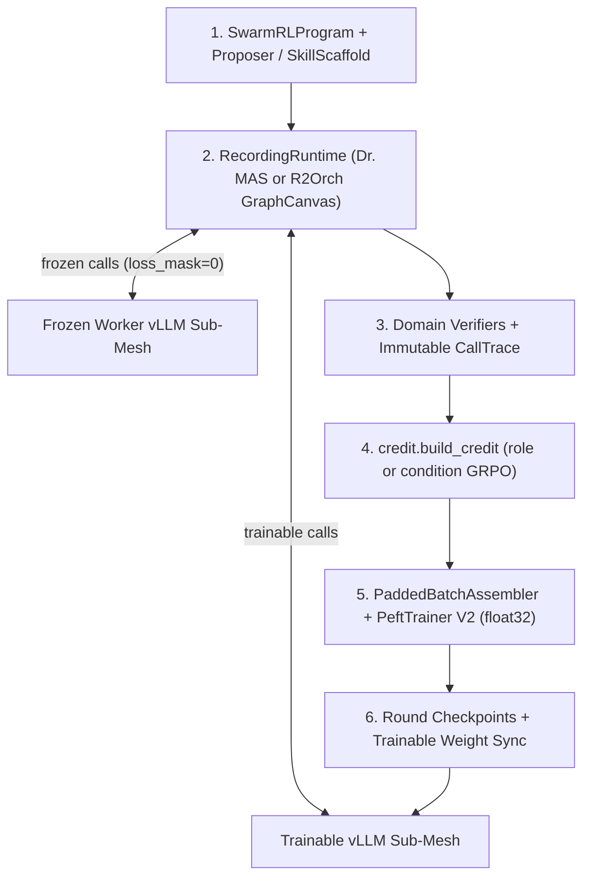

# Tunix Swarm Training: Lead Review One-Pager

**Status as of November 19, 2026.** Dr. MAS completed 500 training steps on 128 TPU v5p chips. R²Orch completed 100 Director steps on 32 chips and 100 full self-play cycles on 128 chips. The [Director and alternating RSI math example](../examples/r2orch_math/README.md) and [collective repair example](../examples/swarm_repair/README.md) have separate CPU training and recovery records.

[English quick overview](swarm_training_overview.md) · [Chinese quick overview](swarm_training_overview_zh.md) · [Formal system design](swarm_training_design.md) · [Validation record](swarm_training_validation.md)

**Decision & delivered scope.** `tunix/dist_rl` now provides reusable multi-agent execution, role-to-policy binding, and credit-assignment contracts (`tunix/dist_rl/swarm/` + `SwarmRLProgram`). The two TPU-tested recipes are: **Dr. MAS shared-policy math** ([`examples/swarm_math`](../examples/swarm_math/README.md)) and **R²Orch heterogeneous Graph Director + frozen Workers + recursive self-play** ([`examples/swarm_r2orch`](../examples/swarm_r2orch/README.md)). [Swarm-Repair](swarm_rlcr_design.md) remains the planned deadline-bounded parallel specialization.

**Verified TPU `v5p` results (`Qwen/Qwen3-4B`).**
1. **Dr. MAS (`SW1–SW2`, 128-chip `v5p-256`, 500 steps):** Shared `Solver → Verifier → Solver` reaches **`60.8 / 77.8` macro `avg@16 / pass@16`** (`60.7 / 77.7` decontaminated; `61.1 / 78.2` at Step 475) across all `1,547` Table 1 math problems, exceeding the published Dr. MAS baseline (`59.0 / 73.2`) by `+1.8 / +4.6` pp.
2. **R²Orch Inner-Loop (`SW3`, 32-chip `v5p`, 100 steps) & Full `R²Orch` (`4x4x8` = 128 chips, 100 cycles):** Trainable `GraphDirectorWorkflow` over frozen Workers (`frozen_worker_max_norm_drift == 0.0`) lifts 4-domain Heldout `avg@2 / pass@2` from `53.96 / 57.55` to **`58.39 / 64.06`**, Locked Test IID to **`47.03 / 48.79`**, and OOD `MATH-Hard` by **`+6.64 / +10.16` pp** while cutting Worker cost `13–23%`. Full `R²Orch` adds `ProposerRuntime` (`ADS+TSDS` + `arms_bell_reward` + pairwise RL+KL), Bayesian `SkillScaffold` withdrawal/admission/audit, and frozen-base `PatsOuterReviewer` distillation under strict zero-skill evaluation.

**System boundary.** Reuse existing `tunix/dist_rl` sampling, `PeftTrainer`, checkpointing, and weight sync:

The numbered path is one training round. Sampling runs over isolated role sub-meshes; immutable `CallTrace` records feed detached credit assignment, and the next round starts only after checkpoint/weight-sync completion (skipping optimizer steps on all-zero-signal rounds).

- **Execution.** `RecordingRuntime` serves the Solver–Verifier and Graph Director workflows. Users can implement new workflows with `SwarmSpec` and use `CollectiveRuntime` for dynamic membership and workspaces.
- **Policy binding.** Roles can share a policy or route to a trainable Director and frozen Workers. `RecordingRuntime.from_bindings` supports both in the TPU recipes. The alternating RSI example commits Director and Proposer state together.
- **Learning.** Immutable call traces retain the actual model context, token IDs, ownership and behavior logprobs. Credit functions select trainable actions and apply the recipe's normalization and reduction. The Dr. MAS TPU profile uses `microbatch_token_mean`, `sampler_is="token"` and float32 reference attention.

**Delivery and acceptance status.**

| **Gate** | **Deliverable** | **Status & Evidence** |
| --- | --- | --- |
| 1 — Correctness | Shared/heterogeneous runtime, `CallTrace`, Dr. MAS & episode credit | **Completed.** PyTorch oracle parity ≤ `2e-6`; `67/67` `tests/dist_rl/swarm` tests green |
| 2 — First result | Pinned `Qwen3-4B` Dr. MAS math reproduction (`SW2`) | **Completed.** `60.8 / 77.8` Table 1 `avg@16 / pass@16` (`1,547 × 16`) vs paper `59.0 / 73.2` |
| 3 — Generality | Trainable `R²Orch` Director + frozen Workers (`SW3`) & Full `R²Orch` self-play | **SW3 TPU-verified (`drift == 0.0`, IID/OOD gains); Full `R²Orch` completed 100 cycles on 128 `v5p` chips** |
| 4 — Parallel swarm | Avalon-inspired Swarm-Repair & remote RPC `swarm_collector` | **CPU fixture verified.** Remote transport and physical-deadline prefix abort remain pending |

**Key lessons & controls.** SplashAttention on TPU `v5p` corrupts backward gradients below layer 15 (cosine `0.155`); `float32` XLA reference attention + `sampler_is="token"` + `microbatch_token_mean` (`rows=4`) are mandatory for stable multi-turn learning. All `R²Orch` evaluations enforce zero-skill deployment (`skill_context=""`) and zero gold-answer leakage into PATS distillation.
