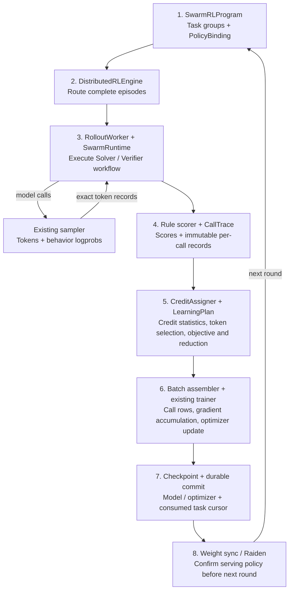

# Tunix Swarm Training: Lead Review One-Pager

**Status:** proposal; implementation and training results pending. **Updated:** November 10, 2026.

[English quick overview](swarm_training_overview.md) · [Chinese quick overview](swarm_training_overview_zh.md) · [Formal system design](swarm_training_design.md)

**Proposed decision.** Extend `tunix/dist_rl` with reusable multi-agent execution and learning contracts. Deliver **Dr. MAS shared-policy math** as the first reproducible recipe, then extend to Avalon-style dynamic parallel teams. The [formal system design](swarm_training_design.md) defines the common contracts and first recipe; [Swarm-Repair](swarm_rlcr_design.md) is the later parallel specialization.

**First result.** Train one shared **Qwen3-4B** as two logical roles: **Solver → Verifier → Solver if rejected**, with at most three model calls. An external rule-based verifier scores the final answer. Start from the [official Dr. MAS recipe][drmas-script]: K=8 independent team episodes per problem, learning rate `1e-6`, thinking disabled, and shared parameters explicitly enabled. Pin model, data, prompts, and source revisions. This establishes conditional multi-agent learning; dynamic parallelism and latency improvements require later experiments.

Dr. MAS provides public training/evaluation code and supports model sharing. Its reported shared-4B run uses approximately **4×H100 for 35 hours**. Measure Tunix memory and throughput before setting its resource budget. [Source][drmas]

**System boundary.** Reuse the existing distributed execution, model training, checkpoint, and weight-sync infrastructure:

The numbered path is one training round. Sampling is a runtime service; scoring and call traces feed learning, and the next round starts only after durable commit and weight-sync acknowledgment. Fully zero-signal rounds reuse the prior checkpoint and commit only data consumption, as shown in the formal flowchart.

- **Execution:** `SwarmProgram` defines roles and conditional/asynchronous control flow; `SwarmRuntime` supplies model/tool calls, lifecycle, and budgets. Fixed workflows and dynamic teams share these contracts.
- **Policy binding:** separate agent instance, semantic role, and parameter identity. V0 has one shared trainable policy. Frozen workers and independently trained policies are separate extensions; the latter require policy version/checkpoint bundles.
- **Learning:** immutable call traces preserve actual visible contexts, token IDs, behavior logprobs, policy versions, and action ownership. `CreditAssigner` and `LearningPlan` specify comparison groups, reward statistics, loss masks, and reduction; the trainer does not interpret communication topology.

**Tunix changes.** Add collector selection to `RolloutManager` and a `SwarmRLProgram` that expands one episode into multiple call payloads. Reuse existing padded batching and trainer machinery, extending payloads where required. Current engine versioning and synchronization assume one trainable policy; heterogeneous co-training requires explicit routing, per-policy versions, and checkpoint bundles. Reference [MARTI][marti] for workflow separation and [Agent Lightning][lightning] for harness integration.

**Delivery and acceptance.**

| Gate | Deliverable | Required evidence |
| --- | --- | --- |
| 1 — Correctness | Shared-policy conditional workflow and Dr. MAS adapter | Reference-aligned advantages/loss/gradients; exact token ownership; real rollout → train → sync → resume |
| 2 — First result | Pinned math train/eval recipe and saved artifacts | Held-out avg@16/pass@16 and cost: untrained teams at initialization, global-normalization RL, Dr. MAS, and single-agent RL |
| 3 — Generality | Trainable orchestrator with frozen workers | Change bindings and workflow without rewriting the trainer; verify frozen parameters stay unchanged |
| 4 — Parallel swarm | Avalon-inspired Swarm-Repair | Dynamic membership, workspace, anytime scoring, deadline cancellation preserving token prefixes; quality/latency evaluation at matched budgets |

**Main risks and controls.** Dr. MAS normalizes over active calls grouped by task and role; porting only role labels into existing Team-GRPO changes the algorithm. Match the [reference statistics][drmas-algo] and loss reduction numerically: the global baseline averages calls per episode, whereas role normalization counts active calls. Conditional missing roles are not zero-reward samples. Episode/call/token weighting remains explicit in the learning plan. Reserve development data separately from final benchmarks. Compare matched token budgets, report latency/cost and uncertainty across seeds, and retain unsuccessful results. Improved quality or stability is an experimental outcome, not an acceptance assumption.

**Deferred scope.** Multiple independently trained policies, counterfactual environment forks, swarm OPD, and RSI curricula follow the first result. Deadline/workspace semantics belong to the Avalon recipe; task generation and skill evolution belong to an outer curriculum controller.

[drmas]: https://github.com/langfengQ/DrMAS
[drmas-script]: https://github.com/langfengQ/DrMAS/blob/master/examples/drmas_trainer/run_math.sh
[drmas-algo]: https://github.com/langfengQ/DrMAS/blob/master/verl/trainer/ppo/core_algos.py
[marti]: https://github.com/TsinghuaC3I/MARTI
[lightning]: https://github.com/microsoft/agent-lightning/blob/main/docs/05-basics.md
