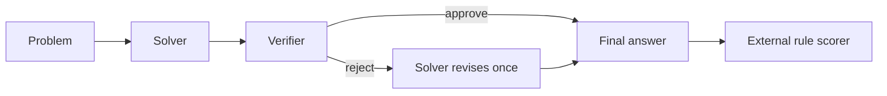
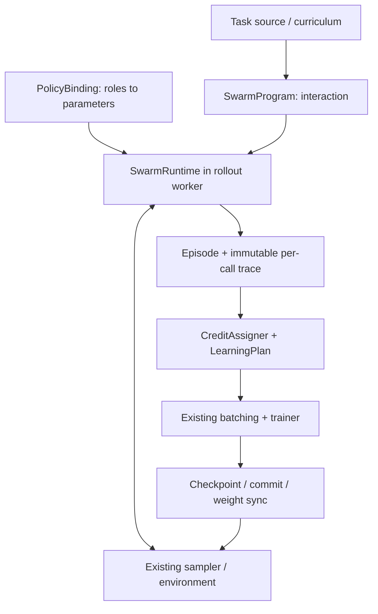
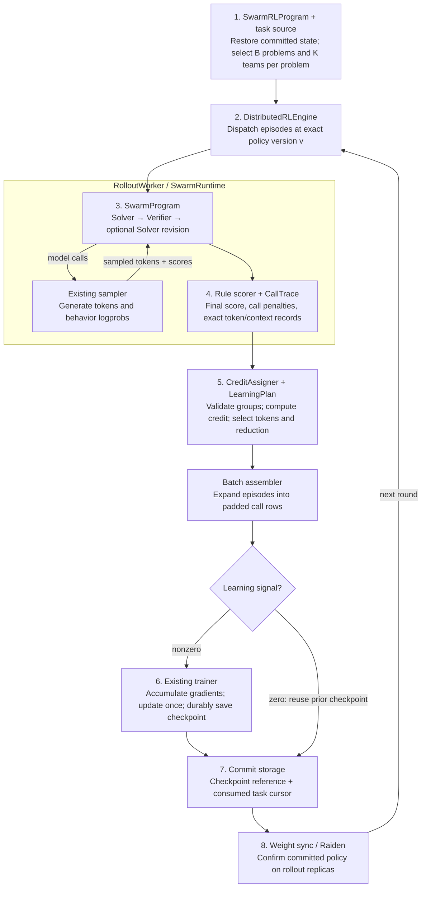

# Tunix Swarm Training: English Quick Overview

**Status:** proposal; implementation and training results pending. **Updated:** November 10, 2026.

[Chinese overview](swarm_training_overview_zh.md) · [Lead one-pager](swarm_training_onepager.md) · [Formal system design](swarm_training_design.md)

## Goal and First Result

Extend `tunix/dist_rl` with reusable multi-agent execution and learning contracts. First deliver **Dr. MAS shared-policy math**: two logical roles use one Qwen3-4B checkpoint, and an external rule-based scorer evaluates the final answer. Then validate a different binding with trainable orchestration and frozen workers, before adding Avalon-style dynamic parallel Swarm-Repair.

The formal design defines the common contracts. The [Swarm-Repair specification](swarm_rlcr_design.md) defines an advanced recipe; its workspace, dynamic membership, deadlines, and fixed team-capacity reduction are optional specializations.

Reference starting values: shared Qwen3-4B, K=8 independent team episodes per problem, learning rate `1e-6`, thinking disabled, no extra KL/entropy. The source workflow has at most three calls; its last Solver call skips another Verifier. Explicitly enable model sharing, since the public script defaults to separate models. Pin source/model/data/template identities and measure Tunix deployment settings before launch. [Source script](https://github.com/langfengQ/DrMAS/blob/master/examples/drmas_trainer/run_math.sh)

This first result validates conditional multi-agent training. Dynamic parallelism and latency gains require the later recipe's own experiments.

## Common System

| Contract | Responsibility |
| --- | --- |
| `SwarmProgram` | Conditional, sequential, concurrent, or dynamic interaction; static DAG is one frontend |
| `SwarmRuntime` | Model/tool calls, optional messages/membership, budgets, cancellation, lifecycle |
| `PolicyBinding` | Separate member `agent_id`, semantic `role_id`, and parameter `policy_id`; choose sharing and training scope |
| `SwarmEpisode / CallTrace` | Exact actor-visible contexts, sampled tokens/logprobs, ownership, policy versions, causal events and outcomes |
| `CreditAssigner` | Explicit comparison sets, reward aggregation, statistical unit and normalization scope |
| `LearningPlan` | Select calls/policies/objectives and loss reduction, then construct existing trainer payloads |

One rollout owner initially owns a whole episode. The control plane dispatches teams; agent scheduling stays local. The initial engine supports one shared trainable policy. Independent co-training later requires actual per-policy routing, versioning, optimizer ownership, synchronization and checkpoint bundles.

Do not merge private histories into a synthetic global conversation. Received messages, tool outputs, and repeated context have zero direct action loss in the receiving call. Frozen-agent calls stay in the trace while contributing no optimizer payload for that policy. Teacher-only context remains separate from the student's actual observations.

## End-to-End Flow

Restore exact committed model/optimizer/cursor identities. Separate collection round, optimizer step and policy version. A fully zero-signal round consumes data without executing an optimizer step. Unknown update outcomes require rollback to the committed state. Retry infrastructure failures with bounded fresh attempts; retain wrong answers and normal conditional termination as valid outcomes.

## Learning and Evaluation

Dr. MAS uses per-task/per-role statistics over active calls. A repeated Solver invocation contributes another observation. The reference global baseline first averages call rewards per episode. Porting only role labels into Tunix's default GRPO grouping would change the algorithm. Match reward penalties, std/epsilon conventions, masks, and loss reduction to a pinned [reference](https://github.com/langfengQ/DrMAS/blob/master/verl/trainer/ppo/core_algos.py).

Reserve development data from training and lock the final test set. Do not copy the source script's benchmark-derived validation subset for checkpoint selection. Compare initial untrained teams, global-normalization RL, Dr. MAS RL, and matched-budget single-agent RL. Report avg@16/pass@16, cost, latency, correction/regression rates, failures, and uncertainty across seeds. Each evaluation sample is a complete team episode. Improved performance is an outcome to measure.

## Delivery Order

| Gate | Deliverable and acceptance |
| --- | --- |
| 1. Correctness | Conditional shared-policy runtime; reference-aligned credit/loss/gradients; exact token ownership and microbatch equivalence |
| 2. First result | Two real accelerator rounds, sync and restore; complete math recipe and held-out controls |
| 3. Generality | Trainable orchestrator with frozen workers using the same runtime/trainer; verify update selection |
| 4. Parallel swarm | Avalon-inspired Swarm-Repair: dynamic members, messages/workspace, anytime score, physical deadlines and prefix-preserving abort |
| 5. Extensions | Independent policies, role OPD, counterfactual forks, and outer RSI curricula with separate acceptance |

Reuse `ClusterOrchestrator`, workers, sampler, trainer, Raiden and checkpoint foundations. Add collector selection, typed episode transport, a sibling `SwarmRLProgram` for one-to-many call expansion, and explicit learning/reduction contracts. Follow [MARTI](https://github.com/TsinghuaC3I/MARTI) and [Agent Lightning](https://github.com/microsoft/agent-lightning/blob/main/docs/05-basics.md) for workflow and harness separation. Implementation details and remaining deployment measurements are in the [formal design](swarm_training_design.md).
