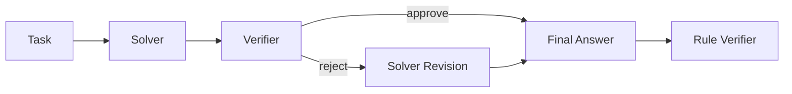
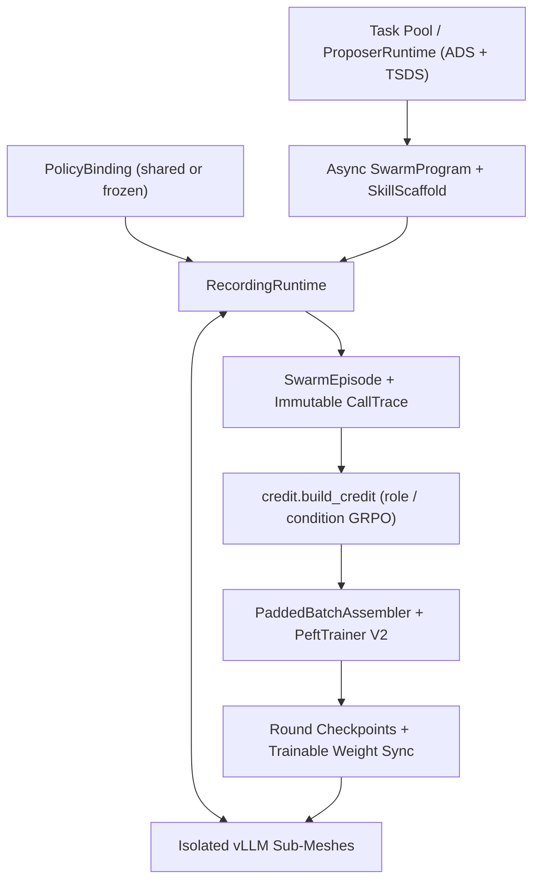

# Tunix Swarm Training: English Quick Overview

**Status as of November 19, 2026.** The TPU validation record covers Dr. MAS and both phases of R²Orch graph training. The [Director and alternating RSI math example](../examples/r2orch_math/README.md) and [collective repair with CISPO](../examples/swarm_repair/README.md) have separate CPU validation records. Custom workflows use `SwarmSpec` or, for dynamic teams, `CollectiveRuntime`.

[Chinese overview](swarm_training_overview_zh.md) · [Lead one-pager](swarm_training_onepager.md) · [Formal system design](swarm_training_design.md) · [Validation record](swarm_training_validation.md)

## Goal and Delivered Recipes

`tunix/dist_rl/swarm/` and `SwarmRLProgram` provide reusable multi-agent execution, role-to-policy binding, and detached GRPO credit on top of Tunix's native sampler and `PeftTrainer`. Two end-to-end `Qwen/Qwen3-4B` recipes are delivered on `origin/haoyu-next`:
1. **Dr. MAS Shared-Policy Math ([`examples/swarm_math`](../examples/swarm_math/README.md), `SW1–SW2`):** `Solver → Verifier → optional Solver` sharing one trainable `Qwen3-4B`, reaching **`60.8 / 77.8` macro `avg@16 / pass@16`** (`60.7 / 77.7` decontaminated; Step 475 `61.1 / 78.2`) across all `1,547` Table 1 problems on TPU `v5p-256` (surpassing paper `59.0 / 73.2`).
2. **R²Orch Graph Orchestration & Recursive Self-Play ([`examples/swarm_r2orch`](../examples/swarm_r2orch/README.md), `SW3` + Full `R²Orch`):** Trainable `GraphDirectorWorkflow` mutating a layered DAG + same-layer peer `GraphCanvas` over frozen Workers (`frozen_worker_max_norm_drift == 0.0`, `SW3` lifting Heldout to `58.39 / 64.06`, Test IID to `47.03 / 48.79`, and OOD `MATH-Hard` by `+6.64 / +10.16` pp), extended in Full `R²Orch` with `ProposerRuntime` (`ADS+TSDS` + `arms_bell_reward` + pairwise RL+KL), Bayesian `SkillScaffold` skill withdrawal/admission/audit, and frozen-base `PatsOuterReviewer` distillation under zero-skill deployment.

The [Swarm-Repair specification](swarm_rlcr_design.md) defines the subsequent deadline-bounded dynamic workspace specialization.

## Common System

| **Contract** | **Implemented Responsibility (`tunix/dist_rl/swarm/`)** |
| --- | --- |
| Async workflow (`SwarmProgram`) | Conditional pipelines (`SolverVerifierWorkflow`) or multi-round DAG/peer builders (`GraphDirectorWorkflow` + `GraphCanvas`) |
| `RecordingRuntime` | Role-routed sampling (`from_bindings`), concurrency-safe `call_id` / seed reservation, token provenance checks |
| `PolicyBinding` | Separates semantic `role` from `policy_id`, `policy_version`, `sampler`, `encode`, and `trainable: bool` |
| `SwarmEpisode / CallTrace` | Immutable prompt/completion token IDs, behavior logprobs, binary or frozen all-zero `loss_mask`, `valid_action` |
| `credit.build_credit` | Filters `c.trainable` calls; computes `(task, role)` active-call or `float64`-accumulated `(task, condition)` episode advantages |
| `SwarmRLProgram` | Supports fixed `group_size` or `allow_variable_group_sizes`, `microbatch_token_mean`, `sampler_is="token"`, zero-signal skip, `restore_state` |

Private agent contexts are never merged into synthetic global transcripts: upstream outputs enter downstream prompts with zero direct action loss, and frozen Worker calls (`trainable=False`) remain in `SwarmEpisode.calls` for cost/topology telemetry without generating trainer payloads.

## End-to-End Flow

Each round restores or advances exact committed state across Director, Proposer, and `SkillScaffold`/`ADS`/`PATS` metadata, skips optimizer steps on zero-variance rounds, updates trainable meshes only, and verifies `frozen_worker_max_norm_drift == 0.0`.

## Learning, TPU Stability, and Evaluation

On TPU `v5p`, `dtype="float32"` with XLA reference attention (`use_flash_attention=False`), `sampler_is="token"`, and `loss_reduction="microbatch_token_mean"` (`rows=4`) prevent SplashAttention backward corruption below layer 15 and match upstream `verl` microbatch weighting. All `R²Orch` benchmarks (`Heldout 126`, `Locked Test IID 414`, `Locked Test OOD 256`) evaluate under strict zero-skill deployment (`skill_context=""`).

## Delivery Order

| **Gate** | **Deliverable and Status** |
| --- | --- |
| 1. Correctness | **Completed.** Reference-aligned credit/loss/gradients (`≤ 2e-6`); `67/67` unit & CPU integration tests passing |
| 2. First result (`SW2`) | **Completed.** 500-step `Qwen3-4B` Dr. MAS TPU reproduction (`60.8 / 77.8` on 1,547 Table 1 problems) |
| 3. Generality (`SW3` + Full `R²Orch`) | **SW3 TPU-verified (`drift == 0.0`); Full `R²Orch` (Proposer + Skill Withdrawal + PATS) completed 100 cycles on 128 `v5p` chips** |
| 4. Parallel swarm | **CPU fixture verified.** Distributed workspace and remote prefix-preserving abort remain pending |
| 5. Extensions | **Planned.** Remote RPC `swarm_collector`, swarm OPD, and counterfactual environment forks |

Full details and benchmark tables are in the [formal system design](swarm_training_design.md).
