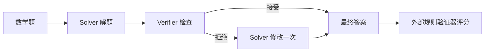
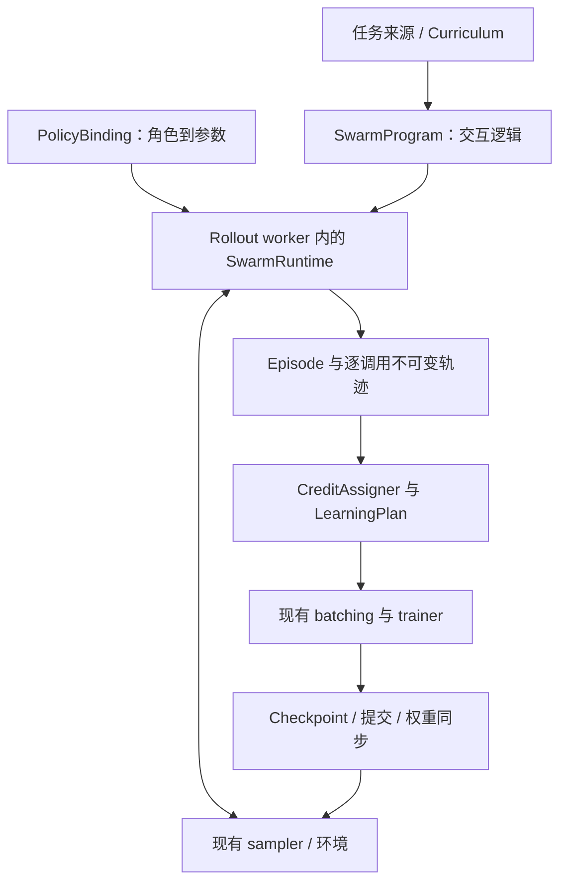
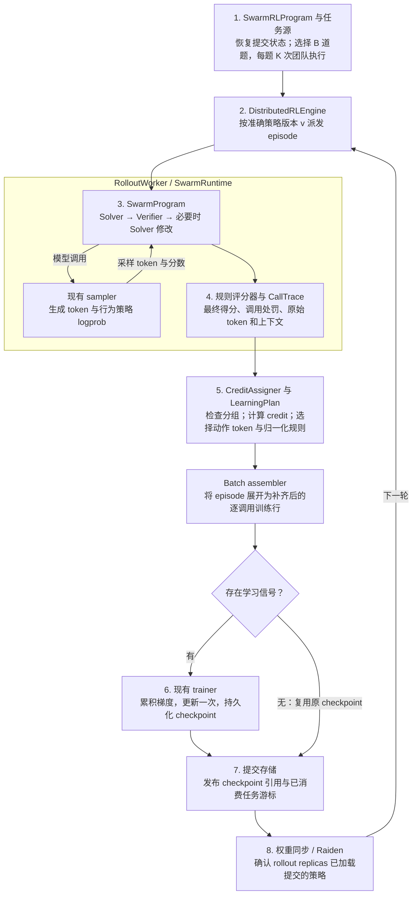

# Tunix Swarm 训练：内部速览

**状态：**共享模型的本机实现与 CPU 验证已完成；分布式 transport 与预训练 Qwen3-4B 实验待验收。**更新日期：**2026 年 11 月 11 日。

代码放在 `dist_rl/swarm/`，训练调度用同级的 `SwarmRLProgram`，数学任务的 prompt、判题、数据和配置放在 `examples/swarm_math/`。已对照原作验证数值，并跑通真实优化器的两轮训练，也覆盖了随机小型 Qwen3 Transformer 的原生采样与训练。下方组件图仍描述完整分布式目标。[运行说明](../examples/swarm_math/README.md) · [验证记录](swarm_training_validation.md)。

[英文速览](swarm_training_overview.md) · [Lead review one-pager](swarm_training_onepager.md) · [正式系统设计（英文）](swarm_training_design.md)

## 目标与首个结果

在 `tunix/dist_rl` 上补齐可复用的多 Agent 执行与学习契约。首先完成 **Dr. MAS 共享模型数学 recipe**：Solver 和 Verifier 使用同一个 Qwen3-4B，最终答案由外部规则验证器评分。随后用“只训练 orchestrator、冻结 workers”检验框架通用性，再扩展 Avalon 风格的动态并行 Swarm-Repair。

正式系统设计定义通用契约；[Swarm-Repair 专项设计](swarm_rlcr_design.md)定义后续 recipe。共享文件系统、动态成员、物理截止时间和固定团队容量分母都属于该 recipe，不是所有 swarm 的前提。

参考初值：共享 Qwen3-4B；每题 K=8 次独立团队执行；学习率 `1e-6`；关闭 thinking；不加额外 KL/entropy。原流程最多三次模型调用，最后一次 Solver 后不再调用 Verifier。公开脚本默认不共享模型，需要显式启用其支持的共享模式。固定代码、模型、数据和模板版本，再实测 Tunix 的硬件配置。[参考脚本](https://github.com/langfengQ/DrMAS/blob/master/examples/drmas_trainer/run_math.sh)

首个结果验证条件式多 Agent 学习。动态并行与延迟收益由后续 recipe 单独验收。

## 通用系统

| 契约 | 职责 |
| --- | --- |
| `SwarmProgram` | 表达条件、顺序、并发与动态交互；固定 DAG 只是其中一种写法 |
| `SwarmRuntime` | 模型与工具调用、可选消息和成员管理、预算、取消、生命周期 |
| `PolicyBinding` | 区分成员 `agent_id`、语义角色 `role_id`、参数 `policy_id`；声明共享关系与训练范围 |
| `SwarmEpisode / CallTrace` | 保存真实可见上下文、采样 token/logprob、动作归属、策略版本、因果关系和结果 |
| `CreditAssigner` | 明确比较组、奖励聚合、统计单位与归一化范围 |
| `LearningPlan` | 选择训练调用、policy、目标和 loss 分母，再生成现有 trainer 的输入 |

初期一个 rollout owner 管理完整 episode，控制平面派发团队，Agent 调度留在本地。V0 使用一个共享可训练 policy。多个独立模型联合训练后续需要真正补齐按 policy 路由、版本、optimizer、同步和 checkpoint 集合。

不能把私人历史拼成无人真正看到的全局对话。收到的消息、工具输出和重复历史在接收方调用中不产生直接动作 loss。冻结 Agent 的调用保留在轨迹中，但不为其 policy 生成更新。Teacher 专属反馈也不能改写学生原本看到的上下文。

## 一轮端到端流程

恢复时使用准确配对的模型、optimizer 和任务游标。区分 collection round、optimizer step 与 policy version。全轮学习信号为零时，只提交数据消费，不执行 optimizer。更新结果不明时恢复已提交状态。基础设施故障使用新 attempt 有限重试；答错与正常条件终止属于有效策略结果。

## 学习与评估

Dr. MAS 按任务和角色，对活跃调用的奖励计算统计量；同一 Solver 再调用一次，就再贡献一个观测。原 global baseline 则先对 episode 内调用奖励求均值。仅给现有 GRPO 分组加 role 字段不能保证算法一致。需要对齐奖励处罚、标准差、epsilon、mask 和 loss reduction。[参考实现](https://github.com/langfengQ/DrMAS/blob/master/verl/trainer/ppo/core_algos.py)

从训练数据单独留开发集，锁定最终测试集，不照抄原脚本中来自 benchmark 的验证子集用于选 checkpoint。对照初始未训练团队、global normalization RL、Dr. MAS RL，以及相同预算单 Agent RL。报告 avg@16/pass@16、成本、耗时、改对/改错率、失败率与多 seed 不确定性。一次评估采样指完整团队执行。质量和稳定性是否提高，需要实验回答。

## 实现顺序

| 阶段 | 交付与验收 |
| --- | --- |
| 1. 正确性 | 共享模型条件式 runtime；对齐参考 credit/loss/梯度；验证 token 归属与 microbatch 等价 |
| 2. 首个结果 | 两轮真实加速器训练、同步和恢复；完整数学 recipe 与独立测试对照 |
| 3. 通用性 | 同一 runtime/trainer 接入可训练 orchestrator 与冻结 workers；验证更新范围 |
| 4. 并行 swarm | Avalon 风格 Swarm-Repair：动态成员、消息/工作区、anytime 评分、物理截止与保留前缀的取消 |
| 5. 扩展 | 独立 policies、角色 OPD、反事实分支、外层 RSI curriculum，各自验收 |

复用 `ClusterOrchestrator`、workers、sampler、trainer、Raiden 和 checkpoint 基础。新增 collector 选择、带类型的 episode 传输、支持一对多调用展开的 `SwarmRLProgram`、明确的学习与归一化契约。系统分层参考 [MARTI](https://github.com/TsinghuaC3I/MARTI) 和 [Agent Lightning](https://github.com/microsoft/agent-lightning/blob/main/docs/05-basics.md)。详细接口与待实测项见[正式设计](swarm_training_design.md)。
