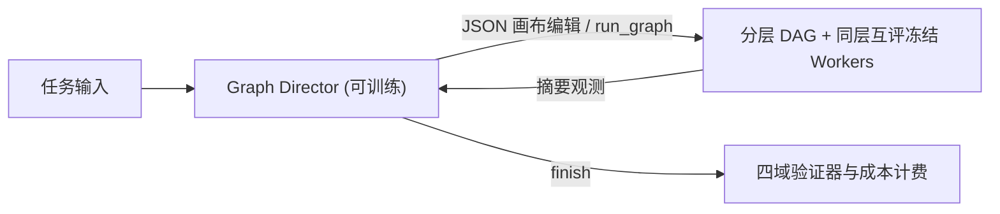
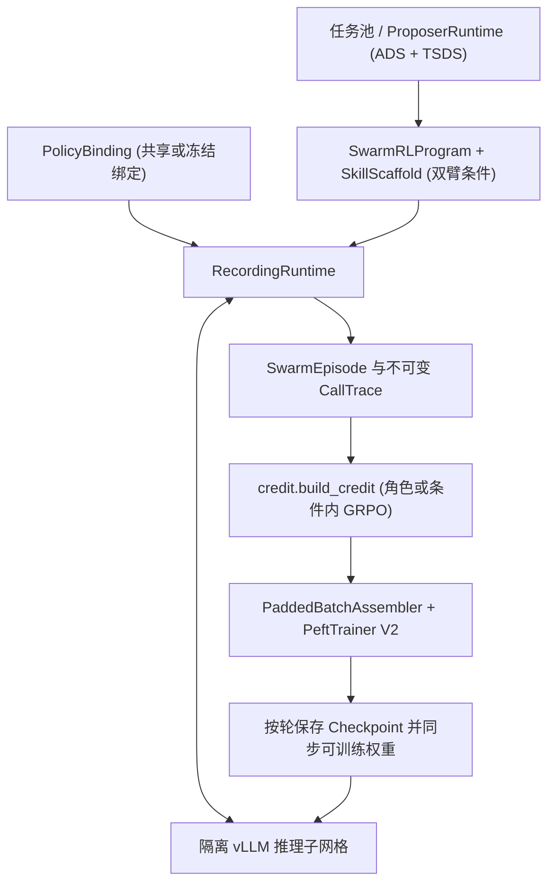

# Tunix Swarm 训练：内部速览

**更新于 2026 年 11 月 19 日。** TPU v5p 验证记录覆盖 Dr. MAS、R²Orch 图编排和完整双时间尺度自博弈。[Director 与交替 RSI 数学示例](../examples/r2orch_math/README.md)及 [CISPO 协作修复示例](../examples/swarm_repair/README.md)另有独立的 CPU 训练和恢复记录。自定义异步流程可使用 `SwarmSpec`，动态成员和共享工作区可使用 `CollectiveRuntime`。

[英文速览](swarm_training_overview.md) · [Lead review one-pager](swarm_training_onepager.md) · [正式系统设计（英文）](swarm_training_design.md) · [验证记录](swarm_training_validation.md)

## 目标与已交付成果

在 `tunix/dist_rl/swarm/` 与同级 `SwarmRLProgram` 上构建统一的多 Agent 采样、异构角色绑定与归因学习契约，目前已在 `origin/haoyu-next` 交付两套完整 `Qwen/Qwen3-4B` recipe：
1. **Dr. MAS 共享模型数学协作（[`examples/swarm_math`](../examples/swarm_math/README.md)，`SW1–SW2`）：**`Solver → Verifier → 必要时 Solver 修订` 共享同一 `Qwen3-4B` 策略，在 TPU `v5p-256` 训练 500 步后于论文 Table 1 全部 `1,547` 道题上取得 **`60.8 / 77.8` 宏平均 `avg@16 / pass@16`**（去污染 `60.7 / 77.7`，Step 475 达 `61.1 / 78.2`），全面超越原论文共享模型基线（`59.0 / 73.2`）。
2. **R²Orch 异构图编排与递归自博弈（[`examples/swarm_r2orch`](../examples/swarm_r2orch/README.md)，`SW3` + `Full R²Orch`）：**可训练 `GraphDirectorWorkflow` 在分层 DAG + 同层互评 `GraphCanvas` 上调度冻结的 `Qwen3-4B` Worker（全程 `frozen_worker_max_norm_drift == 0.0`）。`SW3` 100 步训练使四域 Heldout `avg@2 / pass@2` 由 `53.96 / 57.55` 升至 **`58.39 / 64.06`**，Locked Test IID 升至 **`47.03 / 48.79`**，OOD `MATH-Hard` 跃升 **`+6.64 / +10.16` pp**，同时降低 `13–23%` Worker 开销。完整版 `R²Orch` 进一步集成 `ProposerRuntime`（`ADS+TSDS` 候选表 + `arms_bell_reward` 递归可学性奖励 + `train_mesh` 成对策略梯度与参考 KL 更新）、贝叶斯自举 `SkillScaffold`（技能内化撤回、准入与审计恢复）及基于冻结底座的 `PatsOuterReviewer` 零泄漏技能蒸馏，并在全部评测集上严格执行**零技能卡部署**（`skill_context=""`）。

[Swarm-Repair 专项设计](swarm_rlcr_design.md)定义后续带物理截止时间与共享工作区的动态并行特化版本。

## 通用系统

| **契约模块** | **已实现职责（`tunix/dist_rl/swarm/`）** |
| --- | --- |
| 异步工作流（`SwarmProgram`） | 支持条件流水线（`SolverVerifierWorkflow`）与动态分层 DAG / 同层 `consider_relation` 互评波次（`GraphCanvas`） |
| `RecordingRuntime` | 基于 `from_bindings` 按角色路由采样器，并发预留唯一 `call_id` 与确定性随机种子，校验未填充 token 归属 |
| `PolicyBinding` | 解耦语义 `role`、`policy_id`、`policy_version` 与 `trainable: bool`（统一支持共享策略与冻结 Worker） |
| `SwarmEpisode / CallTrace` | 不可变保存真实可见 `prompt_ids`、`completion_ids`、行为 `logprobs` 与 `loss_mask`（冻结调用强制全 0 掩码） |
| `credit.build_credit` | 自动过滤 `c.trainable` 调用，支持 `(task, role)` 活跃调用归一化与 `float64` 累加的 `(task, condition)` 分组优势 |
| `SwarmRLProgram` | 支持固定 `group_size` 或非对称条件分组（`allow_variable_group_sizes`）、`microbatch_token_mean`、`sampler_is="token"`、零信号跳步与 `restore_state` |

系统严禁拼接无人真正观察到的全局合成对话：上游输出仅作为下游 `prompt_ids` 输入（直接动作 loss 为 0）；冻结 Worker 调用保留在轨迹中用于成本与拓扑统计，绝不进入优化器 payload。

## 一轮端到端流程

每轮支持对 Director、Proposer 以及 `SkillScaffold`/`ADS`/`PATS` 状态字典按轮保存与恢复。双模型分别写入时的中断恢复仍需单独验证。全轮零方差时只推进轮次，避免触发权重衰减。每次发布后仅同步可训练 mesh 并在线强校验 `frozen_worker_max_norm_drift == 0.0`。

## 学习稳定性与评估关键结论

TPU `v5p` 诊断实验证实 SplashAttention 反向传播在第 15 层以下会出现梯度方向崩坏（余弦仅 `0.155`），因此训练侧强制启用 `dtype="float32"` + XLA 参考注意力（`use_flash_attention=False`）+ `sampler_is="token"` 截断重要性权重 + `microbatch_token_mean`（`rows=4`）。所有评测均在锁定的开发/测试集及零技能卡条件下独立完成。

## 推进状态

| **阶段** | **交付内容与当前状态** |
| --- | --- |
| 1. 数值与契约正确性 | **已完成。** 对齐上游 PyTorch 优势/损失/梯度（误差 `≤ 2e-6`），`tests/dist_rl/swarm` 共 `67/67` 单测与集成测试全绿 |
| 2. 首个完整结果（`SW2`） | **已完成。** `Qwen3-4B` Dr. MAS 500 步 TPU 复现，Table 1 `1,547` 题达 `60.8 / 77.8`（超越原论文 `59.0 / 73.2`） |
| 3. 异构编排与自博弈（`SW3` + `Full R²Orch`） | **`SW3` 已完成 TPU 验收（Worker 零漂移 + 四域 IID/OOD 提升）；完整版 `R²Orch`（Proposer + 技能撤回 + PATS）已通过 CPU 验证，并在 128 颗 `v5p` 上完成 100 个训练周期** |
| 4. 动态并行 Swarm | **本机 CISPO 示例已验证动态成员、共享工作区与结算。** 远程工作区和物理截止时保留前缀的流式取消仍待验收 |
| 5. 后续扩展 | **规划中。** 跨进程 RPC `swarm_collector`、Swarm OPD 及反事实分支恢复 |

完整接口契约与实验数据见[正式系统设计](swarm_training_design.md)。
