# Swarms in Tunix: System Design, Architecture Options, Recipes & Validation

| **Item** | **Summary** |
| --- | --- |
| **Goal** | Unified, recipe-agnostic **Multi-Agent / Swarm RL** layer in `tunix/dist_rl` supporting shared-policy collaboration (`Dr. MAS`), heterogeneous DAG orchestration over frozen workers + recursive self-play (`R²Orch`), and deadline-bounded parallel workspaces (`Swarm-Repair`). |
| **Codebase** | [`google/tunix` (`haoyu-next`)](https://github.com/google/tunix/tree/haoyu-next) — [`tunix/dist_rl/swarm/`](https://github.com/google/tunix/tree/haoyu-next/tunix/dist_rl/swarm), [`tunix/dist_rl/orchestrator/swarm_program.py`](https://github.com/google/tunix/blob/haoyu-next/tunix/dist_rl/orchestrator/swarm_program.py), [`tunix/models/qwen3p5/`](https://github.com/google/tunix/tree/haoyu-next/tunix/models/qwen3p5), [`examples/swarm_math/`](https://github.com/google/tunix/tree/haoyu-next/examples/swarm_math), [`examples/swarm_r2orch/`](https://github.com/google/tunix/tree/haoyu-next/examples/swarm_r2orch) |
| **Telemetry** | [`wandb.ai/linchai-google/tunix-swarm`](https://wandb.ai/linchai-google/tunix-swarm) |
| **Primary Google Doc** | [Swarms in Tunix (`System Design`)](https://docs.google.com/document/d/1UekqXb6KAz1lynXvkAmd_lJFHDFdIUFK6PX4revAK0Q/edit?tab=t.0) |

## Master Table of Contents

This consolidated handbook combines the primary **Swarms in Tunix** system design document with every referenced architecture, numerical validation, recipe design, and TPU reproduction/debug sub-document in full:

| **Part** | **In-Document Section** | **Scope** | **Source Google Doc** |
| --- | --- | --- | --- |
| **Part I** | [Swarms in Tunix System Design, Options, and Progress](#part-i-swarms-in-tunix-system-design-options-and-progress) | 1:1 vs. 1-to-M motivation, Trunk Design Options (Option A vs. Option B + 4-seam code/diagram comparison & hybrid synthesis), Dev Map, Recipes Snapshot & Document Index | [Swarms in Tunix](https://docs.google.com/document/d/1UekqXb6KAz1lynXvkAmd_lJFHDFdIUFK6PX4revAK0Q/edit?tab=t.0) · [Overview & Dev Map](https://docs.google.com/document/d/1p12EQEfE4YTZdbSLHC9Wp3RAXbdXlXWbj4c4VJ-i8kg/edit) |
| **Part II** | [Distributed Swarm Training Core Codebase Architecture](#part-ii-distributed-swarm-training-core-codebase-architecture) | Three orthogonal contracts (`RecordingRuntime`, `PolicyBinding`, `credit.build_credit`), layered architecture, 6-stage training loop, module map & TPU `v5p` invariants | [System Design](https://docs.google.com/document/d/15priSJuP3mr5Fy7chnj_bM1Z70WtuLYI7IKa_-qpULI/edit) |
| **Part III** | [Core System and TPU Numerical Validation](#part-iii-core-system-and-tpu-numerical-validation) | `67/67` unit + `768` regression tests, PyTorch `2e-6` parity matrix, 5 infra bug fixes, vLLM logprob fidelity & SplashAttention vs. `float32` backward gradient diagnosis | [Core Numerical Validation](https://docs.google.com/document/d/1aHpP0AzYrneFyjtXqPGtQP-IfHkd1oW_CXPojmLI4zI/edit?resourcekey=0-X5CK8HI50Mh4xAhpvLRqHw) |
| **Part IV** | [Recipe 1 (Dr. MAS) Detailed Design and Emergence Analysis](#part-iv-recipe-1-dr-mas-detailed-design-and-emergence-analysis) | Shared-policy conditional `Solver → Verifier → Solver` state machine, `(task, role)` credit math, 4-row `microbatch_token_mean`, and 3-phase collaboration emergence (`Steps 0 → 500`) | [Dr. MAS Detailed Design](https://docs.google.com/document/d/1eXioOC-_UMYMp6_pZ0IhGouu_cjDl1GLGOvnA0dE2-4/edit) |
| **Part V** | [Recipe 1 (Dr. MAS) Full TPU v5p-256 Reproduction and Debug Log](#part-v-recipe-1-dr-mas-full-tpu-v5p-256-reproduction-and-debug-log) | Complete chronological reproduction record across `Runs 1–5`, `sa1`/`sa2` single-agent controls, `D1–D16` root-cause trace analyses, and `1,547`-problem Paper Table 1 evaluation (`60.8 / 77.8`, peak `61.1 / 78.2`) | [Dr. MAS Repro & Debug Log](https://docs.google.com/document/d/1gqbQK6d9fHbtIYl-q7loHuyFr1saPMX2iAWZz0uUKPg/edit) |
| **Part VI** | [Recipe 2 (R2Orch) Detailed Design (SW3 and Full Self-Play)](#part-vi-recipe-2-r2orch-detailed-design-sw3-and-full-self-play) | Heterogeneous `GraphCanvas` DAG orchestration over frozen workers, Frontier `Proposer` (`ADS + TSDS`), Rubin Bayesian-bootstrap `SkillLedger`, zero-leakage `PATS`, and `Qwen3.5-9B` `4x4x8` TPU `z`-slab layout | [R²Orch Detailed Design](https://docs.google.com/document/d/1RZ8FgplKnJSImi1e5sDfoObtwHm-JCZYdaZxSAcxx0s/edit) |
| **Part VII** | [Recipe 2 (R2Orch) Reproduction, Live 128-Chip Telemetry, and Debug Log](#part-vii-recipe-2-r2orch-reproduction-live-128-chip-telemetry-and-debug-log) | Completed `Qwen3-4B` zero-skill benchmarks (`SW3` vs. `Full R²Orch`), live `Qwen3.5-9B` `v5p-128` progress (`Cycles 0 → 150 / 200`), and `D1–D17` systems/numerical debug log | [R²Orch Repro & Debug Log](https://docs.google.com/document/d/13ArlxPa-EXK5D53lM3oW9gHQjs48DmtkPGl4X8tGPUo/edit) |
| **Part VIII** | [Recipe 3 (Swarm-Repair) Dynamic Parallel Code-Repair Design](#part-viii-recipe-3-swarm-repair-dynamic-parallel-code-repair-design) | Dynamic `spawn_worker` / `retire_worker` lifecycle, versioned shared repository conflict rules, anytime scoring, physical deadline prefix abort, and fixed team-capacity reduction | [Swarm-Repair Design](https://docs.google.com/document/d/1k7uvoreL6ijFx-lix-E4eqYhS2p3FebaLq0jMjPwnpc/edit?resourcekey=0-7GYoT4yzhKvPD0O5PRHVIw) |

---

## Part I: Swarms in Tunix System Design, Options, and Progress

### 1. Motivation

Complex reasoning, heterogeneous orchestration, and repository-level coding tasks increasingly rely on **multi-agent swarms** (e.g., `Solver–Verifier` refinement in `Dr. MAS`, dynamic DAG planning over frozen specialists in `R²Orch`, and parallel worker fan-out in `PARL` / `Swarm-Repair`). However, single-agent `tunix/dist_rl` enforces a strict **`1:1` cardinality invariant**: one `RolloutRequest` runs one agent loop, emits one `TrajectoryItem`, and becomes one `RLTrainerPayload`. Supporting Swarm RL requires generalizing this pipeline to **`1-to-M` episode expansion**—where a single episode coordinates multiple agent roles or sessions and produces **`M` variable-count trainable sequences** (plus zero trainer rows for frozen helpers)—without modifying `PeftTrainer V2` or Raiden weight sync.

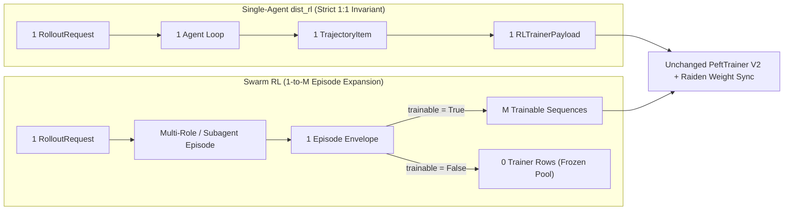

---

### 2. Design Options (Options 1–5)

This section evaluates **five trunk architectures** for landing Swarm RL in `tunix/dist_rl`—spanning our initial TPU prototype (**Option 1**), the single-learner envelope spec (**Option 2**), the `1 + 2` `StandardRLProgram` hybrid (**Option 3**), the 3-contract runtime & composable step spec (**Option 4**, `72abca164`), and our **converged, implemented, TPU-validated Three-Layer architecture (Option 5)**—followed by a 6-seam architectural comparison.

#### 2.1 Option 1: IoC Runtime + Parallel Orchestrator (`haoyu-next` Initial Prototype)

Option 1 prioritized **workflow expressiveness (Inversion of Control)** and **explicit policy routing** while leaving `StandardRLProgram` untouched:
1. **Control Plane (`SwarmRLProgram`):** Sibling orchestrator running synchronous group rounds with outer self-play hooks.
2. **Workflow API (`RecordingRuntime`):** Plain `async` Python (`await runtime.generate(role, prompt)`) recording exact tokens and logprobs.
3. **Sequence Unit (`CallTrace`):** One immutable sequence per LLM call (`O(T^2)` prefix recomputation on long tool loops).
4. **Policy Routing (`PolicyBinding`):** Explicit `(policy_id, sampler, trainable: bool)` supporting frozen workers on Day 1.

#### 2.2 Option 2: Envelope Pipeline + Framework Runners

Option 2 prioritized **One Well-Lit Single-Learner Pipeline** and **TITO merging**:
1. **Control Plane (`StandardRLProgram`):** Queues `1` Envelope `TrajectoryItem` per episode upstream (cardinality `G`) and expands `G -> M` at `ScoredGroup` with 2-level worker semaphores (`_episode_sem` + `_sampler_sem`).
2. **Workflow API (`EpisodeRunner` + `BaseTaskEnv`):** Framework-owned runner subclasses (`SingleAgent`, `Parl`, `MultiRole`) driving `env.step()` loops.
3. **Sequence Unit (`RoleTrajectory`):** Merges multi-turn prefixes per `role_id` (breaks when later rounds restructure prompts or parallel children share `role="worker"`).
4. **Policy Routing (Shared Pool First):** Phase 1 binds all roles to one active trainable pool `v_t` (`Role == Active Policy`).

#### 2.3 Option 3: Hybrid `StandardRLProgram` Trunk (Combining Option 1 + Option 2)

Option 3 grafted Option 1's runtime and policy abstractions onto Option 2's single-learner `StandardRLProgram` trunk:
1. Keeps `StandardRLProgram` (async `DispatchWindow`, `partial_rollout`, 2-level semaphores) as the fixed outer loop with step/epoch callback hooks (forcing 2nd learners like `R²Orch` Proposer into side-channel hooks with split commit boundaries).
2. Layers `SingleAgent` / `Parl` / `MultiRole` runner templates above `RecordingRuntime`.
3. Exposes an explicit user-managed `async with runtime.open_session(role)` API (`SessionTrajectory`) to separate append-only tool loops from restructured calls.
4. Adopts Day-1 `PolicyBinding(policy_id, sampler, trainable: bool)`.

#### 2.4 Option 4: Unified `EpisodeRuntime` + Composable `StepContext` (`72abca164`)

Option 4 ([`docs/unified_episode_runtime_design.md`](./unified_episode_runtime_design.md)) redesigned the public API around **three orthogonal contracts** (`Recipe(workflow, learners, bindings, grade, train_step)`):
1. **`StepContext` (`collect`, `grade`, `record`, multi-target `update`):** Expresses single-learner GRPO as a 1-line built-in while handling multi-learner, multi-objective cycles (`R²Orch` Proposer + Director + replayable `ADS`/`SkillLedger`/`PATS`) under one atomic conditional manifest.
2. **`EpisodeRuntime` (`generate`, `parallel`, `annotate`, `PublicEnvironment`):** Deterministic child lineage (`SubagentTrajectoryRef`), online `CriticalSteps` budgets, and strict `PublicEnvironment` vs. post-run private `grade()` isolation.
3. **Automatic Internal TITO Compaction:** Merges actions internally iff `(participant_id, served_snapshot, encoding, exact_prefix)` match—eliminating manual `open_session()` boilerplate.
4. **3-Way `Learner` / `Binding` / `Objective` Split:** Disjoint `Learner.full` / `Learner.lora`, `PolicyBinding.fixed` / `PolicyBinding.follow` (+ served-snapshot attestation), and `ObjectiveBatch(roles=...)`.

#### 2.5 Option 5 (Recommended & Implemented): Unified Three-Layer Swarm RL Architecture (`tunix/dist_rl/swarm/`)

**Why Option 5 Supersedes Standalone Option 4 and Option 3:** Option 4 resolved the public API and multi-learner orchestration seams, but left **two production-critical gaps** exposed directly on 128-chip TPU `v5p` runs: (a) cross-step async streaming (`DispatchWindow` / `partial_rollout` for `max_policy_lag > 0` single-learner recipes) was absent from standalone Option 4's pinned-bundle step, and (b) neither Option 3 nor Option 4 modeled **serving-vs-learner numerical fidelity**—allowing `bfloat16` merged-LoRA serving on TPU `v5p` to silently truncate `82%–99.9%` of small (`~1e-4`) LoRA weight deltas during `R²Orch` Run 1!

**Option 5** unifies Option 4's clean public contracts, Option 2/3's async streaming & 2-level gating engine, and a mandatory **Layer 3 `ServingFidelity` Startup Parity Gate** into one production-validated three-layer trunk implemented in `tunix/dist_rl/swarm/`:

1. **Layer 1 — Unified Public Execution (`EpisodeRuntime` + `ctx.spawn` / `ctx.parallel` + `CriticalStepsBudget` + Auto-TITO):**
   - `ctx.spawn` / `ctx.parallel` provide deterministic child IDs, parent-child lineage (`SubagentTrajectoryRef`), deadlock-free parent sampler slot release, online `CriticalSteps` accounting ($\text{CriticalSteps} = S_{\text{main}} + \max_i S_{\text{sub}, i}$), `PublicEnvironment` / post-run private `grade()` isolation, and zero-boilerplate automatic internal TITO compaction.
2. **Layer 2 — Dual-Mode Composable Orchestrator (`StepContext` + `STRICT_BUNDLE` / `ASYNC_WINDOW` + Atomic `ManifestStore`):**
   - Exposes `CollectionMode.STRICT_BUNDLE` (`max_policy_lag=0`, pinned `SnapshotBundle` for multi-learner `R²Orch` and strict on-policy `Dr. MAS` / `PARL`) **and** `CollectionMode.ASYNC_WINDOW` (`max_policy_lag > 0`, cross-step streaming `DispatchWindow` + `partial_rollout` with 2-level `_episode_sem` / `_sampler_sem` gating) under one `StepContext` + conditional atomic `ManifestStore` + built-in `group_grpo` / `parl_grpo` objectives.
3. **Layer 3 — `ServingFidelity` Contract & Startup Parity Gate (`serving_fidelity.py` + On-TPU FP32 LoRA Serving):**
   - Every `LearnerSpec` / `PolicySpec` declares an explicit `ServingFidelity(mode=FP32_NATIVE | FULL_BF16 | LORA_UNMERGED_BF16, max_top1_mismatch_rate, max_logprob_abs_diff)`.
   - Before Step 0, `verify_serving_fidelity(...)` audits real sampler vs. learner logprobs & top-1 tokens and fails fast if serving quantization destroys LoRA updates.
   - For TPU LoRA directors (`R²Orch` Run 2), Option 5 pairs `ServingFidelityMode.FP32_NATIVE` with a single-compiled `(dp=8, tp=4)` TRUE `float32` Director (`paper_fp32_director.py`) and **on-TPU LoRA merge (`update_lora`, transferring only `465 MB` LoRA adapters instead of `36 GiB` full weights — `77×` less Pathways proxy traffic, `< 3s` sync, `0` OOM, `TIS = 0.999972` / `1.000068`)**.

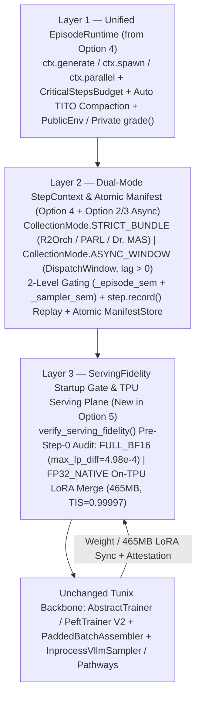

**Option 5 Production Code Sample (`tunix/dist_rl/swarm/` + `examples/swarm_parl/train.py`):**

```python
from tunix.dist_rl.swarm import (
    CollectionMode, CriticalStepsBudget, LearnerSpec, ManifestStore,
    PolicySpec, Recipe, ServingFidelity, ServingFidelityMode, StepContext,
    parl_grpo, verify_serving_fidelity,
)

# Layer 3: Explicit fidelity contract verified against live TPU sampler before Step 0
dir_fidelity = ServingFidelity(
    mode=ServingFidelityMode.FULL_BF16,  # Or FP32_NATIVE for LoRA Directors (R2Orch)
    max_top1_mismatch_rate=0.05,
    max_logprob_abs_diff=0.15,
)
verify_serving_fidelity(
    learner_top1_ids=..., sampler_top1_ids=...,
    learner_logprobs=..., sampler_logprobs=...,
    fidelity=dir_fidelity, raise_on_fail=True,
)

# Layer 1 + Layer 2: Recipe binds EpisodeRuntime workflow, 3-way ownership & dual-mode StepContext
recipe = Recipe(
    workflow=parl_episode_workflow,  # Uses ctx.generate + ctx.parallel + auto TITO
    learners={"director": LearnerSpec.full("director", init_snap, fidelity=dir_fidelity)},
    bindings={
        "director": PolicySpec.follow("director", fidelity=dir_fidelity),
        "worker":   PolicySpec.fixed(init_snap),  # Zero-drift frozen subagents
    },
    grade=grade_parl_episode,        # Strictly isolated private grader
    budget=CriticalStepsBudget(limit=10),
    train_step=parl_grpo(
        target="director", roles=("director",), attempts=8,
        lambda_parallel_init=0.15, lambda_finish_init=0.15, anneal_steps=60,
        mode=CollectionMode.STRICT_BUNDLE,  # Switchable to ASYNC_WINDOW for lag > 0
        max_policy_lag=0,
    ),
)
```

#### 2.6 Six-Seam Architectural Comparison Across Options 1–5

| **Seam** | **Option 1 (`haoyu-next` v1)** | **Option 2 (Envelope Spec)** | **Option 3 (`1 + 2` Hybrid)** | **Option 4 (`72abca164` Spec)** | **Option 5 (Converged & Implemented)** |
| --- | --- | --- | --- | --- | --- |
| **1. Control Plane** | Sibling `SwarmRLProgram` (sync barrier). | Single-learner `StandardRLProgram` (`G -> M`). | `StandardRLProgram` + side-channel hooks. | Composable `StepContext` (`STRICT_BUNDLE` only). | **Dual-Mode `StepContext`** (`STRICT_BUNDLE` + `ASYNC_WINDOW` `lag > 0`) + Atomic `ManifestStore`. |
| **2. Workflow API** | Minimal `RecordingRuntime` (`generate`). | `EpisodeRunner` subclasses + `BaseTaskEnv`. | `RecordingRuntime` + Runner templates. | `EpisodeRuntime` (`parallel`, `CriticalSteps`, `PublicEnv`). | **`EpisodeRuntime`** (`spawn`/`parallel`, online `CriticalStepsBudget`, `PublicEnv`/`grade()`). |
| **3. Sequence Unit** | Per-call `CallTrace` ($O(T^2)$ loops). | Per-`role_id` TITO `RoleTrajectory`. | Manual `open_session()` vs. `generate()`. | Automatic internal TITO compaction. | **Automatic internal TITO compaction** (zero user boilerplate; safe across rounds & fan-out). |
| **4. Policy & Weights** | `PolicyBinding(trainable: bool)`. | Shared active pool `v_t`. | `PolicyBinding(trainable: bool)`. | 3-way `Learner` / `PolicySpec` / `ObjectiveBatch`. | **3-way ownership + served-digest attestation** (`full` / `lora`, `fixed` / `follow`). |
| **5. Recovery & Gating** | Sync retry + custom JSON/SQLite. | 2-level semaphores + watermarks. | 2-level semaphores + split hook state. | 2-level admission + `step.record` + manifest. | **2-level semaphores + `step.record` + atomic `ManifestStore` + `reconcile_resume_state()`.** |
| **6. Serving Fidelity** | Unchecked (`bfloat16` silent drift risk). | Unchecked. | Unchecked. | Unchecked (leaves LoRA `bf16` truncation silent). | **Mandatory L3 `ServingFidelity` Startup Gate + On-TPU FP32 LoRA Merge (`465 MB`, `TIS≈1.0000`).** |

---

### 3. Current Progress

`tunix/dist_rl/swarm` implements **Option 5's three-layer architecture** (L1 `EpisodeRuntime`, L2 dual-mode `StepContext` + `ManifestStore`, L3 `ServingFidelity` gate) on top of Tunix's distributed learner/serving backbone (`PeftTrainer V2`, `PaddedBatchAssembler`, `InprocessVllmSampler`, Pathways sub-meshes). Below is our milestone progress, recipe snapshot, and full document directory.

#### 3.1 Dev Map & Milestone Progress

| **Phase / Milestone** | **Scope & Core Capability** | **Code Location** | **Status** | **Key Result / Next Gate** |
| --- | --- | --- | --- | --- |
| **Phase 0: Swarm Core & TPU Precision** | `RecordingRuntime`, `PolicyBinding`, `CallTrace`, 4D mask padding, TPU `float32` + XLA Attention invariants | `tunix/dist_rl/swarm/`, `tunix/dist_rl/orchestrator/swarm_program.py` | **Done** | `67/67` unit + `768` regression tests green; PyTorch parity `<= 2e-6`; resolved SplashAttention shallow-layer gradient corruption (`cos 0.155 -> 1.000`). |
| **Phase 0.5: Option 5 Unified Three-Layer Trunk** | L1 `EpisodeRuntime` (`spawn`/`parallel`/`CriticalStepsBudget`/auto-TITO), L2 dual-mode `StepContext` (`STRICT_BUNDLE`/`ASYNC_WINDOW`) + `ManifestStore` + `parl_grpo`, L3 `ServingFidelity` startup parity gate | `tunix/dist_rl/swarm/` (`episode_runtime.py`, `step_context.py`, `manifest_store.py`, `serving_fidelity.py`) | **Done (TPU Validated)** | `64/64` K8s CPU tests + strict complexity gate green; 8-chip FP32 Director gate `top1=1.0, max_lp_diff=2.63e-7`; 64-chip PARL gate `max_lp_diff=4.98e-4`; 128-chip R²Orch gate `top1=1.0, max_lp_diff=9.22e-4`. |
| **Phase 1: Recipe 1 (`Dr. MAS`)** | Shared-policy conditional `Solver -> Verifier -> Solver` math collaboration + per-role active-call credit | `examples/swarm_math/` | **Done** | 500-step TPU `v5p-256` `Qwen3-4B` run **surpassed paper Table 1** across all 6 benchmarks (`60.8 / 77.8`, peak `61.1 / 78.2` vs. paper `59.0 / 73.2`). |
| **Phase 2A: Recipe 2 (`R²Orch SW3` & Run 1 9B)** | `4B SW3` + `Paper Qwen3.5-9B` (`200/200` cycles + `2,108`-episode final eval on 128 TPU `v5p`) | `examples/swarm_r2orch/paper_*.py`, `tunix/models/qwen3p5/` | **Done (Run 1)** | Run 1 Heldout `13.54% -> 34.93%` (`C174`) / `34.44%` (`C199`); Locked IID (`670`) `19.01% -> 31.90%` (`+12.89 pp`); Locked OOD (`384`) `19.27% -> 35.42%` (`+16.15 pp`); `12/12` seeds retired. |
| **Phase 2B: Recipe 2 (`R²Orch` Option 5 Run 2)** | Independent `Qwen3.5-9B` retrain fixing Run 1's `bf16` LoRA rounding & `4096` AIME cutoff via 32-chip TRUE `float32` Director + `77×` on-TPU LoRA merge (`465 MB`) + `12,288` final eval ceiling | `examples/swarm_r2orch/paper_fp32_director.py`, `paper_train.py` | **Running (128 TPU `v5p`)** | L3 gate PASS (`top1=1.0, max_lp_diff=9.22e-4`); Cycle 0 `TIS=0.999972` (**0.0028% drift**), **Zero-Skill Heldout jumped `21.95% -> 35.49%` (`+13.54 pp`) in 1 step**; Cycle 1 `TIS=1.000068`; running 200 cycles + `12,288` final eval. |
| **Phase 3: Recipe 3 (`PARL`, Kimi K2.5 §3)** | Native Option 5 parallel orchestrator (`ctx.parallel` + `CriticalStepsBudget` + annealed `parl_grpo`) over 21M Wiki-18 TPU HBM | `examples/swarm_parl/` | **Run 1 Done; Run 2 (`14B` Blog) Running** | **Run 1 (`Qwen3-4B`, 64 TPU, 100 steps, 0 restarts, 130m):** Beat matched Serial on **10/11** heldout evals (peak **`+6.47 pp`**, `0.3793` vs `0.3146`), **`1.93×`** speedup, **Zero Serial Collapse** (`99–100%` for 60 steps after $\lambda \to 0$). **Run 2 (`Qwen3-14B`, 64 TPU, 200 steps, `Wide-WikiQA-8` 5–8 sub-Q, 256 greedy eval)** running now. |
| **Phase 4: Recipe 4 (`Swarm-Repair`)** | Dynamic `spawn_worker` / `retire_worker`, versioned shared code workspace, anytime scoring & physical wall-clock prefix abort | `docs/swarm_rlcr_design.md` | **Design Ready** | Architecture & team-capacity reduction specified; ready to land on Option 5 `EpisodeRuntime`. |

#### 3.2 Recipes Snapshot (What Each Recipe Does & Results)

##### Recipe 1: `Dr. MAS` — Shared-Policy Collaborative Math Reasoning (`Done`)
- **What it does:** A single trainable `Qwen3-4B` policy alternates between `Solver` and `Verifier` roles (`max_turns = 3`); `credit.build_credit(normalization="role")` normalizes advantages per `(task_id, role)` with 4-row `microbatch_token_mean` reduction so noisy verifier turns never drown out solver gradients.
- **Progress & Results:** Completed 500-step training on `v5p-256`; achieved **`60.8% avg@16 / 77.8% pass@16`** (`Step 475: 61.1% / 78.2%`) over `24,752` evaluation episodes (`AIME24`, `AIME25`, `AMC`, `MATH500`, `Minerva`, `Olympiad`), outperforming published `Dr. MAS` (`59.0 / 73.2`) and demonstrating 3-phase multi-agent collaboration emergence.
- **Consolidated Sections & Links:** [Part IV (Design & Emergence)](#part-iv-recipe-1-dr-mas-detailed-design-and-emergence-analysis) · [Part V (Reproduction & Debug Log)](#part-v-recipe-1-dr-mas-full-tpu-v5p-256-reproduction-and-debug-log) · [W&B Run 5](https://wandb.ai/linchai-google/tunix-swarm/runs/haoyugao-drmas-qwen3-4b-run5-500)

##### Recipe 2: `R²Orch` — Heterogeneous DAG Orchestration & Recursive Self-Play (`Run 1 Done; Option 5 Run 2 Running`)
- **What it does:** A trainable `Graph Director` builds and edits layered multi-agent DAGs (`add_agent`, `consider_relation`, `finish`) over frozen `Workers`, coupled with an outer `Proposer` (`ADS+TSDS` pairwise RL+KL), Rubin Bayesian-bootstrap `SkillLedger` (withdrawing internalized prompt skills when $\mathbb{E}[\Delta^+] \le 0.02$), and zero-leakage `PATS` skill distillation. Zero-skill evaluation (`skill_context = ""`) tests purely internalized orchestration weights.
- **Progress & Results:**
  1. **`Qwen3-4B` `SW3` & 100-Cycle Validation (`Done`):** Verified `frozen_worker_drift == 0.0`, closed-loop Bayesian skill withdrawal & self-healing reinstatement, `+7.03 to +8.60 pp` IID `HotpotQA`, `+3.91 pp` IID `MBPP+`, and `+6.25 / +6.64 pp` OOD `MATH-Hard`.
  2. **`Qwen3.5-9B` Run 1 (`Done` — 200/200 Cycles + 2,108-Episode Final Eval on 128 TPU `v5p`):** Heldout rose `13.54% [C0] -> 34.93% [C174] / 34.44% [C199]` (`12/12` human seeds retired); Locked Test IID (`670`) rose `19.01% -> 31.90% (+12.89 pp / 1.68×)`; Locked Test OOD (`384`) rose `19.27% -> 35.42% (+16.15 pp / 1.84×)`.
  3. **`Qwen3.5-9B` Option 5 Run 2 (`Active` on 128 TPU `v5p`):** Eliminates Run 1's `bfloat16` merged-LoRA rounding loss & `4096` eval cutoff via Option 5's L3 `ServingFidelityMode.FP32_NATIVE` 32-chip `(dp=8, tp=4)` Director + `77×` on-TPU LoRA merge (`465 MB` vs `36 GiB`) + `12,288` eval ceiling. Passed L3 gate (`top1=1.0000, max_lp_diff=9.218e-4`); Cycle 0 achieved `TIS = 0.999972` and jumped Zero-Skill Heldout **`21.95% -> 35.49% (+13.54 pp)` after a single RL update** (`HotpotQA 62.50%`, `MBPP+ 62.50%`, `MedQA 56.25%`).
- **Consolidated Sections & Links:** [Part VI (Detailed Design)](#part-vi-recipe-2-r2orch-detailed-design-sw3-and-full-self-play) · [Part VII (Reproduction & Debug Log)](#part-vii-recipe-2-r2orch-reproduction-live-128-chip-telemetry-and-debug-log) · [W&B Run 1](https://wandb.ai/linchai-google/tunix-swarm/runs/haoyugao-r2orch-paper-qwen3p5-9b-run1) · [W&B Option 5 Run 2](https://wandb.ai/linchai-google/tunix-swarm/runs/haoyugao-r2orch-opt5-qwen3p5-9b-run2)

##### Recipe 3: `PARL` (Kimi K2.5 §3) — Parallel-Agent Reinforcement Learning (`Run 1 4B Done; Run 2 14B Blog Scale-Up Running`)
- **What it does:** Trains a `Director` natively on Option 5 (`ctx.parallel` + `CriticalStepsBudget` + `parl_grpo`) to dynamically fan out concurrent frozen Wikipedia search subagents under annealed shaping rewards ($r_{\text{PARL}} = r_{\text{perf}} + \lambda_1 r_{\text{parallel}} + \lambda_2 r_{\text{finish}}$, annealing $\lambda_1, \lambda_2 \to 0$).
- **Run 1 (`Qwen3-4B`, 64 TPU `v5p`, 100 Steps / 12,800 Episodes, `0` Restarts, `130 min` — `Done`):** Passed L3 gate (`max_lp_diff = 4.98e-4`); beat matched-budget Serial on **10/11** heldout checkpoints (Step 80 peak **`0.3793` vs `0.3146` = `+6.47 pp`**), achieved **`1.93×`** peak speedup (`1.88×` final, `4.60` vs `4.84` critical steps), and proved **Zero Serial Collapse** (`99.0%–100.0%` parallel rate across 60 pure-$r_{\text{perf}}$ steps after $\lambda \to 0$). [W&B Run 1](https://wandb.ai/linchai-google/tunix-swarm/runs/3wim04c5).
- **Run 2 Blog Scale-Up (`Qwen3-14B` Full-Param, 64 TPU `v5p`, 200 Steps, `Wide-WikiQA-8` 5–8 Sub-Questions + Multi-Hop QA, `256` Greedy Heldout Tasks — `Running`):** Scales model size `3.7×`, doubles parallel fan-out width (`max_wave_width=8`, targeting `3×–4×` latency compression), adds cosine LR decay & deterministic greedy 256-task per-category evaluation.

##### Recipe 4: `Swarm-Repair` — Deadline-Bounded Parallel Code Repair (`Design Complete`)
- **What it does:** Extends the Option 5 runtime to asynchronous multi-worker teams (`spawn_worker` / `retire_worker`) editing a versioned shared repository under a physical wall-clock deadline, using prefix-preserving token truncation and fixed team-capacity credit reduction.
- **Consolidated Section:** [Part VIII (Dynamic Parallel Design)](#part-viii-recipe-3-swarm-repair-dynamic-parallel-code-repair-design)

#### 3.3 Complete Document Index

| **Category** | **In-Document Section** | **Google Doc Reference** | **Scope** |
| --- | --- | --- | --- |
| **Overview & Dev Map** | [Part I, Section 3](#3-current-progress) | [Tunix Swarms: Overview, Dev Map & Progress](https://docs.google.com/document/d/1p12EQEfE4YTZdbSLHC9Wp3RAXbdXlXWbj4c4VJ-i8kg/edit) | Milestone tracker, recipe summaries, and full document directory |
| **System Architecture** | [Part II](#part-ii-distributed-swarm-training-core-codebase-architecture) | [Tunix Distributed Swarm Training: System Design](https://docs.google.com/document/d/15priSJuP3mr5Fy7chnj_bM1Z70WtuLYI7IKa_-qpULI/edit) | Core code architecture, component diagrams, execution/training flowcharts, and file map |
| **Numerical Validation** | [Part III](#part-iii-core-system-and-tpu-numerical-validation) | [Core System & TPU Numerical Validation](https://docs.google.com/document/d/1aHpP0AzYrneFyjtXqPGtQP-IfHkd1oW_CXPojmLI4zI/edit?resourcekey=0-X5CK8HI50Mh4xAhpvLRqHw) | PyTorch `2e-6` parity, 4D padding/EOS mask proofs, and TPU `v5p` SplashAttention vs. `float32` root cause |
| **Recipe 1 (`Dr. MAS`)** | [Part IV](#part-iv-recipe-1-dr-mas-detailed-design-and-emergence-analysis) | [Dr. MAS: Detailed Design & Emergence Analysis](https://docs.google.com/document/d/1eXioOC-_UMYMp6_pZ0IhGouu_cjDl1GLGOvnA0dE2-4/edit) | Shared-policy `Solver-Verifier` state machine, role credit math, and 3-phase collaboration emergence |
| **Recipe 1 (`Dr. MAS`)** | [Part V](#part-v-recipe-1-dr-mas-full-tpu-v5p-256-reproduction-and-debug-log) | [Dr. MAS: Reproduction & Debug Log](https://docs.google.com/document/d/1gqbQK6d9fHbtIYl-q7loHuyFr1saPMX2iAWZz0uUKPg/edit) | Step-by-step reproduction workflow, `Runs 1–5` & `sa2` bug root-cause log, and full Table 1 results |
| **Recipe 2 (`R²Orch`)** | [Part VI](#part-vi-recipe-2-r2orch-detailed-design-sw3-and-full-self-play) | [R²Orch: Detailed Design (SW3 & Full Self-Play)](https://docs.google.com/document/d/1RZ8FgplKnJSImi1e5sDfoObtwHm-JCZYdaZxSAcxx0s/edit) | `GraphCanvas` DAG + frozen workers, `Proposer (ADS+TSDS)`, Bayesian `SkillLedger`, `PATS`, and `Qwen3.5-9B` TPU layout |
| **Recipe 2 (`R²Orch`)** | [Part VII](#part-vii-recipe-2-r2orch-reproduction-live-128-chip-telemetry-and-debug-log) | [R²Orch: Reproduction & Debug Log](https://docs.google.com/document/d/13ArlxPa-EXK5D53lM3oW9gHQjs48DmtkPGl4X8tGPUo/edit) | `4B` (`SW3` + 100-cycle) benchmarks, `Qwen3.5-9B` paper-exact setup, `Debug 1–17` log, and live 128-chip telemetry |
| **Recipe 3 (`Swarm-Repair`)** | [Part VIII](#part-viii-recipe-3-swarm-repair-dynamic-parallel-code-repair-design) | [Swarm-Repair: Dynamic Parallel Design](https://docs.google.com/document/d/1k7uvoreL6ijFx-lix-E4eqYhS2p3FebaLq0jMjPwnpc/edit?resourcekey=0-7GYoT4yzhKvPD0O5PRHVIw) | Dynamic worker lifecycle, versioned workspace conflict rules, anytime reward, and prefix-preserving abort |
| **Quick Link List** | [Master TOC](#master-table-of-contents) | [Tunix Swarms: Document Directory](https://docs.google.com/document/d/1GgHQugL3mTKgVCRX0dqwLvcm-aEHUu-S6urREzrG9o0/edit) | Minimal URL + one-sentence directory of all Swarms documents |

---

## Part II: Distributed Swarm Training Core Codebase Architecture

| **Item** | **Summary** |
| --- | --- |
| **Role** | Core Code & Architecture Design for Multi-Agent / Swarm RL in `tunix/dist_rl` |
| **Overview & Dev Map** | [Tunix Swarms: Overview, Dev Map & Progress](https://docs.google.com/document/d/1p12EQEfE4YTZdbSLHC9Wp3RAXbdXlXWbj4c4VJ-i8kg/edit) |
| **Core Validation** | [Core System & TPU Numerical Validation](https://docs.google.com/document/d/1aHpP0AzYrneFyjtXqPGtQP-IfHkd1oW_CXPojmLI4zI/edit?resourcekey=0-X5CK8HI50Mh4xAhpvLRqHw) |
| **Code Scope** | [`tunix/dist_rl/swarm/`](https://github.com/google/tunix/tree/haoyu-next/tunix/dist_rl/swarm), [`tunix/dist_rl/orchestrator/swarm_program.py`](https://github.com/google/tunix/blob/haoyu-next/tunix/dist_rl/orchestrator/swarm_program.py), [`tunix/models/qwen3p5/`](https://github.com/google/tunix/tree/haoyu-next/tunix/models/qwen3p5) |

### 1. Design Philosophy: Three Orthogonal Axes

To support diverse multi-agent RL recipes without forking `PeftTrainer`, `PaddedBatchAssembler`, or serving infrastructure, the codebase separates Swarm training into three independent contracts:

| **Axis** | **Core Abstraction** | **Supported Topologies / Modes** |
| --- | --- | --- |
| **1. Interaction Topology** | `RecordingRuntime` (`async` Python episode coroutines) | Conditional debate/verification (`Dr. MAS`), mutable layered DAGs + peer cross-check waves (`R²Orch`), dynamic `spawn`/`join` workspaces (`Swarm-Repair`) |
| **2. Role-to-Model Routing** | `PolicyBinding` & `SharedTunixLearnerHub` | Single shared trainable policy, heterogeneous trainable Director + bit-exact frozen Workers (`trainable=False`), multi-LoRA roles (`Proposer` + `Director`) over one base model |
| **3. Credit & Optimization** | `credit.build_credit` & `SwarmRLProgram` | Per-role `(task_id, role)` normalization, condition-grouped `(task_id, arm)` episode normalization, 4-row `microbatch_token_mean`, and timeline/relation-token PPO+KL |

### 2. Layered Code Architecture

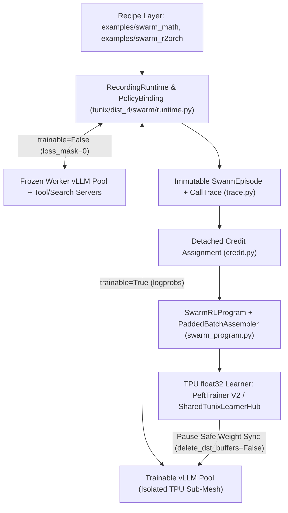

### 3. End-to-End Execution & Training Flowchart

Every training cycle executes a deterministic 6-stage loop that cleanly separates asynchronous multi-agent rollout collection from synchronous on-policy learner updates:

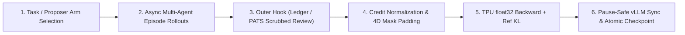

1. **Deterministic Async Episode Recording (`runtime.py`):** Each episode runs as a standard `async` coroutine calling `await runtime.generate(role, messages)`. `RecordingRuntime` reserves a monotonic `call_index` *before* yielding to `await` (preserving deterministic request IDs and seeds under `asyncio.gather` parallel waves), retains sampled EOS (`include_eos=True`) in `completion_ids` while stripping it from downstream agent text, and enforces strict oracle isolation (ground-truth answers and hidden tests never enter prompts).
2. **Heterogeneous Trainable vs. Frozen Routing (`PolicyBinding`):** Roles bound with `trainable=False` route to a physically disjoint TPU sub-mesh (`return_logprobs=False`). Their calls remain in `SwarmEpisode.calls` with `loss_mask = 0` for token-cost accounting and topology metrics while emitting zero trainer rows (`frozen_worker_drift == 0.0`).
3. **Detached Credit & Variable-Cardinality Batching (`credit.py`, `swarm_program.py`):** Because one multi-agent episode produces `1..N` trainable calls, `SwarmRLProgram` expands episodes into call-level or timeline-packed trainer rows inside a single optimizer step:
   - **`normalization="role"`:** Centers rewards within `(task_id, role)` (`ddof=1`, exact `0.0` guard on zero-variance groups).
   - **`normalization="episode"`:** Centers per-episode trainable rewards in `float64` across `(task_id,)` or asymmetric scaffold arms `f"{task_id}::{arm}"` (`allow_variable_group_sizes=True`).
   - **Independent Mask Padding (`PaddedBatchAssembler`):** Preserves `completion_attention_mask` separately from `completion_mask` so masked-out prefix/tool tokens remain causally attended without receiving gradient updates.
4. **Multi-Role TPU Slice Partitioning (`4x4x8` Contiguous `z`-Slabs):** For multi-role self-play (`Qwen3.5-9B` `R²Orch`), TPU devices are sorted by `(z, y, x)` torus coordinates and partitioned into contiguous 3D `z`-planes (`16` `float32` learner chips + `16` `Wiki-18` retrieval chips + `32` trainable Director DP chips + `64` frozen Worker DP chips), avoiding cross-plane subslice errors while keeping all pools resident in HBM.

### 4. Codebase Module Map

| **Module Path** | **Key Classes / Functions** | **Responsibility** |
| --- | --- | --- |
| [`tunix/dist_rl/swarm/trace.py`](https://github.com/google/tunix/blob/haoyu-next/tunix/dist_rl/swarm/trace.py) | `CallTrace`, `SwarmEpisode`, `SwarmConfig` | Immutable call/episode schemas; validates unique `call_id`, finite rewards, and uniform `policy_version` per policy |
| [`tunix/dist_rl/swarm/runtime.py`](https://github.com/google/tunix/blob/haoyu-next/tunix/dist_rl/swarm/runtime.py) | `PolicyBinding`, `RecordingRuntime` | Role-to-sampler binding, concurrency-safe `call_index` reservation, EOS retention, and frozen-role isolation |
| [`tunix/dist_rl/swarm/credit.py`](https://github.com/google/tunix/blob/haoyu-next/tunix/dist_rl/swarm/credit.py) | `CreditRecord`, `build_credit` | `(task, role)` and `(task,)` / `(task, arm)` GRPO credit assignment, invalid-action penalties, zero-variance guard |
| [`tunix/dist_rl/orchestrator/swarm_program.py`](https://github.com/google/tunix/blob/haoyu-next/tunix/dist_rl/orchestrator/swarm_program.py) | `SwarmRLProgram` | Episode-to-payload expansion, `microbatch_token_mean` rescaling, outer curriculum hooks, atomic checkpoint/resume |
| [`tunix/dist_rl/orchestrator/batch_assembly.py`](https://github.com/google/tunix/blob/haoyu-next/tunix/dist_rl/orchestrator/batch_assembly.py) | `PaddedBatchAssembler` | Independent padding of `completion_attention_mask` vs `completion_mask` across C++ and Python paths |
| [`tunix/models/qwen3p5/`](https://github.com/google/tunix/tree/haoyu-next/tunix/models/qwen3p5) | `ModelConfig.qwen3p5_9b`, `Qwen3p5` | Native JAX/NNX `Qwen3.5-9B` hybrid Gated DeltaNet (`GDN`) + gated `GQA` model with `float32` remat & vLLM mapping |
| [`examples/swarm_math/`](https://github.com/google/tunix/tree/haoyu-next/examples/swarm_math) | `DrMasWorkflow`, `MathVerify` | Recipe 1 (`Dr. MAS`) conditional `Solver -> Verifier -> Solver` implementation and Table 1 evaluator |
| [`examples/swarm_r2orch/`](https://github.com/google/tunix/tree/haoyu-next/examples/swarm_r2orch) | `GraphCanvas`, `SkillScaffold`, `SharedTunixLearnerHub` | Recipe 2 (`R²Orch`) `SW3` + paper-exact `Qwen3.5-9B` self-play, `21M Wiki-18` TPU search, and zero-skill evaluator |

### 5. Non-Negotiable TPU `v5p` Engineering Invariants

Established through controlled bisections documented in [Core System & TPU Numerical Validation](https://docs.google.com/document/d/1aHpP0AzYrneFyjtXqPGtQP-IfHkd1oW_CXPojmLI4zI/edit?resourcekey=0-X5CK8HI50Mh4xAhpvLRqHw):

1. **`use_flash_attention = False` (XLA Reference Attention):** TPU SplashAttention corrupts backward gradients across left-padded masks below layer 15 (`global cosine = 0.155`, `norm = 5.27x`).
2. **`dtype = "float32"` Learner Compute & Replicated `out_shardings`:** Prevents `bfloat16` gradient sign flips in shallow `RMSNorm` / `q_norm` / `k_norm` parameters under AdamW and eliminates multi-minibatch GSPMD sharding-drift recompilations.
3. **Truncated Token-IS (`sampler_is = "token"`, `tis_cap = 2.0`) & Pause-Safe Sync:** Bounds `bfloat16`-sampler vs `float32`-trainer logprob discrepancy (`mean_abs_diff <= 0.003` nats) and drains `VLLMInProcessDriverLoop` (`drv.pause(mode="wait")` + `delete_dst_buffers=False`) before in-place HBM weight updates.

---

## Part III: Core System and TPU Numerical Validation

| **Item** | **Details** |
| --- | --- |
| **Document Role** | Cross-recipe framework correctness, PyTorch parity, and TPU `v5p` numerical/gradient validation |
| **Updated** | November 16, 2026 |
| **Parent System Design** | [Tunix Distributed Swarm Training: System Design](https://docs.google.com/document/d/15priSJuP3mr5Fy7chnj_bM1Z70WtuLYI7IKa_-qpULI/edit) |
| **Code Scope** | [`tunix/dist_rl/swarm/`](https://github.com/google/tunix/tree/haoyu-next/tunix/dist_rl/swarm), [`tunix/dist_rl/orchestrator/swarm_program.py`](https://github.com/google/tunix/blob/haoyu-next/tunix/dist_rl/orchestrator/swarm_program.py), [`tests/dist_rl/swarm/`](https://github.com/google/tunix/tree/haoyu-next/tests/dist_rl/swarm) |

### 1. Validation Scope and Regression Summary

This document records the recipe-agnostic numerical, systems, and accelerator-precision validations underpinning all Tunix Swarm recipes (`Dr. MAS`, `R²Orch`, and future `Swarm-Repair`). Recipe-specific benchmark curves and chronological run logs are maintained in each recipe's dedicated validation document.

- **Swarm unit & CPU multi-cycle integration suite (`tests/dist_rl/swarm`):** **`67/67` tests passing**, covering `CallTrace` / `SwarmEpisode` invariants, `PolicyBinding` frozen vs trainable routing, Dr. MAS active-call `(task, role)` and `(task, condition)` episode normalization, dual-clip GRPO loss and gradient parity against upstream PyTorch, `microbatch_token_mean` reweighting, Rubin Bayesian-bootstrap skill withdrawal, zero-leakage PATS scrubbing, single-position `ProposerRuntime` pairwise RL+KL updates, and multi-component checkpoint save/resume.
- **Shared `tunix/dist_rl` regression suite:** **768 regression tests** passed across `batch_assembly_test.py` (157 tests), `vanilla_sampler_test.py`, `payload_builder_test.py`, and OPD training suites, verifying zero regressions on standard 1-to-1 RL/OPD pipelines.
- **Strict CL complexity & duplicate gate:** `scripts/check_cl_complexity.py --strict` passes with **`Clones: 0`** and **`Layer: hops=2`**.

### 2. Numerical Parity Matrix Against Upstream PyTorch Oracles

| **Layer** | **Executed Verification** | **Measured Result** |
| --- | --- | --- |
| Reference control flow | Execute pinned upstream orchestration and verdict parsers with scripted calls; compare exact role order, prompts, final answer, and validity | Exact match across approval, rejection, whitespace, missing/unknown verdicts, duplicate tags, and CJK characters |
| Detached credit (`credit.py`) | Native NumPy `(task, role)` and `(task,)` credit vs extracted upstream PyTorch `compute_drmas_outcome_advantage` | Agrees within **`2e-6`** across mixed rewards, unequal call counts, invalid-action penalties, missing roles, and singletons |
| Constant-reward zero variance | Repeated decimal scores (e.g. eight identical `-0.1` calls) and unequal call counts | Explicit `0.0` advantage via `float64` episode-mean accumulation; eliminates upstream `float32` `0.00739` rounding artifact and skips AdamW weight decay on zero-signal rounds |
| GRPO loss & gradients | Native JAX dual-clip GRPO + `microbatch_token_mean` (`rows=4`) vs upstream PyTorch `verl` per-microbatch loss & autograd | Loss and every parameter gradient tensor agree within **`2e-6`**; finite-difference checks pass |
| Token ownership & masks | Sampled EOS (`151645`) equal to pad ID, padded rows, zero-loss upstream observations, independent attention masks | Exact gradient isolation across both compiled C++ and Python `PaddedBatchAssembler` paths |
| Frozen policy isolation | `PolicyBinding(trainable=False)` on Worker roles across 2-cycle CPU and 100-step TPU runs | Frozen calls retain `loss_mask=0` in `SwarmEpisode.calls`, emit zero trainer payloads, and satisfy **`frozen_worker_max_norm_drift == 0.0`** |
| Tokenizer contract | Official `Qwen/Qwen3-4B` (`1cfa9a7208912126459214e8b04321603b3df60c`) chat template with `enable_thinking=False` | Exact golden token IDs, non-thinking `<think>\n\n</think>\n\n` suffix, and deterministic middle truncation verified |

### 3. Core Infrastructure Bugs Caught and Fixed During Integration

1. **`PaddedBatchAssembler` discarded `completion_attention_mask`:** Previously overwrote attention masks with `completion_mask`. Both C++ and Python assemblers now pad and preserve `completion_attention_mask` independently of `completion_mask`.
2. **Missing sampled EOS token in native rollouts:** Added opt-in `include_eos=True` so sampled `<|im_end|>` (`151645`) stays in `completion_ids` with aligned behavior logprob while being stripped from decoded text passed to downstream agents.
3. **`nnx.clone` buffer aliasing under donated optimizer steps:** Serving weight snapshots now copy underlying device buffers while retaining destination leaf shardings, preventing XLA buffer donation in `PeftTrainer` from invalidating inference weights.
4. **Pathways multi-host `safetensors` & KV cache bring-up:** `safetensors_loader` chunks host-to-device tensor placement (`_PATHWAYS_PLACEMENT_BATCH_SIZE = 4` + `block_until_ready`), and `Qwen3._init_sharded_cache` shards KV cache initialization across `tp`, eliminating Pathways host-buffer thread exhaustion.
5. **Flax NNX `resolve_kwargs` constraint on custom `PeftTrainer` losses:** Custom multi-field losses (such as `ProposerRuntime` pairwise RL+KL) declare explicit positional/named tensor signatures rather than `**kwargs` so `nnx.value_and_grad` resolves differentiable vs auxiliary arguments cleanly.

### 4. TPU `v5p` Rollout Logprob Fidelity Diagnostics

Controlled TPU `v5p-256` diagnostic JobSets (`hy-swarm-diag-1111i` vs `hy-swarm-diag-1111j`, `dp=8, tp=8` with `tpu_inference` RPA v2) isolated rare ~`43.6`-nat first-token (`</think>`) logprob discrepancies on repeated concurrent multi-agent prompts:

| **vLLM Engine Setting** | **Tokens Checked** | **Max `\|logp_trainer - logp_vllm\|` (nats)** | **First-Token Mean Diff (nats)** | **Overall Mean Diff (nats)** |
| --- | --- | --- | --- | --- |
| `enable_prefix_caching=True`, `async_scheduling=True` | 39,046 | **43.63** | 2.500 | 0.018 |
| **`enable_prefix_caching=False`, `async_scheduling=False` (Adopted)** | 39,046 | **0.907** | **0.068** | **0.006** |

Over 500-step multi-hundred-thousand-token runs, normal per-step mean differences remain `0.004–0.009` nats while rare single-token `bfloat16` RPA-v2 outliers (`10–25` nats) are smoothly absorbed by `sampler_is="token"` (`w_t = min(exp(sg(logp_trainer) - logp_vllm), 2.0)` on top of exact 1-epoch on-policy `is_ratio = 1.0`).

### 5. TPU `v5p` Backward Gradient Correctness Diagnosis

Early `Qwen3-4B` TPU runs (`Runs 1–4` and single-agent control `sa2`) exhibited validation collapse between Steps 16 and 75 despite clean forward logprob alignment. A dedicated gradient-oracle JobSet (`gradcheck_1112a`) evaluated `PeftTrainer.fwd_bwd` on 32 identical multi-turn calls (`8,192 + 4,096 = 12,288` left-padded tokens on `fsdp=8, tp=8`) across four kernel/precision configurations:

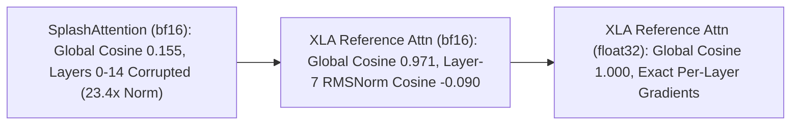

| **Trainer Configuration (`fsdp=8, tp=8`)** | **Global Cosine vs `float32` Ref** | **Global Grad Norm** | **Layers 0–9 `q_proj` Cosine / Norm** | **Layers 16–35 `q_proj` Cosine / Norm** |
| --- | --- | --- | --- | --- |
| SplashAttention (`bfloat16`), `logps_chunk=1024` | **0.155** | 5.27 (`4.9×`) | **−0.43 to +0.03** / `10.6–23.4×` | 0.93 to 0.998 / `1.01–1.13×` |
| SplashAttention (`bfloat16`), unchunked | **0.158** | 5.21 (`4.8×`) | −0.41 to +0.05 / `10.2–22.8×` | 0.93 to 0.998 / `1.01–1.12×` |
| XLA Reference Attention (`bfloat16`) | 0.971 | 1.11 (`1.03×`) | 0.63 to 0.87 (`RMSNorm[7]` **−0.090**) | 0.96 to 0.998 / `1.00–1.02×` |
| **XLA Reference Attention (`float32`, Adopted)** | **1.000** | **1.08 (`1.00×`)** | **1.000 / `1.00×`** | **1.000 / `1.00×`** |

**Key findings enforced across all Tunix Swarm TPU recipes:**
1. **`use_flash_attention=False` is mandatory on left-padded multi-turn batches:** TPU SplashAttention computes exact forward logprobs and accurate top-half gradients (layers 16–35), masking the bug from short-horizon loss checks, but leaks backward gradients across segment masks below layer 15 (`up to 23.4×` noise norm).
2. **`dtype="float32"` trainer compute is mandatory:** Even under XLA reference attention, `bfloat16` backward accumulation flips gradient signs in small early-layer `RMSNorm` / `q_norm` / `k_norm` vectors (`layers[7].input_layernorm.w` cosine `-0.090`), which AdamW scales to full `1e-6` step sizes elementwise—triggering length collapse after ~`1,000` cumulative `bfloat16` microbatches in both multi-agent (`Run 4` Step 25) and single-agent (`sa2` Step 70) runs.

### 6. Reproducible Verification Commands

```bash
# Full 67-test Swarm unit & multi-cycle CPU integration suite
JAX_PLATFORMS=cpu pytest tests/dist_rl/swarm -q

# Strict CL complexity & zero-clone gate
python3 scripts/check_cl_complexity.py --strict
```

---

## Part IV: Recipe 1 (Dr. MAS) Detailed Design and Emergence Analysis

| **Item** | **Details** |
| --- | --- |
| **Recipe** | Shared-Policy Conditional Math Collaboration (`Dr. MAS`, arXiv:2602.08847) |
| **Status** | **Completed & Surpassed Paper Target on TPU `v5p-256`** (`Step 500: 60.8 / 77.8`, `Step 475: 61.1 / 78.2` vs Paper `59.0 / 73.2`) |
| **Updated** | November 16, 2026 |
| **Code Path** | [`examples/swarm_math/`](https://github.com/google/tunix/tree/haoyu-next/examples/swarm_math) on `origin/haoyu-next` |
| **Companion Docs** | [Overall Swarm System Design](https://docs.google.com/document/d/15priSJuP3mr5Fy7chnj_bM1Z70WtuLYI7IKa_-qpULI/edit) · [Dr. MAS Validation & Reproduction Log](https://docs.google.com/document/d/1gqbQK6d9fHbtIYl-q7loHuyFr1saPMX2iAWZz0uUKPg/edit) |
| **Pinned Upstream** | [`langfengQ/DrMAS@c2f724e7`](https://github.com/langfengQ/DrMAS/tree/c2f724e7358e7dc5bf2ea792ab07a3b5d90290c9) · Model: `Qwen/Qwen3-4B` (`1cfa9a72`, thinking disabled) |

### 1. Recipe Architecture and Workflow Contract

`examples/swarm_math` implements the shared-parameter `Solver → Verifier → optional Solver` conditional multi-agent workflow (`SW1–SW2` / Gates `G1–G3`) on top of `tunix/dist_rl/swarm` without modifying `PeftTrainer`.

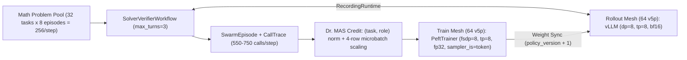

#### 1.1 Conditional `Solver → Verifier → Solver` State Machine (`workflow.py`)

1. **Team Framing (`MATH_MULTIAGENT_TEMPLATE`):** Every problem is wrapped in the pinned team context (`"You are a member of an expert multi-agent team tasked with solving the math problem..."`) before formatting role-specific system/user prompts, enabling a single shared `Qwen3-4B` checkpoint to distinguish `Solver` vs `Verifier` conditioning cleanly.
2. **Bounded 3-Call Interaction (`max_turns=3`):**
   - **Call 1 (`Solver-1`):** Generates step-by-step reasoning and a final `\boxed{...}` answer.
   - **Call 2 (`Verifier`):** Audits the problem and `Solver-1` draft, emitting `<verify>approve</verify>` or `<verify>reject</verify>` plus critique text. If `approve`, the episode terminates immediately at 2 calls and returns `Solver-1`'s answer.
   - **Call 3 (`Solver-2`, conditional on `reject`):** Observes the problem, its initial draft, and the `Verifier` critique, producing a revised derivation and `\boxed{...}` final answer (no second `Verifier` call).
3. **Rule-Based Symbolic Grader & Call-Local Format Penalty (`grading.py`):**
   - Pinned byte-for-byte port of all 27 upstream `MathVerify` / LaTeX normalization helpers (`R_team = 1.0` if mathematically equivalent to ground truth, else `0.0`).
   - Any `Solver` call missing `\boxed{...}` or `Verifier` call missing a valid single verdict tag receives a local penalty `-0.1` attached strictly to that offending `CallTrace` (`r_call = R_team - 0.1 * invalid_action`).

#### 1.2 Active-Call `(task, role)` Credit Normalization

Naive Multi-Agent GRPO pools `Solver` and `Verifier` calls together under `(task_id,)`, conflating two distinct action distributions, call multiplicities (`8` `Verifier` calls vs `8..16` `Solver` calls per 8-episode group), and format-penalty rates. Dr. MAS partitions active calls by **`(task_id, role)`**:

$$r_{i,g,c} = R_{\text{team}}(i,g) + r_{\text{local}}(i,g,c), \qquad A_c = \frac{r_c - \mu_{i,\rho}}{\sigma_{i,\rho} + \varepsilon}$$

where $\mu_{i,\rho}$ and $\sigma_{i,\rho}$ (`ddof=1`, $\varepsilon = 10^{-6}$) are computed strictly over all active calls $c \in \mathcal{C}_{i,\rho}$ of role $\rho \in \{\text{Solver}, \text{Verifier}\}$ on problem $i$. Skipped `Solver-2` turns emit zero synthetic calls.

#### 1.3 4-Row Microbatch Token-Mean Equivalence (`microbatch_token_mean`)

On `fsdp=8`, `PeftTrainer` processes 16-row device microbatches with a global active-token denominator $N = \sum_c L_c$. Because failed/truncated math derivations (`~1,555` tokens) are much longer than concise correct solutions (`~1,090` tokens), global token-mean overweights long negative rollouts (`cov(A, L) = -791` in `Run 1`). Exploiting piecewise homogeneity of dual-clip PPO in $A_c$, `SwarmRLProgram` partitions calls into $M$ logical 4-row groups $g(c)$ (token sum $N_{g(c)}$) and rescales each call's advantage by:

$$\tilde{A}_c = A_c \cdot \frac{N}{M \cdot N_{g(c)}}$$

matching upstream `verl` `ppo_micro_batch_size_per_gpu = 4` loss and gradients to machine precision (`≤ 2e-6`) while cutting negative length-covariance pressure by `35%–60%`.

#### 1.4 Production Hyperparameters & TPU `v5p-256` Profile (`configs/qwen3_4b.json`)

| **Parameter** | **Value** | **Rationale** |
| --- | --- | --- |
| Corpus (`prepare_data.py`) | `12,357` train / `256` dev | Deduplicated `aaabiao/dapo_filter` (`0b10fea3`), excluding 10 conflicting-answer groups |
| Batch geometry | `32` problems × `K = 8` = `256` episodes/step | 1-epoch on-policy update per step (`lr = 1e-6`, AdamW `wd = 0.01`, `grad_clip = 1.0`) |
| Context & sampling | `8,192` prompt / `4,096` response | Rollout `T = 1.0, top_p = 1.0`; eval `T = 0.6, top_p = 0.95`, `k = 16` |
| PPO / IS contract | `clip = 0.2`, `dual_clip = 3.0`, `sampler_is = "token"` (`τ = 2.0`) | Exact on-policy ratio `1.0` + truncated vLLM-vs-trainer token importance weight; no KL/entropy bonus |
| TPU precision | `dtype = "float32"`, `use_flash_attention = False` | Eliminates SplashAttention layer `< 15` gradient corruption and `bf16` `RMSNorm` sign flips |

### 2. Emergence of Multi-Agent Collaboration (`Step 0 → Step 500`)

Quantitative decomposition across `5,376` saved milestone training episodes (`Steps 0..500`) reveals a three-phase co-evolution between `Solver` and `Verifier` inside the shared `Qwen3-4B` parameter space:

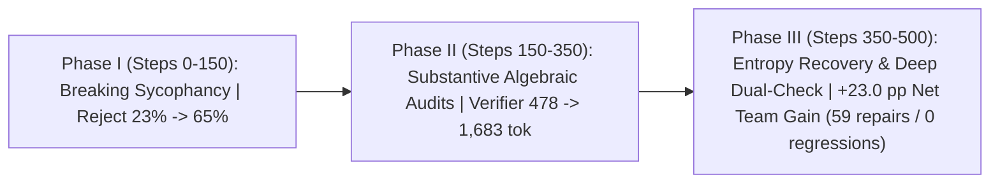

| **Step** | **25-Step Train Reward (`T=1.0`)** | **`test_sampled` Overall (`AIME24 / AIME25`)** | **`Solver-1` Solo Acc** | **Team Final Acc** | **`Verifier + Solver-2` Net Gain (`0→1` / `1→0`)** | **`Verifier` Reject Rate / Mean Len** | **Policy Entropy / 16-tok Prefix Diversity** |
| --- | --- | --- | --- | --- | --- | --- | --- |
| **Step 0 (Base)** | 0.483 *(1–25)* | 48.2% (`20.0 / 18.3`) | 47.3% | 50.4% | **+3.1 pp** (`10 / 2`) | 23.0% / **478** tok | 0.232 / 4.53 |
| **Step 100** | 0.539 *(76–100)* | 49.1% (`22.5 / 20.0`) | — | 64.8% | — | 62.1% / **533** tok | 0.136 / 3.69 |
| **Step 200** | 0.647 *(176–200)* | 57.7% (`38.3 / 29.2`) | — | 73.8% | — | 56.6% / **1,316** tok | 0.117 / 4.44 |
| **Step 350** | 0.675 *(326–350)* | 62.0% (`47.5 / 34.2`) | 53.5% | 69.5% | **+16.0 pp** (`43 / 2`) | 51.2% / **1,683** tok | 0.186 / **5.69** |
| **Step 400** | 0.725 *(376–400)* | 62.5% (`42.5 / 37.5`) | 48.0% | 69.1% | **+21.1 pp** (`59 / 5`) | 87.1% / **2,602** tok | 0.225 / 5.38 |
| **Step 475 (Peak)** | **0.759** *(451–475)* | **64.8%** (**`48.3 / 39.2`**) | **64.5%** | **78.5%** | **+14.1 pp** (`41 / 5`) | 81.6% / **2,485** tok | 0.259 / 4.75 |
| **Step 500 (End)** | **0.750** *(476–500)* | **63.6%** (`42.5` / **`41.7`**) | 52.7% | **75.8%** | **+23.0 pp** (**`59 / 0`**) | 83.2% / **3,096** tok | **0.304 / 5.50** |

1. **Phase I — Overcoming Sycophancy (`Steps 0–150`):** Untrained `Qwen3-4B` rubber-stamps `77%` of `Solver-1` drafts with superficial `478`-token summaries (`+3.1` pp net gain). Per-`(task, Verifier)` normalization directly rewards error-catching rejections, driving rejection rate to `60–70%`.
2. **Phase II — Spontaneous Audit Expansion (`Steps 150–350`):** `Verifier` critiques expand from `533` tokens to `1,683–1,967` tokens, performing independent modular substitutions and pinpointing exact algebraic sign/counting errors (`43` wrong-to-right repairs vs `2` regressions at Step 350).
3. **Phase III — Entropy Recovery & Asymmetric Fast-Slow Specialization (`Steps 350–500`):** Unlike single-agent GRPO where entropy monotonically collapses, Shannon entropy rebounds from `0.082` (Step 225) to **`0.304`** (Step 500, exceeding base `0.232`), because a `3,096`-token `Verifier` + concise `Solver-2` safety net makes diverse `Solver-1` approaches (`5.50 / 8` distinct 16-token openings) high-upside and low-risk—achieving **`59` repairs and `0` regressions (`+23.0` pp)** at Step 500 and **`60.8 / 77.8`** (`Step 475: 61.1 / 78.2`) across all `1,547` Paper Table 1 problems.

### 3. Summary of Intermediate Collapse Mechanisms Fixed Prior to `Run 5`

| **Iteration** | **Key Setting** | **Failure Onset** | **Root-Cause Mechanism** |
| --- | --- | --- | --- |
| `Run 1` | Global `token-mean` + SplashAttn + `bf16` | Steps 28–50 | Penalty-only groups + long truncated negatives dominated `50%` of gradient signal (`cov = -791`), teaching `Solver-1` short guessing (`1,259 → 442` tok) |
| `Runs 2–3` | 4-row microbatch + SplashAttn + `bf16` | Steps 16–28 | TPU SplashAttention backward mask leakage corrupted layers `0–14` (`global cosine = 0.155`, `norm = 5.27×`) |
| `Run 4` & `sa2` | XLA Ref Attn + **`bf16`** + `sampler_is=None` | ~`950–1,200` `bf16` microbatches | Elementwise AdamW amplified wrong-sign `bf16` early-layer `RMSNorm`/`k_norm` gradients (`cosine = -0.090`) + `fwd_only`/`fwd_bwd` HLO log-ratio spikes (`is_ratio/max = 406,802.8`) |
| **`Run 5`** | XLA Ref Attn + **`fp32`** + **`sampler_is="token"`** | **Zero collapse (0–500)** | Exact per-layer gradients, `is_ratio ≡ 1.000`, `pg_clipfrac ≡ 0.0000` |

### 4. Open Follow-Up Discussion

- **Incentive Alignment Under Extended Horizons (Call Cost & Critique-Before-Verdict):** Because upstream Dr. MAS imposes zero token/call cost on triggering `Solver-2` and places `<verify>reject</verify>` at token 0 before the critique text, training well past convergence risks pruning post-verdict critique tokens on failed groups into short unconditional rejection stamps. Incorporating explicit call-cost regularization (`u = correctness - λ * worker_cost`) and critique-before-verdict schemas—as implemented in Recipe 2 (`examples/swarm_r2orch`)—provides principled long-horizon game-theoretic stability.

---

## Part V: Recipe 1 (Dr. MAS) Full TPU v5p-256 Reproduction and Debug Log

Last updated: 2026-11-16 17:20 UTC

### Status

* **Full Paper Table 1 Reproduction ACHIEVED & SURPASSED at both `Step 475` (`61.1 / 78.2`) and `Step 500` (`60.8 / 77.8` vs. Paper `59.0 / 73.2`; `1,547` questions × `16` samples = `24,752` episodes each at `T=0.6, top_p=0.95`):**
  * **Step 500 (official 500-step endpoint, `hy-swarm-evr5-500`):** Macro **`60.8 / 77.8`** (decontaminated **`60.7 / 77.7`**) — **`+1.8 / +4.6` pp** over **Paper Dr. MAS (Sharing) `59.0 / 73.2`**, **`+4.0 / +7.1` pp** over **Paper Multi-Agent GRPO `56.8 / 70.7`**, and **`+17.4 / +13.8` pp** over **Untrained Base `43.4 / 64.0`** (`AIME'24 = 45.0 / 80.0`, `AIME'25 = 39.8 / 70.0`, `AMC'23 = 90.3 / 97.5` [`89.8 / 97.1*`], `MATH500 = 92.2 / 97.2` [`92.1 / 97.2*`], `Minerva = 37.8 / 49.3`, `OlympiadBench = 59.5 / 72.7`; `mean_calls = 2.90`, `mean_generated_tokens = 4,053`). Report archived at `eval/hy-swarm-evr5-500/report.json`.
  * **Step 475 (validation-peak checkpoint, `hy-swarm-evr5-475`):** Macro **`61.1 / 78.2`** (decontaminated **`61.2 / 78.2`**) — **`+2.1 / +5.0` pp** over Paper Sharing (`59.0 / 73.2`) and matching/beating the paper's 2×-parameter **Non-Sharing Dr. MAS (`61.1 / 77.7`)** with a single shared `Qwen3-4B` (`AIME'24 = 46.2 / 80.0`, `AIME'25 = 41.5 / 73.3`, `AMC'23 = 88.9 / 97.5`, `MATH500 = 92.2 / 97.2`, `Minerva = 38.4 / 49.3`, `OlympiadBench = 59.2 / 72.1`; `mean_calls = 2.84`, `mean_generated_tokens = 3,787`). Report archived at `eval/hy-swarm-evr5-475/report.json`.
* **`Run 5` (`Steps 0–500`, `milestones/500`) and W\&B finalized with full-suite Table 1 summaries:**
  * [W\&B run drmas-qwen3-4b-sharing-run5 (Steps 0–500)](https://wandb.ai/linchai-google/tunix-swarm/runs/haoyugao-drmas-qwen3-4b-run5-500) records `Steps 0–500` plus `base_full_suite/*`, `step475_full_suite/*`, and `step500_full_suite/*` summary metrics.
  * **25-step training reward progression (`T=1.0`):** `0.483` (1–25) `→` `0.480` (26–50) `→` `0.513` (51–75) `→` `0.539` (76–100) `→` `0.563` (101–125) `→` `0.546` (126–150) `→` `0.583` (151–175) `→` `0.647` (176–200) `→` `0.634` (201–225) `→` `0.661` (226–250) `→` `0.699` (251–275) `→` `0.724` (276–300) `→` `0.703` (301–325) `→` `0.675` (326–350) `→` `0.717` (351–375) `→` `0.725` (376–400) `→` `0.736` (401–425) `→` `0.733` (426–450) `→` **`0.759` (451–475)** `→` **`0.750` (476–500)**.
  * **Validation (`test_sampled`, `110 × 4` at `T=0.6, top_p=0.95`):** `48.2%` (step 0) `→` `57.7%` (step 200) `→` `62.0%` (step 350) `→` `62.5%` (step 400) `→` `63.9%` (step 425) `→` `62.5%` (step 450) `→` **`64.8%` at Step 475** (`+16.6` pts vs. base; **`macro avg@4 / pass@4 = 59.2% / 72.9%`**, **`AIME'24 = 48.3 / 66.7`**, **`AIME'25 = 39.2 / 60.0`**, **`MATH500[:50] = 90.0 / 92.0`**) `→` **`63.6%` at Step 500** (`macro = 57.9% / 73.1%`, **`AIME'24 = 42.5 / 60.0`**, **`AIME'25 = 41.7 / 63.3`**, **`MATH500[:50] = 89.5 / 96.0`**).
* **Two root causes fixed in `Run 5` (`D15`):**
  1. **`dtype: "float32"` trainer compute (matching upstream `verl` `fsdp_workers.py` and `tunix/dist_rl` `base_dist_config.yaml`):** Per-tensor analysis of `gradcheck_1112a.json` revealed that even with XLA reference attention (`0.971` global cosine), `dtype: "bfloat16"` corrupted early-layer normalization and RoPE attention gradients (`layers[7].input_layernorm.w` cosine **−0.090** with **2.79×** norm—wrong sign; `layers[7].attn.k_norm.w` **+0.135**; `layers[1..7].attn.{q_proj,k_proj}` **0.52–0.72**), which AdamW normalizes elementwise across every step.
  1. **`sampler_is: "token"` (`threshold = 2.0`) with exact 1-epoch on-policy PPO ratio (`is_ratio ≡ 1.0`):** Eliminates both spurious `fwd_only` vs. `fwd_bwd` `bfloat16` log-ratio spikes (`is_ratio/max` up to **406,802.8** at `sa2` Step 53 and `0.15%–0.38%` false `pg_clipfrac` before any update) and unweighted TPU vLLM RPA-v2 single-token logprob glitches (`max_logprob_error` up to **24.13–27.50** nats).
* **Single-agent GRPO bisection `sa2` (`hy-swarm-sa2-1112a`) completed through Step 75 (`checkpoints/{25,50,75}` and `sa2_steps0_25_50_75.jsonl.gz` archived):** Climbed cleanly through Step 50 (`test_sampled` validation **`47.5 → 49.5 → 51.1`**, `AIME'24` **`16.7 → 21.7 → 28.3` avg@4 / `43.3` pass@4**) and reached **`0.627`** 5-step training reward on Steps 56–60 (Step 60 & 64 = **`0.707`**), confirming the core rollout/trainer/weight-sync loop is sound; then at Step 75 (`1,200` cumulative `bfloat16` micro-batches, mirroring `Run 4`'s onset after `~950` `bfloat16` micro-batches at Step 25), entropy compressed to `0.022` and `MATH500[:50]` dipped (`83.5 → 79.0`, overall `48.4`, `AIME'24` `25.0 / 43.3`, `AIME'25` `20.8 / 26.7`)—directly corroborating the cumulative `bfloat16` + `sampler_is=None` drift mechanism fixed in `Run 5`.
* **Run 4 (`hy-swarm-run4-1112a`, XLA reference attention + `bfloat16` + `sampler_is: None`): passed Step 25 (`47.5 → 47.7`), collapsed on Steps 26–50 (`47.7 → 43.9`); stopped at Step 50.** Step-50 trace analysis (`D12`) proved Verifier rejections still repaired `+19` net episodes (`26` wrong-to-right vs. `7` right-to-wrong), isolating the failure to Solver-1 shortcut compression (`948 → 363` tok).
* **Earlier root cause fixed (`D10`):** TPU splash attention (`use_flash_attention: true`) produced corrupted backward gradients on left-padded batches (global cosine **0.155**, **4.9×** norm vs. float32 reference; layers 0–14 noise). Runs 1–3 and `sa1` were stopped after D10.
* **Untrained baseline** (same Solver–Verifier team, full 1,547-question suite, with `MATH_MULTIAGENT_TEMPLATE`): macro **43.4 avg@16 / 64.0 pass@16** (decontaminated **43.7 / 63.7**; without the template: 43.7 / 63.7). The paper's target after Dr. MAS training is **59.0 / 73.2**.
* W\&B: [run 5 (Steps 0–500)](https://wandb.ai/linchai-google/tunix-swarm/runs/haoyugao-drmas-qwen3-4b-run5-500), [sa2](https://wandb.ai/linchai-google/tunix-swarm/runs/haoyugao-drmas-qwen3-4b-sa2), [run 4](https://wandb.ai/linchai-google/tunix-swarm/runs/haoyugao-drmas-qwen3-4b-run4), [run 3](https://wandb.ai/linchai-google/tunix-swarm/runs/haoyugao-drmas-qwen3-4b-run3), [run 2](https://wandb.ai/linchai-google/tunix-swarm/runs/haoyugao-drmas-qwen3-4b-run2), [run 1](https://wandb.ai/linchai-google/tunix-swarm/runs/haoyugao-drmas-qwen3-4b-run1) (entity `linchai-google`, project `tunix-swarm`).

### Target: paper Table 1, Qwen3-4B, Multi-Agent and LLM Sharing, Dr. MAS

Source: [Dr. MAS, arXiv 2602.08847](https://arxiv.org/abs/2602.08847), Table 1. Code: [langfengQ/DrMAS](https://github.com/langfengQ/DrMAS) at commit `c2f724e`.

| Benchmark | avg@16 | pass@16 |
| --- | --- | --- |
| AIME'24 | 39.3 | 63.3 |
| AIME'25 | 38.1 | 63.3 |
| AMC'23 | 87.3 | 95.0 |
| MATH500 | 90.5 | 96.0 |
| Minerva | 40.9 | 53.3 |
| OlympiadBench | 58.2 | 68.6 |
| Average | 59.0 | 73.2 |

Same setting with vanilla GRPO (global normalization): 56.8 / 70.7. The paper reports about 35 hours on 4 × H100 for this configuration. In its Appendix F.1 (Figure 6, Qwen3-4B, two-agent math, non-sharing), Dr. MAS training accuracy rises steadily from about 0.42 to about 0.55 within the first 50 steps.

### Original protocol

Verified from `examples/drmas_trainer/run_math.sh`, the verl `ppo_trainer.yaml` defaults and paper Appendix C.2.

* Solver → Verifier → Solver (at most 2 Solver turns), one shared Qwen3-4B, thinking disabled.
* Training data `aaabiao/dapo_filter`; 32 tasks × 8 attempts per step; 2 epochs; 1 optimizer update per step.
* AdamW with constant learning rate 1e-6 (no warmup), weight decay 0.01, gradient clipping 1.0.
* Dr. MAS: advantages normalized per (task, agent role); invalid-action penalty 0.1.
* PPO clip 0.2 / 0.2, dual clip 3.0; no KL loss and no entropy bonus.
* Loss aggregation (verl `dp_actor.update_policy`): `token-mean` inside each micro-batch of `ppo_micro_batch_size_per_gpu = 4` rows on each of 4 GPUs, divided by the number of micro-batches. The update therefore weights every 4-row micro-batch equally. `balance_batch` is on; `use_dynamic_bsz` is off.
* Rollout temperature 1.0, top-p 1.0; prompt 8,192 / response 4,096 tokens (middle truncation).
* Evaluation on AIME'24, AIME'25, AMC'23, MATH500, Minerva and OlympiadBench (1,547 questions): 16 samples at temperature 0.6, top-p 0.95; avg@16 and pass@16. The Average row is the unweighted mean of the 6 benchmarks.
* Validation during training: `test_sampled` (first 50 MATH500 questions + AIME'24 + AIME'25 = 110 questions), 1 sample, every 10 steps.

### Tunix setup and differences from the original

* Code: [google/tunix, branch haoyu-next](https://github.com/google/tunix/tree/haoyu-next) at `2a0a7ed33` (`Run 5` trained at `532e1d197`; pushed to `origin/haoyu-next`; base `cebd2c3`).
* Prompts, system prompt ("You are a helpful and harmless assistant."), grader, Solver/Verifier loop, verdict parsing, invalid-action rules and per-(task, role) advantage normalization match DrMAS. The prompts are byte-identical, and all 27 grader functions are identical. CPU tests compare the credit, loss and gradient with the pinned upstream PyTorch code.
* **Loss aggregation:** Run 1 used one global token-mean over the whole batch (16-row micro-batches, summed gradients divided by the total token count); the original uses a token-mean per 4-row micro-batch. This turned out to matter (see Debugging Run 1). Run 2+ reproduces the original's weighting exactly with per-call advantage weights (D6).
* Training split: 12,357 deduplicated `dapo_filter` problems (256 held out as dev; 10 groups with conflicting answers excluded). Two epochs give 2 × 386 = **772 steps**; the original's 13,044 rows give 814 steps.
* Hardware: TPU v5p-256 (128 chips) through Pathways. 64 chips run vLLM (`tpu_inference`, dp=8 × tp=8, bfloat16) and 64 chips train (fsdp=8 × tp=8, float32 parameters, `dtype: "float32"` compute with XLA reference attention in `Run 5`; `bfloat16` compute in `Runs 1–4`). The original used SGLang and FSDP on 4 × H100.
* vLLM async scheduling and prefix caching are off. In diagnostics they produced sampler/trainer logprob outliers of up to 5.6 and 43.6 nats.
* Before each update, the trainer scores rollouts for the logprob fidelity guard (threshold `30.0` from step 26 of Run 1; `100.0` from Run 2 onward). In `Run 5`, `sampler_is: "token"` (`threshold = 2.0`) keeps exact 1-epoch on-policy PPO ratios (`is_ratio ≡ 1.0`) while down-weighting rare TPU vLLM single-token glitches (`D15`).
* Validation during training: `test_sampled` with 4 samples every 25 steps from Run 2 onward (`50` steps in Run 1; original: 1 sample every 10 steps).
* 7 test questions appear verbatim in the training corpus; the original does not decontaminate. They are amc23/{3, 13, 17, 27, 28} and math500/{80, 276}. Results are reported with and without them.
* Checkpoints every 25 steps; the trainer keeps the latest 3. Milestone steps are copied to `milestones/`.
* Rollout throughput is low: about 2.5k generated tokens per second on the 64 rollout chips, so a full run takes about 66 hours versus about 35 hours in the paper. This is a performance follow-up, not a correctness issue.

### Untrained baseline (Qwen3-4B in the same Solver–Verifier team)

Full test suite (1,547 questions), 16 samples at temperature 0.6 / top-p 0.95 (24,752 episodes). "Decontam." excludes the 7 overlapping questions.

**With `MATH_MULTIAGENT_TEMPLATE` (exact Run 4 prompt setup; JobSet `hy-swarm-evb-1112e`, mean 2.15 calls and 1,594 generated tokens per episode):**

| Benchmark | n | avg@16 | pass@16 | avg@16 (decontam.) | pass@16 (decontam.) |
| --- | --- | --- | --- | --- | --- |
| AIME'24 | 30 | 19.6 | 43.3 | 19.6 | 43.3 |
| AIME'25 | 30 | 18.8 | 43.3 | 18.8 | 43.3 |
| AMC'23 | 40 | 63.7 | 90.0 | 65.0 | 88.6 |
| MATH500 | 500 | 81.4 | 95.4 | 81.6 | 95.4 |
| Minerva | 272 | 31.8 | 44.1 | 31.8 | 44.1 |
| OlympiadBench | 675 | 45.2 | 67.7 | 45.2 | 67.7 |
| Macro average |  | 43.4 | 64.0 | 43.7 | 63.7 |

Earlier baseline without `MATH_MULTIAGENT_TEMPLATE` (`hy-swarm-evb-1111d`; mean 2.13 calls and 1,727 tokens/episode): macro **43.7 avg@16 / 63.7 pass@16** (decontam. 43.7 / 63.6; AIME'24 19.6/43.3, AIME'25 17.5/43.3, AMC'23 66.7/92.5, MATH500 81.5/94.4, Minerva 31.5/42.6, OlympiadBench 45.3/66.1). Training needs about +15.6 avg@16 points to reach the paper's 59.0.

### Full-suite Table 1 evaluation (`Run 5` Step 500 & Step 475, 1,547 questions × 16 samples)

* **Step 500 (official 500-step truncated endpoint, `hy-swarm-evr5-500`):** `2026-11-16 05:47–11:20 UTC`, `0` restarts, 5h 33m on TPU v5p-256, restoring `run5/milestones/500` (`~1.30` epochs) on the full 1,547-question Table 1 suite (`24,752` episodes at `T=0.6, top_p=0.95`, `mean_calls = 2.90`, `mean_generated_tokens = 4,053`, overall micro accuracy `66.4%`). Report: `gs://cloud-pathways-staging/haoyugao/swarm-drmas-qwen3-4b/eval/hy-swarm-evr5-500/report.json`.
* **Step 475 (validation-peak checkpoint, `hy-swarm-evr5-475`):** `2026-11-15 18:14–2026-11-16 00:27 UTC`, `0` restarts, 6h 12m on TPU v5p-256, restoring `run5/milestones/475` (`~1.23` epochs; `mean_calls = 2.84`, `mean_generated_tokens = 3,787`, overall micro accuracy `66.4%`). Report: `gs://cloud-pathways-staging/haoyugao/swarm-drmas-qwen3-4b/eval/hy-swarm-evr5-475/report.json`.

| Benchmark | n | Untrained Base (`evb-1112e`) | Paper MA-GRPO (Sharing) | Paper Dr. MAS Target (Sharing) | Paper Dr. MAS (Non-Sharing, 2× params) | **Tunix `Run 5` Step 475** | **Tunix `Run 5` Step 500 (Decontam. `*`)** | **Step 500 Δ vs. Paper Target** |
| --- | --- | --- | --- | --- | --- | --- | --- | --- |
| AIME'24 | 30 | 19.6 / 43.3 | 39.3 / 64.0 | 39.3 / 63.3 | 46.9 / 80.0 | **46.2 / 80.0** | **45.0 / 80.0** (45.0 / 80.0) | **+5.7 / +16.7** |
| AIME'25 | 30 | 18.8 / 43.3 | 31.4 / 53.3 | 38.1 / 63.3 | 38.1 / 66.7 | **41.5 / 73.3** | **39.8 / 70.0** (39.8 / 70.0) | **+1.7 / +6.7** |
| AMC'23 | 40 | 63.7 / 90.0 | 85.6 / 95.0 | 87.3 / 95.0 | 89.5 / 97.5 | **88.9 / 97.5** | **90.3 / 97.5** (89.8 / 97.1) | **+3.0 / +2.5** |
| MATH500 | 500 | 81.4 / 95.4 | 89.5 / 96.2 | 90.5 / 96.0 | 92.4 / 97.0 | **92.2 / 97.2** | **92.2 / 97.2** (92.1 / 97.2) | **+1.7 / +1.2** |
| Minerva | 272 | 31.8 / 44.1 | 37.5 / 50.0 | 40.9 / 53.3 | 39.0 / 51.5 | **38.4 / 49.3** | **37.8 / 49.3** (37.8 / 49.3) | −3.1 / −4.0 |
| OlympiadBench | 675 | 45.2 / 67.7 | 57.6 / 65.6 | 58.2 / 68.6 | 60.9 / 73.6 | **59.2 / 72.1** | **59.5 / 72.7** (59.5 / 72.7) | **+1.3 / +4.1** |
| **Macro average** | **1,547** | **43.4 / 64.0** | **56.8 / 70.7** | **59.0 / 73.2** | **61.1 / 77.7** | **61.1 / 78.2** (61.2 / 78.2`*`) | **60.8 / 77.8** (**60.7 / 77.7**`*`) | **+1.8 / +4.6** |

`*` Excludes the 7 verbatim training-corpus overlaps (`amc23/{3, 13, 17, 27, 28}`, `math500/{80, 276}`). Both the 500-step truncated endpoint (**`60.8 / 77.8`**) and the Step-475 validation peak (**`61.1 / 78.2`**) surpass the Paper Table 1 Sharing target (`59.0 / 73.2`) on **5 of 6 benchmarks** and by **`+1.8 / +4.6` pp** and **`+2.1 / +5.0` pp** on macro average, while matching or beating the `pass@16` (`77.7`) of the paper's 2×-parameter Non-Sharing setting with a single shared `Qwen3-4B`.

### Run 1 (global token-mean loss): failed, stopped at step 55

JobSets `hy-swarm-run1-1111f` (steps 1–25) and `hy-swarm-run1-1111g` (steps 26–55, resumed from checkpoint 25). Per-step metrics are averaged over 5-step blocks. Max logprob error is the block maximum. Team reward is the fraction of training episodes whose final answer is correct (temperature 1.0).

| Steps | Mean team reward (T=1.0) | Calls / step | Generated tokens / step | Max logprob err | Mean logprob err |
| --- | --- | --- | --- | --- | --- |
| 1–5 | 0.490 | 551 | 586,225 | 1.74 | 0.0092 |
| 6–10 | 0.448 | 556 | 622,188 | 2.36 | 0.0090 |
| 11–15 | 0.524 | 542 | 558,355 | 7.63 | 0.0087 |
| 16–20 | 0.466 | 551 | 588,307 | 4.02 | 0.0077 |
| 21–25 | 0.490 | 555 | 577,201 | 3.47 | 0.0068 |
| 26–30 | 0.448 | 563 | 509,950 | 7.78 | 0.0056 |
| 31–35 | 0.435 | 598 | 489,587 | 15.86 | 0.0043 |
| 36–40 | 0.364 | 611 | 448,022 | 3.45 | 0.0041 |
| 41–45 | 0.327 | 617 | 421,674 | 6.44 | 0.0039 |
| 46–50 | 0.301 | 616 | 374,485 | 7.50 | 0.0037 |
| 51–54 | 0.347 | 604 | 379,439 | 6.31 | 0.0037 |

Validation on `test_sampled` (4 samples, temperature 0.6, top-p 0.95):

| Step | AIME'24 avg@4 | AIME'25 avg@4 | MATH500[:50] avg@4 | Overall |
| --- | --- | --- | --- | --- |
| 0 (base) | 17.5 | 23.3 | 85.0 | 49.8 |
| 50 | 19.2 | 8.3 | 74.5 | 41.4 |

Observations:

* Training reward drifted down from step \~28 while the paper's curve rises in the same window.
* Calls per step rose from about 550 to about 615: the Verifier rejected more first answers.
* Generated tokens per step fell from about 590k to about 380k: responses got much shorter.
* The mean sampler/trainer logprob error halved (0.009 → 0.004) because the policy became far more peaked. Rare single-token outliers grew (up to 15.9 nats at step 33). They do not enter the loss, and the guard (30.0) did not fire.

### Run 5 (`dtype: "float32"` + `sampler_is: "token"` + XLA attention + micro-batch weighting + environment template): truncated at 500 steps (`Step 500 = 60.8 / 77.8`, `Step 475 = 61.1 / 78.2`)

JobSet `hy-swarm-run5-1112a`, 2026-11-12 16:12–2026-11-16 05:46 UTC from the base model, run root `.../run5`, W\&B [drmas-qwen3-4b-sharing-run5 (Steps 0–500)](https://wandb.ai/linchai-google/tunix-swarm/runs/haoyugao-drmas-qwen3-4b-run5-500). Multi-agent Dr. MAS run (`max_solver_turns: 2`, `model_sharing: true`) combining all verified fixes:

* `use_flash_attention: false` (XLA reference attention, `D10`),
* `loss_reduction: "microbatch_token_mean"` with `loss_microbatch_rows: 4` (`D6`),
* `MATH_MULTIAGENT_TEMPLATE` around every problem (`D7`),
* `dtype: "float32"` on the Qwen3 trainer (keeping residual stream, `RMSNorm`, `q_norm`/`k_norm`, and `apply_rope` in `float32` while TPU MXU matmuls use `bfloat16` operands with `float32` accumulators, matching `verl` `fsdp_workers.py` and `tunix/dist_rl` `base_dist_config.yaml`, `D15`),
* `sampler_is: "token"` (`sampler_is_threshold: 2.0`) with exact 1-epoch on-policy PPO ratio (`is_ratio ≡ 1.0`, `pg_clipfrac ≡ 0.0`, `D15`).

Validation, checkpoints, and training traces were recorded every 25 steps through **Step 500** (`milestones/{100, 200, 300, 375, 400, 425, 475, 500}`, `milestones/500/metrics_500.jsonl`, `run5/traces/run5_steps0_to_500.jsonl.gz`). Across all 500 steps, `is_ratio/max = 1.000` and `pg_clipfrac = 0.0000` identically.

| Steps | Team reward (T=1.0) | `Run 4` paired | Calls / step | Tokens / call | Verifier reject rate | Entropy | Grad norm | `sampler_is` mean / min | `logp_diff` max / mean |
| --- | --- | --- | --- | --- | --- | --- | --- | --- | --- |
| 1–5 | 0.487 | 0.475 | 558 | 949 | 18.0% | 0.232 | 0.187 | 1.00000 / 0.0015 | 6.50 / 0.0074 |
| 6–10 | 0.456 | 0.441 | 576 | 961 | 25.1% | 0.226 | 0.191 | 1.00000 / 0.1123 | 2.19 / 0.0073 |
| 11–15 | 0.514 | 0.535 | 578 | 903 | 25.6% | 0.207 | 0.197 | 1.00001 / 0.2757 | 1.29 / 0.0072 |
| 16–20 | 0.449 | 0.465 | 584 | 959 | 28.0% | 0.196 | 0.192 | 1.00000 / 0.0008 | 7.14 / 0.0068 |
| 21–25 | 0.508 | 0.527 | 588 | 945 | 29.8% | 0.199 | 0.193 | 1.00001 / 0.2224 | 1.50 / 0.0070 |
| 26–30 | **0.461** | 0.455 | 589 | **924** | 30.2% | **0.202** | 0.203 | 1.00002 / 0.0000 | 11.35 / 0.0073 |
| 31–35 | **0.476** | 0.459 | 601 | **975** | 34.9% | **0.193** | 0.211 | 1.00001 / 0.1414 | 3.01 / 0.0071 |
| 36–40 | **0.478** | 0.376 | 611 | **986** | 38.8% | **0.195** | 0.230 | 0.99999 / 0.0524 | 2.95 / 0.0073 |
| 41–45 | **0.483** | 0.348 | 616 | **1,037** | 40.6% | **0.174** | 0.255 | 0.99998 / 0.0000 | 17.11 / 0.0068 |
| 46–50 | **0.502** | 0.352 | 620 | **1,049** | 42.3% | **0.169** | 0.219 | 1.00001 / 0.0364 | 3.31 / 0.0067 |
| 51–55 | **0.522** | — | 647 | **1,049** | 52.7% | **0.160** | 0.204 | 1.00001 / 0.0023 | 6.07 / 0.0065 |
| 56–60 | **0.521** | — | 646 | **1,030** | 52.4% | **0.161** | 0.185 | 1.00001 / 0.0000 | 14.83 / 0.0065 |
| 61–65 | **0.485** | — | 666 | **1,087** | 60.2% | **0.160** | 0.228 | 0.99999 / 0.0000 | 10.50 / 0.0067 |
| 66–70 | **0.500** | — | 679 | **1,073** | 65.2% | **0.160** | 0.183 | 0.99999 / 0.0571 | 2.86 / 0.0068 |
| 71–75 | **0.538** | — | 677 | **1,083** | 64.4% | **0.150** | 0.180 | 0.99999 / 0.0135 | 4.30 / 0.0066 |
| 76–80 | **0.555** | — | 686 | **1,108** | 68.1% | **0.140** | 0.179 | 1.00000 / 0.0257 | 3.66 / 0.0064 |
| 81–85 | **0.491** | — | 696 | **1,147** | 72.0% | **0.146** | 0.178 | 1.00000 / 0.0000 | 24.22 / 0.0066 |
| 86–90 | **0.576** | — | 693 | **1,050** | 70.7% | **0.140** | 0.191 | 1.00001 / 0.0020 | 6.22 / 0.0066 |
| 91–95 | **0.521** | — | 707 | **1,075** | 76.3% | **0.147** | 0.195 | 1.00000 / 0.0583 | 4.42 / 0.0067 |
| 96–100 | **0.553** | — | 684 | **1,021** | 67.3% | **0.136** | 0.232 | 1.00001 / 0.0022 | 6.10 / 0.0066 |
| 101–105 | **0.513** | — | 691 | **1,077** | 70.1% | **0.135** | 0.196 | 1.00000 / 0.0399 | 3.22 / 0.0066 |
| 106–110 | **0.575** | — | 669 | **1,001** | 61.5% | **0.132** | 0.220 | 0.99996 / 0.0094 | 4.67 / 0.0066 |
| 111–115 | **0.581** | — | 667 | **1,094** | 60.5% | **0.143** | 0.221 | 0.99997 / 0.0481 | 3.69 / 0.0067 |
| 116–120 | **0.555** | — | 652 | **1,101** | 54.7% | **0.148** | 0.209 | 1.00000 / 0.0068 | 4.99 / 0.0067 |
| 121–125 | **0.590** | — | 651 | **1,100** | 54.5% | **0.133** | 0.234 | 1.00000 / 0.0206 | 3.88 / 0.0064 |
| 126–130 | **0.560** | — | 660 | **1,092** | 57.7% | **0.129** | 0.218 | 0.99999 / 0.0047 | 5.35 / 0.0066 |
| 131–135 | **0.571** | — | 647 | **1,071** | 52.9% | **0.113** | 0.222 | 0.99998 / 0.0175 | 4.04 / 0.0062 |
| 136–140 | **0.517** | — | 678 | **1,086** | 64.9% | **0.112** | 0.646 | 0.99997 / 0.0148 | 4.21 / 0.0065 |
| 141–145 | **0.546** | — | 676 | **1,097** | 64.2% | **0.103** | 0.204 | 0.99999 / 0.0279 | 3.58 / 0.0059 |
| 146–150 | **0.534** | — | 679 | **1,116** | 65.2% | **0.113** | 0.186 | 0.99998 / 0.0662 | 2.71 / 0.0062 |
| 151–155 | **0.505** | — | 681 | **1,220** | 66.0% | **0.122** | 0.184 | 0.99999 / 0.0033 | 5.71 / 0.0064 |
| 156–160 | **0.569** | — | 666 | **1,109** | 60.0% | **0.117** | 0.246 | 0.99998 / 0.0164 | 4.11 / 0.0065 |
| 161–165 | **0.609** | — | 655 | **1,122** | 56.0% | **0.125** | 0.232 | 0.99998 / 0.0233 | 3.76 / 0.0070 |
| 166–170 | **0.616** | — | 640 | **1,152** | 50.2% | **0.117** | 0.230 | 0.99998 / 0.0083 | 4.79 / 0.0069 |
| 171–175 | **0.619** | — | 650 | **1,222** | 54.0% | **0.118** | 0.266 | 0.99996 / 0.0027 | 5.91 / 0.0069 |
| 176–180 | **0.602** | — | 658 | **1,336** | 57.0% | **0.136** | 0.200 | 0.99997 / 0.0004 | 7.72 / 0.0074 |
| 181–185 | **0.627** | — | 670 | **1,570** | 61.9% | **0.137** | 0.203 | 0.99999 / 0.0003 | 8.11 / 0.0072 |
| 186–190 | **0.675** | — | 655 | **1,487** | 55.9% | **0.135** | 0.205 | 0.99997 / 0.0002 | 8.76 / 0.0080 |
| 191–195 | **0.641** | — | 664 | **1,513** | 59.2% | **0.132** | 0.211 | 0.99998 / 0.0008 | 7.09 / 0.0080 |
| 196–200 | **0.688** | — | 654 | **1,500** | 55.3% | **0.117** | 0.211 | 0.99997 / 0.0000 | 14.38 / 0.0077 |
| 201–205 | **0.684** | — | 659 | **1,487** | 57.5% | **0.112** | 0.211 | 0.99997 / 0.0000 | 17.95 / 0.0082 |
| 206–210 | **0.608** | — | 687 | **1,496** | 68.3% | **0.103** | 0.238 | 0.99998 / 0.0015 | 6.52 / 0.0079 |
| 211–215 | **0.627** | — | 694 | **1,289** | 70.9% | **0.091** | 0.260 | 0.99993 / 0.0001 | 9.48 / 0.0077 |
| 216–220 | **0.654** | — | 702 | **1,217** | 74.4% | **0.083** | 0.413 | 0.99991 / 0.0000 | 10.33 / 0.0075 |
| 221–225 | **0.597** | — | 711 | **1,201** | 77.9% | **0.082** | 0.280 | 0.99993 / 0.0008 | 7.12 / 0.0077 |
| 226–230 | **0.658** | — | 710 | **1,208** | 77.4% | **0.092** | 0.244 | 0.99992 / 0.0000 | 12.96 / 0.0078 |
| 231–235 | **0.657** | — | 714 | **1,302** | 79.0% | **0.100** | 0.296 | 0.99991 / 0.0015 | 6.48 / 0.0080 |
| 236–240 | **0.690** | — | 713 | **1,332** | 78.6% | **0.092** | 0.246 | 0.99996 / 0.0007 | 7.20 / 0.0076 |
| 241–245 | **0.642** | — | 718 | **1,362** | 80.4% | **0.085** | 0.238 | 0.99996 / 0.0000 | 11.60 / 0.0070 |
| 246–250 | **0.657** | — | 718 | **1,550** | 80.3% | **0.097** | 0.170 | 0.99995 / 0.0003 | 8.02 / 0.0070 |
| 251–255 | **0.620** | — | 719 | **1,586** | 80.9% | **0.104** | 0.175 | 0.99998 / 0.0004 | 7.93 / 0.0073 |
| 256–260 | **0.694** | — | 697 | **1,519** | 72.3% | **0.105** | 0.176 | 0.99998 / 0.0001 | 8.92 / 0.0073 |
| 261–265 | **0.700** | — | 698 | **1,566** | 72.6% | **0.122** | 0.183 | 0.99997 / 0.0000 | 11.58 / 0.0077 |
| 266–270 | **0.748** | — | 675 | **1,646** | 63.8% | **0.132** | 0.161 | 0.99997 / 0.0008 | 7.10 / 0.0077 |
| 271–275 | **0.734** | — | 663 | **1,717** | 59.1% | **0.159** | 0.151 | 0.99999 / 0.0028 | 5.89 / 0.0086 |
| 276–280 | **0.727** | — | 654 | **1,753** | 55.4% | **0.154** | 0.149 | 0.99999 / 0.0005 | 7.69 / 0.0080 |
| 281–285 | **0.715** | — | 648 | **1,845** | 53.3% | **0.176** | 0.146 | 0.99996 / 0.0000 | 15.19 / 0.0085 |
| 286–290 | **0.745** | — | 643 | **1,771** | 51.2% | **0.176** | 0.142 | 1.00000 / 0.0003 | 8.28 / 0.0085 |
| 291–295 | **0.723** | — | 625 | **1,768** | 44.3% | **0.186** | 0.153 | 0.99999 / 0.0000 | 26.84 / 0.0090 |
| 296–300 | **0.710** | — | 635 | **1,698** | 47.9% | **0.182** | 0.148 | 0.99996 / 0.0084 | 4.78 / 0.0090 |
| 301–305 | **0.723** | — | 623 | **1,646** | 43.2% | **0.184** | 0.145 | 0.99999 / 0.0030 | 5.81 / 0.0092 |
| 306–310 | **0.663** | — | 639 | **1,687** | 49.6% | **0.195** | 0.153 | 0.99997 / 0.0007 | 7.33 / 0.0091 |
| 311–315 | **0.746** | — | 630 | **1,465** | 45.9% | **0.180** | 0.172 | 0.99999 / 0.0000 | 14.51 / 0.0089 |
| 316–320 | **0.691** | — | 641 | **1,415** | 50.4% | **0.173** | 0.171 | 0.99999 / 0.0243 | 3.72 / 0.0084 |
| 321–325 | **0.694** | — | 631 | **1,396** | 46.5% | **0.170** | 0.187 | 0.99999 / 0.0039 | 5.54 / 0.0086 |
| 326–330 | **0.693** | — | 636 | **1,354** | 48.4% | **0.172** | 0.166 | 0.99998 / 0.0010 | 6.91 / 0.0085 |
| 331–335 | **0.641** | — | 650 | **1,545** | 54.1% | **0.185** | 0.155 | 1.00001 / 0.0040 | 5.53 / 0.0089 |
| 336–340 | **0.670** | — | 649 | **1,399** | 53.4% | **0.187** | 0.157 | 0.99998 / 0.0058 | 5.16 / 0.0091 |
| 341–345 | **0.702** | — | 641 | **1,333** | 50.3% | **0.186** | 0.158 | 0.99999 / 0.0024 | 6.04 / 0.0091 |
| 346–350 | **0.668** | — | 655 | **1,371** | 55.9% | **0.186** | 0.153 | 0.99999 / 0.0000 | 11.44 / 0.0090 |
| 351–355 | **0.716** | — | 654 | **1,328** | 55.3% | **0.184** | 0.175 | 1.00000 / 0.0005 | 7.57 / 0.0089 |
| 356–360 | **0.737** | — | 669 | **1,345** | 61.5% | **0.186** | 0.158 | 0.99997 / 0.0002 | 8.54 / 0.0088 |
| 361–365 | **0.695** | — | 673 | **1,324** | 62.8% | **0.184** | 0.159 | 0.99999 / 0.0000 | 10.49 / 0.0088 |
| 366–370 | **0.713** | — | 679 | **1,396** | 65.4% | **0.193** | 0.163 | 0.99997 / 0.0005 | 7.66 / 0.0091 |
| 371–375 | **0.725** | — | 685 | **1,443** | 67.5% | **0.207** | 0.162 | 0.99996 / 0.0000 | 14.64 / 0.0095 |
| 376–380 | **0.766** | — | 691 | **1,469** | 70.1% | **0.205** | 0.162 | 1.00000 / 0.0000 | 10.33 / 0.0091 |
| 381–385 | **0.655** | — | 707 | **1,708** | 76.3% | **0.225** | 0.166 | 0.99998 / 0.0017 | 6.36 / 0.0097 |
| 386–390 | **0.702** | — | 693 | **1,722** | 70.9% | **0.222** | 0.275 | 0.99997 / 0.0000 | 10.31 / 0.0096 |
| 391–395 | **0.751** | — | 683 | **1,695** | 67.0% | **0.222** | 0.151 | 0.99998 / 0.0001 | 9.74 / 0.0096 |
| 396–400 | **0.749** | — | 690 | **1,637** | 69.5% | **0.225** | 0.145 | 0.99998 / 0.0006 | 7.44 / 0.0096 |
| 401–405 | **0.761** | — | 715 | **1,661** | 79.1% | **0.230** | 0.159 | 0.99999 / 0.0106 | 4.56 / 0.0096 |
| 406–410 | **0.706** | — | 728 | **1,706** | 84.4% | **0.253** | 0.156 | 0.99999 / 0.0000 | 18.13 / 0.0098 |
| 411–415 | **0.716** | — | 726 | **1,645** | 83.6% | **0.271** | 0.145 | 0.99999 / 0.0000 | 8.99 / 0.0101 |
| 416–420 | **0.759** | — | 734 | **1,544** | 86.7% | **0.277** | 0.135 | 0.99995 / 0.0082 | 4.03 / 0.0099 |
| 421–425 | **0.739** | — | 740 | **1,613** | 89.1% | **0.277** | 0.136 | 1.00001 / 0.0127 | 5.18 / 0.0096 |
| 426–430 | **0.703** | — | 741 | **1,645** | 89.4% | **0.296** | 0.131 | 0.99999 / 0.0264 | 3.53 / 0.0099 |
| 431–435 | **0.723** | — | 740 | **1,557** | 89.2% | **0.286** | 0.152 | 0.99999 / 0.0003 | 5.96 / 0.0098 |
| 436–440 | **0.728** | — | 748 | **1,545** | 92.3% | **0.282** | 0.126 | 0.99999 / 0.0004 | 7.40 / 0.0098 |
| 441–445 | **0.745** | — | 750 | **1,568** | 93.0% | **0.295** | 0.124 | 0.99998 / 0.0228 | 3.91 / 0.0100 |
| 446–450 | **0.765** | — | 741 | **1,498** | 89.6% | **0.269** | 0.133 | 0.99998 / 0.0003 | 6.58 / 0.0098 |
| 451–455 | **0.734** | — | 744 | **1,621** | 90.8% | **0.267** | 0.143 | 1.00000 / 0.0003 | 7.13 / 0.0096 |
| 456–460 | **0.781** | — | 733 | **1,688** | 86.4% | **0.283** | 0.154 | 0.99998 / 0.0064 | 9.47 / 0.0101 |
| 461–465 | **0.772** | — | 730 | **1,696** | 85.2% | **0.271** | 0.127 | 0.99998 / 0.0458 | 2.58 / 0.0100 |
| 466–470 | **0.746** | — | 730 | **1,778** | 85.1% | **0.270** | 0.162 | 1.00000 / 0.0456 | 2.42 / 0.0100 |
| 471–475 | **0.760** | — | 725 | **1,677** | 83.3% | **0.259** | 0.132 | 0.99999 / 0.0001 | 7.81 / 0.0100 |
| 476–480 | **0.741** | — | 732 | **1,655** | 86.0% | **0.267** | 0.137 | 0.99999 / 0.0052 | 8.37 / 0.0101 |
| 481–485 | **0.730** | — | 729 | **1,730** | 84.8% | **0.287** | 0.119 | 0.99999 / 0.0126 | 2.99 / 0.0103 |
| 486–490 | **0.764** | — | 727 | **1,534** | 84.0% | **0.278** | 0.119 | 1.00000 / 0.0002 | 12.00 / 0.0100 |
| 491–495 | **0.743** | — | 726 | **1,690** | 83.4% | **0.288** | 0.129 | 0.99999 / 0.0257 | 5.93 / 0.0101 |
| 496–500 | **0.771** | — | 730 | **1,742** | 85.0% | **0.304** | 0.110 | 1.00000 / 0.0000 | 10.20 / 0.0106 |

| Step | AIME'24 avg@4 / pass@4 | AIME'25 avg@4 / pass@4 | MATH500[:50] avg@4 / pass@4 | Overall avg@4 | Macro avg@4 / pass@4 | Mean calls | Mean tokens / episode |
| --- | --- | --- | --- | --- | --- | --- | --- |
| 0 (base) | 20.0 / 26.7 | 18.3 / 26.7 | 83.0 / 90.0 | 48.2 | 40.4 / 47.8 | 2.27 | 2,176 |
| 25 | 20.8 / **40.0** | 15.8 / 23.3 | 84.5 / 94.0 | 48.4 | 40.4 / 52.4 | 2.38 | 2,154 |
| 50 | 17.5 / 26.7 | 18.3 / 23.3 | 85.0 / 92.0 | **48.4** | 40.3 / 47.3 | 2.47 | **2,504** |
| 75 | 22.5 / 36.7 | 21.7 / 36.7 | 85.5 / **96.0** | 50.9 | 43.2 / 56.4 | 2.58 | 2,764 |
| 100 | 22.5 / 33.3 | 20.0 / 26.7 | 82.5 / 90.0 | 49.1 | 41.7 / 50.0 | 2.55 | 2,497 |
| 125 | 29.2 / 46.7 | 21.7 / 36.7 | 83.5 / 90.0 | 51.8 | 44.8 / 57.8 | 2.49 | 2,765 |
| 150 | 26.7 / 46.7 | 17.5 / 33.3 | 84.0 / 88.0 | 50.2 | 42.7 / 56.0 | 2.55 | 2,977 |
| 175 | 25.8 / 46.7 | 22.5 / 36.7 | **89.0** / 94.0 | 53.6 | 45.8 / 59.1 | 2.50 | 3,422 |
| 200 | 38.3 / 60.0 | 29.2 / 46.7 | 86.5 / 90.0 | 57.7 | 51.3 / 65.6 | 2.50 | 3,592 |
| 225 | 35.0 / 50.0 | 25.8 / 40.0 | 86.0 / 90.0 | 55.7 | 48.9 / 60.0 | 2.66 | 3,065 |
| 250 | 38.3 / **63.3** | 31.7 / 46.7 | 87.0 / 92.0 | 58.6 | 52.3 / 67.3 | 2.71 | 3,906 |
| 275 | 44.2 / **63.3** | 32.5 / 53.3 | 88.0 / 94.0 | 60.9 | 54.9 / 70.2 | 2.54 | 4,393 |
| 300 | 43.3 / **63.3** | 28.3 / 50.0 | 88.0 / 90.0 | 59.5 | 53.2 / 67.8 | 2.48 | 4,006 |
| 325 | 37.5 / 56.7 | 25.8 / 36.7 | 86.5 / 94.0 | 56.6 | 49.9 / 62.4 | 2.47 | 3,136 |
| 350 | 47.5 / 63.3 | 34.2 / 50.0 | 87.5 / 94.0 | 62.0 | 56.4 / 69.1 | 2.52 | 3,235 |
| 375 | 43.3 / 63.3 | 33.3 / 50.0 | 88.0 / 88.0 | 60.9 | 54.9 / 67.1 | 2.66 | 3,751 |
| 400 | 42.5 / **66.7** | 37.5 / 56.7 | 89.5 / **96.0** | 62.5 | 56.5 / **73.1** | 2.78 | 4,594 |
| 425 | 45.8 / 63.3 | **41.7** / 60.0 | 88.0 / **96.0** | 63.9 | 58.5 / **73.1** | 2.88 | 4,392 |
| 450 | 42.5 / 60.0 | 38.3 / 60.0 | 89.0 / **96.0** | 62.5 | 56.6 / 72.0 | 2.90 | 4,738 |
| 475 | **48.3 / 66.7** | 39.2 / 60.0 | **90.0** / 92.0 | **64.8** | **59.2** / 72.9 | 2.83 | 4,844 |
| 500 | 42.5 / 60.0 | **41.7 / 63.3** | 89.5 / **96.0** | 63.6 | 57.9 / **73.1** | 2.90 | **5,139** |

### Single-agent GRPO bisection (`sa2`): completed 75 steps, archived, swapped to Run 5

JobSet `hy-swarm-sa2-1112a`, 2026-11-12 12:04–16:12 UTC, run root `.../sa2`, W\&B [drmas-qwen3-4b-single-agent-sa2](https://wandb.ai/linchai-google/tunix-swarm/runs/haoyugao-drmas-qwen3-4b-sa2). Identical stack and task seed (`42`) to Run 4 (`use_flash_attention: false`, `dtype: "bfloat16"`, `sampler_is: null`, 4-row micro-batch token-mean, `MATH_MULTIAGENT_TEMPLATE`) with `max_solver_turns: 1` (256 Solver calls/step, ~2.8 min/step) plus per-step trainer telemetry. Paper Table 1 single-agent GRPO reference is **55.9 avg@16 / 70.9 pass@16**. Checkpoints `{25, 50, 75}` and full traces for steps `{0, 25, 50, 75}` (`1,024` episodes) are archived at `sa2/traces/sa2_steps0_25_50_75.jsonl.gz`.

| Steps | `sa2` reward (T=1.0) | `Run 4` reward (paired) | `sa2` tok / call | `Run 4` tok / call | `sa2` entropy | `sa2` grad norm | `sa2` clipfrac | `sa2` max `is_ratio` | `sa2` max / mean logprob err |
| --- | --- | --- | --- | --- | --- | --- | --- | --- | --- |
| 1–5 | 0.492 | 0.475 | 1,384 | 963 | 0.234 | 0.181 | 0.0015 | 380.1 | 4.30 / 0.0091 |
| 6–10 | 0.419 | 0.441 | 1,502 | 1,030 | 0.228 | 0.174 | 0.0014 | 16.7 | 4.37 / 0.0090 |
| 11–15 | 0.530 | 0.535 | 1,471 | 1,016 | 0.208 | 0.191 | 0.0017 | 5.3 | 2.15 / 0.0090 |
| 16–20 | 0.479 | 0.465 | 1,593 | 1,087 | 0.176 | 0.176 | 0.0016 | 10.2 | 2.74 / 0.0083 |
| 21–25 | 0.521 | 0.527 | 1,645 | 1,023 | 0.136 | 0.189 | 0.0022 | 97,328.5 | 11.49 / 0.0078 |
| 26–30 | **0.490** | 0.455 | **1,502** | 845 | 0.094 | 0.259 | 0.0028 | 31.3 | 4.40 / 0.0072 |
| 31–35 | **0.542** | 0.459 | **1,524** | 737 | 0.060 | 0.316 | 0.0028 | 26.1 | 3.49 / 0.0063 |
| 36–40 | **0.479** | 0.376 | **1,519** | 569 | 0.047 | 0.355 | 0.0030 | 1,856.1 | 12.78 / 0.0064 |
| 41–45 | **0.523** | 0.348 | **1,567** | 533 | 0.035 | 0.317 | 0.0026 | 99.1 | 21.17 / 0.0056 |
| 46–50 | **0.553** | 0.352 | **1,718** | 497 | 0.033 | 0.464 | 0.0026 | 38.8 | 4.31 / 0.0053 |
| 51–55 | **0.567** | — | **1,855** | — | 0.038 | 0.315 | 0.0029 | 406,802.8 | 14.31 / 0.0058 |
| 56–60 | **0.627** | — | **1,917** | — | 0.039 | 0.282 | 0.0027 | 12,457.5 | 13.50 / 0.0059 |
| 61–65 | **0.580** | — | **2,054** | — | 0.040 | 0.379 | 0.0030 | 244.4 | 8.15 / 0.0059 |
| 66–70 | **0.524** | — | **1,878** | — | 0.035 | 0.553 | 0.0029 | 69.0 | 16.20 / 0.0060 |
| 71–75 | **0.575** | — | **1,775** | — | 0.028 | 0.403 | 0.0033 | 374.4 | 24.13 / 0.0060 |

| Step | AIME'24 avg@4 / pass@4 | AIME'25 avg@4 / pass@4 | MATH500[:50] avg@4 / pass@4 | Overall avg@4 | Macro avg@4 / pass@4 | Mean tokens / episode |
| --- | --- | --- | --- | --- | --- | --- |
| 0 (base) | 16.7 / 26.7 | 18.3 / 33.3 | 83.5 / 94.0 | 47.5 | 39.5 / 51.3 | 1,371 |
| 25 | 21.7 / 36.7 | **21.7 / 36.7** | 83.0 / 88.0 | **49.5** | **42.1 / 53.8** | 1,535 |
| 50 | **28.3 / 43.3** | 20.0 / 26.7 | 83.5 / 90.0 | **51.1** | **43.9 / 53.3** | **1,647** |
| 75 | 25.0 / **43.3** | 20.8 / 26.7 | 79.0 / 86.0 | 48.4 | 41.6 / 52.0 | 1,601 |

**Key bisection takeaways (`D14`, `D15`):**
1. **Steps 1–65 confirmed core single-role RL health:** `sa2` climbed from `0.492` to **`0.627`** 5-step training reward (single steps 60 & 64 reached **`0.707`**), lengthened derivations from `1,384` to **`2,054`** tok/call, and lifted validation to **`51.1%`** at Step 50 (`+11.6` avg@4 on `AIME'24`).
1. **Steps 66–75 pinpointed the cumulative `bfloat16` + `sampler_is=None` threshold:** Notice that `Run 4` (`~38` micro-batches/step in `bfloat16`) peaked at Step 25 (`~950` cumulative micro-batches) and declined across Steps 26–50 (`~1,900` micro-batches), whereas `sa2` (`16` micro-batches/step in `bfloat16`) peaked at Step 50–65 (`800–1,040` cumulative micro-batches) and began dipping at Step 75 (`1,200` cumulative micro-batches, entropy `0.022`, `MATH500[:50]` `83.5 → 79.0`, Step 72 `max_logprob_error = 24.13` / `is_ratio/max = 168.0`, Step 53 `is_ratio/max = 406,802.8`). Both trajectories cross the onset threshold at `~1,000` cumulative `bfloat16` micro-batches, with multi-turn long prompts (`up to 8,192` tokens) accelerating the degradation in `Run 4`.

### Run 4 (micro-batch loss weighting + environment template + XLA attention): passed Step 25, collapsed on Steps 26–50, stopped at Step 50

JobSet `hy-swarm-run4-1112a`, 2026-11-12 05:36–12:04 UTC, run root `.../run4`. Identical to Run 3 except `use_flash_attention: false` (XLA reference attention, D10). Validation and traces every 25 steps; checkpoints 25 and 50 and full traces for steps `{0, 25, 50}` archived on GCS.

| Steps | Mean team reward (T=1.0) | Calls / step | Tokens / call | Verifier reject rate | Generated tokens / step | Max logprob err | Mean logprob err |
| --- | --- | --- | --- | --- | --- | --- | --- |
| 1–5 | 0.475 | 559 | 963 | 18.5% | 539,290 | 20.42 | 0.0097 |
| 6–10 | 0.441 | 572 | 1,030 | 23.4% | 589,385 | 4.63 | 0.0094 |
| 11–15 | 0.535 | 573 | 1,016 | 23.9% | 583,866 | 5.47 | 0.0090 |
| 16–20 | 0.465 | 592 | 1,087 | 31.2% | 643,655 | 6.48 | 0.0082 |
| 21–25 | 0.527 | 606 | 1,023 | 36.7% | 619,902 | 2.14 | 0.0071 |
| 26–30 | 0.455 | 632 | 845 | 46.8% | 533,932 | 5.19 | 0.0065 |
| 31–35 | 0.459 | 661 | 737 | 58.1% | 486,964 | 8.30 | 0.0061 |
| 36–40 | 0.376 | 682 | 569 | 66.5% | 388,308 | 12.00 | 0.0070 |
| 41–45 | 0.348 | 696 | 533 | 71.7% | 370,407 | 27.50 | 0.0068 |
| 46–50 | 0.352 | 701 | 497 | 73.9% | 348,777 | 5.53 | 0.0069 |

| Step | AIME'24 avg@4 / pass@4 | AIME'25 avg@4 / pass@4 | MATH500[:50] avg@4 / pass@4 | Overall avg@4 | Macro pass@4 | Mean calls | Mean tokens / episode |
| --- | --- | --- | --- | --- | --- | --- | --- |
| 0 (base) | 20.0 / 33.3 | 16.7 / 23.3 | 82.5 / 92.0 | 47.5 | 49.6 | 2.28 | 2,233 |
| 25 | 22.5 / 33.3 | 15.8 / 30.0 | 82.0 / 88.0 | **47.7** | **50.4** | 2.42 | 2,162 |
| 50 | 15.0 / 23.3 | 8.3 / 16.7 | 82.5 / 88.0 | 43.9 | 42.7 | 2.61 | 1,151 |

**Summary of Run 4 phases (`run4/traces/run4_steps0_25_50.jsonl.gz`):**

* **Phase 1 (Steps 1–25, healthy improvement over Runs 1–2):** Fixing the splash-attention gradient bug lifted Steps 21–25 reward to **0.527** (+0.037 vs. Run 1, +0.029 vs. Run 2 on identical tasks), held validation at **47.7** (macro pass@4 **50.4**, vs. Run 2's drop to 46.1), and kept episode length at 2,162 tokens.
* **Phase 2 (Steps 26–50, delayed entropy & Solver-length collapse):** Starting right after Step 25—when sampled-token mean logprob had already tightened from `−0.216` to `−0.065`—tokens/call dropped monotonically from `1,023` to `497`, Verifier rejections surged from `36.7%` to `73.9%` (`89.1%` on the Step-50 trace), and Step-50 validation fell to `43.9` (`AIME'24` 15.0, `AIME'25` 8.3; episode tokens halved to 1,151). See D12 and D13 below for the complete Step-50 trace and code-audit diagnostics.

### Run 3 (verl per-micro-batch token-mean + environment template): stopped at step 13 (broken gradient)

JobSet `hy-swarm-run3-1112a`, started 2026-11-12 04:04 UTC from the base model. Same as Run 2 plus the upstream `MATH_MULTIAGENT_TEMPLATE` around every question (D7). In-cluster CPU suite before launch: 130 passed.

| Step | Team reward (T=1.0) | Calls | Generated tokens | Max logprob err | Mean logprob err |
| --- | --- | --- | --- | --- | --- |
| 1 | 0.520 | 565 | 533,597 | 1.19 | 0.0088 |
| 2 | 0.559 | 549 | 469,956 | 1.64 | 0.0098 |
| 3 | 0.418 | 551 | 532,011 | 2.66 | 0.0092 |
| 4 | 0.445 | 564 | 557,591 | 1.37 | 0.0090 |
| 5 | 0.492 | 557 | 543,857 | 8.83 | 0.0097 |

Initial validation with the template: AIME'24 20.8, AIME'25 16.7, MATH500\[:50\] 80.5, overall 46.8 (Run 2's base without the template: 49.5; the 110-question, 4-sample estimate has a standard error of roughly 2 points). Run 3 was stopped at 05:34 UTC after step 13 (steps 6–13: reward 0.266, 0.449, 0.598, 0.453, 0.410, 0.559, 0.625, 0.512) once D10 showed that its gradient was wrong. Its step-0 trace (base model with the template) is kept as `run3/traces/run3_step0.jsonl.gz`.

### Run 2 (verl per-micro-batch token-mean): degraded, stopped at step 28

JobSet `hy-swarm-run2-1112a`, 01:26–04:51 UTC. Identical to Run 1 except for `loss_reduction: microbatch_token_mean` (4-call loss groups, D6), the guard at 100.0, and validation/traces every 25 steps.

| Steps | Mean team reward (T=1.0) | Calls / step | Generated tokens / step | Max logprob err | Mean logprob err |
| --- | --- | --- | --- | --- | --- |
| 1–5 | 0.493 | 553 | 581,428 | 3.69 | 0.0093 |
| 6–10 | 0.463 | 564 | 636,657 | 2.83 | 0.0092 |
| 11–15 | 0.520 | 556 | 575,210 | 3.19 | 0.0087 |
| 16–20 | 0.455 | 579 | 612,258 | 2.70 | 0.0076 |
| 21–25 | 0.498 | 621 | 559,725 | 3.20 | 0.0064 |
| 26–28 | 0.471 | 643 | 477,390 | 4.56 | 0.0055 |

| Step | AIME'24 avg@4 | AIME'25 avg@4 | MATH500[:50] avg@4 | Overall |
| --- | --- | --- | --- | --- |
| 0 (base) | 19.2 | 18.3 | 86.5 | 49.5 |
| 25 | 15.0 | 17.5 | 82.0 | 46.1 |

### Debugging Run 1

#### D1. Episode behavior: base model vs. policy at step 50

From the saved traces (base: earlier 2-step run `hy-swarm-4b-1111k`, step 0; Run 1: step-50 trace, 256 episodes each).

| Metric | Base (step 0) | Run 1, step 50 |
| --- | --- | --- |
| Team reward | 0.531 | 0.234 |
| First Solver answer correct | 51.6% | 18.8% |
| Verifier approves / rejects | 82.8% / 17.2% | 50.4% / 48.8% (0.8% missing tag) |
| First answer correct, given approved | 59.0% | 29.8% |
| Rejected episodes: first correct → final correct | 15.9% → 25.0% | 7.2% → 16.8% |
| Rejected: wrong→right / right→wrong | 11.4% / 2.3% | 11.2% / 1.6% |
| Solver 1 length, mean / median (tokens) | 1,477 / 1,259 | 792 / 442 |
| Solver 1 truncated at 4,096 / no boxed answer | 3.5% / 3.1% | 6.2% / 12.1% |
| Verifier length, mean | 597 | 366 |
| Solver 2 truncated / no boxed answer | 0.0% / 0.0% | 8.8% / 10.4% |
| Distinct first answers per task (of 8) | 8.00 | 7.75 |

Typical step-50 first answers are short, superficially plausible derivations with a boxed answer and no checking. In approved base episodes, wrong answers were longer than correct ones (mean 1,555 vs. 1,090 tokens).

#### D2. Entropy collapse

Sampled-token logprobs recorded by vLLM at temperature 1.0:

| Metric | Base (step 0) | Run 1, step 50 |
| --- | --- | --- |
| Mean logprob, Solver 1 / Verifier | −0.228 / −0.222 | −0.020 / −0.026 |
| Share of tokens with logprob < −1 | 7.3% | 0.49% |
| Share of tokens with logprob < −5 | 0.32% | 0.011% |
| Lowest sampled logprob | −14.5 | −9.3 |

The base-model tail decays smoothly down to −14.5. The sampler is therefore not truncating low-probability tokens; the policy itself became nearly deterministic within 50 updates.

#### D3. Where the training signal comes from

Advantages recomputed from the traces with the recipe's credit rules. A group is all calls of one role for one task. In "penalty-only" groups every episode has the same team reward (mostly all wrong). There, the 0.1 invalid-action penalty is the only variation, and the per-group std normalization blows it up. With one invalid call among 8, that call gets about −2.5 and every valid but wrong call about +0.35.

| Share of |advantage| × tokens (global token-mean weights) | Base (step 0) | Run 1, step 50 | | --- | --- | --- | | Solver, correctness groups | 61% | 35% | | Solver, penalty-only groups | 16% | 50% | | Verifier, correctness groups | 23% | 14% | | Verifier, penalty-only groups | 0% | 1% |

This rewards valid-but-wrong answers on hard problems and pushes hard against long or truncated outputs. As accuracy drops, more groups become all-wrong and the penalty-only share grows: a feedback loop. The same credit rules exist upstream, so the question is why upstream does not spiral (see D5).

#### D4. Checks that ruled out implementation bugs

* **Optimizer state:** the Adam `count` in checkpoints 25 and 50 is 25 and 50. The state persists and increments once per step.
* **Update size:** parameter change from checkpoint 25 to 50 (25 updates at learning rate 1e-6) was max 1.0e-5 / 1.2e-5 / 2.25e-5 and mean 2.7e-6 / 4.2e-6 / 4.5e-6 for `final_norm`, a `q_norm` and an MLP `down_proj` matrix. The bound is 25 × 1e-6 = 2.5e-5, so the updates are not amplified.
* **One optimizer update per round:** confirmed in code (`fwd_bwd` per micro-batch, one `update`) and in the trainer step counter.
* **Sampler distribution:** see D2.
* **Gradient direction** (diagnostic JobSet `hy-swarm-diag-1112b`; 16 tasks × 8 attempts with the base policy, 280 calls in 18 micro-batches, three updates on the fixed batch through the same engine/worker path, learning rate 1e-6, rescoring after each update):

| After update | Token-mean surrogate change | Δlogp/token, positive-advantage rows | Δlogp/token, negative-advantage rows |
| --- | --- | --- | --- |
| 1 | +6.6e-5 | +1.5e-4 | +1.9e-5 |
| 2 | +3.7e-4 | +6.8e-4 | −3.3e-4 |
| 3 | +5.9e-4 | +8.8e-4 | −6.3e-4 |

Same split by role after update 3: Solver +7.4e-4 / −5.1e-4, Verifier +1.3e-3 / −1.2e-3. At update 1 the PPO ratio averaged 1.0005 and the gradient norm was 0.195 (no clipping), so the loss path and the scoring path agree. The update moves the policy in the right direction.

#### D5. Loss weighting: global token-mean vs. verl's per-micro-batch token-mean

The same trace advantages under three token weightings (micro-batches of 4 rows in episode order for the verl-like scheme):

| Trace | Weighting | Penalty-only share | Truncated negative-row share | Weighted cov(advantage, length) |
| --- | --- | --- | --- | --- |
| Base, step 0 | Global token-mean (Run 1) | 16% | 17% | −304 |
| Base, step 0 | Per-micro-batch token-mean (verl, 4 rows) | 11% | 11% | −198 |
| Base, step 0 | Per-sequence mean | 6% | 5% | −92 |
| Run 1, step 50 | Global token-mean (Run 1) | 50% | 46% | −791 |
| Run 1, step 50 | Per-micro-batch token-mean (verl, 4 rows) | 31% | 21% | −331 |

verl's weighting cuts the pressure toward shorter outputs by about 35–60% and the penalty-only share by about a third. Combined with the feedback loop in D3, this plausibly decides whether training improves (as in the paper) or spirals down (Run 1).

#### D6. Fix: verl-equivalent micro-batch loss weighting

1. `loss_reduction: microbatch_token_mean` with `loss_microbatch_rows: 4` (`SwarmConfig`; Qwen profile). Each round, the calls are assigned to groups of 4 by a permutation seeded by the round; verl's balanced data-parallel split also mixes tasks into its micro-batches. Each call's advantage is then multiplied by `N / (G · N_g)`: `N` is the batch token count, `G` the number of groups and `N_g` the call's group token count. Every PPO-clip and dual-clip branch is linear in the advantage, so the native batch token-mean then equals verl's mean of 4-row micro-batch token-means exactly. It works for any device `micro_batch_size` (kept at 16).
1. A CPU unit test compares loss and gradient with the upstream PyTorch per-micro-batch objective (including clipped and dual-clip tokens and padding rows). The end-to-end CPU training test runs in both modes.
1. Reweighting Run 1's own traces this way lowers the length pressure (weighted covariance of advantage and length) from −304 to −195 at step 0 and from −791 to −435 at step 50.
1. Run 2 restarts from step 0 with validation and traces every 25 steps. Continue to 772 steps only if training reward and validation do not degrade like Run 1.
1. If Run 2 still degrades, compare remaining differences next: rollout numerics and per-token weighting of the format penalty.

Attempts on the way to this fix (all failed before any TPU time was spent):

* A loss-function wrapper that reported each device micro-batch's token-mean with denominator 1 failed in flax: `nnx.value_and_grad` could not resolve keyword arguments through a `(*args, **kwargs)` wrapper.
* Device micro-batches of 4 rows are impossible on this mesh: the training batch is split over `fsdp = 8` devices, so `micro_batch_size` must be a multiple of 8. This also broke the mesh-validation test.
* The CPU test pod failed with `exec /usr/bin/bash: argument list too long`: the base64 patch embedded in the container command crossed Linux's 128 KiB per-argument limit (97 KB diff). The renderer now gzips the patch (39 KB) and rejects scripts over 120 KB.

#### D7. Second fidelity gap: missing multi-agent environment template in the prompts

While re-checking the original data path (02:57–03:58 UTC), I found that upstream does not put the raw question into `{env_prompt}`. In multi-agent mode (`agent.multi_agent: True`, the default and asserted in `main_ppo.py`), `MathEnvironmentManager.build_text_obs` wraps every question with `MATH_MULTIAGENT_TEMPLATE` from `agent_system/environments/prompts/math.py`:

```
You are a member of an expert multi-agent team tasked with solving the math problem.
The team's math problem is: {task_description}
```

`BaseAgent.build_prompt` then fills the Solver and Verifier prompts with that text. The Tunix workflow passed only the question, so Runs 1 and 2 (and the base-model evaluation) used prompts without the team framing. The CPU workflow test had not caught it because its upstream emulation also fed the raw question. Fix: `prompts.MATH_MULTIAGENT_TEMPLATE` (identical to upstream) wraps the question for both roles, and the workflow test now builds the upstream observation with the template and checks the string. Run 3 combines both fixes. Run 2 continues to its step-50 validation as an ablation (micro-batch weighting only, old prompts).

### Debugging Run 2

#### D8. Run 2 vs. Run 1 on the same tasks

Both runs use seed 42, so step k trains on the same 32 tasks in both. Paired 5-step blocks (Run 1 → Run 2):

| Steps | Team reward | Calls / step | Tokens / call |
| --- | --- | --- | --- |
| 1–5 | 0.490 → 0.493 | 551 → 553 | 1,065 → 1,051 |
| 6–10 | 0.448 → 0.463 | 556 → 564 | 1,118 → 1,129 |
| 11–15 | 0.524 → 0.520 | 542 → 556 | 1,030 → 1,034 |
| 16–20 | 0.466 → 0.455 | 551 → 579 | 1,067 → 1,057 |
| 21–25 | 0.490 → 0.498 | 555 → 621 | 1,039 → 902 |
| 26–27 | 0.492 → 0.467 | 552 → 640 | 935 → 733 |

The per-micro-batch weighting did not slow the drift: from step 16 on Run 2 makes more calls (more Verifier rejections) and shorter calls than Run 1 did at the same step.

#### D9. Run 2 behavior at step 25 (trace analysis)

| Metric | Step 0 (base) | Step 25 |
| --- | --- | --- |
| Team reward | 0.508 | 0.402 |
| First Solver answer correct | 48.0% | 38.7% |
| Verifier approves / rejects | 80.9% / 19.1% | 48.0% / 52.0% |
| First answer correct, given approved | 57.0% | 62.6% |
| Rejected: wrong→right / right→wrong | 18.4% / 4.1% | 8.3% / 5.3% |
| Rejected: Solver 2 repeats the boxed answer | 42.9% | 57.1% |
| Solver 1 length, mean / median (tokens) | 1,410 / 1,192 | 1,021 / 822 |
| Verifier length, mean / median (tokens) | 571 / 524 | 303 / 273 |
| Solver 2 calls | 49 | 133 |

The Verifier changes fastest: it rejects far more often and writes half as much. Under the shared team reward, rejecting is cheap (a second Solver turn rarely turns a right answer wrong), so this incentive also exists upstream. What is not expected is the Solver getting worse and shorter at the same time. With one shared model, the shorter-output drift of one role can carry over to the other.

#### D10. Gradient-correctness and on-policy check: the production gradient is wrong

JobSet `hy-swarm-gck-1112a` (04:55–05:30 UTC). 32 real calls with non-zero advantage from Run 2's step-0 trace, in 2 micro-batches of 16 padded to 8,192 + 4,096 tokens exactly as in training. The token-mean policy gradient (on-policy PPO ratio, so the gradient is −A·∇log π) was accumulated through the production `PeftTrainer.fwd_bwd` path on the production mesh (fsdp 8 × tp 8) in four configurations, then compared tensor by tensor.

| Configuration | Cosine vs. float32 reference (all parameters) | Gradient norm |
| --- | --- | --- |
| Splash attention, log-prob chunk 1,024, bf16 (production) | **0.155** | 5.27 |
| Splash attention, no log-prob chunking, bf16 | 0.158 | 5.21 |
| XLA reference attention, bf16 | 0.971 | 1.11 |
| XLA reference attention, float32, highest matmul precision (reference) | 1 | 1.08 |

Production vs. splash without chunking: cosine 0.9999, so log-prob chunking is not involved; the error comes from the splash-attention path.

Per layer (cosine with the float32 reference / norm ratio; q_proj and down_proj shown, the other matrices follow the same pattern):

| Layers | Production q_proj | Production down_proj | XLA reference (bf16) q_proj |
| --- | --- | --- | --- |
| 0–9 | −0.43 to +0.03 / 10.6–23.4× | −0.04 to +0.08 / 5.9–14.5× | 0.63–0.87 |
| 10–14 | −0.04 to +0.12 / 6.7–10.9× | +0.12 to +0.49 / 2.1–6.1× | 0.84–0.96 |
| 15 | 0.25 / 3.7× | 0.95 / 1.09× | 0.98 |
| 16–35 | 0.93–0.998 / 1.01–1.13× | 0.99–0.999 / 1.01–1.04× | 0.96–0.998 |

The splash gradient is right in the upper half of the network and wrong from layer 15 down, with a spurious component that grows toward the input. The input embedding gradient had cosine 0.64 and 1.6× norm. The forward pass was right, which is why the earlier checks (D4) did not catch it: forward log-probs matched vLLM, and on a fixed batch the update still moved the surrogate in the right direction (the correct upper layers carry a small true-gradient component). A plausible mechanism, not yet confirmed: the kernel's backward pass leaks gradient across the per-token segment mask into the thousands of padded positions (prompts are left-padded to 8,192 tokens), and the leak then flows down the residual stream. Isolating it in the kernel is a follow-up; it may also affect other Tunix recipes that train with `use_flash_attention: true` on padded batches.

On-policy check in the same job (128 base-policy calls, 109,456 tokens): mean sampled negative log-prob 0.2350, mean policy entropy 0.2373, mean rollout-minus-trainer log-prob +0.0006, mean absolute difference 0.0095 nats. Rollouts are sampled from the current policy.

Follow-up isolation on CPU (`hy-swarm-splash-1112a`, 05:42 UTC): the splash kernel run in Pallas interpret mode (float32, causal multi-head mask, per-token segment IDs, pre-scaled queries as Tunix passes them) matched the reference attention exactly (relative error ≤ 1e-6 for the output and dq/dk/dv; zero gradient at padded positions) in all 24 tested cases: grouped-query (4 q heads per kv head) and multi-head, left/right/no padding, with and without `vmap` over the batch, logits scaled up 8×, and T = 1,024 with 256-token blocks. So the kernel's algorithm is correct as written. The fault is in what interpret mode does not exercise: the TPU-compiled kernel, bfloat16 inputs, the production shapes (T = 12,288, 1,024-token blocks), or the real activations at padded positions. A TPU reproduction is needed to pin it down.

**Fix:** `use_flash_attention: false` in `configs/qwen3_4b.json`; `train.py` rejects `use_flash_attention: true`, and a CPU test covers the guard. The XLA reference attention ran at the same 16-row × 12,288-token micro-batch shape in this job without memory problems. Its step time in training is measured in Run 4.

#### D11. Single-agent GRPO control (`sa1`): stopped

JobSet `hy-swarm-sa1-1112a` (04:58–05:35 UTC): identical stack with `max_solver_turns: 1`. Initial single-Solver validation 47.5 (AIME'24 16.7, AIME'25 18.3, MATH500\[:50\] 83.5); steps 1–5 reward 0.508, 0.562, 0.391, 0.406, 0.453. Stopped once D10 found the root cause, because it trained with the same broken gradient.

### Debugging Run 4 (Steps 26–50 collapse)

#### D12. Deep trace analysis across Steps 0, 25, and 50: Solver-1 shortcut collapse vs. Verifier repair

Archived full traces (`run4/traces/run4_steps0_25_50.jsonl.gz`, 768 episodes = 256 per checkpoint boundary):

| Metric | Step 0 (round 1) | Step 25 (round 26) | Step 50 (round 51) |
| --- | --- | --- | --- |
| Team reward (256 episodes, T=1.0) | 0.527 | 0.430 | **0.230** |
| Mixed / all-zero / all-one groups (of 32) | 22 / 5 / 5 | 14 / 11 / 7 | 18 / 13 / 1 |
| Unique 16-token Solver-1 prefixes (of 8) | 4.94 | 2.81 | **2.09** |
| Solver-1 length, correct / wrong (tokens) | 1,021 / 1,696 | 948 / 1,191 | **363 / 427** |
| Solver-2 length, correct / wrong (tokens) | 1,113 / 1,191 | 934 / 1,259 | **482 / 610** |
| Verifier reject rate / mean length (tokens) | 16.4% / 451 | 38.3% / 452 | **89.1% / 399** |
| Verifier starts response with `<verify>` tag | 88.3% | 100.0% | **100.0%** |
| Invalid actions (Solver / Verifier calls) | 4 / 0 | 7 / 2 | 5 / 3 |
| Mean sampled logprob (all / Solver / Verifier) | −0.216 / −0.216 / −0.216 | −0.065 / −0.064 / −0.071 | **−0.034 / −0.029 / −0.048** |
| Tokens with sampled logprob &lt; −0.1 | 21.3% | 8.0% | **4.5%** |

**Causal test — did the Verifier break Solver-1, or did Solver-1 collapse first?** On all tasks with at least one winning attempt in the group (where the exact winning boxed answer is known directly from the group), we tracked `Solver-1 → Verifier → Solver-2` transitions:

| Checkpoint | Tasks with ≥1 winner | Solver-1 accuracy | Final team accuracy | Rejected `0 → 1` (repaired wrong) | Rejected `1 → 0` (corrupted right) | Net Verifier effect |
| --- | --- | --- | --- | --- | --- | --- |
| Step 0 | 27 / 32 (216 ep) | 61.1% (132) | 62.5% (135) | 3 | 0 | **+3 (+1.4%)** |
| Step 25 | 21 / 32 (168 ep) | 61.3% (103) | 65.5% (110) | 10 | 3 | **+7 (+4.2%)** |
| Step 50 | 19 / 32 (152 ep) | **26.3% (40)** | **38.8% (59)** | **26** | **7** | **+19 (+12.5%)** |

Key takeaways from the raw text and transitions:

1. **Multi-agent verification still helped (+12.5 pts at Step 50):** Even at Step 50, Verifier rejections fixed 26 wrong Solver-1 answers while overturning 7 right ones. The 89.1% rejection rate was primarily a *reaction* to Solver-1 being wrong 77% of the time (though in several Step-50 episodes the Verifier opened with `<verify>reject</verify>` out of habit and ended with `<verify>approve</verify>` after checking the math).
1. **Penalty-only groups were NOT the driver in Run 4:** Invalid Solver calls stayed tiny (4, 7, 5 out of 298–484 calls; vs. 12.1% missing boxed answers in Run 1).
1. **Primary pathology — hand-waving shortcut compression + 6.3× entropy collapse:** By Step 50, Solver-1 compressed to ~300–430 tokens and began skipping actual algebra with summary placeholders (*"Using the cyclic quadrilateral property... After solving, we find that the perimeter is 24 + 12√3"* and *"Solving the system reveals that a = 6√3 and b = 6"*), guessing a clean `\boxed{}` number at the end. Meanwhile head-pod trainer logs showed positive on-policy token-mean surrogate loss on nearly every step (`+0.015` to `+0.046`) because wrong responses remain longer than right responses (`427` vs. `363` tokens), maintaining continuous negative-advantage token pressure toward shorter outputs once diversity drops (`2.09` unique 16-token prefixes per 8-rollout group).

#### D13. Line-by-line upstream (`verl` / `DrMAS`) vs. Tunix code audit & telemetry fixes

Cross-checking every file in `langfengQ/DrMAS` (`c2f724e`) and paper Appendix C.2 against Tunix `haoyu-next` confirmed no missing hyperparameter (no hidden KL term, entropy bonus, LR warmup, or advantage clip), and surfaced four concrete implementation differences to bisect starting with `sa2`:

1. **`verl` sequence-length balancing vs. `SwarmRLProgram` micro-batching (`seqlen_balancing.py`, `rollout_loop.py` — corrected):** Initially we simulated `get_seqlen_balanced_partitions(..., k_partitions=4, equal_size=True)` assuming a role-major buffer (`Solver-1` → `Verifier` → `Solver-2`), which gave `7 / 140` mixed micro-batches (`44.9%` Verifier weight). Re-reading `agent_system/multi_turn_rollout/rollout_loop.py:73-90, 478-481` (`gather_rollout_data`) revealed `total_batch_list[bs]` is flattened in **episode-major** order (`[Solver-1_0, Verifier_0, ..., Solver-1_255, Verifier_255]`). Re-running Karmarkar-Karp on exact episode-major order gave `128 / 140` mixed micro-batches and `0.718 / 0.282` Solver/Verifier weight shares—matching `SwarmRLProgram`'s `0.708 / 0.292` within `1%`! Thus micro-batch ordering is **ruled out** as a difference from upstream.
1. **`bfloat16` early-layer backward & RoPE precision (`dtype: "bfloat16"` vs. `verl` `fsdp_workers.py` `torch.float32`):** Inspecting `verl/workers/fsdp_workers.py:204-209` confirmed `verl` loads the actor module in `torch.float32` (`torch_dtype = torch.float32 if self._is_actor else torch.bfloat16`) under FSDP mixed precision (`param_dtype=bf16, reduce_dtype=fp32, buffer_dtype=fp32`), whereas Tunix `Qwen3` (`dtype: "bfloat16"`, `model.py:480-481, 516`) casts both `apply_rope` `sin`/`cos` and every residual stream output back to `bfloat16` across 36 layers. On long multi-turn prompts (`1,200–8,192` tokens in `Run 4` vs. `< 525` tokens in `sa2`), `bfloat16` ULP quantization at large sequence positions compounds with early-layer backward noise (`L01–L07 q_proj/k_proj` cosine `0.52–0.75` vs. `float32` in `hy-swarm-gck-1112a`).
1. **`fwd_only` (`engine.score`) vs. `fwd_bwd` (`grpo_loss_fn`) XLA HLO mismatch (`is_ratio/max` up to `97,328` before any update):** Newly wired telemetry in `sa2` exposed `log_ratio/abs_mean ≈ 0.006–0.009` (`pg_clipfrac ≈ 0.0015–0.0033`) and `is_ratio/max` spikes up to **`380` (step 2), `97,328` (step 22), and `17,065` (step 51)** on the very first pass over each batch—because `TrainerWorker.per_token_logps` (`fwd_only`, no remat) and `grpo_loss_fn` (`fwd_bwd`, `RematConfig.DECODER`) compile distinct `bfloat16` XLA HLO fusions! For single-epoch on-policy updates (`num_iterations = 1`), using `stop_gradient(per_token_logps)` inside `grpo_loss_fn` (`use_rollout_logps=False`) makes `is_ratio ≡ 1.000000` (`pg_clipfrac = 0.0000`), matching PyTorch `verl`'s single-pass ratio while keeping `engine.score` purely for rollout fidelity checks.
1. **Trainer internal telemetry wired (`swarm_program.py`, `wandb_sync.py`):** `TrainerWorker.update()` already returned `(train_step, MetricsBuffer)` containing `loss`, `grad_norm`, exact full-vocabulary `entropy`, `ppo_kl`, `pg_clipfrac`, `pg_clipfrac_lower`, and `is_ratio/max`, which `SwarmRLProgram` previously discarded. Wiring `_trainer_metrics` hit an intermediate unit-test failure in `hy-swarm-cputest-1112j` (`3 failed, 128 passed`): `PeftTrainer._write_metrics` pre-reduces `WeightedMetric`s (`entropy`, `ppo_kl`, `pg_clipfrac`) via `weighted_metric_mean` into `buf.scalar_metrics` rather than `buf.weighted_metrics`. Reading both maps fixed the bug (`hy-swarm-cputest-1112k`: **131 passed**; complexity gate **218.4 / 100 PASS**).

#### D14. `sa2` vs. `Run 4` paired Step 0 / 25 / 50 trace comparison: single-role RL is healthy, collapse is 100% multi-turn specific

Paired comparison on the exact same 32-task checkpoint-boundary batches (`sa2/traces/sa2_steps0_25_50.jsonl.gz` vs. `run4/traces/run4_steps0_25_50.jsonl.gz`, 256 episodes per step):

| Metric | `sa2` Step 0 / 25 / 50 (`max_solver_turns: 1`) | `Run 4` Step 0 / 25 / 50 (`max_solver_turns: 2`) |
| --- | --- | --- |
| Episode accuracy on trace batch (`T=1.0`) | `0.539 → 0.484 → 0.398` (hard batch at round 51; steps 46–50 mean **0.553**) | `0.527 → 0.430 →` **0.230** (steps 46–50 mean **0.352**) |
| Validation overall / `AIME'24` avg@4 (`T=0.6`) | **`47.5 → 49.5 → 51.1`** / **`16.7 → 21.7 → 28.3`** | `47.5 → 47.7 →` **43.9** / `20.0 → 22.5 →` **15.0** |
| Mixed / all-zero / all-one groups (of 32) | `25/4/3 → 19/7/6 →` **22/8/2** | `22/5/5 → 14/11/7 →` **18/13/1** |
| Solver-1 correct length, mean (tokens) | **`1,035 → 1,291 → 1,541`** (+49% longer) | `1,021 → 948 →` **363** (−64% shorter) |
| Solver-1 wrong length, mean (tokens) | `1,724 → 1,765 → 2,339` | `1,696 → 1,191 →` **427** |
| Max prompt length in batch (tokens) | `356 / 522 / 264` | **`4,959 / 8,192 / 4,638`** |
| Invalid Solver actions (of 256 Step-1 calls) | `0 / 0 / 0` | `0 / 0 / 0` |
| Mean sampled logprob / full-vocab entropy | `−0.212 → −0.099 → −0.045` / `0.234 → 0.136 → 0.033` | `−0.216 → −0.065 → −0.034` / n/a |

Notice the stark divergence: even though **both** `sa2` and `Run 4` sharpen token entropy by Step 50 (`−0.045` vs. `−0.034` sampled logprob; wrong derivations remain longer than right responses in both), **`sa2` lengthens its reasoning (`1,035 → 1,541` tokens) and gains `+3.6` pts overall / `+11.6` pts on `AIME'24`**, whereas **`Run 4` shrinks `Solver-1` by `64%` (`1,021 → 363` tokens) into Verifier-like high-level summaries**.

#### D15. Root-cause resolution for `Run 5`: early-layer `bfloat16` norm/RoPE gradient sign errors + `sampler_is: "token"` on-policy ratio baseline

Exhaustive inspection of `gradcheck_1112a.json` (tensor-by-tensor cosines and norms of `XLA reference attention, bfloat16` vs. `float32`), `sa2` Steps 1–75 telemetry, upstream `langfengQ/DrMAS` (`verl/workers/fsdp_workers.py`, `dp_actor.py`, `ppo_trainer.yaml`), and `tunix/dist_rl` (`base_dist_config.yaml`, `tunix/rl/algo_core.py`, `tunix/models/qwen3/model.py`) identified two compounding numerical bugs remaining in `Run 4` and `sa2`:

1. **`dtype: "bfloat16"` early-layer `RMSNorm`, `q_norm`/`k_norm`, and RoPE attention gradient corruption (`gradcheck_1112a.json`):** Although switching from splash attention to XLA reference attention raised the *global* parameter gradient cosine from `0.155` to `0.971` (dominated by large upper-layer MLP matrices), individual early-layer normalization and attention parameters in `dtype: "bfloat16"` still suffered severe gradient corruption relative to `float32`:

| Parameter tensor (`Qwen3-4B`, `dtype: "bfloat16"` XLA vs. `float32`) | Cosine vs. `float32` | Norm ratio vs. `float32` |
| --- | --- | --- |
| `layers[7].input_layernorm.w` | **−0.0896** (wrong sign!) | **2.789×** |
| `layers[7].attn.k_norm.w` | **+0.1349** | 1.077× |
| `layers[7].attn.q_norm.w` | **+0.2951** | 1.157× |
| `layers[4].attn.q_norm.w` / `layers[10].attn.k_norm.w` | **+0.4747 / +0.4996** | 1.285× / **2.412×** |
| `layers[1..7].attn.{q_proj, k_proj}` (`2.6M–10.5M` params each) | **+0.5219 to +0.7210** | 1.23×–1.44× |

   Why this breaks multi-turn RL first: **AdamW** normalizes every parameter elementwise by its running second moment (`~1e-6` step per element on `128`-dim `q_norm`/`k_norm` and `2,560`-dim `input_layernorm` regardless of raw gradient norm!), while `Qwen3` (`model.py:480-481, 516`) casts both `apply_rope` (`sin`/`cos` at positions up to `8,192`) and all 36 residual-stream additions to `self.config.dtype`. Both upstream `verl` (`fsdp_workers.py:206`: `torch_dtype = torch.float32 if self._is_actor`, keeping residual stream, `RMSNorm`, `q_norm`/`k_norm`, and RoPE in `fp32` while running matmuls in `bf16`) and every full-parameter RL config in `tunix/dist_rl` (`base_dist_config.yaml:32`, `deepswe.yaml`, `gsm8k.yaml`) set **`dtype: "float32"`** on the trainer (`bfloat16` only on vLLM rollout). On TPU v5p, JAX `float32` `einsum` uses `DEFAULT` (`bf16`) MXU operands with `fp32` accumulators and outputs, matching `verl`'s mixed-precision throughput without overflowing `95 GB` HBM (already verified at `(16, 12288)` in `hy-swarm-gck-1112a`).

2. **`fwd_only` vs. `fwd_bwd` PPO ratio spikes (`is_ratio/max = 406,802.8`) + unweighted TPU vLLM logprob glitches (`max_logprob_error = 27.50`):**
   * Paper Appendix C.2 and `drmas_trainer/run_math.sh` (`ppo_epochs: 1`, `ppo_mini_update_num: 1`) perform **strictly 1 on-policy update per step** (`is_ratio ≡ 1.0`, `pg_clipfrac ≡ 0.0`). Overwriting `old_per_token_logps` with `engine.score` (`fwd_only`, no remat) caused `fwd_bwd` (`RematConfig.DECODER`) to see bogus single-token log-ratios up to `+12.92` (`is_ratio/max = 406,802.8` at `sa2` Step 53; `97,328.5` at Step 22), falsely clipping `0.15%–0.38%` of positive-advantage tokens on every step and amplifying negative-advantage tokens up to `3.0×` via dual-clip.
   * Simultaneously, rare TPU vLLM RPA-v2 `bfloat16` single-token glitches (`max_logprob_error = 20.42` and `27.50` in `Run 4`; `21.17` and `24.13` in `sa2`) correspond to `p_trainer / q_vllm ≈ 1e-9` to `1e-12`, yet received full `1.0` weight when `old_per_token_logps` was overwritten without importance-sampling truncation.
   * **Unified fix (`sampler_is: "token"`):** Wiring `sampler_is: str | None = None` (`sampler_is_threshold: float = 2.0`) in `SwarmConfig` / `SwarmRLProgram` (`swarm_program.py`) and setting `"sampler_is": "token"` in `configs/qwen3_4b.json` preserves `engine.score` for the `max_logprob_error` guard while passing the rollout logprobs into `grpo_loss_fn` (`algo_core.py:480-528, 628-635`). Inside `grpo_loss_fn`, `should_fuse_sampler_agreement` computes detached per-token truncated IS weights `min(exp(logp_trainer - logp_vllm), 2.0)` (`≈ 1.000` on normal tokens; `≈ 0.0` on `20–27` nat vLLM glitches) and sets `old_per_token_logps = stop_gradient(per_token_logps)` so **`is_ratio ≡ 1.000000`, `pg_clipfrac ≡ 0.0`, and `ppo_kl ≡ 0.0`**. Because `per_token_loss * safe_sis` remains linear in `advantages`, `weight_microbatches` preserves exact 4-row micro-batch token-mean equivalence.

3. **Verification & intermediate test catch before `Run 5` launch:**
   * Added `_RECIPE_REQUIREMENTS` guards in `examples/swarm_math/train.py` rejecting `dtype != "float32"` or invalid `sampler_is`, and added unit tests in `tests/dist_rl/swarm/{training_test,recipe_test}.py` plus new telemetry keys (`sampler_is/weight_mean`, `sampler_is/weight_min`, `sampler_is/frac_clipped_at_threshold`, `sampler_trainer/logp_diff_mean`, `sampler_trainer/logp_diff_max`).
   * Extracting `_score_microbatches` lowered the CL complexity score from `218.4` to **`171.8 / 100` (PASS)**.
   * First CPU test run `hy-swarm-cputest-1112l` caught a field-name bug in the newly written test (`c0.logprobs` instead of `CallTrace.rollout_logprobs`, `1 failed, 131 passed`); fixing the test in `hy-swarm-cputest-1112m` passed **`132 passed, exit=0`**.

#### D16. `Run 5` vs. `Run 4` Step 0–500 trace verification: collapse eliminated & crisp Solver–Verifier specialization

Comparing `run5/traces/run5_steps0_to_500.jsonl.gz` (`5,376` episodes across all 21 milestones `0..500`, crossing Epoch 1 at `Step 386`) against `run4/traces/run4_steps0_25_50.jsonl.gz` (`768` episodes):

| Metric (`32 tasks × 8` milestone batches) | `Run 4` Step 0 → 25 → 50 (`bfloat16`, `sampler_is: None`) | `Run 5` Step 0 → 100 → 200 → 350 → 400 → 450 → 475 → 500 (`float32`, `sampler_is: "token"`) |
| --- | --- | --- |
| Episode accuracy on trace batch (`T=1.0`) | `0.527 → 0.430 →` **0.230** | `0.504 → 0.648 → 0.738 → 0.695 → 0.691 → 0.695 →` **0.785 → 0.758** |
| Mixed / all-zero / all-one groups (of 32) | `22/5/5 → 14/11/7 →` **18/13/1** | `21/7/4 → 16/4/12 → 12/4/16 → 12/6/14 → 11/5/16 → 17/4/11 → 9/3/20 →` **13 / 3 / 16** |
| Unique 16-token Solver-1 prefixes (of 8) | `4.94 → 2.81 →` **2.09** | `4.53 → 3.69 → 4.44 → 5.69 → 5.38 → 3.78 → 4.75 →` **5.50** (sustained above base!) |
| Mean sampled logprob (active tokens) | `−0.216 → −0.065 →` **−0.034** | `−0.213 → −0.112 → −0.089 → −0.169 → −0.220 → −0.236 → −0.214 →` **−0.249** |
| Full-vocabulary Shannon entropy (5-step mean) | n/a (`sa2`: `0.234 → 0.136 → 0.033 → 0.022`) | **`0.232 → 0.136 → 0.117 → 0.186 → 0.225 → 0.269 → 0.259 → 0.304`** |
| Solver-1 correct / wrong length (tokens) | `1,021/1,696 → 948/1,191 →` **363 / 427** | `1,088/1,719 → 1,030/1,504 → 1,511/2,727 → 728/1,071 → 1,495/1,743 → 1,463/2,137 → 1,172/1,986 →` **1,515 / 1,871** |
| Verifier reject rate / mean length (tokens) | `16.4%/451 → 38.3%/452 →` **89.1% / 399** | `23.0%/478 → 62.1%/533 → 56.6%/1,316 → 51.2%/1,683 → 87.1%/2,602 → 93.8%/2,383 → 81.6%/2,485 →` **83.2% / 3,096** |
| Invalid actions (Solver / Verifier calls) | `4/0 → 7/2 →` **5 / 3** | `4/0 → 1/0 → 32/1 → 3/0 → 13/1 → 10/0 → 4/1 →` **4 / 1** (`0.69%` of `725` calls) |

Across Steps 451–500, the shared `Qwen3-4B` policy lifted 25-step training reward to **`0.759` (451–475)** and **`0.750` (476–500)** while rebounding Solver-1 prefix diversity to **`5.50 / 8`** (`mean_logp = −0.249`, `entropy = 0.304`) and dropping invalid actions back to `0.69%`—pushing Step-475 validation to **`64.8%` overall (`macro avg@4 / pass@4 = 59.2% / 72.9%`, `AIME'24 = 48.3 / 66.7`, `AIME'25 = 39.2 / 60.0`, `MATH500[:50] = 90.0 / 92.0`)** and holding **`63.6%` at Step 500 (`AIME'24 = 42.5 / 60.0`, `AIME'25 = 41.7 / 63.3`, `MATH500[:50] = 89.5 / 96.0`)**, with `Verifier + Solver-2` converting `59` wrong Solver-1 drafts to right and `0` right answers to wrong (`+23.0 pp` net multi-agent gain at Step 500).

### Timeline (UTC)

| Time | Event |
| --- | --- |
| 11-11 17:48 | In-cluster CPU suite: 126 tests passed, including resume equal to an uninterrupted run and eval-mode restore |
| 11-11 17:51 | Launched the TPU smoke test hy-swarm-smoke-1111c (train → resume → eval) and the base-model evaluation |
| 11-11 18:01 | Smoke: model and vLLM up (async scheduling on, prefix caching off); initial evaluation on 30 AIME'24 tasks |
| 11-11 18:05 | The base-model evaluation JobSet never created Jobs: its coordinator pod label was 65 characters (limit 63). Relaunched as hy-swarm-evb-1111d; the renderer now rejects long names |
| 11-11 18:28 | Smoke step 1: 256 episodes, 556 calls; max logprob error 4.67 with async scheduling on (mean 0.0087) |
| 11-11 18:36 | Smoke checkpoint 1 committed on GCS (45 GB, 72 s asynchronous save); step 2 max error 4.99 |
| 11-11 18:39 | Launched the full run hy-swarm-run1-1111f: 772 steps, async scheduling and prefix caching off, auto-resume, up to 10 JobSet restarts |
| 11-11 18:52 | Started copying milestone checkpoints to run1/milestones/ |
| 11-11 18:55 | GKE node auto-provisioning added a third 4x4x8 node pool; all 32 run workers running |
| 11-11 19:03 | Smoke resume on TPU passed: restored step 2, history steps and policy versions [1, 2, 3], initial evaluation and validations carried over, step 3 max error 1.27, checkpoint 3 saved in 62 s |
| 11-11 19:05 | Full run started fresh (restored step 0); initial validation on test_sampled (110 tasks × 4) |
| 11-11 19:14 | Initial validation of the base model (avg@4): AIME'24 17.5, AIME'25 23.3, MATH500[:50] 85.0, overall 49.8 |
| 11-11 19:16 | Smoke test passed: eval-mode restore of step 3 (2 samples: AIME'25 21.7 / 33.3, AMC'23 67.5 / 77.5; overlapping question IDs reported) |
| 11-11 19:20 | Run step 1: 256 episodes, 551 calls; max logprob error 1.38, mean 0.0088 |
| 11-11 19:52 | Steady state over steps 2–6: about 4.7–5.2 minutes per step (rollout about 230 s including weight publishing, scoring about 10 s, training about 37 s). The first training step spent 8.5 minutes compiling |
| 11-11 20:18 | Step 12: one token's max logprob error was 7.63 (step mean 0.0087, normal); steps 1–11 were 1.1–2.4. With an 8.0 abort guard, rare outliers would restart the run from its last checkpoint. The loss uses trainer-recomputed old logprobs, so these outliers do not enter the PPO ratio |
| 11-11 20:40 | Base-model full-suite evaluation finished (table above) |
| 11-11 20:43 | Armed an automatic switch: once checkpoint 25 commits, hy-swarm-run1-1111f is replaced by hy-swarm-run1-1111g, which resumes from step 25 with the guard at 30.0 and no other changes |
| 11-11 21:00 | Steps 18–21: max logprob error 4.02, 3.20, 1.75, 3.14; mean about 0.007 (lower than at the start) |
| 11-11 21:24 | Checkpoint 25 committed (step 25 history, policy version 25 and initial evaluation in its metadata). hy-swarm-run1-1111f deleted; hy-swarm-run1-1111g created at 21:25 |
| 11-11 21:33 | hy-swarm-run1-1111g restored step 25 in 42 s (guard 30.0 in its config) and resumed rollouts for step 26 |
| 11-11 21:48 | Step 26 max logprob error 7.78 (would have nearly hit the old 8.0 guard); the first step after the restart spent about 14 minutes in rollout warm-up and 10 minutes compiling the training step |
| 11-11 22:38 | Step 33: max logprob error 15.86 (mean 0.0041); passed under the 30.0 guard |
| 11-11 23:10 | Training reward over steps 28–38 averaged about 0.41 versus about 0.48 over steps 1–27; rejections and shorter outputs rising. Flagged as a red flag |
| 11-11 23:16 | Set up W&B mirroring (hy-swarm-wandb-run1, CPU pod reading GCS metrics; secret haoyugao-wandb) |
| 11-12 00:02 | Baseline behavior statistics from the earlier 2-step run's traces (D1, base column) |
| 11-12 00:15 | Step 50 trained; validation finished at 00:21: overall 41.4 (base 49.8), AIME'25 8.3 (base 23.3), MATH500[:50] 74.5 (base 85.0). Checkpoint 50 saved |
| 11-12 00:28 | Step-50 trace analysis: first Solver answers 18.8% correct (base 51.6%), median length 442 tokens (base 1,259), 12.1% without a boxed answer; Verifier rejects 49%. Sampled-token mean logprob −0.02 (base −0.23): entropy collapse |
| 11-12 00:33 | First gradient-direction diagnostic hy-swarm-diag-1112a failed at start (KeyError: 'MODEL_SNAP': the variable was not exported). Relaunched as hy-swarm-diag-1112b at 00:35 |
| 11-12 00:37 | Ruled out an optimizer bug: Adam count 25 / 50 in checkpoints 25 / 50; parameter drift within the learning-rate bound (D4) |
| 11-12 00:40 | Ruled out sampler tail truncation: base sampled logprobs reach −14.5 with a smooth tail (D2) |
| 11-12 00:47 | Training-signal decomposition: penalty-only groups grew from 16% to 50% of the signal (D3) |
| 11-12 00:49 | Stopped Run 1 at step 55 (hy-swarm-run1-1111g deleted). Checkpoints 25 and 50 and the step-50 trace kept on GCS |
| 11-12 01:00 | Gradient-direction diagnostic finished: the update raises positive-advantage and lowers negative-advantage log-probs; no sign or alignment bug (D4) |
| 11-12 01:01 | Loss-weighting comparison: verl's 4-row micro-batch token-mean cuts the length pressure by 35–60% and the penalty-only share by about a third (D5). Next: implement it and rerun |
| 11-12 01:10 | First implementation (loss wrapper + 4-row device micro-batches) failed the CPU suite: flax could not resolve keyword arguments through the wrapper, and micro_batch_size: 4 is not divisible by fsdp = 8 |
| 11-12 01:14 | Reimplemented as per-call advantage weights with 4-call loss groups (D6); device micro-batches stay at 16 rows. Complexity gate passed |
| 11-12 01:19 | CPU test pod failed with argument list too long (embedded patch over 128 KiB); renderer now gzips the patch (97 KB → 39 KB) and rejects scripts over 120 KB |
| 11-12 01:25 | In-cluster CPU suite: 129 passed, including the upstream per-micro-batch loss/gradient comparison and the end-to-end training test in both modes |
| 11-12 01:26 | Launched Run 2 hy-swarm-run2-1112a (run root .../run2, 772 steps, loss_reduction: microbatch_token_mean, loss_microbatch_rows: 4, guard 100.0, validation and traces every 25 steps), its W&B mirror hy-swarm-wandb-run2 and the milestone copier |
| 11-12 02:31 | Run 2 steps 1–6 match Run 1 on the same tasks (reward 0.493 vs 0.490 over steps 1–5); base validation 49.5 (Run 1: 49.8) |
| 11-12 03:55 | Run 2 steps 1–20 still match Run 1 within ±0.015 reward per 5-step block; calls per step slightly higher in steps 16–20 (579 vs 551) |
| 11-12 03:57 | Found the missing multi-agent environment template in the prompts (D7); fixed and tested (identical string to upstream) |
| 11-12 04:03 | In-cluster CPU suite: **130 passed** (adds the template check) |
| 11-12 04:04 | **Launched Run 3** `hy-swarm-run3-1112a` (both fixes), its W&B mirror and milestone copier. Run 2 continues to step 50 as an ablation |
| 11-12 04:36 | Run 3 initial validation (with the template): overall 46.8 (AIME'24 20.8, AIME'25 16.7, MATH500[:50] 80.5); Run 2 base: 49.5. First Run 3 training steps follow at 04:36–04:58 |
| 11-12 04:39 | Paired comparison Run 1 vs Run 2 (same tasks per step): steps 21–27 Run 2 used 621–640 calls per step vs 552 in Run 1 (more Verifier rejections) and 733–902 tokens per call vs 935–1,039. Run 2 degrades at least as fast as Run 1 |
| 11-12 04:51 | Saved Run 2's step-0 and step-25 traces to GCS (run2/traces/run2_steps0_25.jsonl.gz) and **stopped Run 2 at step 28** (JobSet, W&B mirror and milestone copier deleted). Conclusion: verl-style micro-batch weighting alone does not prevent the degradation |
| 11-12 04:55 | Launched gradient-correctness diagnostic hy-swarm-gck-1112a (D10): same real micro-batches through PeftTrainer.fwd_bwd with splash vs. reference attention, chunked vs. unchunked log-probs, bf16 vs. float32 compute; plus an on-policy check (sampled NLL vs. policy entropy) |
| 11-12 04:55 | Run 2 step-25 trace analysis (D9): Verifier approvals 80.9% → 48.0%, Verifier length 571 → 303 tokens, first-Solver accuracy 48.0% → 38.7%, Solver-1 median length 1,192 → 822 tokens |
| 11-12 04:56 | Looked for upstream-trained checkpoints to compare behavior: the README's Hugging Face collection (langfeng01/dr-mas) returns 401 and no Dr. MAS math checkpoint is listed under the author; not available |
| 11-12 04:58 | Launched single-agent GRPO control hy-swarm-sa1-1112a (D11): identical stack and data, Solver only (max_solver_turns: 1), validation and traces every 25 steps |
| 11-12 05:00 | On-policy check passed: sampled-token mean NLL 0.2350 vs. mean policy entropy 0.2373 (109,456 tokens) |
| 11-12 05:23 | Single-agent control: initial single-Solver validation 47.5; first training steps at 05:25–05:34 |
| 11-12 05:30 | **Gradient check result: the production gradient is wrong** (cosine 0.155 with the float32 reference, 4.9× its norm); layers 16–35 correct, layers below 15 essentially noise; XLA reference attention correct (cosine 0.97); log-prob chunking not involved (D10) |
| 11-12 05:35 | Stopped Run 3 (step 13), the single-agent control (step 5) and the diagnostic JobSet; saved Run 3's step-0 trace |
| 11-12 05:36 | Fix: use_flash_attention false in the Qwen profile and a guard in train.py with a CPU test; first version of the guard failed the complexity gate (validate_config +7 cognitive), refactored into a requirements table, gate PASS |
| 11-12 05:36 | **Launched Run 4** hy-swarm-run4-1112a (run root .../run4): Run 3's recipe plus XLA attention; W\&B mirror hy-swarm-wandb-run4 and milestone copier started; CPU suite hy-swarm-cputest-1112i launched for the final code |
| 11-12 05:42 | CPU isolation of the splash kernel (Pallas interpret mode): correct in all 24 cases (GQA/MHA, left/right padding, segment IDs, vmap, large logits). The bug needs the TPU-compiled path or production shapes/data to appear |
| 11-12 05:44 | Agent server restart stopped local background tasks; restarted Run 4's milestone copier. Cluster jobs (Run 4, its W\&B mirror) were unaffected |
| 11-12 05:40 | In-cluster CPU suite hy-swarm-cputest-1112i completed: **131 passed** (covers the use_flash_attention guard) |
| 11-12 06:01 | Run 4 initial validation (with template): overall 47.5 (AIME'24 20.0, AIME'25 16.7, MATH500[:50] 82.5) |
| 11-12 06:20 | Launched hy-swarm-evb-1112e: full 1,547-question test suite (avg@16 / pass@16) on the untrained Qwen3-4B team **with** MATH_MULTIAGENT_TEMPLATE for an exact apples-to-apples baseline |
| 11-12 06:23 | Run 4 steps 1–2 completed with XLA reference attention (reward 0.527, 0.566; max logprob err 1.46, 1.34). Step 2 steady-state duration: 5.95 min (scoring 13 s, fwd_bwd+update 64 s; only +27 s/step over splash attention, no OOM) |
| 11-12 08:28 | Templated base full-suite evaluation hy-swarm-evb-1112e finished: macro **43.4 avg@16 / 64.0 pass@16** (decontam. **43.7 / 63.7**; 2.15 calls, 1,594 tokens/episode). Deleted completed JobSet |
| 11-12 08:28 | Run 4 reached step 20: paired reward ahead of Run 3 on steps 11–14 (+0.029) and ahead of Run 2 on steps 11–20 (+0.016 / +0.010); tokens/call 1,088 (no length shrinkage); mean logprob err 0.0082 |
| 11-12 09:05 | **Run 4 completed Step 25 + validation + checkpoint 25**: Steps 21–25 mean reward **0.527** (+0.037 vs Run 1, +0.029 vs Run 2); validation **47.7** (base 47.5; Run 2 fell 49.5 → 46.1); validation tokens 2,162 (base 2,233) |
| 11-12 09:14 | Saved and analyzed Run 4 step-0/25 traces (`run4_steps0_25.jsonl.gz`): Verifier (452 tok) and Solver-2 (1,160 tok) lengths preserved, 8.00/8 distinct answers, round-26 reward 0.430 vs Run 2's 0.402; sampled logprob sharpened (−0.215 → −0.061) — watching Steps 26–50 closely |
| 11-12 11:39 | Wired trainer step telemetry (`loss`, `grad_norm`, `entropy`, `ppo_kl`, `pg_clipfrac`, `is_ratio/max`) in `SwarmRLProgram` and `wandb_sync.py`; first CPU test `hy-swarm-cputest-1112j` failed (`3 failed, 128 passed`) because `PeftTrainer` pre-reduces `WeightedMetric`s into `scalar_metrics` (D13) |
| 11-12 11:57 | Fixed `_trainer_metrics` to read both `scalar_metrics` and `weighted_metrics`; `hy-swarm-cputest-1112k` **131 passed** (complexity gate 218.4/100 PASS). Run 4 Step-50 validation finished: overall **43.9** (step 25: 47.7, base: 47.5), episode tokens 1,151 (step 25: 2,162) |
| 11-12 12:03 | Archived Run 4 checkpoints 25 & 50, `metrics.jsonl`, and full step-{0, 25, 50} traces (`run4_steps0_25_50.jsonl.gz`, 768 episodes); W\&B `run4` synced through step 50 |
| 11-12 12:04 | Swapped the 128-chip v5p slice from `hy-swarm-run4-1112a` to single-agent GRPO bisection **`hy-swarm-sa2-1112a`** (`max_solver_turns: 1`, `use_flash_attention: false`) + W\&B mirror `hy-swarm-wandb-sa2`; admitted immediately on `multislice-queue` |
| 11-12 12:07 | Step-50 causal trace analysis (D12): Verifier still repaired +19 net episodes (26 `0→1` vs 7 `1→0`, lifting 26.3% → 38.8%), proving the collapse originated in **Solver-1 shortcut compression** (948 → 363 tok, skipping algebra with *"After solving, we find..."*, sampled logprob −0.216 → −0.034) |
| 11-12 13:36 | **`sa2` passed Step 25**: validation rose `47.5 → 49.5` (`AIME'24` `16.7 → 21.7`, `AIME'25` `18.3 → 21.7`), training tokens lengthened (`1,384 → 1,645` tok/call); telemetry also exposed `is_ratio/max` up to `97,328` from `fwd_only` vs. `fwd_bwd` `bfloat16` HLO differences (D13) |
| 11-12 14:15 | Corrected D13.1 micro-batch simulation: `verl`'s `gather_rollout_data` (`rollout_loop.py`) flattens episodes in episode-major order (`128/140` mixed micro-batches, `0.718/0.282` role shares), matching `SwarmRLProgram` (`0.708/0.292`) |
| 11-12 14:52 | **`sa2` passed Step 50 with zero collapse (Outcome B confirmed, D14)**: validation rose to **51.1** (`+3.6` pts; `AIME'24` **28.3 avg@4 / 43.3 pass@4**, `+11.6 / +16.6` pts), steps 46–50 mean reward **0.553** (vs. Run 4's `0.352`), correct Solver length **1,541** tok (vs. Run 4's `363`), entropy plateau `0.033`; archived `sa2/traces/sa2_steps0_25_50.jsonl.gz` |
| 11-12 15:28 | Per-tensor audit of `gradcheck_1112a.json` + `sa2` telemetry pinpointed `dtype: "bfloat16"` early-layer norm/RoPE gradient sign errors (`layers[7].input_layernorm.w` cos `−0.090`, `k_norm.w` `+0.135`) and `fwd_only` vs. `fwd_bwd` PPO ratio spikes (`is_ratio/max` up to `406,802.8` at `sa2` step 53); designed `dtype: "float32"` + `sampler_is: "token"` fixes for Run 5 (`D15`) |
| 11-12 15:46 | Implemented `dtype: "float32"` + `sampler_is: "token"` + telemetry/config guards; complexity gate **PASS (171.8 / 100)**. First CPU test `hy-swarm-cputest-1112l` caught `CallTrace.rollout_logprobs` field name in new unit test (`1 failed, 131 passed`); fixed in `hy-swarm-cputest-1112m` (**132 passed, exit=0** at 15:57) |
| 11-12 16:08 | **`sa2` completed Step 75** (`56–60` mean reward peaked at **0.627**, steps 60 & 64 at **0.707**; at Step 75 = `1,200` cumulative `bfloat16` micro-batches, entropy reached `0.022` and validation dipped `51.1 → 48.4`, corroborating the `~1,000`-micro-batch `bfloat16` drift onset). Archived `checkpoints/{25,50,75}`, `sa2_metrics_step75.jsonl`, and `sa2/traces/sa2_steps0_25_50_75.jsonl.gz` (`1,024` episodes) |
| 11-12 16:12 | **Atomically swapped TPU v5p-256 slice from `sa2` to full multi-agent `Run 5` (`hy-swarm-run5-1112a`)** + W\&B mirror `hy-swarm-wandb-run5` + milestone copier; all 32 worker pods scheduled immediately |
| 11-12 17:02 | **`Run 5` initial validation (`48.2%`) and Steps 1–2 (`0.504`, `0.566`) verified in `dtype: "float32"` + `sampler_is: "token"`**: zero OOM, `~6.3` min/step steady state (`~110 s` for 35 `float32` micro-batches + weight publish), `is_ratio/max = 1.0`, `pg_clipfrac = 0.0`, `sampler_is/weight_mean = 1.00003` (`weight_min = 0.00151` automatically silencing Step 1's `6.50`-nat token), entropy `0.219 → 0.245` |
| 11-12 19:46 | **`Run 5` passed Step 25 + validation + checkpoint 25 with zero entropy/diversity collapse (`D16`)**: validation rose `48.2 → 48.4` (`macro pass@4` `47.8 → 52.4`, `AIME'24 pass@4` `26.7 → 40.0`, `MATH500[:50]` `83.0/90.0 → 84.5/94.0`); paired round-26 trace (`run5/traces/run5_steps0_25.jsonl.gz`) showed `mean_logp = −0.183` (vs. Run 4's `−0.065`), unique 16-tok prefixes `5.03/8` (vs. `2.81/8`), `23/32` mixed groups (vs. `14/32`), correct Solver-1 length `1,146` tok (vs. `948`), `0/0` invalid actions, and `+5.0` pts higher Step-26 accuracy (`0.480` vs. `0.430`) |
| 11-13 02:50 | **`Run 5` broke cleanly through Step 50 and Step 75, now at Step 86**: Step-50 paired trace beat Run 4 by `+16.8` pts (`0.398` vs. `0.230`; Solver-1 `1,300` tok vs. `363`, prefix diversity `5.03/8` vs. `2.09/8`, `mean_logp` `−0.195` vs. `−0.034`); Step-75 validation climbed to **`50.9%` overall (`macro pass@4 = 56.4%`, `AIME'24` `22.5/36.7`, `AIME'25` `21.7/36.7`, `MATH500[:50]` `85.5/96.0`, `2,764` tok/ep)**, Steps 76–80 mean reward reached **`0.555`**, entropy steady at `0.146` at Step 85; archived `run5/traces/run5_steps0_25_50_75.jsonl.gz` |
| 11-13 04:53 | **`Run 5` completed Step 100 + `milestones/100` + round-101 trace**: 25-step training reward climbed `0.483 → 0.480 → 0.513 → 0.539` (round-101 trace accuracy **`0.648`**, `12/32` tasks solved `8/8`, only `4/32` all-zero, `mean_logp = −0.112`, `entropy = 0.129` at Step 102); Step-100 validation **`49.1%`** (`AIME'24` `22.5/33.3`, `AIME'25` `20.0/26.7`); archived `run5/traces/run5_steps0_25_50_75_100.jsonl.gz` |
| 11-13 07:59 | **`Run 5` passed Step 125 (now at Step 130 / 772) with new all-time validation peak**: 25-step reward reached **`0.563`** on steps 101–125 (`121–125 = 0.590`, step 116 = `0.676`); Step-125 validation hit **`51.8%` overall (`macro avg@4 / pass@4 = 44.8% / 57.8%`, `AIME'24 = 29.2 / 46.7`, `AIME'25 = 21.7 / 36.7`, `2,765` tok/ep)**; entropy stabilized around `0.133–0.148` and Verifier `reject_rate` moderated `70.9% → 60.3%` as Solver-1 accuracy rose; archived `run5/traces/run5_steps0_25_50_75_100_125.jsonl.gz` (`1,536` episodes) |
| 11-13 11:06 | **`Run 5` passed Step 150 (now at Step 156 / 772, 20.2%)**: 25-step reward `0.546` on steps 126–150 (single-step peak **`0.688`** at step 135, `0.676` at step 148, `0.664` at step 156; one pre-clip `grad_norm = 2.38` spike at step 136 clipped cleanly to `1.0`, `step 137 = 0.218`); Step-150 validation **`50.2%` overall (`AIME'24 = 26.7 / 46.7`, `MATH500[:50] = 84.0 / 88.0`, `2,977` tok/ep)**; round-151 prefix diversity rebounded to **`5.06 / 8`** (`23/32` mixed, only `3/32` all-zero, correct `Solver-1 = 1,369` tok, `Verifier = 672` tok); archived `run5/traces/run5_steps0_25_50_75_100_125_150.jsonl.gz` (`1,792` episodes) |
| 11-13 16:54 | **`Run 5` passed Step 175 & Step 200 (`milestones/200` archived; now at Step 201 / 772, 26.0%) with a major validation leap**: 25-step reward surged to **`0.583`** (steps 151–175) and **`0.647`** (steps 176–200; Step 201 = **`0.738`**); Step-175 validation hit **`53.6%`** (`MATH500[:50] = 89.0 / 94.0`) and Step-200 validation jumped to **`57.7%` overall (`macro avg@4 / pass@4 = 51.3% / 65.6%`, `AIME'24 = 38.3 / 60.0`, `AIME'25 = 29.2 / 46.7`, `3,592` tok/ep)** as `Verifier` audit length doubled (`672 → 955 → 1,316` tok) and `Solver-1` correct derivations grew to `1,511` tok (`16/32` tasks solved `8/8` on round 201); archived `run5/traces/run5_steps0_to_200.jsonl.gz` (`2,304` episodes) |
| 11-13 23:16 | **`Run 5` passed Step 225 & Step 250 (`32.4%` complete, 31h uptime, 0 restarts) with new all-time training & validation records**: 25-step reward hit **`0.661`** on steps 226–250 (`236–240 = 0.690`); Step-225 validation **`55.7%`**, Step-250 validation **`58.6%` overall (`macro avg@4 / pass@4 = 52.3% / 67.3%`, `AIME'24 = 38.3 / 63.3`, `AIME'25 = 31.7 / 46.7`, `MATH500[:50] = 87.0 / 92.0`, `3,906` tok/ep)**; `Verifier` audit length grew to `1,967` tok while `Solver` invalid calls fell `32 → 8 → 11`; archived `run5/traces/run5_steps0_to_250.jsonl.gz` (`2,816` episodes) |
| 11-14 04:33 | Committed all 21 `haoyu-next` recipe/engine/doc files locally as `532e1d197` (`check_cl_complexity.py` PASS `171.8 / 100`); non-interactive `git push` blocked on empty `~/.git-credentials` (reported `git -C ~/src/tunix-dq push origin haoyu-next` to user) |
| 11-14 06:30 | **`Run 5` passed Step 275 & Step 300 (`38.9%` complete, 38h uptime, 0 restarts; `milestones/300` copying)**: 25-step reward climbed to **`0.699`** (steps 251–275) and **`0.724`** (steps 276–300; round-276 trace = **`0.816`**, `19/32` solved `8/8`); Step-275 validation broke 60% at **`60.9%` overall (`AIME'24 = 44.2 / 63.3`, `AIME'25 = 32.5 / 53.3`, `MATH500[:50] = 88.0 / 94.0`)** and Step-300 held **`59.5%` (`AIME'24 = 43.3 / 63.3`)** with `entropy` rebounding to **`0.182`** and Verifier rejections dropping `77.0% → 41.0%`; archived `run5/traces/run5_steps0_to_300.jsonl.gz` (`3,328` episodes) |
| 11-14 13:15 | **`Run 5` passed Step 325 & Step 350 (`354 / 772`, `45.9%`, 45h uptime, 0 restarts, `milestones/300` verified) with a new all-time validation record**: 25-step reward held **`0.703`** (301–325) and **`0.675`** (326–350; 351–354 = `0.704`); Step-350 validation reached **`62.0%` overall (`macro avg@4 / pass@4 = 56.4% / 69.1%`, `AIME'24 = 47.5 / 63.3`, `AIME'25 = 34.2 / 50.0`, `MATH500[:50] = 87.5 / 94.0`, `3,235` tok/ep)** with all-time-high Solver-1 prefix diversity **`5.69 / 8`**, `entropy = 0.186`, and `3 / 0` invalid calls; archived `run5/traces/run5_steps0_to_350.jsonl.gz` (`3,840` episodes) |
| 11-14 19:33 | **`Run 5` crossed Epoch 1 (`Step 386`) and completed Step 400 (`51.8%`, 51.4h uptime, 0 restarts; `milestones/375` archived, `milestones/400` copied at 19:52) with new all-time training & validation records**: 25-step reward climbed to **`0.717`** (351–375) and **`0.725`** (376–400; 391–400 = **`0.750`**); Step-375 validation **`60.9%`**, Step-400 validation **`62.5%` overall (`macro avg@4 / pass@4 = 56.5% / 73.1%`, `AIME'24 = 42.5 / 66.7`, `AIME'25 = 37.5 / 56.7`, `MATH500[:50] = 89.5 / 96.0`, `4,594` tok/ep)** with `entropy` rebounding to **`0.225`** and `5.38 / 8` prefix diversity; archived `run5/traces/run5_steps0_to_400.jsonl.gz` (`4,352` episodes) |
| 11-15 03:39 | **`Run 5` passed Step 425 & Step 450 (`453 / 772`, `58.7%`, 59.1h uptime, 0 restarts; `milestones/{400,425}` archived on GCS) with new all-time training & validation records**: 25-step reward hit **`0.736`** (401–425) and **`0.733`** (426–450; 446–450 = **`0.765`**); Step-425 validation reached **`63.9%` overall (`macro avg@4 / pass@4 = 58.5% / 73.1%`, `AIME'24 = 45.8 / 63.3`, `AIME'25 = 41.7 / 60.0`, `MATH500[:50] = 88.0 / 96.0`, `4,392` tok/ep)** and Step-450 held **`62.5%` (`AIME'24 = 42.5 / 60.0`, `AIME'25 = 38.3 / 60.0`, `MATH500[:50] = 89.0 / 96.0`, `4,738` tok/ep)**—both simultaneously beating Paper Table 1's full-2-epoch `AIME'24` (`39.3`) & `AIME'25` (`38.1`) targets; archived `run5/traces/run5_steps0_to_450.jsonl.gz` (`4,864` episodes) |
| 11-15 06:32 | Pushed commit `532e1d197` (`Complete Qwen3-4B Dr. MAS TPU v5p-256 training recipe and gradient fixes`, 21 files) to `origin/haoyu-next` (`https://github.com/google/tunix/tree/haoyu-next`) |
| 11-15 10:56 | **`Run 5` passed Step 475 & Step 500 (`milestones/{475,500}` archived on GCS) with new all-time training & validation peaks**: 25-step reward surged to **`0.759`** (451–475; 456–460 = **`0.781`**) and **`0.750`** (476–500; 496–500 = **`0.771`**, `entropy = 0.304`); Step-475 validation hit **`64.8%` overall (`macro avg@4 / pass@4 = 59.2% / 72.9%`, `AIME'24 = 48.3 / 66.7`, `AIME'25 = 39.2 / 60.0`, `MATH500[:50] = 90.0 / 92.0`)** and Step-500 held **`63.6%` (`AIME'24 = 42.5 / 60.0`, `AIME'25 = 41.7 / 63.3`, `MATH500[:50] = 89.5 / 96.0`, `5,139` tok/ep)** with `5.50 / 8` prefix diversity and `4 / 1` invalid calls; archived `run5/traces/run5_steps0_to_500.jsonl.gz` (`5,376` episodes) |
| 11-15 18:14 | **Launched full-suite evaluation `hy-swarm-evr5-475` (`1,547` questions × `16` attempts) on peak checkpoint `milestones/475`** using a `4x4x8` TPU slice; restored step 475 in `36.3 s` |
| 11-16 00:27 | **Full-suite Table 1 evaluation `hy-swarm-evr5-475` (`milestones/475`, `1,547 × 16 = 24,752` episodes) completed (`exit=0`, `0` restarts, 6h 12m) — PAPER TARGET SURPASSED**: macro **`61.1 avg@16 / 78.2 pass@16`** (decontam. **`61.2 / 78.2`**) vs. Paper Dr. MAS Sharing target **`59.0 / 73.2`** (**`+2.1 / +5.0` pp**) and Untrained Base `43.4 / 64.0` (`+17.7 / +14.2` pp); **`AIME'24 = 46.2 / 80.0`** (`+6.9 / +16.7`), **`AIME'25 = 41.5 / 73.3`** (`+3.4 / +10.0`), **`AMC'23 = 88.9 / 97.5`**, **`MATH500 = 92.2 / 97.2`**, **`Minerva = 38.4 / 49.3`**, **`OlympiadBench = 59.2 / 72.1`**. Saved `eval/hy-swarm-evr5-475/report.json` and cleaned up JobSet |
| 11-16 05:46 | **Finalized `Run 5` at Step 500 (`milestones/500/metrics_500.jsonl`), updated W\&B `haoyugao-drmas-qwen3-4b-run5-500` to Steps 0–500, and launched full-suite evaluation `hy-swarm-evr5-500` (`EVAL_RESTORE_STEP=500`, `1,547 × 16`)** |
| 11-16 06:09 | **Verified `hy-swarm-evr5-500` running cleanly (`32/32` TPU workers `Running`, `0` restarts)**: restored `milestones/500` and entered `24,752`-episode evaluation rollout (`2,043` active sequences across `8` DP ranks, `7.5k–9.5k` generation tokens/s) |
| 11-16 11:20 | **Full-suite Table 1 evaluation `hy-swarm-evr5-500` (`milestones/500`, `1,547 × 16 = 24,752` episodes) completed (`exit=0`, `0` restarts, 5h 33m) — PAPER TARGET SURPASSED AT 500-STEP ENDPOINT**: macro **`60.8 avg@16 / 77.8 pass@16`** (decontam. **`60.7 / 77.7`**) vs. Paper Dr. MAS Sharing target **`59.0 / 73.2`** (**`+1.8 / +4.6` pp**; `AIME'24 = 45.0 / 80.0`, `AIME'25 = 39.8 / 70.0`, `AMC'23 = 90.3 / 97.5`, `MATH500 = 92.2 / 97.2`, `Minerva = 37.8 / 49.3`, `OlympiadBench = 59.5 / 72.7`). Updated W\&B summary (`step500_full_suite/*`), completed 100-step `SW3` `R²Orch` TPU validation (`hy-swarm-r2o-run1` + `hy-swarm-r2o-ev0`), pushed `2a0a7ed33` to `origin/haoyu-next`, and cleaned up all cluster jobs |

### Artifacts

* **Run 5 root:** `gs://cloud-pathways-staging/haoyugao/swarm-drmas-qwen3-4b/run5/` (`checkpoints/`, `milestones/{100,200,300,375,400,425,475,500}`, `milestones/500/metrics_500.jsonl`, `traces/run5_steps0_to_500.jsonl.gz`).
* **Full-suite Table 1 evaluation reports:** `gs://cloud-pathways-staging/haoyugao/swarm-drmas-qwen3-4b/eval/hy-swarm-evr5-500/report.json` (`Step 500` endpoint: **`60.8 / 77.8`**, decontam. **`60.7 / 77.7`**) and `.../eval/hy-swarm-evr5-475/report.json` (`Step 475` peak: **`61.1 / 78.2`**, decontam. **`61.2 / 78.2`**).
* Run 1 root: `gs://cloud-pathways-staging/haoyugao/swarm-drmas-qwen3-4b/run1/`, containing `checkpoints/` (25 and 50 kept), `outputs/` (one `metrics.jsonl` per JobSet attempt) and `traces/` (`base_1111k.jsonl.gz`, `run1_step50.jsonl.gz`).
* Run 2 root: `gs://cloud-pathways-staging/haoyugao/swarm-drmas-qwen3-4b/run2/` (`checkpoints/`, `milestones/`, `outputs/`, `traces/run2_steps0_25.jsonl.gz`).
* Run 3 root: `gs://cloud-pathways-staging/haoyugao/swarm-drmas-qwen3-4b/run3/` (`checkpoints/`, `milestones/`, `outputs/`).
* Run 4 root: `gs://cloud-pathways-staging/haoyugao/swarm-drmas-qwen3-4b/run4/` (`checkpoints/25`, `checkpoints/50`, `outputs/`, `traces/run4_steps0_25_50.jsonl.gz`).
* Single-agent control roots: `gs://cloud-pathways-staging/haoyugao/swarm-drmas-qwen3-4b/sa1/` (stopped at step 5, splash attention) and `gs://cloud-pathways-staging/haoyugao/swarm-drmas-qwen3-4b/sa2/` (completed 75 steps, `checkpoints/{25,50,75}`, `outputs/`, `traces/sa2_steps0_25_50_75.jsonl.gz`).
* Gradient check report (per-tensor cosines and norms): `gs://cloud-pathways-staging/haoyugao/swarm-drmas-qwen3-4b/diag/gradcheck_1112a.json`.
* Evaluation reports: `gs://cloud-pathways-staging/haoyugao/swarm-drmas-qwen3-4b/eval/<jobset>/report.json`.
* W\&B: [run 5 (Steps 0–500)](https://wandb.ai/linchai-google/tunix-swarm/runs/haoyugao-drmas-qwen3-4b-run5-500), [sa2](https://wandb.ai/linchai-google/tunix-swarm/runs/haoyugao-drmas-qwen3-4b-sa2), [run 4](https://wandb.ai/linchai-google/tunix-swarm/runs/haoyugao-drmas-qwen3-4b-run4), [run 3](https://wandb.ai/linchai-google/tunix-swarm/runs/haoyugao-drmas-qwen3-4b-run3), [run 2](https://wandb.ai/linchai-google/tunix-swarm/runs/haoyugao-drmas-qwen3-4b-run2), [run 1](https://wandb.ai/linchai-google/tunix-swarm/runs/haoyugao-drmas-qwen3-4b-run1) (project `linchai-google/tunix-swarm`).
* Cluster: GKE `bodaborg-v5p-nap` (europe-west4), namespace `trellis`.

### Follow-up discussion

* **Incentive design for extended multi-turn training (turn cost & verdict ordering):** Because the upstream Dr. MAS protocol imposes zero cost for invoking a second Solver turn and places `<verify>reject</verify>` at token 0 before the Verifier's written critique, over-training past convergence carries a game-theoretic risk where negative advantages on failed hard problems prune post-tag explanations into bare rejection tags (which become zero-net-gradient fixed points once all rollouts in a `(task, Verifier)` group emit the identical tag sequence). General multi-agent orchestration recipes should therefore pair explicit call/token cost penalties (as implemented in `examples/swarm_r2orch` via `worker_cost`) with critique-before-verdict prompt formatting.

---

## Part VI: Recipe 2 (R2Orch) Detailed Design (SW3 and Full Self-Play)

| **Item** | **Summary** |
| --- | --- |
| **Recipe** | Heterogeneous Graph Orchestration & Two-Timescale Recursive Self-Play (`R²Orch`, arXiv:2610.22740) |
| **Status** | **`SW3` & `Qwen3-4B` 100-Cycle TPU-Verified (`drift == 0.0`); Paper-Exact `Qwen3.5-9B` 200-Cycle Run Active on `v5p-128`** |
| **Overview & System Design** | [Overview, Dev Map & Progress](https://docs.google.com/document/d/1p12EQEfE4YTZdbSLHC9Wp3RAXbdXlXWbj4c4VJ-i8kg/edit) · [Swarm System Design](https://docs.google.com/document/d/15priSJuP3mr5Fy7chnj_bM1Z70WtuLYI7IKa_-qpULI/edit) |
| **Reproduction & Debug Log** | [R²Orch: Reproduction & Debug Log](https://docs.google.com/document/d/13ArlxPa-EXK5D53lM3oW9gHQjs48DmtkPGl4X8tGPUo/edit) |
| **Code Scope** | [`examples/swarm_r2orch/`](https://github.com/google/tunix/tree/haoyu-next/examples/swarm_r2orch) & [`tunix/models/qwen3p5/`](https://github.com/google/tunix/tree/haoyu-next/tunix/models/qwen3p5) |

### 1. End-to-End Two-Timescale Architecture

`R²Orch` trains a **Graph Director** and a **Curriculum Proposer** over a **frozen Worker & Reviewer base model**, internalizing multi-agent topology design and skill usage into Director weights so deployment runs **zero-skill (`skill_context = ""`)**.

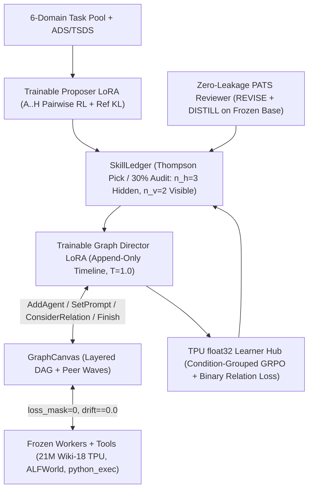

### 2. Inner Loop (`SW3`): Heterogeneous `GraphCanvas` & Frozen Worker Isolation

#### 2.1 Atomic Graph Editing & Execution Protocol (`canvas.py`)
Over up to `max_rounds = 24` turns (`6` in lightweight `SW3`), the Director mutates a bounded `GraphCanvas` (`max_agents = 6`, `relay_max_chars = 1000`):

| **Action** | **Execution Semantics** |
| --- | --- |
| `add_agent` / `set_prompt` / `set_model` | Creates or updates an agent node with anti-leakage delegation checks and scoped tool budgets |
| `set_layer` / `delete_agent` | Places nodes into ordered DAG layers or prunes stale subgraphs and downstream caches |
| `consider_relation` | Attaches a binary `off/on` peer-communication decision (`relation_token_span`) scored over exact 2-token categorical logprobs |
| `finish` | Commits the verified output node's artifact and terminates the episode (`u = y - 0.005 * C_worker`) |

#### 2.2 Frozen Worker Isolation & Cost-Regularized Objective
- **Strict Parameter Isolation:** Frozen Workers execute on a physically disjoint TPU `worker_mesh` (`return_logprobs=False`, `loss_mask=0`), verified via `frozen_worker_max_norm_drift == 0.0`.
- **Director Objective (`paper_kernels.py`, `paper_trainer.py`):** Optimizes asymmetric dual-clip PPO/GRPO (`clip_low = 0.20`, `clip_high = 0.28`, `tis_cap = 2.0`, `kl_coefficient = 0.005`, `kl_reference_stride = 4`, `kl_term_cap = 10.0`) in **`float32`** over full `32K` append-only Director timelines (`raw_policy_backward_mode = "timeline"`, `fuse_old_logprobs = True`), combining ordinary action tokens with exact 2-way `off/on` relation-token logprobs.

### 3. Outer Loop (`Full R²Orch`): Proposer, Bayesian Skill Withdrawal & PATS

1. **Frontier Proposer (`ADS + TSDS`, `2` lists × `8` candidates `A..H` per domain):**
   - Draws `4` candidates from `ADSBoundaryScheduler` (`16` K-Means clusters per domain tracking the empirical `p ≈ 0.5` boundary) and `4` from `TSDSRetriever` (cosine similarity around learnable tasks), sampling `2` distinct tasks per list (`24` tasks × `5` siblings = `120` rollouts/cycle).
   - Trained on `train_mesh` (`rank=64` `float32` LoRA, `lr = 1e-5`) via clipped pairwise policy gradient (`gap_clip = 4.0`) + 8-way categorical reference KL (`kl_beta = 1.0`) driven by `arms_bell_reward` ($\gamma = 0.5$, endpoint penalty $-0.2$, duration scaling $(T_d / T_q)^{0.5}$).
2. **Bayesian-Bootstrap Skill Withdrawal (`SkillLedger`):**
   - Splits each 5-rollout group into **`n_h = 3` hidden** (candidate skill withheld) and **`n_v = 2` visible** (skill injected), normalizing Director advantages within `(task_id, condition)` so hidden rollouts are never penalized against visible hints.
   - Evaluates `2,000` Rubin Dirichlet bootstrap draws over paired correctness contrasts $z = \bar{y}_{\text{vis}} - \bar{y}_{\text{hid}}$ (`window_cycles = 30`): **withdraws** skills once internalized ($n_k \ge 12, \mathbb{E}[\Delta_k^+] \le 0.02$), **admits** distilled skills when $\Pr(\Delta_k \le 0) \le 0.05$, and **audits/reinstates** (`audit_share = 0.30`) if performance regresses.
3. **Zero-Leakage `PATS` Outer Distillation:**
   - Scrubbed public rollout summaries (zero gold answers or private test outputs) are reviewed by the frozen base model (`T = 0.0`) to `REVISE` underperforming cards and `DISTILL` new cards from dual-failure groups.

### 4. Paper-Exact `Qwen3.5-9B` TPU `v5p-128` (`4x4x8`) System Layout

To reproduce all 6 IID domains (`AIME`, `HotpotQA`, `NQ-Open`, `MedQA`, `MBPP+`, `ALFWorld`) and OOD suites (`TriviaQA`, `MuSiQue`, `MATH-Hard`) on `Qwen/Qwen3.5-9B` (32-layer hybrid `3:1` Gated DeltaNet + gated `GQA`, `vocab = 248,320`), a `4x4x8` slice (`128` chips, `16` chips per `z`-plane) is partitioned along contiguous 3D `z`-slabs:

| **TPU `z`-Slab** | **Chips / Mesh** | **Resident Component** |
| --- | --- | --- |
| `z = 0` (`4x4x1`) | `16` (`fsdp=4, tp=4`) | `SharedTunixLearnerHub`: `float32` `Qwen3p5` base + `rank=64` `Proposer` & `Director` LoRAs + constrained `A..H` / `off..on` logit scorer |
| `z = 1` (`4x4x1`) | `16` (`ret=16`) | `paper_retrieval.py`: `21,015,324`-passage `Wiki-18` `E5-base-v2` `bfloat16` exact inner-product TPU search (`:18610`) |
| `z = 2..3` (`4x4x2`) | `32` (`dp=32, tp=1`) | `director_sampler`: `VllmSampler` (`max_model_len=32768`, `return_logprobs=True`) with pause-safe per-cycle LoRA merge sync |
| `z = 4..7` (`4x4x4`) | `64` (`dp=64, tp=1`) | `worker_sampler`: Frozen `Qwen3.5-9B` `VllmSampler` (`return_logprobs=False`) serving Workers & `PATS` Reviewer + CPU `ALFWorld` / `python_exec` |

---

## Part VII: Recipe 2 (R2Orch) Reproduction, Live 128-Chip Telemetry, and Debug Log

| **Item** | **Summary** |
| --- | --- |
| **Scope** | End-to-end reproduction workflow, benchmark validation, and chronological bug/debug log for `R²Orch` (`Stage 1 SW3` + `Stage 2 Full Paper Qwen3.5-9B`) |
| **Companion Docs** | [Overview, Dev Map & Progress](https://docs.google.com/document/d/1p12EQEfE4YTZdbSLHC9Wp3RAXbdXlXWbj4c4VJ-i8kg/edit) · [Swarm System Design](https://docs.google.com/document/d/15priSJuP3mr5Fy7chnj_bM1Z70WtuLYI7IKa_-qpULI/edit) · [R²Orch Detailed Design](https://docs.google.com/document/d/1RZ8FgplKnJSImi1e5sDfoObtwHm-JCZYdaZxSAcxx0s/edit) |
| **W&B Runs** | [`Qwen3.5-9B` Paper Run (`haoyugao-r2orch-paper-qwen3p5-9b-run1`)](https://wandb.ai/linchai-google/tunix-swarm/runs/haoyugao-r2orch-paper-qwen3p5-9b-run1) · [`4B` `SW3` (`haoyugao-r2orch-sw3-qwen3-4b-run1`)](https://wandb.ai/linchai-google/tunix-swarm/runs/haoyugao-r2orch-sw3-qwen3-4b-run1) · [`4B` 100-Cycle (`haoyugao-r2orch-full-qwen3-4b-run1`)](https://wandb.ai/linchai-google/tunix-swarm/runs/haoyugao-r2orch-full-qwen3-4b-run1) |

### 1. Reproduction Roadmap & Two-Track Validation Summary

1. **Track A — `Qwen3-4B` Self-Contained 4-Domain + 2-OOD Validation (`Completed`):** Verified core `SW3` heterogeneous DAG orchestration and `Full R²Orch` (`Proposer` + Bayesian `SkillLedger` + `PATS`) over `100` steps/cycles on `v5p-128`, proving bit-exact frozen Worker isolation (`drift == 0.0`), automatic skill withdrawal + audit reinstatement, and OOD `MATH-Hard` transfer (`+6.64 / +10.15 pp`).
2. **Track B — Paper-Exact `Qwen3.5-9B` 6-Domain + OOD Full Stack (`Active 200-Cycle Run`):** Built the missing model/environment stack (`Qwen3.5-9B` hybrid `GDN+GQA` JAX `float32` `rank=64` LoRA hub, `21,015,324`-passage `Wiki-18` TPU search server, `ALFWorld` TextWorld/PDDL environment, `python_exec` sandbox, `32K` timeline backward pass), passed 16-chip preflight (`rc=0`), and is actively executing the 200-cycle 128-chip TPU `v5p` training run (`hy-swarm-r2o9b-tr`).

### 2. Paper-Exact `Qwen3.5-9B` Reproduction Pipeline & Live Telemetry

#### 2.1 Environment & Data Manifest (`gs://cloud-pathways-staging/haoyugao/r2orch-9b-assets/`)
- **Models:** `Qwen/Qwen3.5-9B` (`32` layers: `24` Gated DeltaNet + `8` gated `GQA`, `vocab=248320`) and `intfloat/e5-base-v2` (`768`-d retriever encoder).
- **Environments & Search:** Exact `Wiki-18` `21,015,324 × 768` `fp16` embedding corpus (`30.1 GiB`, sharded across `16` TPU `v5p` chips on `:18610`), `ALFWorld 2.1.1` (`3,553` PDDL games in dedicated Python venv), and `python_exec` (`15s`, `4 GB` sandbox for `AIME` / `MBPP+`).
- **Datasets:** Pinned `beita6969/R2Orch@12ceb756` 6 IID domains (`AIME`, `HotpotQA`, `NQ-Open`, `MedQA`, `MBPP+`, `ALFWorld`; `190` Heldout tasks, `670` Locked IID test tasks) + OOD suites (`TriviaQA`, `MuSiQue`, `MATH-Hard`; `384` tasks), verified zero overlap.

#### 2.2 Preflight Gates (`hy-swarm-r2o9b-pf`) & Live 128-Chip Progress (`hy-swarm-r2o9b-tr`)

| **Verification Stage** | **Measured Result** |
| --- | --- |
| **Sampler vs. Learner Logprob Parity** | `vLLM` (`bfloat16` Torchax `Qwen3_5ForCausalLM`) vs `Qwen3p5` (`float32` JAX) **`mean_abs_diff = 0.00254` nats, `max_abs_diff = 0.00910` nats** |
| **Tool & Environment Gates** | `Wiki-18` `21M`-passage TPU search ready in `103.6s` (`top1 = 'Inception'`); `ALFWorld` session verified (`25` admissible commands); HTTP `A..H` & `off/on` constrained logprobs verified |
| **Cycle 0 (`128` chips + Zero-Skill Heldout)** | `Director` (`step=2`, `loss=0.1902`, `kl=2.30e-5`, `tis_mean=0.9808`), `Proposer` (`step=1`, `pair_loss=-0.6328`), `7s` zero-error `vLLM` hot-load; **Zero-Skill 6-Domain Heldout (`190` tasks): `13.54%` mean** (`MBPP+ 31.25%`, `HotpotQA 18.75%`, `MedQA 18.75%`, `NQ-Open 12.50%`, `AIME 0.0%`, `ALFWorld 0.0%`; `37` protocol/deadline errors) |
| **Cycles 1–24 (`25th-Cycle` Zero-Skill Heldout)** | **Zero-Skill 6-Domain Heldout (`v0050`, `190` tasks) jumped `13.54% -> 25.00%` (`+11.46 pp`) while errors fell `83.8%` (`37 -> 6`)**: `HotpotQA` `18.75% -> 50.00%`, `NQ-Open` `12.50% -> 40.62%` (beating paper's `23.59%` direct `9B` backbone), `MBPP+` `31.25% -> 37.50%`, `ALFWorld` `0.0% -> 3.12%`; `6 / 18` seed skills retired |
| **Cycles 25–49 (`50th-Cycle` Heldout + `PATS` Distillation)** | **`Cycle 49` Zero-Skill Heldout (`v0100`) doubled baseline (`13.54% -> 27.12%`, `+13.58 pp`)**: `HotpotQA` **`59.38%` (`+40.63 pp`, surpassing paper's `57.81%` direct `Qwen3.5-9B` backbone in zero-skill mode)**, `MBPP+` **`50.00%` (`+18.75 pp`)**, `AIME` broke zero (**`3.33%`**). **All `3/3` `HotpotQA` human seeds retired**, `NQ-Open` triggered automatic audit reinstatement (`admitted`), and at `Step 52` **`PATS` (`DISTILL`) synthesized a live semantic-validated trial skill (`pats_d5d6474b...`, *"Verify Evidence Sufficiency"*)** |
| **Cycles 50–74 (`75th-Cycle` Heldout + `89.0%` Train Peak)** | **`Cycle 74` Zero-Skill Heldout (`v0149`, `37.5%`) rose monotonically to `29.17%` (`+15.63 pp` / `2.15x` over `C0`)**: `MBPP+` surged **`50.00% -> 59.38%` (`0` errors)**, `HotpotQA` held **`59.38%`** (`Step-52` `PATS` card internalized & retired at `Step 66`), `NQ-Open` rebounded **`31.25% -> 40.62%`**, **all `3/3` `MedQA` seeds retired (`Step 64`)**, and **`Cycle 70` hit an `89.0%` 6-domain training mean** (`AIME 100%`, `ALFWorld 100%`, `MBPP+ 100%`) |
| **Cycles 75–99 (`100th-Cycle` / `50%` Halfway Milestone)** | **Crossed `100 / 200` cycles (`v0199`): `Cycle 99` Zero-Skill Heldout (`26.60%`) achieved all 6 domains simultaneously non-zero for the first time** (`HotpotQA 59.38%`, `MBPP+ 43.75%`, `NQ-Open 34.38%`, `MedQA 15.62%`, `AIME 3.33%`, `ALFWorld 3.12%`) while **protocol/deadline errors fell `91.9%` (`37 -> 3 / 190`)**; `PATS` distilled & retired a 2nd live skill (`pats_15e72a39...`, `C91 -> C95`) |
| **Cycles 100–125 (`125th-Cycle` / `63%` + Admitted `PATS` Skill)** | **All `3/3` `MBPP+` human seeds retired (`9/9` across `HotpotQA` + `MedQA` + `MBPP+`), lifting `Cycle 124` Zero-Skill `MBPP+` Heldout `+9.37 pp` (`43.75% -> 53.12%`)**; at `Cycle 103`, a 3rd `PATS` card (`pats_44622d08...`) proved positive lift (`n=52`, `mean=+2.56%`, $\mathbb{E}[\Delta^+]=0.0321$) and **promoted `trial` -> `admitted`**, driving **`Cycle 111` to a record `92.2%` batch mean** (`MBPP+ 100%`, `NQ-Open 93.8%`, `HotpotQA 87.5%`) |
| **Cycles 126–149 (`150th-Cycle` / `75%` Three-Quarter Milestone)** | **Crossed `150 / 200` cycles (`v0299`, verified hands-free auto-resume via `reconcile_resume_state()`, `~10.9–12.7 min/cycle`): `pats_44622d08...` completed weight internalization & retired (`HotpotQA` Heldout `46.88% -> 50.00%`, `MedQA` `9.38% -> 18.75%`, `NQ-Open` locked at `34.38%`, `MBPP+ 43.75%`, `mean_acc 24.48%`)**. **`PATS` expanded across domains (`6` live skills distilled total: `C132` first `MBPP+` card retired w/ `C149` `MBPP+` train `100%`, plus `C147` dual `HotpotQA` + `MBPP+` trial cards)**; `C148` train hit **`78.7%`** (`ALFWorld 100%`, `NQ-Open 100%`, `HotpotQA 92.9%`); final `50` cycles (`Cycle 150 -> 199`) in progress |

### 3. Completed `Qwen3-4B` Zero-Skill Benchmark Reference (`SW3` vs `Full R²Orch`)

Evaluated across `796` zero-skill tasks (`k = 2`, `skill_context = ""`, `frozen_worker_max_norm_drift == 0.0`):

| **Benchmark (`n`)** | **Step 0 Base** | **`SW3` (`12,800` eps)** | **`Full R²Orch` (`8,000` eps)** | **Takeaway** |
| --- | --- | --- | --- | --- |
| **Heldout Macro (`126`)** | 53.96 / 57.55 | **58.39 / 64.06** | 55.08 / 57.50 *(Step 40: `55.99`)* | `100.0%` finish rate; Step-60 `HotpotQA` reaches **`70.31 / 71.88`** |
| **Locked Test IID Macro (`414`)** | 44.30 / 47.47 | **47.03** / 48.79 | 45.81 / **48.98** | **`Full R²Orch` achieves best `pass@2` (`48.98%`) & `-22.5%` lower cost with `37.5%` fewer episodes** |
| — IID `HotpotQA` (`128`) / `MBPP+` (`128`) | 32.81 / 68.36 | **41.41** / 71.48 | 39.84 / **72.27** | `+7.03 to +8.60 pp` multi-hop QA and **`+3.91 pp`** code synthesis gains |
| — OOD `MATH-Hard` (`128`) | 54.30 / 59.38 | **60.94 / 69.53** | **60.55 / 66.41** | **`+6.64 / +10.15 pp`** (`SW3`) and **`+6.25 / +7.03 pp`** (`Full R²Orch`) OOD transfer |

### 4. Chronological Reproduce & Debug Log (Key Bugs & Fixes)

| **#** | **Stage / Component** | **Bug / Failure Symptom** | **Root Cause & Fix** |
| --- | --- | --- | --- |
| **D1-D2** | `Qwen3p5` Model & Registry | Missing `Qwen3.5-9B` config; `b=1` `fsdp` batch-axis error on `train_mesh` | Added `ModelConfig.qwen3p5_9b()` (`32L` hybrid `GDN+GQA`, `partial_rotary=0.25`) + `act_btd=(None, None, None)` sharding override |
| **D3-D4** | `Wiki-18` `shard_map` & JAX `jit` | `_local_topk` rank mismatch `(B, k)` vs `(1, B, k)`; `arr.sharding` `Tracer` error inside `@jax.jit` | Returned `vals[None, :, :]` for `P("ret", None, None)` reduction; guarded `not isinstance(arr, jax.core.Tracer)` in `merge_lora_state` |
| **D5-D6** | Pathways & OpenAI Wire Format | `'proxy'` backend uninitialized; `openai` flattened `extra_body` (`allowed_token_ids`); `T != 1.0` sampling error | Initialized `pathwaysutils.initialize()`; merged top-level + nested `extra_body` and set `"generation_config": "vllm"` |
| **D7-D8** | Dual `VllmSampler` Torchax Concurrency | `AttributeError: 'NoneType' has no attribute 'padded_num_reqs'` & `set_vwc` signature `TypeError` under concurrent Director + Worker pools | Replaced process-global `_forward_context` & `_vllm_model_wrapper_context` with `threading.local()` stacks + reentrant `_TORCHAX_LOCK` during JIT trace |
| **D9** | XLA Recompiles & `/tmp` Budget | `20` XLA compiles on `ppo_mini_batches=2` + `2.7 GiB/cycle` checkpoint growth vs `126 GiB` `/tmp` | Pinned replicated `out_shardings` on grad/step fns, shared `lora_scale=0.0` reference PyTree, coarsened `5 × 3` buckets (`6.7x` faster), added rolling checkpoint pruning |
| **D10** | Zero-Skill Eval & Schema | `app.solve()` missing `run_id`; `AutoVerifier` missing `math_hard_symbolic`; `r2orch_metrics@1` nested schema | Passed `run_id`, registered `_MathHardSymbolicVerifier` on `AutoVerifier.adapters`, aligned live tracker & W&B sidecar |
| **D11** | `4x4x8` 3D Torus Subslice | `16+8+32+72` split half of `z=1` (`Cannot use a subslice because computation does not use contiguous chips`) | Sorted devices by `(z, y, x)` and sliced full 16-chip `z`-planes (`16 + 16 + 32 + 64 = 128`) |
| **D12** | HBM Sync Race (`Array deleted`) | `--async-next-cycle` raced `VLLMInProcessDriverLoop` against `update_params` (`delete_dst_buffers=True`) | Set `delete_dst_buffers=False`, wrapped `update_params` in `drv.pause(mode="wait")` / `drv.resume()`, warmed up both vLLM pools at boot (`7s` zero-error sync) |
| **D13** | Eval Stragglers & `2400s` Floor | 3 unbounded `AIME` eval tasks spun `60+ min` behind sequential suite barriers; upstream `training_cycle.py` `2400s` constant overrode `360s` TOML | Attached `RolloutDeadline(360s/300s)` + pooled all 6 suites `longest_first` (`~10x` faster eval), aligned `R2ORCH_*_ROLLOUT_WALL_TIME_S = 360.0`, set Worker `return_logprobs=False`, resumed seamlessly at `Cycle 1` (`collection_wall_s` `-53%`) |
| **D14-D17** | Worker Reset, Host `/tmp` & Atomic Resume | Transient IFRT worker disconnects (`C62`, `C83`) left full neighbor `/tmp`, non-atomic `pats_state.step`, or partial `solver_rollouts.jsonl` (`worker_backend_unavailable`) | Upgraded `_gcs_sync.py` (`~80s` parallel `latest.json` pull), isolated `64 GiB` RAM `emptyDir` + excluded node `alzw`, and added `reconcile_resume_state()` + `maxRestarts: 20` + `final_eval` watchdog |
| **D18** | `300s/360s` Timeout Truncation (`enable_prefix_caching=False`) | Hybrid `GDN` layers disable prefix cache on TPU; tight `300s/360s` deadlines killed `97%` of AIME/ALFWorld & `70%` of MedQA before Finish | Restored `900s–1200s` train & `900s–1800s` eval rollout budgets at `C157`: AIME finish rate jumped `3.3% -> 66.7%` and `C174` Zero-Skill Heldout surged `+10.45 pp` to `34.93%` (Run 1 finished all `200/200` cycles + `2,108`-episode final eval: IID `19.01% -> 31.90%`, OOD `19.27% -> 35.42%`) |

### 5. Option 5 Independent Retrain (`Run 2`: 32-Chip TRUE `float32` Director on `128` TPU `v5p`) — Reproduction & Debug Log (`D19–D23`)

To eliminate Run 1's two remaining sources of precision/eval gap—(a) `bfloat16` merged-LoRA serving truncating `82%–99.9%` of small (`~1e-4`) LoRA weight deltas and (b) `4096` single-call AIME output cutoffs—we launched a full independent 200-cycle retrain (`hy-swarm-r2o9b-opt5`, [W&B Run 2](https://wandb.ai/linchai-google/tunix-swarm/runs/haoyugao-r2orch-opt5-qwen3p5-9b-run2)) on **Option 5** (`16` Learner + `16` Wiki-18 HBM + `32` single-compiled `(dp=8, tp=4)` TRUE `float32` Director + `64` frozen `VllmSampler` Workers = `128` TPU `v5p` chips, final eval ceiling `12,288` tokens):

- **Verified Breakthroughs (Pre-Launch & Early Cycles):**
  - **L3 Startup Parity Gate:** `[option5-L3] ServingFidelity PASS mode=fp32_native top1=1.0000 max_lp_diff=9.218e-04`.
  - **Cycle 0 (`proposer` step 1 + `director` step 2):** **`r2orch_tis_weight_mean = 0.999972`** (`0.0028%` drift!), `r2orch_logratio_abs_mean = 0.001139`; **Zero-Skill 6-Domain Heldout (`190` tasks) jumped `+13.54 pp` in a single RL update (`21.95%` base -> `35.49%` `cycle-0000`):** `HotpotQA 28.12% -> 62.50%`, `MBPP+ 46.88% -> 62.50%`, `MedQA 15.62% -> 56.25%`, `AIME 6.67%`, `ALFWorld 9.38%`, `NQ-Open 15.62%`.
  - **Cycle 1 (`proposer` step 3 `43.5s` + `director` step 4 `187.8s`):** **`r2orch_tis_weight_mean = 1.000068`** (`0.0068%` drift).

| **#** | **Stage / Component** | **Bug / Failure Symptom** | **Root Cause & Permanent Fix** |
| --- | --- | --- | --- |
| **D19** | FP32 Director Call API & `12288` Ceiling | `BatchingFp32DirectorSampler.__call__` lacked `prompt_token_ids` kwarg; `GEN_BUCKETS` capped below `12,288` | Added `prompt_token_ids` passthrough & expanded `GEN_BUCKETS = (32, 256, 1024, 2048, 4096, 12288)` (`a598936dc`). |
| **D20** | Head Node `tmpfs` Pressure & `e5-base-v2` | `251 GiB` `n2d-standard-64` evicted (`jax-tpu 179.5 GiB + pathways-proxy 56.4 GiB`); unlinking `e5-base-v2` broke `E5SkillEmbedder` | Unlinked `31 GiB` `vectors_fp16.npy` (`release_vectors_file(unlink=True)`) & `18 GiB` `Qwen3.5-9B/*.safetensors` (`+50 GiB` RAM reclaimed) while keeping `0.4 GiB` `e5-base-v2` intact (`c5725ef3c`, `1c61eee5b`). |
| **D21** | `SubmissionJournal` Poison-Lock & Stale `latest.json` on Resume | Crashed Cycle 1 left 86 SHA-256 hashed `<sha>.json/.lock` receipts in `state/submissions/` (triggering `CanvasState.FAILED` / `CollectionInfrastructureIncidentError` at Round 0) and a stale `checkpoints/director/latest.json` pointing to unsynced `step-00000004` | Upgraded `reconcile_resume_state()` (`607e14c13`) to parse `run_id` inside every hashed receipt JSON, remove all `cycle >= completed_cycles` receipts/locks, scan actual intact `step-*/lora_weights.npz` dirs, and repair `latest.json` + `training_state.json` before `boot_tpu_services()`. |
| **D22** | Shared `base_state` Leaf Deletion | `_delete_jax_leaves(merged)` deleted `float32[248320, 4096]` (`embedder`) shared with `hub.base_state` because `base_state` and `sync_dtype` are both `float32` (`24/24` Proposer HTTP 500s) | Guarded `_delete_jax_leaves(merged, keep_tree=self.hub.base_state)` & protected `new_state` leaves (`b076c5d6c`). |
| **D23** | Cross-Mesh `36 GiB` Host OOM, GCS Sync Stall & `/tmp` Disk Growth | Streaming full `36 GiB` FP32 `merged` weights through `pathways-proxy` on `load_adapter("director-v0004")` OOM-killed `251 GiB` head node; naive `_gcs_sync.py` re-uploaded `5.5 GiB` every `30s`; `200 × 177 MiB` exceeded `27 GiB` `/tmp` | Retained immutable `_base_state` on Director TPU HBM (`95 GiB/chip`) and implemented `BatchingFp32DirectorSampler.update_lora()` (`14aedde6b`): transfers only **`465 MB` LoRA adapters (`77×` smaller)** and merges `float32` directly on TPU HBM (`< 3s`, `~0.5 GiB` host RAM, `0` OOM); upgraded `_gcs_sync.py` to 8-thread incremental `(mtime_ns, size)` sync + GCS-verified local blob pruning. |

---

## Part VIII: Recipe 3 (Swarm-Repair) Dynamic Parallel Code-Repair Design

| Item | Decision |
| --- | --- |
| Status | Engineering design draft for review; implementation has not started |
| Version | 1.3 |
| Audience | Engineering leads, implementers, and reviewers |
| Parent design | [Documentation Hub](https://docs.google.com/document/d/1p12EQEfE4YTZdbSLHC9Wp3RAXbdXlXWbj4c4VJ-i8kg/edit) · [Overall System Design](https://docs.google.com/document/d/15priSJuP3mr5Fy7chnj_bM1Z70WtuLYI7IKa_-qpULI/edit) |
| Updated | November 10, 2026 |
| Baseline | `haoyu-next` at `bcd4b0cef` |
| Implementation scope | Extend `tunix/dist_rl` |
| Target recipe | Swarm-Repair: shared-policy, time-budgeted collaborative code repair |

**Implementation context:** the first local shared-policy math slice is now [CPU-validated](https://docs.google.com/document/d/1aHpP0AzYrneFyjtXqPGtQP-IfHkd1oW_CXPojmLI4zI/edit). Swarm-Repair itself remains unimplemented; the system below is its target design.

**Document authority:** the [common system design](https://docs.google.com/document/d/15priSJuP3mr5Fy7chnj_bM1Z70WtuLYI7IKa_-qpULI/edit) defines framework interfaces and the first Dr. MAS math recipe. This document defines the later Swarm-Repair specialization. Shared weights, collective credit, workspace tools, dynamic membership, physical deadlines, and fixed team-capacity reduction below apply to this recipe only. New interfaces are proposed additions; implementation and accelerator acceptance remain pending.

**Delivery order:** shared-policy math correctness and held-out results → frozen-worker orchestration → this dynamic parallel recipe → optional independent-policy, distillation, counterfactual, and RSI extensions. The [internal overview](https://docs.google.com/document/d/15priSJuP3mr5Fy7chnj_bM1Z70WtuLYI7IKa_-qpULI/edit) summarizes the complete program.

Review order: [architecture](#3-placement-in-the-existing-dist-architecture), [E2E flow](#4-end-to-end-flow), [runtime protocol](#5-rollout-protocol-and-team-execution), [learning](#6-team-learning-and-trainer-integration), and [recovery](#7-checkpoint-retry-and-failure-semantics).

### 1. Target Capability

Deliver a complete swarm recipe on the existing distributed RL stack: one shared policy learns to delegate, communicate, edit a shared workspace, and combine work from concurrent agents. Teams receive task-level rewards, and every member's generated actions contribute to the same policy update.

The method inspiration is [How to Train a Swarm](https://www.gr.inc/blog/how-to-train-a-swarm) and [Avalon-M1 / RLCR](https://www.gr.inc/avalonm1.pdf). RLCR uses shared parameters and collective advantages; most reported environments use CISPO. This design selects **Team-GRPO** to reuse Tunix's existing policy-loss machinery, with explicit team grouping and loss reduction. It targets comparable swarm functionality rather than numerical reproduction of that recipe.

The completed recipe includes all of the following:

| ID | Capability | Required behavior |
| --- | --- | --- |
| FR-1 | Shared-policy learning | Coordinator and workers share one checkpoint; all roles contribute gradients |
| FR-2 | Adaptive team | Coordinator can spawn and retire workers within a fixed member cap |
| FR-3 | Concurrent execution | Independent agents issue overlapping model/tool calls through the rollout worker |
| FR-4 | Collaboration | Private histories, explicit messages, and a versioned shared filesystem |
| FR-5 | Collective reward | One verified score and one group-relative advantage per team episode |
| FR-6 | Anytime task scoring | Score the committed artifact at termination, including useful partial progress |
| FR-7 | Physical time budget | Enforce a team deadline; preserve eligible interrupted generation prefixes |
| FR-8 | Complete distributed recipe | Train, synchronize, checkpoint, restore, and evaluate using the existing dist workers |

Token-budget-only execution is an intermediate integration profile. The final time-budgeted recipe must pass the cutoff and interrupted-prefix gates below. Separate role models, teacher distillation, and mid-episode recovery are outside this design.

#### 1.1 Nonfunctional Requirements

| ID | Requirement | Required property |
| --- | --- | --- |
| NFR-1 | Data integrity | Preserve exact contexts, action ownership, finite behavior logprobs, and snapshot/verifier identity |
| NFR-2 | Policy consistency | Zero policy staleness within a round; all compared teams use an equivalent serving profile |
| NFR-3 | Recoverability | Restore a published model/optimizer/cursor boundary; do not consume one group in two committed updates |
| NFR-4 | Bounded execution | Bound queues, memory, tool work, and every lifecycle stage; quarantine unknown backend state |
| NFR-5 | Reproducibility | Pin inputs/configuration and retain inspectable artifacts; asynchronous timing is not promised to replay bit for bit |
| NFR-6 | Compatibility | Ordinary GRPO/OPD behavior remains unchanged when team fields are absent |

#### 1.2 Scope and Terminology

This recipe implementation has one active control-plane owner and one rollout owner per team. Independent role models, cross-replica intra-team routing, nonzero policy lag, and mid-episode restore are excluded. The delivery boundary is the complete time-budgeted recipe, not merely a token-budget smoke run.

| Term | Meaning |
| --- | --- |
| Agent | One role/history and action loop; shares policy parameters with other team members |
| Call | One model invocation with an immutable prompt and a sampled continuation |
| Team episode | One isolated attempt at a task, from reset through cutoff, verification, and finalization |
| Task group | K independent team episodes compared for one task/reset and common budgets |
| Collection round | B task groups collected under one behavior version before a possible optimizer update |
| Optimizer update | One application of accumulated gradients; skipped when the whole round has zero learning signal |
| Serving profile | Model/dtype, mesh, scheduler/concurrency, and tool CPU limits under which a team executes |

### 2. Recipe: Swarm-Repair

#### 2.1 Environment

Use small Python repositories with executable specifications, visible tests, and protected reward tests. Tasks include interacting bugs across files and interface boundaries, so integration and communication can matter. Begin with validated fixtures and deterministic bug mutations; split train/development/test by project and mutation family before generating tasks.

Each team receives an isolated copy of the same initial repository. The coordinator starts alone and can create up to three workers. A worker receives a task description and has the same editing and testing capabilities as the coordinator. All members use the same dense Qwen3-8B policy, tokenizer, and tool format. Only the coordinator can finish the team; workers can finish assignments or be retired.

Tools: `spawn_worker`, `retire_worker`, `send_message`, `read_messages`, `list_files`, `read_file`, `apply_patch`, `run_public_tests`, `wait`, and `finish`. Roles and assignments are policy choices; the runtime supplies concurrency and resource limits.

At completion or budget exhaustion, freeze the shared workspace and run the protected verifier outside the writable repository:

$$
R(S)=\sum_{j=1}^{J}w_j\mathbf{1}[\text{protected test }j\text{ passes on }S],
\qquad w_j\ge0,\quad\sum_jw_j=1.
$$

Weights are fixed per task and balanced across behavioral requirements. Reward depends on the latest committed snapshot, not historical best performance. A final answer is unnecessary for receiving credit. Syntax errors, wrong patches, and failing tests are valid low-reward outcomes. Grader corruption or service failure is an infrastructure error.

Initially score only the final snapshot during training. Evaluate frozen intermediate snapshots offline to obtain progress curves. Visible tests provide tool feedback; protected test contents remain inaccessible. Do not sum repeated snapshot scores or add hand-designed rewards for messaging, spawning, or apparent parallelism.

#### 2.2 Initial Profile

These are proposed defaults; the recipe implementation must resolve immutable revisions and validate the accelerator profile before launch.

| Parameter | Starting setting |
| --- | --- |
| Policy | Qwen3-8B; pinned model/tokenizer revisions and template digest |
| Team | One coordinator initially; at most four live agents total |
| Team concurrency | One active generation per agent; up to four concurrent calls |
| Serving admission | Initially one active team per rollout replica; multiple replicas can serve different teams |
| Group / update | K = 4 independent teams per task; B = 2 tasks per optimizer update |
| Team budget | 8,192 total generated tokens; at most 32 calls |
| Per-call limits | 512 generated tokens; at most 8,192 prompt-plus-response tokens |
| Deadline | Proposed 180 seconds; calibrate on development tasks and freeze before held-out evaluation |
| Sampling | Temperature 1; top-p 1; top-k disabled; return sampled-token logprobs |
| Training | One fresh batch per optimizer update; GRPO clip 0.2; zero policy staleness |
| Additional losses | Reference KL, entropy bonus, and OPD disabled initially |
| Batching | Padded call rows; packing follows correctness acceptance |

Use the native Qwen3 trainer and compatible in-process vLLM/Raiden path as the starting deployment. The current sampler completion API needs a streaming/cancellation extension for physical deadlines. Reuse its policy state and serving engine rather than launching an independent inference stack.

Fix optimizer settings, precision, mesh, fixture image, task split, and backend versions in the recipe manifest after a short development calibration. Calibrate task difficulty so the base model produces both successes and failures and can use the tools. If a tool-format warmup is required, version its data and include that initialization in every experimental baseline.

### 3. Placement in the Existing Dist Architecture

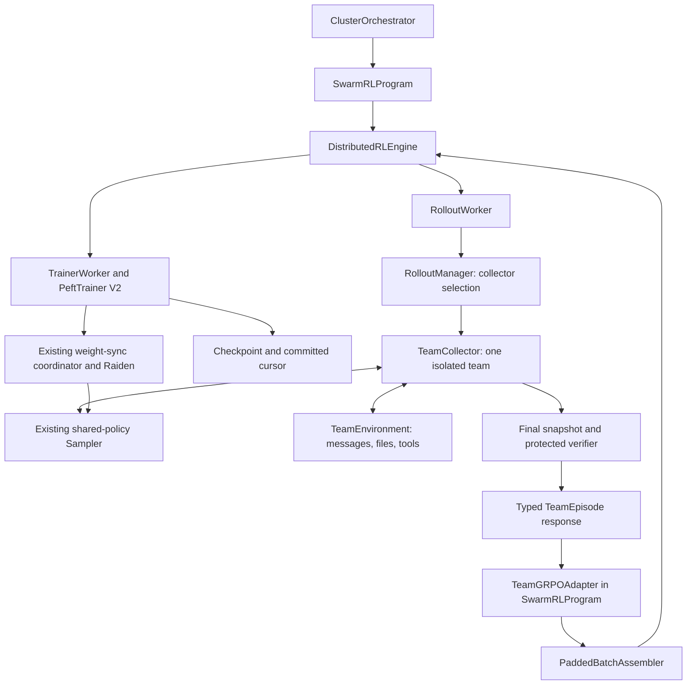

**The control plane schedules complete team episodes. Agent-level scheduling lives inside a rollout worker.** Implement this through the parent design's `SwarmProgram`, `SwarmRuntime`, `PolicyBinding`, immutable episode/call traces, `CreditAssigner`, and `LearningPlan`. `TeamCollector` below names this recipe's executor specialization; its lifecycle uses the common swarm collector. `TeamGRPOAdapter` is a recipe learning adapter, not the only framework learning path. Each team stays on one rollout worker for its entire episode and uses that worker's sampler. This keeps file/message ordering local, avoids one control-plane RPC per agent turn, and reuses existing worker admission, health reporting, and policy synchronization.

`SwarmRLProgram` implements the existing `RLProgram` interface and runs through `ClusterOrchestrator.run(program)`. It owns task groups, reward-to-advantage conversion, trainer batches, and committed training progress. It does not own model serving, training meshes, or a separate synchronization service.

#### 3.1 Existing Components and Changes

| Existing component | Integration |
| --- | --- |
| [ClusterOrchestrator](https://github.com/google/tunix/blob/haoyu-next/tunix/dist_rl/orchestrator/orchestrator.py) | Reuse worker registration, bring-up, monitoring, and `run(RLProgram)` |
| [Engine interface](https://github.com/google/tunix/blob/haoyu-next/tunix/dist_rl/orchestrator/rl_engine_interface.py) / [DistributedRLEngine](https://github.com/google/tunix/blob/haoyu-next/tunix/dist_rl/orchestrator/distributed_rl_engine.py) | Add typed team dispatch/poll methods using the existing rollout session and routing; reuse train/sync/save/restore methods |
| [RolloutWorker](https://github.com/google/tunix/blob/haoyu-next/tunix/dist_rl/worker/rollout_worker.py) | Reuse the worker and sampler; add conversion of team results into a typed response |
| [RolloutManager](https://github.com/google/tunix/blob/haoyu-next/tunix/dist_rl/rollout/manager.py) | Replace hard-coded collector construction with explicit single-agent/team collector selection; track and drain both |
| [Sampler protocol](https://github.com/google/tunix/blob/haoyu-next/tunix/dist_rl/rollout/sampler.py) / [in-process vLLM](https://github.com/google/tunix/blob/haoyu-next/tunix/dist_rl/rollout/inprocess_vllm_sampler.py) | Reuse token-ID sampling, concurrency, and policy state; add prefix streaming and request abort |
| [StandardRLProgram](https://github.com/google/tunix/blob/haoyu-next/tunix/dist_rl/orchestrator/rl_program.py) | Keep ordinary trajectory behavior; implement `SwarmRLProgram` alongside it because team-to-call expansion changes group cardinality |
| [GRPOConfig](https://github.com/google/tunix/blob/haoyu-next/tunix/rl/algorithm_config.py) and [payload builder](https://github.com/google/tunix/blob/haoyu-next/tunix/dist_rl/orchestrator/payload_builder.py) | Reuse the advantage estimator and policy loss; add team-level scoring and one-to-many payload construction |
| [Payloads](https://github.com/google/tunix/blob/haoyu-next/tunix/dist_rl/common/datatypes.py) / [batch assembly](https://github.com/google/tunix/blob/haoyu-next/tunix/dist_rl/orchestrator/batch_assembly.py) | Preserve original token/mask arrays; add explicit per-row loss-denominator contributions |
| [TrainerWorker](https://github.com/google/tunix/blob/haoyu-next/tunix/dist_rl/worker/trainer_worker.py) / [native trainer](https://github.com/google/tunix/blob/haoyu-next/tunix/dist_rl/train/peft_trainer_v2.py) | Reuse forward/backward, denominator-aware accumulation, optimizer update, and checkpointing |
| [Weight synchronization](https://github.com/google/tunix/blob/haoyu-next/tunix/dist_rl/weight_sync) | Reuse policy transfer and barriers; prohibit synchronization while a training team is active |
| [Trajectory storage](https://github.com/google/tunix/blob/haoyu-next/tunix/dist_rl/trajectory) | Extend schemas with team/agent/call lineage and shared-artifact references |

The current manager can advance a request to a newer sampler version. Team mode must instead reject version mismatch. The current collector also treats generic timeout/cancellation as invalid: normal team deadline termination requires its own valid outcome.

#### 3.2 Recipe Modules and Common Integration

All paths below are proposed additions within `dist_rl`.

| Path | Responsibility |
| --- | --- |
| `swarm/trace.py` | Shared transport DTOs without dependencies on collector/trainer implementations |
| `rollout/swarm_collector.py` + recipe `SwarmProgram` | Common collector lifecycle; recipe agent loops, spawn/retire, budgets and deadline |
| `examples/swarm_repair/environment.py` | Recipe message broker, versioned workspace, tools, freeze/score boundary |
| `orchestrator/swarm_program.py` | Task-group rounds and training/checkpoint lifecycle |
| `orchestrator/team_grpo_adapter.py` | Collective advantages, per-call payloads, reduction accounting |
| `examples/swarm_repair/` | Task fixtures, prompts, configs, launchers, evaluation, and run guide |

#### 3.3 Process and Resource Topology

| Process / resource | Owns | Does not own |
| --- | --- | --- |
| CPU control-plane process | `ClusterOrchestrator`, registry, `DistributedRLEngine`, `SwarmRLProgram`, pending groups and committed cursor | Agent conversations, mutable workspaces, model parameters |
| Rollout worker CPU process | `RolloutManager`, local collectors, message/file ordering, sampler adapter, token-prefix buffers | Reward normalization or optimizer state |
| Rollout accelerator replica | Shared policy weights, inference KV state, concurrent request execution | Cross-team communication or training gradients |
| Tool / verifier subprocesses | Bounded tests against an explicitly identified snapshot | Direct writes to the live shared workspace or authoritative event ordering |
| Trainer worker and accelerator mesh | Actor parameters, optimizer, gradient accumulation, native loss computation | Tool/environment execution |
| Shared artifact/checkpoint storage | Immutable task assets, event/token files, workspace snapshots, checkpoints, commit/evaluation manifests | A live task queue or an implicit transaction coordinator |

A rollout worker owns one active team in the initial profile. Multiple replicas serve independent teams; each replica can continuously batch up to four members of its current team. Agents are logical policy instances, not separately loaded models. A model replica may itself span multiple accelerator devices according to the existing sampler configuration.

Keep trainer and rollout allocations separate initially so environment scheduling does not compete with optimizer execution for the same model buffers. Use the existing remote-execution and worker launch mechanisms. The new control-plane program registers one `ACTOR` trainer role and the existing `ROLLOUT` role pool; no new worker role is required. Replica counts and trainer/rollout meshes are deployment overlays, not hard-coded into the algorithm.

This initial topology batches a team's agents on one model replica; it does not distribute one team's calls across independently loaded replicas. It establishes bounded swarm functionality with local state ownership. Measure actual decode/tool overlap and latency rather than assuming an agent count translates into the same speedup. Serving one team across multiple rollout owners would require a separate shared-state/routing design.

The first deadline-training pool must be homogeneous: every team compared within a task group uses the same serving-profile digest, including model/dtype, replica mesh, scheduler settings, member concurrency, and tool CPU limits. Validate this at worker startup and team finalization. The current sticky-hash router does not enforce capacity equivalence or load balancing by itself. A deployment change that alters the profile requires revalidation before another comparison group.

#### 3.4 Architectural Invariants

1. A team has one owner, one behavior policy version, and an isolated environment attempt.
2. The controller accepts each token/tool event at most once; committed events define observations and artifacts.
3. Group-relative reward statistics are computed over K teams before expanding calls.
4. Training uses each call's sampled context and behavior probabilities, with one action owner per token.
5. No new rollout round starts until its serving replicas acknowledge the selected policy version.
6. A durable training commit couples model/optimizer state with the consumed data cursor; an RPC acknowledgement alone is not a commit.

### 4. End-to-End Flow

#### 4.1 Startup and Restore

1. The recipe launcher resolves model/tokenizer revisions, task manifests, prompts, tool schemas, verifier image, optimizer settings, and deployment configuration into a hashed run manifest.
2. Register trainer and rollout handles with `ClusterOrchestrator`. Run the existing `initialize → compile → start` lifecycle and verify worker descriptions.
3. Add swarm startup validation: positive budgets, K ≥ 2, compatible model/tokenizer/template digests, team concurrency, a writable artifact/checkpoint destination, supported sampling probabilities, and streaming/abort capability for deadline mode.
4. Configure `GRPOConfig` and `PaddedBatchAssembler` through `engine.configure_worker(algo_config=..., assembler=...)`. The recipe's `TeamGRPOAdapter` owns credit and call-row expansion in `SwarmRLProgram`; trainer loss/input wiring uses the shared function registry and `algo_core`. Dummy compilation payloads must include the new denominator tensor, old logprobs, and explicit attention masks with the same structure as real batches.
5. For a new run, establish policy version 0 and save an initial restorable model/optimizer checkpoint. For resume, read the last published training commit and select its exact checkpoint; do not infer the data cursor from the newest checkpoint directory.
6. Restore model/optimizer state and the run cursor, validate digests, synchronize the selected policy version, and verify acknowledgement from every participating rollout replica.
7. Start scheduling only after those checks. Evaluation-only startup follows the same pinning and synchronization path but never configures an optimizer update.

Existing startup validators assume ordinary trajectory batch geometry. Add a swarm validator that distinguishes task groups, team episodes, and variable call rows; do not require the number of call rows to be divisible by K. Retain relevant mesh, token-capacity, and microbatch constraints.

#### 4.2 One Training Round

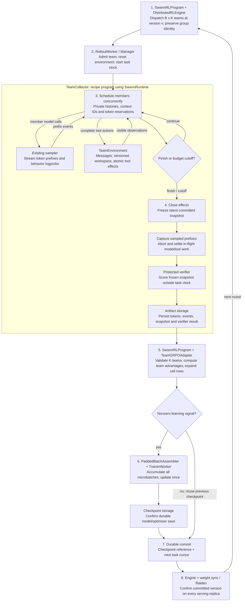

Within each team, the collector issues member calls concurrently; the execution subgraph shows the repeated sampling/tool cycle. Different teams can also run concurrently on different rollout replicas. The program buffers finalized groups but starts training only when the entire update is validated and its required artifacts are durable.

Task identity is independent of completion order. The planner chooses B task/reset specifications, constructs K team seeds for each, and records their expected request IDs. Completions enter that registry by group/team/attempt ID. Duplicate completions are ignored only if their content hashes agree; stale attempts and conflicting duplicates cannot enter training.

#### 4.3 Concrete Data Example

Consider a task where parser and consumer modules disagree about an interface. The coordinator can assign one worker to the parser and another to the consumer while inspecting public test failures itself. Workers exchange the proposed interface through messages, patch against file versions, and ask the coordinator to run an integration test. Their histories remain separate even though they read shared files.

For an **illustrative**, unmeasured group with returns `[0, 0.25, 0.75, 1]`, the mean is `0.5` and the sample standard deviation is approximately `0.456435`. Using the existing estimator's additive epsilon, team advantages are approximately `[-1.095443, -0.547721, 0.547721, 1.095443]`. A team producing 14 calls still receives one advantage, just as a team producing 6 calls does. Workers do not become additional entries in that four-element reward vector.

With B = 2, K = 4, and `T_max = 8192`, the update denominator is 65,536. The call count and realized output length do not change it. Every eligible continuation token from the same team receives that team's advantage; received copies of messages have no direct action loss.

#### 4.4 Evaluation and Shutdown

For baseline/final/eval-only modes, load the selected checkpoint, synchronize its policy, and run the same team executor against a fixed evaluation manifest. Save per-task snapshots, scores, budgets, and costs; bypass advantage construction and all trainer updates. Run single-agent, fixed-team, and adaptive-team modes through this same environment/tool boundary.

Graceful shutdown first stops new group admission. Either finish and commit the current complete round or explicitly abandon it and retain the previous commit. Abort outstanding generations, terminate tool process groups, flush event/artifact writers, and then release workers through the existing lifecycle. Never publish partially accumulated gradients as a checkpointed training boundary. An ungraceful stop follows the recovery rules in Section 7.

#### 4.5 Control-Plane Pseudocode

The helpers below express the proposed program flow; they are not claims of existing method names. The engine training/synchronization calls use the current dist primitives.

```python
commit = load_or_initialize_committed_run()  # includes a durable step-0 checkpoint
await restore_exact_checkpoint_and_sync(commit)

while not run_limit_reached(commit):
    plan = plan_task_groups(commit.cursor, B, K, commit.policy_version)
    episodes = await collect_with_bounded_group_retry(plan)
    groups = validate_and_finalize_groups(episodes, plan)
    rows = build_team_training_rows(groups)
    updated = has_learning_signal(groups)

    if updated:
        batches = assemble_padded_microbatches(rows)
        for i, batch in enumerate(batches):
            await engine.train_step(
                batch,
                accumulate_gradients=True,
                apply_optimizer=(i == len(batches) - 1),
            )
        checkpoint = await force_save_and_verify_durable_checkpoint()
    else:
        checkpoint = commit.checkpoint

    candidate = build_next_commit(commit, plan, groups, checkpoint, updated)
    publish_commit_with_parent_fence(candidate, expected_parent=commit.id)
    commit = candidate
    if updated:
        await engine.sync_weights(policy_version=commit.policy_version)
    await verify_serving_fleet_version(commit.policy_version)
```

A collect failure never reaches training. A train/save failure never publishes a new cursor. A sync failure occurs after the commit and blocks further collection until recovery. Stop conditions bound both optimizer updates and collection rounds so repeated zero-variance groups cannot create an unbounded run.

### 5. Rollout Protocol and Team Execution

#### 5.1 Request and Result

Extend `RolloutRequest` with an optional typed `team_spec`. An absent value keeps the existing collector path. In team mode, `prompt_id` identifies a task group and `group_index` identifies one of its K independent team attempts. Derive a unique team ID from run, update, group, and attempt; derive call IDs from team, agent, and call sequence.

Extend `RolloutResponse` with an optional `team_episode`, mutually exclusive with its existing trajectory payload. Add `dispatch_team_rollouts` and `poll_team_rollouts` to the engine, backed by the same worker `generate` RPC and rollout session. Preserve the team envelope through worker serialization and engine response conversion. A swarm program exclusively owns its dispatch/poll stream; a standard trajectory consumer must reject a team envelope rather than flatten it.

| Record | Required contents |
| --- | --- |
| `TeamSpec` | Task/reset hashes, membership cap, tool config, token/call/deadline budgets, policy version, serving-profile digest, seed |
| `TeamEpisode` | Group/team/attempt IDs, behavior version, agent calls, outcome, event/artifact references, final score and verifier digest |
| `AgentCall` | Agent/call IDs, exact prompt and completion IDs, logprobs, positions, masks, sampling contract, visible-event cursor, timestamps |
| `TeamEvent` | Team sequence number, causal parents, actor, event type, monotonic offset, payload hash, commit result |

Keep calls as separate conversations. A team response cannot be represented by concatenating private agent histories into a single causal sequence.

##### Identity, Shapes, and Versioning

| Field | Meaning and validation |
| --- | --- |
| `run_id` / `schema_version` | Namespace and wire format; reject unsupported schema versions before execution |
| `group_id` | One task/reset comparison within a collection round; exactly K team slots |
| `team_index` / `attempt_id` | Stable slot in the group and a fresh infrastructure retry epoch |
| `team_id` / `request_id` | Run/round/group/slot/attempt-derived identities; never reuse an old execution identity for a new environment |
| `agent_id` / `call_id` | Team-local member identity and monotonically numbered calls; retired IDs are never reused |
| `policy_version` | Exact serving version for every call in the team; no automatic upgrade |
| `serving_profile_digest` | Hash of the comparable serving/tool allocation; must match for every team in a task group |
| `prompt_ids` / `completion_ids` | Unpadded int32 arrays of lengths P and C; P + C ≤ configured context cap |
| `old_logprobs` | Float32 array of length C, aligned one-to-one to accepted generated token IDs |
| `visible_event_seq` / `context_digest` | Immutable observation cursor and hash of exact serialized conditioning inputs |
| `snapshot_ref` / `artifact_digest` | Immutable final project state; verifier and returned score must reference this same artifact |

Persist token arrays in a compact binary format and events as versioned records. The finalized RPC response includes the bounded call arrays needed for training plus artifact references, so the control plane does not depend on a partially wired trajectory-store read path. Hashes identify both inline content and durable copies. A response is finalized only after required files and its team manifest are written and flushed.

Retain initial reset assets and committed file versions sufficient to reconstruct frozen snapshots. Existing trajectory entries can index each agent/call and carry team lineage; a separate immutable team manifest joins them. No SQL schema migration or exactly-once queue is required to make the first file-backed recipe functional.

##### Internal API Changes

These are proposed signatures; ordinary trajectory APIs remain valid.

```python
# DistributedRLEngine / AbstractRLEngine
async def dispatch_team_rollouts(requests: Sequence[RolloutRequest]) -> list[str]: ...
async def poll_team_rollouts(timeout_s: float) -> list[TeamResult]: ...
async def cancel_team_rollouts(team_ids: Sequence[str]) -> list[CancelReceipt]: ...

# RolloutWorker; generate remains the existing entry point
async def cancel_team(team_id: str, attempt_id: str) -> CancelReceipt: ...

# Optional streaming capability on the existing sampler adapter
def sample_stream(request: SamplingRequest) -> AsyncIterator[SamplingEvent]: ...
async def abort_request(request_id: str) -> AbortReceipt: ...
```

`TeamResult` is a discriminated success/error envelope carrying request/group/attempt identity. `SamplingEvent` carries a call ID, a stable token-index range, token IDs, aligned logprobs, and finish/error information. Accept contiguous, nonconflicting prefixes only; duplicate chunks must match already accepted content. `AbortReceipt` distinguishes settled, already completed, and unknown execution state. Only the first two allow resource reuse or a subsequent weight sync.

The engine wrappers preserve the existing `TaskSession` transport and remote `generate` method. They also keep a pending-request registry and reject a trajectory result in a team stream. Because current transport errors can arrive without a request ID, an unidentifiable error invalidates the entire uncommitted collection round rather than guessing which team failed.

#### 5.2 Collector Lifecycle

Introduce a collector lifecycle contract covering `run_episode`, `pause`, `resume`, `cancel`, completion state, and resource cleanup. `TrajectoryCollectorEngine` remains the default; `TeamCollector` implements the same lifecycle for an entire team. Update manager result typing, completion queues, error conversion, and cleanup explicitly. Team KV migration and partial-rollout weight switching are disabled in the first recipe.

Add an enforced team-admission semaphore in the manager and per-team call quotas in the collector; the current manager's stored `max_concurrency` value alone does not enforce this admission policy. Queue a team before its task clock starts. Release its slot only after all backend requests and tool processes have settled, so timed-out work cannot overlap the next team's supposedly isolated serving allocation.

A team's detailed lifecycle is:

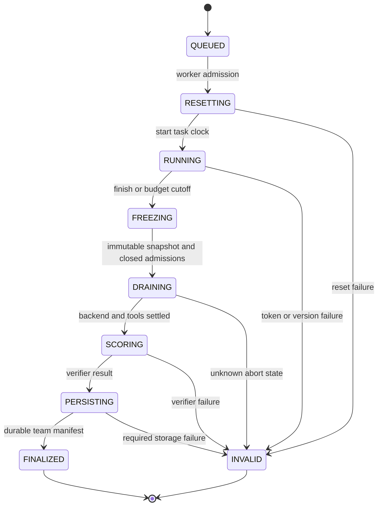

Member states are `IDLE`, `GENERATING`, `WAITING_TOOL`, `RETIRING`, and `RETIRED`. Spawn creates a new private history. Retirement closes that member's admissions and captures/settles its in-flight prefix at a member-specific cutoff. A retiring member counts against the member/concurrency cap until its backend and tools settle. Its late tool effects are rejected; its earlier sampled actions remain eligible. Agent IDs are never recycled.

At call admission, capture an immutable local context and visible-message cursor. New messages cannot modify an in-flight prompt. Message delivery is an environment event. Generated messages train on the sender side; received copies become context for the recipient.

File writes use expected versions and atomic patches. Conflicts return tool observations. Tests reference immutable workspace snapshot IDs. An event's commit order determines visibility; wall-clock arrival order alone does not. Tool processes run outside the async scheduling loop so one blocking test cannot serialize every agent.

##### Tool and Observation Semantics

Each completed continuation may request one structured tool action. A malformed or unknown action returns an ordinary error observation and consumes its generated tokens and call slot. The tool schema and parser are pinned run assets; the harness does not silently repair malformed actions.

| Tool family | Contract |
| --- | --- |
| Spawn / retire | Coordinator-only; enforce the live-member cap atomically; a spawn includes a bounded assignment; retirement preserves past calls |
| Send / read messages | Address team-local members; allocate message IDs and delivery sequence numbers; receiver reads are idempotent |
| Read / list files | Return a named workspace version with bounded output and explicit truncation markers |
| Apply patch | Compute candidate content in staging; check expected versions and cutoff; publish one new workspace-manifest version atomically |
| Public tests | Run an immutable snapshot in a subprocess; return snapshot ID, bounded output, and exit/timeout status |
| Wait | Suspend until a message/tool event or a bounded timeout; never block the whole collector event loop |
| Finish | Coordinator freezes the team; a worker marks its own assignment idle/completed |

Only the collector can publish live workspace mutations. Test processes receive read-only snapshots or private temporary copies, so a late subprocess cannot modify the frozen artifact. A multi-file patch commits as one manifest-pointer update, not independent writes whose intermediate state another agent might observe.

Before committing an action, check that the team/member is active, the attempt is current, the action is not duplicated, resource limits allow it, and the controller clock is before cutoff. The accepted event is its linearization point. Heavy patch preparation and test execution happen outside that critical section; final publication returns to it.

The scheduler wakes idle members on assignment/message delivery and observes at most one outstanding generation per member. A waiting coordinator does not prevent workers from progressing. All-waiting teams eventually receive a bounded wait timeout or the team deadline; an all-retired-worker team still allows the coordinator to continue. Call limits, tool concurrency, output bounds, and process timeouts prevent an invalid tool loop from consuming unlimited resources.

Each observation includes the task/role and assignment, visible messages, the latest completed tool result, live-member states, workspace version, remaining task time, and free/reserved token and call budgets. Those fields are environment context with zero direct policy loss. A token-only smoke profile explicitly marks time pressure disabled. No protected-test result is exposed before the episode's reward evaluation.

#### 5.3 Budgets and Physical Deadline

The collector atomically reserves response-token capacity before dispatch and returns unused reservations when a call settles. Count tokens from every agent, including reasoning, communication, and malformed calls. Charge discarded backend-generated tokens against their reservation as well; abort receipts report accepted, discarded, and total generated counts. If the backend cannot determine consumed capacity, charge the full reservation rather than returning potentially spent tokens. A fully reserved quota waits for outstanding calls before declaring exhaustion.

Start the task clock after reset and worker admission, immediately before the first policy call. Charge all subsequent prefill, queuing, generation, tools, and communication against the team deadline. Record initial admission delay separately. Initially admit one active team per replica to reduce cross-team queue interference.

At cutoff:

1. Close admissions and freeze the mutation ledger at the latest committed workspace version.
2. Reject subsequent writes and message delivery; isolate or cancel outstanding tools.
3. Capture accepted generated prefixes and their logprobs, including unfinished calls; abort remaining generation.
4. Score the frozen snapshot, then finalize the team. Cleanup and grading cannot add task progress.

Use the collector's monotonic clock as the authority. Define token acceptance at timestamped stream events entering that collector, with stable per-call indices. A chunk received after cutoff is not accepted; unaccepted backend work is recorded as wasted computation. The sampler extension must expose prefix tokens/logprobs and an acknowledged request abort. `asyncio` task cancellation alone is insufficient because backend generation may continue.

The current final-response sampler interface does not provide this contract. Prefix-preserving streaming/abort is a required implementation item for the final recipe. Dropping interrupted calls or replacing a physical deadline with “finish the current turn” would change the training data and budget semantics.

Valid outcomes include `FINISHED`, `TOKEN_LIMIT`, `CALL_LIMIT`, `CONTEXT_LIMIT`, and `DEADLINE`. Keep their scores and actions even when unsuccessful. Lost token data, wrong policy versions, verifier faults, and worker crashes are infrastructure failures. Retry an invalid task group as a whole with a new attempt ID, within a fixed retry limit; never selectively replace valid low-scoring teams. Stop after persistent infrastructure failure.

#### 5.4 Lifecycle Watchdogs

The task deadline bounds only active task execution. Every other phase also needs a finite operational timeout, supplied by the deployment profile and validated at startup. A poll returning no result is not proof that remote execution has stopped.

| Watchdog | Owner | Timeout result |
| --- | --- | --- |
| Team queue/admission | Program and manager | Cancel the queued attempt; no task clock or policy outcome has started |
| Reset | Collector | Infrastructure failure; release only after environment cleanup |
| Tool process | Environment | Candidate-code timeout is a normal tool/test result; kill its process group after bounded grace |
| Backend abort/settle | Collector and sampler | Unknown state is infrastructure failure; quarantine the replica and prohibit sync/reuse |
| Protected verifier | Collector | Candidate-code test timeout produces a failing test score; verifier/service failure invalidates the attempt |
| Persistence/flush | Worker | Incomplete required artifacts invalidate finalization |
| Whole remote request/round | Program | Cancel/fence overdue attempts; bounded retry or stop even if workers keep heartbeating |
| Checkpoint save / weight sync | Program and existing coordinator | Block commit/collection until durable state and fleet consistency are known |

Queue and whole-request limits must account for actual planned placement and queued waves, not only the 180-second task deadline. Bound a request by admission + reset + task + settle + verification + persistence + transport margins; bound a round across its finite retry epochs. The worker enforces local watchdogs while the program independently enforces the whole-request/round bound. `TaskSession.poll_completed` returning an empty batch does not reset those timers.

On watchdog expiry, close admissions and effects first, retain available diagnostic records, and request cleanup. A timed-out backend or storage RPC may still be running; do not reuse its resources or issue a duplicate mutation merely because the local await ended. If termination cannot be confirmed, stop or restart the responsible worker under the failure protocol in Section 7.

### 6. Team Learning and Trainer Integration

#### 6.1 Advantage Unit

Collect K independent team episodes for the same task/reset, policy version, and budgets. The task state is identical; policy seeds differ. Compute advantages before expanding teams into training rows:

$$
\mu_q=\frac1K\sum_kR_{qk},\qquad
\sigma_q=\sqrt{\frac1{K-1}\sum_k(R_{qk}-\mu_q)^2},\qquad
A_{qk}=\frac{R_{qk}-\mu_q}{\sigma_q+10^{-6}}.
$$

Use the existing `grpo` estimator's sample standard deviation (`ddof=1`) and additive epsilon. Its inputs here are K team rewards with an all-valid team mask after group validation. Freeze one advantage per team and apply it to all eligible member tokens. Do not treat agents as GRPO completions or renormalize by role, call, or agent count. Constant-score groups contribute zero policy gradient. Require K complete, valid teams before a group enters training; if the entire update has zero advantages, skip the optimizer update.

`TeamGRPOAdapter` adds a team-specific payload method while reusing GRPO estimator/loss registration. Existing `StandardRLProgram.critique_stage` requires one payload per input trajectory; swarm teams instead expand into a variable number of call rows, so they use `SwarmRLProgram`'s group assembly path.

#### 6.2 Token Ownership

Each `AgentCall` becomes one `RLTrainerPayload`: exact observed prompt, original sampled continuation, behavior logprobs, explicit attention/action masks, and the team's fixed advantage. Preserve next-token alignment, position IDs, tokenizer/template identity, and sampled EOS. Token equality with PAD/EOS does not determine validity.

| Tokens | Attention | Direct policy loss |
| --- | --- | --- |
| Current call's sampled tokens, including accepted unfinished prefixes | Valid | Team advantage |
| Role/task prompt, tool schema, previous outputs repeated in context | Valid | Zero |
| Received messages, file contents, tool results, harness separators | Valid | Zero |
| Padding | Invalid | Zero |

A sampled token has exactly one owning call row. Repeating it in another context does not create another action term. Train on the context actually seen at sampling time; never reconstruct it from the final shared workspace or re-tokenize a rendered transcript.

#### 6.3 Objective and Global Reduction

Reuse the token-level clipped surrogate with immutable behavior logprobs and advantages:

The recipe explicitly selects `loss_algo="grpo"`, `advantage_estimator="grpo"`, `epsilon=epsilon_high=0.2`, `epsilon_c=None`, and `beta=0`. Sampler importance/rejection corrections and sequence-disagreement filtering are disabled initially. These settings and the team-capacity reducer must be explicit in the resolved configuration rather than inherited from ordinary GRPO defaults.

$$
r_t(\theta)=\exp(\log\pi_\theta(a_t\mid h_t)-\log\pi_b(a_t\mid h_t)),
\qquad
\ell_t=\min(r_tA,\operatorname{clip}(r_t,1-\eta,1+\eta)A),
$$

$$
L(\theta)=-\frac{1}{BKT_{\max}}\sum_{q,k,c,t}m_{qkct}\ell_{qkct}.
$$

`T_max` is the fixed team generated-token cap; `c` indexes calls across all team members. This chosen reduction keeps the gradient invariant to how actions are partitioned into calls and avoids weighting short turns more heavily. It is not a claim to reproduce the source recipe's reduction. Ratios are per token, not a product across the full team trajectory.

Add an optional per-row `loss_denominator` tensor to the training payload and carry it through `PaddedBatchAssembler`, the adapter's model-input mapping, and the loss function. Allocate each team's `T_max` denominator across its call rows; contributions across the update must sum to `B*K*T_max`. An accounting-only masked row handles an actionless team. Dummy padding contributes zero. These weights are accounting values, not advantage weights.

Return the unreduced surrogate sum and denominator through the existing weighted-loss path. The native trainer already accumulates numerator gradients and denominators across microbatches. Do not divide each microbatch by the full update denominator and then accumulate it again. Verify equivalent reduction across data shards; do not rely on default sequence-mean aggregation. Sampling temperature and filter semantics must match training probabilities.

#### 6.4 Trainer RPC Boundary

Section 4 defines the round. Within its training stage, `SwarmRLProgram` is the sole issuer of trainer mutations and sends microbatches in a fixed order:

| Call | Required behavior |
| --- | --- |
| Intermediate `engine.train_step` | `accumulate_gradients=True`, `apply_optimizer=False`; accumulate numerator gradients and denominator only |
| Last `engine.train_step` | Apply exactly one update from all microbatches; report the actual resulting optimizer step |
| Zero-signal round | Do not invoke an optimizer update, including momentum or weight decay; retain the old checkpoint/version |
| Save | Request the exact updated model/optimizer state and verify persistence before cursor publication |
| Sync | Serve the committed policy only after every selected rollout worker acknowledges that version |

A team never spans policy versions. Drain every member and backend request before synchronization; pausing a Python collector is insufficient. Restore from the published checkpoint/cursor pair after an unknown training outcome, as defined in Section 7.

#### 6.5 Payload Assembly and Numerical Contract

Set `use_rollout_logps=True` and preserve exact token continuity. Before training, rescore a diagnostic subset with the unchanged trainer weights and compare sampled-token probabilities. Freeze dtype/backend-specific numerical tolerances during acceptance and record mean/max differences and ratio distributions. Unexpected differences block acceptance rather than being hidden by stale-policy or filtering corrections.

For each team, allocate denominator contributions using `d_c = T_max / N_calls` for its N call rows; an actionless team uses one accounting row with denominator `T_max`. Carry those values unchanged through padding and microbatch slicing. A representation split must redistribute the original contribution, not allocate another team budget. Verify that their global sum is exactly the intended update denominator within floating-point tolerance.

The native loss must mask inactive positions before evaluating unsafe arithmetic so padded logprob placeholders cannot cause `0 * NaN`. Preserve the action mask separately from attention validity. The same explicit completion lengths used for training must be used for optional logprob diagnostics.

The assembler and model-input builder need tests for the new denominator tensor, including dummy compilation payloads. Return an unreduced loss numerator and additive denominator, not a mean of row means. Check how the configured JAX mesh reduces each quantity: replicated values cannot be counted once per replica while sharded values are counted once globally. The distributed gradient must match the single-device dense oracle under the same parameters and data.

Treat the optimizer update as indivisible. If any microbatch fails after partial accumulation or an update RPC has an unknown outcome, stop admitting work and restore the last committed model/optimizer state; do not blindly retry the last training RPC. Reset gradient accumulators as part of restore or worker reinitialization.

### 7. Checkpoint, Retry, and Failure Semantics

#### 7.1 Three Progress Counters

| Counter | Advances when | Recovery source |
| --- | --- | --- |
| `collection_round` | A complete set of B task groups is committed, including an all-zero-advantage round | Published run commit |
| `optimizer_step` | The optimizer actually applies an update | Model/optimizer checkpoint |
| `policy_version` | A new parameter state is selected for serving | Checkpoint header plus published run commit |

A zero-advantage round consumes tasks but must not apply Adam momentum/weight decay, increment the optimizer step, or invent a new parameter version. It may publish a new cursor commit referencing the same model/optimizer checkpoint. This also handles a zero-signal first round by referencing the initial step-0 checkpoint.

The current engine restore path can infer policy version from a global step and treats step 0 as a fresh run. Add a swarm-aware restore branch that preserves explicit policy-version metadata and recognizes a valid initial checkpoint. Add an optional exact `step` selector to the public resume method, forwarding to the existing private restore primitive. `SwarmRLProgram` restores its collection cursor from the run commit, not from the method's integer step return.

#### 7.2 Durable Commit Protocol

A run commit contains `commit_id`, parent commit hash, collection round, consumed group/attempt IDs, next dataset cursor, seed-schedule state, optimizer checkpoint reference/step, policy version, run-manifest digest, and finalized team-manifest references.

1. Flush team token/event files, snapshots, and verifier records; validate their hashes.
2. For a nonzero-signal update, save the complete model and optimizer at its actual optimizer step with immutable checkpoint metadata. For a zero-signal round, retain the previous checkpoint reference.
3. Verify checkpoint persistence, then write an immutable run commit referring to that checkpoint and the consumed data.
4. Atomically publish the commit pointer with the expected parent. A second controller with an incompatible parent cannot advance the same run.
5. Synchronize the committed policy version before the next collection round. A sync failure does not undo a durable training commit; recovery restores that commit and repairs the fleet before proceeding.

For the first recipe, require synchronous checkpointing and a forced save for each optimizer update. The current `save_checkpoint` RPC can acknowledge an initiated asynchronous save and does not return a durable checkpoint receipt. Propagate the save result/reference through the trainer/worker path and verify durable completion before publication. An asynchronous profile needs an explicit completion barrier and is deferred.

Use atomic rename and directory synchronization for a local/shared filesystem commit pointer. Hold an exclusive process-lifetime run lock on a filesystem with verified locking semantics; check the parent pointer while holding that lock. For object storage, publish immutable objects first and update the pointer with a generation/ETag precondition, while the launcher enforces a single active control-plane owner. The first recipe has no time-expiring leader lease or automatic controller failover: replacement starts only after the old owner is stopped. A pointer CAS alone would not fence stale optimizer RPCs. The trajectory writer's `flush()` helps persist traces; it is not a cross-store transaction.

Prevent retention from deleting the checkpoint referenced by the current or previous committed pointer, even when a newer uncommitted checkpoint exists. On restart, ignore orphan checkpoints/partial manifests and select the exact committed checkpoint. The initial and latest committed states must remain restorable.

Before reusing an optimizer-step storage key after rollback, handle orphan checkpoint directories explicitly. For example, an uncommitted save at step N can collide with recollection from committed step N−1 and its next save at N. First stop the old controller and settle or restart the trainer writer; verify the directory is unreferenced by every retained commit, move it to an orphan quarantine outside the active checkpoint namespace, and recreate/refresh the checkpoint manager before saving that step again. Never overwrite or quarantine a referenced checkpoint. Test this crash point with the actual checkpoint backend; `force=True` alone is not an overwrite policy.

#### 7.3 Failure Handling

| Failure / interruption | Required action |
| --- | --- |
| Invalid action, wrong patch, test failure, candidate-code test timeout | Valid policy behavior; keep tokens and measured task score |
| Team deadline or token/call/context exhaustion | Freeze and score; retain eligible tokens and a valid budget outcome |
| Lost RPC reply but same remote execution remains identifiable | Poll/query the same execution; do not create a second environment |
| Token gap, nonfinite behavior score, policy mismatch, invalid snapshot | Reject the task group before training; cancel peers and retry with a fresh group-attempt epoch |
| Worker unreachable or completion error without identity | Abandon all affected/unknown pending groups; in the conservative profile retry the uncommitted collection round |
| Partial gradient accumulation or unknown optimizer RPC outcome | Restore the last committed model/optimizer and clear accumulators; recollect the round |
| Checkpoint saved but run commit not published | Treat checkpoint as orphaned; restore the previous published commit |
| Run commit published but sync fails | Keep commit; restore its policy and reestablish a consistent serving fleet |
| Unknown backend abort state or mixed-version serving fleet | Quarantine/restart affected workers; no reuse or new collection until consistency is proved |
| Control-plane crash during rollout | Discard unfinished attempts; reset environments and recollect from the committed cursor |

Disable automatic per-task redispatch in `TaskSession` for the swarm profile (`max_task_retries=0`). Poll retries that observe the same execution are allowed; scheduling a new team attempt is a program-level decision. Use at most two infrastructure retry epochs per collection round initially, then stop with recorded failures. Preserve all valid low-reward episodes when there is no infrastructure failure.

Before a retry, fence the old epoch, cancel healthy peers, and settle their backend/tool work. Unreachable owners cannot publish into the new attempt's namespace. Reject all late results from abandoned epochs. If the owner cannot confirm cleanup, quarantine that replica rather than overlapping a new team with unknown work.

Honor the existing weight-sync coordinator's failure states. An aborted sync can be retried only after destinations confirm a consistent old version. Partial publication, unknown transfer state, or a restart-required state blocks collection; the control-plane must not simply clear the error or increment a version. Multi-round native-trainer/Raiden acceptance is a prerequisite, not an assumption of this design.

### 8. Configuration, Capacity, and Observability

#### 8.1 Configuration Ownership

| Configuration | Owner / lifecycle |
| --- | --- |
| Model/tokenizer/template, tool schema, verifier and task split | Immutable run manifest; validate on workers and resume |
| B, K, objective, fixed denominator, sampling distribution | Program/adapter configuration; frozen within the run |
| Team size, deadline, call/context/output limits | `TeamSpec`; identical for teams compared within a group |
| Replica count, mesh, precision, tool CPU slots, I/O destinations | Deployment overlay validated against registered worker capabilities |
| Evaluation seeds, budgets, baseline modes | Separate immutable evaluation manifest referring to a checkpoint |

The initial launch must reject unsupported strict-deadline capability, incompatible tokenizer/template hashes, missing old logprobs, disabled checkpointing, asynchronous saves without a completion barrier, team partial-rollout mode, and automatic single-task redispatch. Changing environment/reward/optimizer contracts creates a new run or an explicitly versioned experiment rather than silently continuing an old checkpoint.

#### 8.2 Capacity and Backpressure

For the proposed B = 2, K = 4 profile, one update has eight team episodes, at most 256 call rows, and at most 65,536 generated action tokens. At 8,192 total tokens per call, the conservative upper bound is 2,097,152 row tokens before accounting for padding. Raw int32 token IDs alone can approach 8 MiB across an update; logprobs, masks, events, and artifacts add to that. These are analytic limits, not measured throughput or accelerator-memory claims.

Use bounded queues at team admission, generation admission, tool execution, finalized-group buffering, and artifact writing. Keep the first control-plane window to one collection round. Do not enqueue later-policy work while the current update is accumulating. With R rollout replicas and one active team per replica, no more than R teams and four times R member calls are active; group completion may require multiple waves.

Cap tool output, message sizes, event buffers, and local snapshot storage through the recipe configuration. Stream required records to storage and stop before accepting work whose records cannot be retained. Do not discard token prefixes or active histories to relieve memory pressure. Artifact-write failure invalidates the attempt; optional telemetry loss can be counted without discarding an otherwise complete training record.

Start with train microbatch size one and a small fixed set of padded length buckets, each with a configured compilation payload including all optional tensor fields. Select the bucket from the exact stored row length; never truncate a sampled context to fit. Profile prefill, repeated context, padding, compilation, and tool CPU separately before increasing concurrency or enabling packing.

Budget storage and write bandwidth for full parameter-plus-optimizer checkpoints, not just inference weights. Retain the initial checkpoint and the required committed recovery states, and measure synchronous save cost per update. Saving every optimizer update is a deliberate first-profile durability/throughput trade-off; relaxing that schedule requires an explicit rollback-window and cursor-commit policy.

#### 8.3 Metrics and Traceability

| Scope | Required metrics |
| --- | --- |
| Fleet / round | Healthy replicas and their policy versions; dispatch, queue, rollout, scoring, assembly, train, save, and sync times |
| Team | Reward/outcome, live/spawned members, generated/input tokens, active calls, message count, patch conflicts, deadline/cancellation waste |
| Training | Reward variance, zero-advantage groups, valid/retried groups, action-token count, denominator sum, loss, gradient norm, clip fraction, optimizer step |
| Artifacts / recovery | Write/flush failures, committed cursor, checkpoint reference, orphan attempts/checkpoints, rejected stale/duplicate responses |

Record `run → collection round → group → attempt → team → agent → call → event` lineage. A reviewer should be able to move from one reward or gradient-bearing row to the exact context, sampler response, workspace snapshot, and verifier result that produced it. Keep raw per-task measurements alongside aggregates.

Report task time from first admitted call to freeze, backend cleanup time, grading time, initial queue delay, and total end-to-end latency separately. Include repeated input processing and accelerator allocation/cost when comparing teams with a single agent. A token-budget metric alone cannot demonstrate wall-clock efficiency.

### 9. Implementation Plan and Acceptance

These are recipe-local gates, after the common design's first math result and frozen-worker generality gates. Reuse the common runtime, traces, learning-plan interface, commit machinery and collector lifecycle; the work below adds Swarm-Repair-specific behavior.

`examples/swarm_repair/` must provide pinned configs and launchers using the existing dist worker setup, plus four entry modes: baseline evaluation, training, resume, and evaluation of a saved checkpoint. Persist the resolved manifest, team traces, final patches/snapshot hashes, verifier outcomes, checkpoint references, and per-task evaluation tables.

| Stage | Required output / exit gate |
| --- | --- |
| 1. Environment and inference | Stable resets/verifier; single-agent baseline; multi-agent communication and concurrent generation with reproducible artifacts |
| 2. Team learning | Team DTOs and adapter; numerical gradient oracle; mask/group/reduction tests; two actual local optimizer updates |
| 3. Distributed loop | Two accelerator collect/train/sync rounds; round two uses updated weights; checkpoint/resume preserves the next group cursor |
| 4. Time-budgeted swarm | Prefix-preserving sampler abort; no post-cutoff effects; valid deadline episodes and unfinished-call prefixes reach training |
| 5. Recipe acceptance | Dynamic 1–4-agent execution, complete train/eval/resume commands, held-out comparisons, uncertainty and cost reporting |

Stages 1–3 may use token-budgeted smoke runs. Stages 4–5 are required before calling the final recipe complete.

Correctness checks must include an independent tiny shared-policy gradient oracle with unequal agent/call lengths; team-versus-agent grouping; first-token and EOS alignment; sender/receiver duplication; zero-variance groups; malformed tools; file conflicts; budget exhaustion; infrastructure faults; microbatch/shard reduction invariance; and cutoff races with real backend cancellation. No-action/zero-advantage controls must avoid an optimizer update. A trace with overlapping calls alone does not establish backend parallel execution; validate serving overlap as well.

For held-out evaluation, compare the same initialization and task manifest across: single-agent RL, shared-policy team RL, independent parallel attempts with visible-test-based selection, fixed-size teams, and adaptive teams. Include frozen-policy controls and messaging/workspace ablations. Match the declared training-compute budget and report actual training tokens, optimizer updates, and accelerator time; equal update counts alone do not match the cost of variable-length teams. Evaluate each trained checkpoint in both single-agent and team modes so additional RL is distinguishable from team training.

Use paired task-level comparisons, at least three training seeds for the main study, and a held-out task count selected before final evaluation; a 100-task pilot is a starting point. Report reward/success, quality versus time, latency distributions, generated and repeated input tokens, tool time, serving/accelerator cost, wasted canceled work, and failure rate. Keep unsuccessful/capped episodes in aggregates and bootstrap differences by task. Run token-matched and wall-clock-matched comparisons separately, accounting for selection and coordinator overhead.

The resulting artifacts support a reproducible account of whether team training improves useful collaboration. Performance gains are experimental outcomes, not prerequisites that the implementation can assume.

#### 9.1 Change Sequence and Regression Boundary

| Change | Main files / dependency | Review criterion |
| --- | --- | --- |
| Transport and collector selection | `swarm/trace.py`, `common/datatypes.py`, rollout manager/worker, engine interface/router | Standard single-agent requests preserve their existing result shape and lifecycle; team envelopes survive serialization |
| Team runtime and environment | Team collector, sampler streaming/abort, workspace/message/tool adapters | Concurrent requests, snapshot consistency, quotas, and cutoff behavior pass independently of RL |
| Team training path | Team adapter, payload/assembler/model-input extensions, loss reduction, swarm program | Full-update gradient oracle and microbatch/device equivalence pass |
| Commit and recovery | Checkpoint receipt/restore selector, explicit policy metadata, run-commit storage | Crash injection before/after update, save, publication, and sync recovers the declared state |
| Complete recipe | Fixtures, pinned config, launch/eval/resume entry modes | Two real distributed rounds, a restore, and controlled held-out evaluation produce auditable artifacts |

Add new fields as optional defaults and select team mode explicitly. Ordinary GRPO and OPD retain their current trajectory path and loss behavior when team fields are absent. Run their affected DTO, assembler, program, and checkpoint regression checks alongside the swarm-specific suite. A new sampler streaming capability must not change existing completion-only calls.

#### 9.2 Requirements-to-Verification Map

| Requirement | Verification evidence |
| --- | --- |
| FR-1, FR-5; NFR-1 | Independent team-gradient oracle, existing-estimator agreement, token ownership, row/denominator invariance |
| FR-2, FR-3, FR-4 | Spawn/retire limits, real serving overlap, message visibility, patch-conflict and snapshot tests |
| FR-6, FR-7; NFR-4 | Partial-progress scoring, valid budget outcomes, real prefix/abort acceptance, lifecycle watchdog injection |
| FR-8; NFR-2, NFR-3 | Two distributed collect/train/sync rounds, serving-profile validation, exact checkpoint/cursor restoration, crash-point tests |
| NFR-5 | Resolved immutable manifests, raw task artifacts, repeatable evaluation entry modes |
| NFR-6 | Existing trajectory/GRPO/OPD DTO, assembly, loss, program, and checkpoint regression checks |

The documented estimator example can be verified against existing source before implementation. All new-runtime and training acceptance items remain pending until executable evidence is attached to the implementation review.

### 10. Design Decisions and Alternatives

| Decision | Rationale | Alternative and trade-off |
| --- | --- | --- |
| Team-local rollout ownership | Reuses the worker/sampler lifecycle and keeps message/file ordering local | Controller-per-call or multi-owner teams add RPCs and distributed state; consider only after the bounded recipe |
| Shared policy with Team-GRPO | Uses existing actor training and advantage/loss machinery | Independent role policies or CISPO need additional objective/policy lifecycle validation |
| Fixed team-capacity reduction | Call count and turn splitting do not alter team weight | Per-call means favor short turns; realized-token means introduce length-dependent scaling |
| Synchronous policy rounds | Gives one behavior version and a simple commit boundary | Overlapped stale rollouts may improve utilization but require explicit off-policy semantics |
| Prefix-preserving physical cutoff | Keeps observed action prefixes and the scored artifact consistent with the task boundary | Turn-boundary caps are simpler but allow time overshoot and change the environment |
| Synchronous per-update checkpoint | Provides a precise rollback boundary for the initial recipe | Async/periodic saves reduce overhead but require durable-completion and replay-window protocols |

### 11. Risks and Open Measurements

| Item | Mitigation or decision needed | Exit gate |
| --- | --- | --- |
| Base policy cannot explore tools or useful teamwork | Calibrate fixture difficulty and any declared format warmup; inspect zero-variance groups | Environment/inference acceptance |
| Tasks reward independent search rather than coordination | Include dependency-heavy repairs and independent-attempt/message/workspace controls | Recipe evaluation |
| Backend cannot preserve prefixes or settle aborts | Extend and validate the selected native-compatible sampler; deadline mode stays unsupported until then | Physical-deadline acceptance |
| Throughput or memory limits | Measure native-trainer meshes, repeated prefill, padding, team concurrency, and synchronous save cost | Distributed acceptance |
| Hardware placement distorts relative rewards | Homogeneous serving profile, frozen concurrency/tool limits, recorded digest and queue metrics | Startup and group validation |
| Recovery reuses the wrong model or storage key | Commit-selected restore, explicit counters, orphan quarantine, retention and crash-injection tests | Recovery acceptance |

Before a long run, freeze immutable model/tool assets, optimizer settings, feasible deployment meshes, stream-chunk granularity, abort-settle and lifecycle timeouts, verifier CPU limits, fixture difficulty, and the deadline/evaluation grid. These measurements may change numeric defaults. Changing objective, observation, event, or commit semantics requires a design revision.

### 12. References

- [How to Train a Swarm](https://www.gr.inc/blog/how-to-train-a-swarm): method motivation and collaboration incentives.
- [Avalon-M1 / RLCR report](https://www.gr.inc/avalonm1.pdf): shared-policy collective-reward method reference.
- [Tunix distributed RL source](https://github.com/google/tunix/blob/haoyu-next/tunix/dist_rl/): inspected baseline; specific integration files are linked in Section 3.1.
- [Common system design](https://docs.google.com/document/d/15priSJuP3mr5Fy7chnj_bM1Z70WtuLYI7IKa_-qpULI/edit): authoritative common contracts and first-recipe delivery gates.
- [Internal overview](https://docs.google.com/document/d/15priSJuP3mr5Fy7chnj_bM1Z70WtuLYI7IKa_-qpULI/edit): concise program summary.
