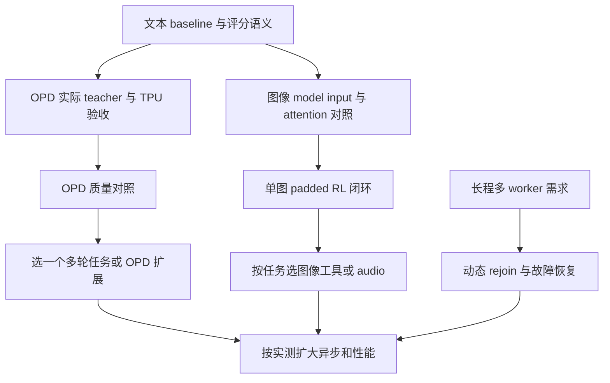

# Tunix 研发地图

> **Swarm 设计更新（2026-11-10）：**近期顺序采用 OPD → 通用 swarm 框架与 Dr. MAS 共享 Qwen3-4B 数学 recipe → 冻结 workers 的 orchestrator → Avalon 风格动态并行团队 → RSI 与其他扩展。下文的多模态、后端和性能工作仍是独立可选方向，不作为 swarm 的前置。权威设计见[正式系统设计](swarm_training_design.md)，内部讨论见[中文速览](swarm_training_overview_zh.md)。

## Swarm 新主线：先拿可验证结果

| 阶段 | 需要补齐 | 验收产物 |
| --- | --- | --- |
| 通用契约 | collector 选择、`SwarmProgram`/runtime、agent/role/policy 绑定、逐调用不可变轨迹、credit 与 learning plan | 保留真实上下文/token/logprob；episode 一对多展开；学习统计与 loss 分母明确 |
| 首个数学 recipe | 共享 Qwen3-4B；Solver → Verifier → 拒绝时 Solver 修改；K=8；外部规则评分 | 对齐 Dr. MAS 活跃调用归一化和 global baseline；两轮真实训练、同步、checkpoint 恢复 |
| 独立质量验证 | 训练集另留 dev，锁定最终测试；未训练团队/global/Dr. MAS/等预算单 Agent 对照 | avg@16/pass@16、token/耗时/成本、改对与改错率、多 seed 波动及原始轨迹 |
| 通用性验收 | 可训练 orchestrator + 冻结 workers 的路由与训练范围 | 同一 runtime/trainer 支持不同交互与绑定；冻结参数不变 |
| 动态并行 recipe | 动态成员、消息/工作区、anytime reward、物理 deadline、保留采样前缀的后端取消 | 截止后无副作用、真实重叠执行、等预算质量与延迟报告 |
| 后续扩展 | 多独立 policy 的版本/checkpoint 集合、角色 OPD、环境 fork、外层 RSI curriculum | 每条扩展独立验收；不能把单 policy 引擎或 metadata 当作已支持 |

Dr. MAS 的共享模式是原实现支持的配置，但公开 launcher 默认不共享。原文约 4×H100、35 小时只作资源参考，Tunix 的 mesh、精度、采样契约和吞吐仍待实测。现阶段没有 swarm 训练结果。参考：[官方代码](https://github.com/langfengQ/DrMAS)、[后续 Swarm-Repair 专项设计](swarm_rlcr_design.md)。

路线更新日期：2026 年 11 月 10 日。原有能力审计基线是 `2176443ad6bb61093e8d133a0d2d19045655db80`，参考 Miles 固定版本 `88cf4fc932fca650aebc409ccbb5bc9dd7f59afe`；本图同时包含 `haoyu-next` 工作区新增的 OPD 实现。

**单人主线：先验收文本 OPD，再交付 Dr. MAS 共享模型数学 recipe，随后检验不同 swarm 架构。** 当前可以启动真实 teacher 协议检查和 TPU 运行，不必等所有下列方向完成。详细能力比较见[能力清单](tunix_capability_checklist.md)，各方向的阶段产出见[研发路线图](tunix_rl_research_directions.md)；当前 swarm 顺序以本文和正式设计为准。

## 1 近期中期长期分别做什么

| 时段 | 默认投入 | 交付边界 | 可并行或提前的条件 |
| --- | --- | --- | --- |
| 现在 | OPD 真实服务与 TPU 验收 | 固定外部 teacher、文本 sampled-token、GRPO、G≥2、temperature 1 | 可并行做 VLM 模型加载和 attention 小原型；teacher 资源不可用时先做 VLM |
| 下一里程碑 | 共享模型数学 swarm RL | Qwen3-4B、条件 Solver–Verifier、Dr. MAS/global 对照、规则评分 | 不等待共享文件系统、动态成员、物理 deadline 或多独立 policy |
| 中期 | 冻结 workers 编排，再扩动态并行团队 | 通用绑定与训练范围；后续 Swarm-Repair 的时间/工作区语义 | RSI 在外层扩任务与技能状态；多模态按独立需求推进 |
| 贯穿主线 | Recipe、指标、数值与恢复验证 | 每个新增能力有明确模型、后端、硬件和运行证据 | 长程或可抢占任务前，动态 rejoin 必须提前；性能优化由 profiler 决定 |
| 长期独立方向 | 训练服务、多策略、连续 diffusion | 各自有任务、资源预算与独立设计 | 有实际客户或研究任务时立项，不阻塞 OPD 和 VLM |

“新增能力”表示需要建立新的训练或服务流程；“完善已有能力”表示已有代码可复用，工作落在覆盖范围、正确性和运行证据上。两者都不能只以新增 flag 或进程成功退出作为完成标准。

- **新增训练能力**：在线 OPD、标准图像/audio/video RL 闭环、候选分布蒸馏、sampling-support replay、score centering。
- **完善已有能力**：async、packing、token continuity、routing replay、权重同步、Zero-TIM、模型接入和 recipe 验证。
- **独立新运行时**：multi-policy、multi-LoRA 训练服务、连续 latent diffusion；各自评估资源与任务，不列成全库升级的前置。

## 2 现有基础和当前边界

| 基础 | 已经有什么 | 仍需补什么 |
| --- | --- | --- |
| RL 与 Agentic RL | PPO、GRPO 等算法、DeepSWE/FrozenLake、多轮轨迹、异步调度 | 把新监督信号和新媒体输入接入现有流程，保留 mask、版本与有效组语义 |
| 分布式运行时 | `dist_rl` worker、queue、背压、staleness、Raiden、健康监控 | 故障后动态重建和重新加入、恢复后的样本消费语义、多配置的真实验证 |
| 数值一致性 | IS/RS、agreement 指标、MoE routing replay、Zero-TIM 内核 | 标准模型 recipe、明确支持矩阵，以及采样 support 与 full-policy score 的区分 |
| 多模态基础 | Gemma3 vision、Gemma4 vision/audio、processors、原生媒体采样、图像 DPO notebook 和图像 SFT 脚本 | 维护现有 SFT 示例；建立标准 RL 媒体 DTO、模型 attention、scoring、assembler 与 loss 的完整链路 |
| 蒸馏 | 数据批次的 logit/feature/attention distillation；新增在线 OPD | 在线 OPD 的真实服务协议、TPU 闭环和质量对照；后续再扩教师形式 |
| 模型与优化 | Native Tunix、MaxText 接入、LoRA/QLoRA、分片和性能记录 | 用具体模型和硬件组合证明支持程度，补跨后端权重与输入契约 |

基础入口：[算法适配][algo]、[分布式程序][program]、[模型加载][automodel]、[Zero-TIM][zero-tim]。本图不把已有异步、TITO 基础、replay 或图像 DPO 重列为从零新增。

多模态示例实际散落在以下入口，并没有统一收进 `dist_rl/examples/recipes`：

| 示例 | 内容 | 当前应如何理解 |
| --- | --- | --- |
| [图像 SFT](../examples/sft/vlm_training.py) | Gemma3-4B-PT，LaTeX_OCR 图片转 LaTeX，含 LoRA 和训练调用 | 已有参考脚本；硬编码 GCS checkpoint/tokenizer，且调用了当前不存在的 `get_positions_and_attention_mask`，需要维护与实机验证 |
| [图像 DPO](../examples/vl_dpo_gemma3.ipynb) | Gemma3-4B-IT，RLAIF-V 图像偏好对，含 `DPOTrainer.train` | 已有多模态训练 notebook；本次未重跑其加速器训练 |
| [图像/音频推理](../tunix/models/gemma4/sampling_example.ipynb) | Gemma4 的多图、音频输入与文本输出 | 已有推理示例，不包含 RL 更新 |

当前没有完整的标准图像/音频 GRPO 或多模态 OPD recipe。Gemma3/4 的 GSM8K、FrozenLake 脚本使用文本任务；模型具备视觉能力不代表这些 recipe 已启用媒体训练。

## 3 OPD 验收与可选图像 RL 工作包

### 文本 OPD 已实现待验收

`haoyu-next` 已有外部 `SGLangTeacherScorer`、tokenizer 兼容检查、逐 token OPD transform、critique 接线、CLI、recipe 和 CPU 测试。当前状态是 **已通过本机数值与训练闭环，待真实运行时验收**：真实 SGLang teacher 与目标 TPU 的训练运行、长程收敛和能力迁移实验尚未完成。

当前信号是 `任务系数 × 已归一化 task advantage − 蒸馏系数 × (student rollout logprob − teacher logprob)`；旧 student、teacher 和最终 advantage 都作为固定数据。纯 OPD 保留原任务得分作日志，训练信号不依赖非零 task reward。

本轮复核保留了与 Miles 一致的 reverse-KL 方向和先计算 task advantage 再叠加 OPD 的顺序；补上 teacher 全序列 token ID 校验、有效 response span、可取消的完整请求超时，以及 tokenizer backend 语义检查。训练端区分 loss mask 与 attention validity：tool observation 不参与 loss，但保留上下文；真实 EOS 与 pad 共用 ID 时也不会被当成 padding。超过 assembler 预算的有效轨迹会在 teacher 请求前失败，避免评分与训练上下文不一致。详细约束与测试见[OPD 说明][opd-guide]。

同时修复了异步 vLLM 按候选字典首项取分数的问题，改为按真实生成 token ID 取值；reference 评分也完整保留 packed segment 和局部位置。进一步补齐实际 sampler 的完整分布契约和 checkpoint 目标身份校验。本轮联合 CPU 回归为 **775 passed、286 个子测试通过、6 skipped**；非均匀分布的 dense-KL 梯度误差小于 `3e-8`，本机两轮真实优化器更新使小模型 KL 从 `0.149617002` 降到 `0.147754008`。实验方法、负对照及边界见[验证记录](opd_validation.md)；这不是实际 SGLang/GPU/TPU 训练的运行证据。

| 工作 | 具体模块 | 第一个交付与完成门槛 |
| --- | --- | --- |
| 真实 teacher 协议 | [teacher.py][teacher] | 对固定 student 轨迹返回同 token、同 response span 的分数；核对零新增 token、首个 response token、EOS、错误返回和超时 |
| TPU 两轮闭环 | [OPD recipe][opd-recipe]、[程序][program]、[权重同步][weight-sync] | 原文本 baseline 与 OPD 各跑两轮；第二轮确实用更新后的 student；teacher 固定；记录各阶段耗时与 logprob 差异 |
| 学习价值 | [OPD transform][opd-core]、[示例说明][opd-guide] | 固定 train/eval 子集比较初始 student、pure OPD、GRPO、GRPO+OPD；同时报告质量、长度、有效 token、teacher 成本 |
| 运行身份与恢复 | 已保存和校验 OPD manifest：声明的 teacher revision、tokenizer 指纹、系数与生效采样契约 | 对真实 checkpoint 做中断/恢复验收；部署侧保证远程服务实际使用所声明的固定权重；缺身份的正系数 fresh run 不支持恢复 |

首版保持 G≥2、temperature=1、top-p=1、top-k 禁用、实际 rollout logprobs、staleness=0、真实权重同步和无 in-flight 权重更新。Student/teacher 需要兼容的 fast tokenizer；不支持仅凭同词表接入无法核验的 slow tokenizer。Reference KL 与 OPD 独立；先用 beta=0 的小 recipe，再按需要接 reference worker。CPU 测试不替代以上运行和质量门槛。

### 图像 RL 先补模型输入再接训练

首选 Gemma3-4B-IT、固定单图、原生 vanilla、padded batch。已有 VLM DPO 提供视觉加载先例；若内存迫使改选 Gemma4-E2B，需要同时处理 static `soft_token_counts`、patch bucket 与 DP 切片，不能只替换模型名。

| 改动 | 具体模块 | 第一个交付与完成门槛 |
| --- | --- | --- |
| 视觉模型 factory | [AutoModel][automodel]、Gemma3 config/params、vanilla worker factory | 显式加载 vision，配置 ImageProcessor；同 checkpoint、图片、token 得到一致模型输入 |
| Attention 和 token 语义 | [原生 prefill][vanilla]、[RL scoring][rl-common]、Gemma3 `get_attention_mask` | 先用 dense mask；修复 rollout 的视觉双向块与 RL 普通 causal mask 不同的问题；同权重 response logprobs 对齐 |
| 媒体传递 | [DTO][dto]、collector、trajectory、[算法适配][algo]、[assembler][assembler] | 图片作为真实 PyTree leaf 贯穿 `RLTrainerPayload` 与 `LogprobsRequest`；group 复制、shuffle、padding、microbatch 后仍对应同一轨迹 |
| Actor 和 reference scoring | [TrainerWorker][trainer-worker]、[InferenceWorker][inference-worker] | 两条评分路径都保留媒体；覆盖 microbatch slice 和 reference 重建请求，不能只修 loss forward |
| 冻结和优化 | [PeftTrainer V2][trainer]、共享 policy loss | 内存允许时用 LM 全参并冻结 vision/projection/norm；optimizer、autodiff、初始和重建的 accumulator 共享 trainable filter |
| 最小任务 recipe | 新增单图 GEO3K 或固定视觉问答 recipe | 图片变化影响分布；vision 不更新、语言参数更新；同步后再采样；固定 bucket 连续运行不反复编译 |

如需 LoRA，先核对 Gemma 语言层实际路径，并让 trainer/sampler 构建同一 adapter graph；首版先验证全树同步。当前 Qwen 风格默认正则和原生 worker 工厂不能自动满足此要求。

首个图像 recipe 拒绝媒体 packing、超过预算的残缺图片块和 placeholder 数量不匹配；暂不同时支持无图/多图混合、视频、audio 或 encoder 更新。媒体不能藏在 payload metadata，trainer 会清理该字段。

## 4 中期训练扩展按任务选择

| 方向 | 当前缺口与要补的模块 | 首个交付与验收 | 依赖或启动条件 |
| --- | --- | --- | --- |
| G=1 pure OPD | GRPO 入口与 adapter 的有效组检查目前要求多个有效样本；需专用 pure-OPD 组语义 | 单响应纯蒸馏能训练，失败/全 mask 样本仍排除；普通 GRPO 的安全检查不变 | 基础 OPD 已验收，且多次生成成为主要成本 |
| Top-k OPD | teacher 候选分布、候选 IDs/probs、词表集合和尾部语义没有在线接口 | 小词表 oracle 验证目标、梯度与归一化；再比较 sampled-token 的方差、质量和成本 | 有监督密度需求；不复用离线 `LogitStrategy` 名称来掩盖目标差异 |
| 多 teacher | scorer 路由、teacher 身份、tokenizer 校验与缓存键需按样本管理 | 一个 metadata 路由到一个 specialist，fallback 明确；恢复不能切错 teacher | 有多任务或 specialist 合并实验；不要一开始做 ensemble |
| Teacher 性能 | 已有 timeout/并发限额；再按实测补请求打包、重复前缀和评分缓存 | 精确缓存键含 teacher revision、原 token IDs、评分配置；有吞吐提升且不改变分数 | profiler 证明 teacher 等待占主要时间 |
| 多轮与工具 OPD | 现有 collector 可复用，需核对每轮 assistant mask、exact tokens 和截断 | 先在现有 DeepSWE 或小工具环境做固定评测；tool observation 不产生更新 | 文本 OPD 已通过；padded 多轮不必等待 sequence packing |
| 图像工具任务 | 每轮新图片/截图需要 media-to-token 与 media-to-turn 对齐 | 一个截图工具环境，工具返回媒体后仍能评分和训练；取消/超时可清理 | 单图 RL 稳定后；单独设计媒体 packing |
| Audio 理解 RL | Gemma4/audio processor 和 sampler 已有；audio DTO、scorer、loss、batch bucket 未贯通 | 一个转录或可验证音频问答 recipe；长度/clip mask、无声/padding、logprob 对齐正确 | 有音频任务和 Gemma4 资源；沿已稳定的媒体契约扩展 |
| 视频理解 RL | 帧采样、时间/空间位置、解码缓存、token budget 和视频 reward 未形成标准路径 | 固定短视频、固定帧数的问答 recipe；帧顺序敏感，跨 batch 位置不串样本 | 图像路径稳定且有视频 benchmark；不能仅凭 processor 有视频参数宣布支持 |
| Score centering | 没有对应候选概率数据契约与目标实现 | 独立的小词表梯度 oracle、off-policy 对照，再评估候选传输成本 | 已有质量基线且 off-policy drift 成为瓶颈；与 OPD 组合另验 |

图像、audio 和视频**输入理解**与图像/视频**输出生成**是不同工作包。VLM+OPD 也应等两条链路分别通过后再组合。

## 5 系统能力补覆盖范围和运行质量

| 方向 | 现状与具体要补什么 | 第一个交付与验收 | 何时做 |
| --- | --- | --- | --- |
| Packing | 文本 assembler/packing 已有，OPD 的 CPU 字段/advantage 对齐已覆盖；补实际模型 packed/unpacked loss 与梯度等价、TPU 运行，以及媒体 segment 映射 | tokens、advantages、old/ref scores、mask 同步重排；跨 segment 不泄漏；媒体无静默丢失 | 文本实际模型验证接在主线后；媒体 packing 单独排期 |
| 有界异步 | 已有 queue、staleness、dispatch 和背压；补 OPD 的固定 behavior scores 与 group 消费语义 | 从 lag=0 逐步到有限 lag；统计过期/不完整组和有效 token；新增开销有实际吞吐收益 | 同步学习结果可解释后；首版 OPD 当前不允许非零 staleness |
| 动态 rejoin | [registry][registry] 会拒绝被 evict 的 worker ID；需重建、初始化、编译、同步、激活的阶段状态 | 杀一个 rollout worker 后容量恢复；新实例收到当前权重再接任务；旧实例不能重复回包 | 多 worker、可抢占和长程任务之前，可与功能主线并行 |
| 恢复与数据消费 | 已有 checkpoint 和轨迹存储；需验证 weight version、队列、待提交 group 的共同恢复点 | 中断/恢复后无重复更新、无越过提交点丢失，teacher/recipe 身份一致 | 短程先 checkpoint restart；长程必须做故障注入 |
| TITO 和外部 session | 已有 exact token continuity；缺把外部 harness 纳入该契约的通用 adapter | 先接一个 Harbor/OpenEnv 等 harness，验证多轮 template 与工具 observation 的原始 token 对齐 | 必须使用外部 benchmark 时，不为追名称重写内部容器 |
| Zero-TIM recipe | 已有 canonical Pallas kernels 和 Qwen3 benchmark；需接标准训练/采样模型 profile | 指定 model/mesh/dtype/temperature 下核对 sampler、engine rescoring、trainer；记录开销与支持限制 | 基线先量误差；伪 OPD 信号接近真实信号时提前做 |
| Sampling-support replay | 当前缺 top-k/top-p 实际采样 support 的标准字段；需区分 behavior score 与 full-policy score | 保存有限 support，训练在同集合归一化；用独立小分布测试；reference/OPD 另用正确全分布语义 | 任务必须使用过滤采样时；不是 MoE routing replay |
| MoE routing replay | 已有采集、编码、packing、MaxText replay；补模型/后端和 session 覆盖 | 同 token 的 expert IDs 在 prompt/response/packing 后一致；缺 trace 明确失败；测传输成本 | 具体 MoE 模型需要时，不列成 Tunix 完全缺失能力 |
| 权重同步 | Raiden 和版本管理已有；补同步暂停范围、失败回滚和跨布局映射 | 同步前后校验权重身份及 logprobs；失败不暴露半更新版本；分别测 stage/transfer/resume 耗时 | 先验收正确性，再按分项瓶颈优化；LoRA transport 另验 |

Zero-TIM 不会自动修正 top-k/top-p 分布语义；support replay 也不会自动修正模型 forward、媒体 attention 或 MoE routing。三类问题需要不同对照。

本节只有 sampling-support replay 需要引入新的采样分布契约；其他项主要延伸已有运行时。动态 rejoin 是缺少的生命周期阶段，不能把已有 eviction、健康检查或任务重试当成已完成重建和回归容量。

## 6 后端模型和验证体系贯穿每个交付

新增一个模型后，先落一条完整 recipe，而不是一次扩大所有算法和后端组合。[模型 registry][model-registry]、[MaxText 接入][maxtext]、native trainer 和 sampler 是分别需要验证的边界。

| 工作 | 具体补充 | 完成标准 |
| --- | --- | --- |
| Model/backend 支持表 | 列出 model、tokenizer、attention、dtype、训练/采样后端、mesh、权重转换、目标与输入模态 | 每项标代码存在、短程运行、完整质量曲线、持续回归的证据；不按模型家族整体打勾 |
| Recipe 配置 | 在 [examples/recipes][recipes] 复用共同 launcher，显式记录生效值和数据切分 | 不存在只 export 却未消费的设置；配置与 checkpoint 可追溯；重跑使用相同输入和模型身份 |
| Correctness gate | 扩展 [CPU 测试][opd-tests]、模型测试、packing/replay 测试和 [TPU nightly][nightly] | 数学 oracle、score 对齐、mask/梯度、同步和恢复各有独立门槛；短 smoke 不替代收敛验证 |
| 性能与质量 gate | 复用 `tunix/perf`、metrics 和固定评测集 | compilation/warm-up 单列；分 rollout/teacher/assemble/train/sync/eval 记录；同硬件历史门禁不混基线 |
| 发布支持范围 | 每条 recipe 附已验证拓扑、失败行为与限制 | 用户能判断在自己的硬件/模型上哪些步骤仍需验收，不把 CPU 成功写成 TPU 训练已验证 |

Miles 的按 recipe/拓扑划分证据等级可以借鉴，但无需在第一项工作前搭完整平台。先让 OPD 和首个数学 swarm recipe 的配置、质量与耗时可复现，再逐步加自动门禁。

## 7 需求触发和独立长期方向

| 方向 | 当前基础与新增范围 | 首个交付与验收 | 立项触发 |
| --- | --- | --- | --- |
| 低精度 RL | 已有 mixed precision、[qwix LoRA/QLoRA][qwix]；还缺训练量化、rollout 量化、导出与评分误差的闭环 | 选目标硬件真正支持的一种格式，先冻结质量基线，验证更新/导出/再加载与 score/gradient 误差预算 | HBM/吞吐成为实测瓶颈；MXFP8/NVFP4 的 GPU kernel 不直接移植为 TPU 能力 |
| Multi-policy | actor/reference/teacher 角色不是多个独立可学习 policy；需要各自 trainer、engine、奖励、版本和共同 checkpoint | 一个 solver/verifier 协同训练任务；数据与奖励不串 policy，恢复各方状态一致 | 明确的协同训练或 self-play 研究目标 |
| Multi-LoRA 训练服务 | 单任务 LoRA 不包含租户/API/adapter slot；新增独立 optimizer、调度、版本化采样、隔离与持久化 | 同一 base 上两个训练客户，梯度、adapter、版本、失败和资源配额互不污染 | 有共享资源服务用户；作为服务项目而非单任务训练 flag |
| 连续 diffusion RL | 当前 [token diffusion][token-diffusion] 是离散 target/logits 与 weighted CE；新增连续 latent/DiT、VAE、noise schedule、去噪轨迹、reward 与模型后端 | 一个图像模型、一个 reward、同步小规模 Flow-GRPO；先验 SDE logprob 与 rollout/trainer 一致，再谈视频/NFT/SFT | 已确定生成模型方向和 JAX/采样后端资源，独立设计数据契约 |

连续 diffusion 的参考是独立 `radixark/miles_diffusion`，固定版本 `221f965fa68e4d865665a48e8478932a231dc4ad`。Flow-GRPO、DiffusionNFT 和 flow SFT 不是同一个 loss；每个模型/拓扑/目标分别验收，不能沿 AR `completion_ids` 少量加字段就宣称覆盖。

## 8 依赖关系和下一次选择

依赖图中的 OPD 和 VLM 两支可并行。服务化、多策略、低精度和连续 diffusion 不在这条必经路径上；是否投入，由具体任务、硬件预算和 profiler 决定。

下一项默认工作是 OPD 的真实服务与 TPU 验收。通过后交付质量对照，并开始单图 VLM；若 teacher 资源持续缺位，就先推进图像输入/attention 验证。每次只选择一个新的训练语义或系统变量，已有 baseline 用来判断变化来自哪里。

[algo]: ../tunix/dist_rl/orchestrator/algorithm_adapter.py
[program]: ../tunix/dist_rl/orchestrator/rl_program.py
[automodel]: ../tunix/models/automodel.py
[zero-tim]: ../tunix/zero_tim_kernel/README.md
[teacher]: ../tunix/dist_rl/distillation/teacher.py
[opd-core]: ../tunix/dist_rl/distillation/on_policy.py
[opd-recipe]: ../tunix/dist_rl/examples/recipes/run_gsm8k_opd_qwen3_0p6b.sh
[opd-guide]: ../tunix/dist_rl/examples/on_policy_distillation/README.md
[weight-sync]: ../tunix/dist_rl/weight_sync
[vanilla]: ../tunix/dist_rl/rollout/vanilla_sampler.py
[rl-common]: ../tunix/rl/common.py
[dto]: ../tunix/dist_rl/common/datatypes.py
[assembler]: ../tunix/dist_rl/orchestrator/batch_assembly.py
[trainer-worker]: ../tunix/dist_rl/worker/trainer_worker.py
[inference-worker]: ../tunix/dist_rl/worker/inference_worker.py
[trainer]: ../tunix/dist_rl/train/peft_trainer_v2.py
[registry]: ../tunix/dist_rl/orchestrator/worker_registry.py
[model-registry]: ../tunix/models/registry.py
[maxtext]: ../tunix/utils/maxtext_utils.py
[recipes]: ../tunix/dist_rl/examples/recipes
[opd-tests]: ../tests/dist_rl/distillation
[nightly]: ../.github/workflows/tpu-nightly-regression.yml
[qwix]: ../tunix/cli/utils/model.py
[token-diffusion]: ../tunix/diffusion/README.md
