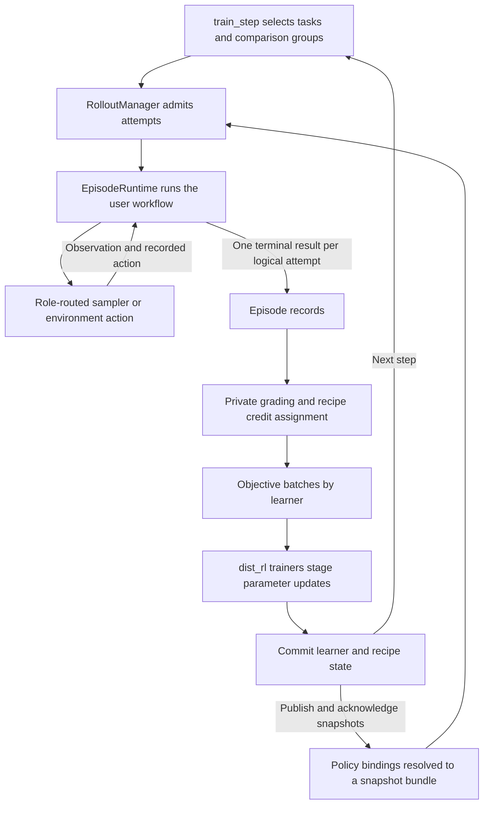

# Designing swarms in Tunix with one episode runtime

**Status** · Proposed public API for `tunix.dist_rl` · November 2026

An **episode** is one attempt by one or more participants to solve a task. A single solver answering a question, a solver consulting a verifier, and a director delegating to ten workers each produce one episode. Tunix should run all three through the same model-call interface and preserve enough evidence to train from the decisions each participant actually made.

Each recipe has three parts.

| Interface | Question it answers | What a user supplies |
| --- | --- | --- |
| [`workflow(task, ctx)`](#contract-1-episode-runtime) | How does the team act? | An async Python function that returns the team's output. |
| [`PolicyBinding`](#contract-2-policy-binding-and-parameter-ownership) | Which policy acts in each role? | A role-to-policy map and the parameters each learner owns. |
| [`train_step(step)`](#contract-3-a-composable-training-step) | What does the system learn from a collection of episodes? | Usually a built-in step and a grader. A new learning algorithm can supply a function. |

The signatures and examples below are proposed Python interfaces. Lowercase helpers such as `edit_prompt` and `grade_math` stand for application code. Model revisions, sampling profiles and optimizer settings would be supplied by the run configuration.

## Define your first swarm

Suppose an author drafts an answer and an editor revises it. The goal is to improve the editor using the final answer's correctness.

```python
async def edit_answer(task, ctx):
    draft = await ctx.generate("author", task.question)
    edit = await ctx.generate("editor", edit_prompt(task.question, draft.text))
    return edit.text

recipe = Recipe(
    workflow=edit_answer,
    learners={"editor": Learner.full(initial=qwen_snapshot)},
    bindings={
        "author": PolicyBinding.fixed(qwen_snapshot),
        "editor": PolicyBinding.follow("editor"),
    },
    grade=grade_math,  # grade_math(episode, private_example) -> Score
    train_step=group_grpo(target="editor", roles=("editor",), attempts=4),
)
await train(recipe, dataset=math_tasks)
```

For each question, Tunix collects four independent draft–edit attempts, grades the four final answers, computes group-relative advantages, and applies them to the editors' generated tokens. An editor sees the draft as input. The author continues to serve the specified snapshot after the editor's first update. To train both roles with one model, point both bindings at one learner and include both roles in the objective. To train a different topology, change the workflow.

A dataset row can be represented as `{"id": "math-17", "public": {"question": "What is 6 × 7?"}, "private": {"answer": "42"}}`. The loader passes the public fields to the workflow as `task` and joins the private fields to the completed episode by ID for `grade_math`.

## End-to-end flow



The **rollout worker** owns one live episode, its public environment, and its children. The **step coordinator** owns comparison-group membership, grading, updates and the commit. The **trainer** owns optimizer state and device execution. Only public observations cross from a grader-backed environment into the workflow. Evaluation uses the same workflow, bindings, budget and grader with a specified snapshot bundle and sampling profile. It emits episode metrics without invoking an update.

## Contract 1. Episode runtime

```python
class EpisodeRuntime(Protocol):
    env: PublicEnvironment

    async def generate(self, role: str, prompt: Prompt) -> Action: ...
    async def parallel(self, jobs, worker_workflow, *, parent: Action | None = None) -> list: ...
    def annotate(self, action: Action, **facts) -> None: ...

async def workflow(task: PublicTask, ctx: EpisodeRuntime) -> Output: ...
```

- **`generate`** resolves the role, submits one request and returns an action handle with a stable ID and the text visible to the workflow. Tunix records the exact encoded context, sampled token IDs, sampling profile and served policy version. Following bindings capture sampled-token behavior log probabilities by default. A recipe can request them for fixed bindings when it needs additional scoring evidence. Projected text used to parse a verdict or build the next prompt is separate from sampled tokens.
- **`parallel`** runs one child workflow per job. For a peer team, `await ctx.parallel(task.parts, solve_subtask)` can be the first line of the workflow. The cohort belongs to the current participant. Pass `parent=decision` when a model action requested the work. Children share the episode's budget and policy bundle and may take multiple model or tool steps. Allocate child IDs in input order before dispatch and return results in that order. Retain parentage, completion status and costs after the join.
- **`env` and `annotate`** expose task-specific operations and attach public facts such as a format check to an action. An episode opens and closes its environment once. The root joins or cancels outstanding children before the result becomes terminal. Answer keys, hidden tests and comparisons across attempts belong to grading.

The stored result has a small common schema. Large token arrays and model-specific data, including routed experts, can be referenced in a trajectory store.

| Record | Required information |
| --- | --- |
| Episode | Task, comparison group, logical attempt ID, snapshot bundle, terminal status, public output, action references and costs. Include the public task variant when conditions differ. |
| Model action | Action and participant IDs, role, generating policy and served snapshot, parent/cohort when present, exact model input and output, attention visibility and generated-token provenance. Retain behavior log probabilities for candidate training actions. |
| Score | Episode ID, scalar or structured outcome, optional per-action annotations and grader revision. Grading can run after collection and can be replayed. |

A role can appear several times or have many concurrent instances. Session compaction is an internal optimization. It can join actions when the actual token history is append-only for the same participant, snapshot and encoding, and replay preserves positions, masks and objective weights. Separate contexts stay separate even when both participants use the role name `worker`.

## Contract 2. Policy binding and parameter ownership

Bindings describe **which weights generated an action**. Learners declare **which parameters an optimizer can change**. The objective chooses **which actions receive credit**.

```python
class PolicyBinding:
    @classmethod
    def fixed(cls, snapshot: Snapshot, *, capture_logprobs: bool = False) -> "PolicyBinding": ...
    @classmethod
    def follow(cls, learner: str) -> "PolicyBinding": ...

# Two independent adapters can share one immutable base and tokenizer.
learners = {
    "writer": Learner.lora(base=qwen_snapshot, adapter="writer"),
    "critic": Learner.lora(base=qwen_snapshot, adapter="critic"),
}
bindings = {
    "solver": PolicyBinding.follow("writer"),
    "verifier": PolicyBinding.follow("critic"),
    "judge": PolicyBinding.fixed(qwen_snapshot),
}
```

A fixed binding names an immutable snapshot. At step entry the coordinator resolves following bindings to committed learner snapshots and pins the complete bundle. Every collection in the step uses that bundle, including sibling attempts and child workers. Admission leases the requested versions, and the sampler must attest the served identity, including the base and adapter revisions. A backend with one mutable replica can enforce this by draining before reload. Deployment configuration maps policies to pools and TPU meshes independently of role names.

Multiple roles may follow one learner. They then share one parameter owner, optimizer and publication. A role can also follow that learner while its actions are excluded from the objective. Its behavior changes as the learner improves. Independent optimizers must own disjoint mutable parameters. Two trainable adapters may share a fixed base. Jointly updated base parameters require one declared owner. Validate these constraints and required sampler capabilities at startup.

## Contract 3. A composable training step

```python
class StepContext(Protocol):
    tasks: TaskBatch
    state: RecipeState              # committed state entering this step
    snapshots: SnapshotBundle       # captured at step entry

    async def collect(self, plan: AttemptPlan) -> Episodes: ...
    async def grade(self, episodes: Episodes) -> Scores: ...
    async def record(self, key: str, operation) -> Evidence: ...
    async def update(self, target: str, batch: ObjectiveBatch) -> None: ...

async def train_step(step: StepContext) -> StepResult:
    plan = repeat(step.tasks, attempts=4)
    episodes = await step.collect(plan)
    scores = await step.grade(episodes)
    batch = token_grpo(episodes, scores, roles=("solver",))
    await step.update("solver", batch)
    return StepResult()
```

This is the expansion of `group_grpo(target="solver", roles=("solver",), attempts=4)`. A plan gives each attempt a stable group, group slot, seed and public task view. `collect` returns one accepted result per logical slot. `record` durably records the result of a keyed, replayable outer decision, such as a sampled curriculum selection. `snapshots` also includes learners without an episode role and any named fixed reference declared by the recipe.

`update` checks that the selected actions belong to the target, the behavior version is admissible, and token IDs, masks and log probabilities align. It stages the optimizer update privately. Returning `StepResult()` keeps the existing recipe state. A successful step commits the staged updates, input cursor and returned state together. A step with no eligible updates can still advance the cursor. Only committed versions are eligible for publication.

**Counts and reduction.** A plan with four attempts could produce ten calls and six eligible training rows. Grade the four attempts, compute credit over the population named by the recipe, and then expand the selected actions. The recipe specifies the objective and its reduction. The step sets the logical update boundary. Padding, sequence packing and gradient accumulation may split the work across devices while preserving that reduction. Rows with observations or tool results retain their attention context and exclude those token positions from policy loss. Frozen calls retain their value for grading and accounting. A valid episode may yield zero rows.

**Objective types.** `ObjectiveBatch` carries an objective, its typed examples, reduction and provenance. Token policy gradients use detached advantages and aligned behavior log probabilities. A finite-choice objective uses the candidate set and selected indices. Teacher or reference scoring is a training service. For sampled-token OPD, it scores the exact unpadded student tokens in their original context before packing. An empty target has no optimizer or version advance. A zero policy-gradient advantage alone cannot suppress another active loss such as reference KL.

## Four recipe examples

| Recipe | Episode | Policy ownership | Learning population |
| --- | --- | --- | --- |
| Single agent | One solver answers a question or runs a tool loop | One learner | Same-task attempts |
| Dr. MAS, shared Qwen3-4B | Solver, Verifier, conditional Solver revision | Both roles follow one learner | Active calls within task and role |
| PARL | Director chooses when to answer or launch parallel workers | Director learns, worker snapshot is fixed within the configured phase | Team outcomes across attempts, gradient on Director actions |
| R²Orch | Director builds and executes a worker graph for a selected task and skill condition | Director and Proposer have distinct objectives, workers are frozen | Director credit within task slot and condition, Proposer credit over candidate pairs |

### Single agent

```python
async def solve(task, ctx):
    answer = await ctx.generate("solver", task.question)
    return answer.text

single = Recipe(
    workflow=solve, learners={"solver": Learner.full(initial=qwen_snapshot)},
    bindings={"solver": PolicyBinding.follow("solver")}, grade=grade_math,
    train_step=group_grpo(target="solver", roles=("solver",), attempts=4),
)
```

A tool-using solver can loop over `ctx.generate` and `ctx.env` in this same function. The existing agent/environment interaction loop becomes a built-in `agent_env_workflow`. It retains token recording, tool observations, stopping and reward behavior through the same runtime.

### Dr. MAS with a shared Solver and Verifier

```python
async def solver_verifier(task, ctx):
    first = await ctx.generate("solver", solver_prompt(task))
    ctx.annotate(first, valid=valid_solver_answer(first.text))
    check = await ctx.generate("verifier", verifier_prompt(task, first.text))
    verdict = project_verdict(check.text)
    ctx.annotate(check, valid=verdict.valid)
    if verdict.approved:
        return first.text
    revision = await ctx.generate("solver", revision_prompt(task, first, verdict))
    ctx.annotate(revision, valid=valid_solver_answer(revision.text))
    return revision.text

shared = PolicyBinding.follow("math")
drmas = Recipe(
    workflow=solver_verifier, learners={"math": Learner.full(initial=qwen_snapshot)},
    bindings={"solver": shared, "verifier": shared}, grade=grade_math,
    train_step=drmas_grpo(target="math", attempts=8, profile="qwen3_4b"),
)
```

The shared-Qwen profile grades the final solver answer, subtracts the format penalty on each invalid call, and normalizes over the calls that actually occurred within each task and role. A revision adds a second Solver sample. The pinned Tunix profile uses sample standard deviation, treats a singleton as mean zero and scale one before epsilon, and gives constant multi-call groups zero advantage. It averages token means across logical groups of four calls. Preserve that grouping and its seed across changes in physical microbatch size. Both roles contribute to one optimizer update. [Dr. MAS paper](https://arxiv.org/abs/2602.08847) · [Pinned Tunix recipe and numerical reference](https://github.com/google/tunix/blob/25fb13e6ed8fcb22cfa0df987807f2cd704a27da/examples/swarm_math/README.md)

### PARL with a trainable Director

```python
async def parl_episode(task, ctx):
    reports = []
    while True:
        decision = await ctx.generate("director", director_prompt(task, reports))
        command = parse_director_action(decision.text)
        if command.is_final:
            return command.answer
        wave = await ctx.parallel(command.jobs, solve_subtask, parent=decision)
        reports.extend(wave)

async def solve_subtask(job, ctx):
    # The worker may take multiple model or tool steps within its budget.
    return await worker_tool_loop(job, ctx, role="worker")

parl = Recipe(
    workflow=parl_episode, learners={"director": Learner.full(initial=qwen_snapshot)},
    bindings={"director": PolicyBinding.follow("director"),
              "worker": PolicyBinding.fixed(worker_snapshot)},
    grade=grade_parallel_task, budget=CriticalSteps(limit=critical_step_limit),
    train_step=parl_grpo(target="director", roles=("director",), attempts=4),
)
```

The Director chooses the number of waves and their width. A bounded command parser defines invalid actions and the runtime enforces the episode budget even when the Director keeps spawning. The PARL score combines task performance, a worker-instantiation term and a subtask-finish term. The latter two coefficients decay to zero. The proposed Tunix step applies this score to Director decisions using group-relative credit. Worker outputs, completion and costs remain available to the grader. [Kimi K2.5 technical report, §3](https://arxiv.org/html/2602.02276v1#S3)

Critical steps are a resource budget. Charge each stage its main-agent steps plus the maximum steps of its parallel children, with zero child steps for a direct action. A dispatch costing one step, two workers taking two and five steps, and one final answer cost **seven critical steps**. Track total work and elapsed wall time independently. To enforce the budget online, each child gets the remaining stage allowance and the join charges the longest branch. Benchmark against serial execution with matched task quality and separately report all three costs.

### R²Orch with a stateful training step

The inner workflow uses `ctx.generate("director", ...)` to edit a task graph and `ctx.parallel(...)` to execute ready workers when the Director requests execution. The task view carries the skill context for that attempt. The outer Proposer chooses which tasks the Director will train on. If revealing a skill helps on a task, the cycle can retain it. If the Director also succeeds when that skill is hidden, the skill can be withdrawn. The training step owns this comparison across episodes. [R²Orch paper](https://arxiv.org/abs/2610.22740) · [Pinned upstream implementation](https://github.com/beita6969/R2Orch/tree/12ceb7563aa50439687f21ba5da60ad74a75eb89)

```python
async def r2orch_step(step):
    old = step.state
    selection = await step.record(
        "selection", lambda: select_candidate_pairs(old, step.snapshots["proposer"])
    )
    plan = await step.record(
        "skill_arms", lambda: plan_skill_arms(old, selection, hidden=3, visible=2)
    )
    episodes = await step.collect(plan)
    scores = await step.grade(episodes)

    evidence = join_by_selection_slot(plan, episodes, scores)
    ledger = update_skill_ledger(old.ledger, evidence)
    pairs = recursive_learnability(selection, evidence, old.ledger.priors, ledger)
    proposer = candidate_pair_objective(pairs, reference=step.snapshots["proposer_ref"])
    await step.update("proposer", proposer)
    scheduler = advance_ads(old.scheduler, selection, evidence)
    review = await step.record(
        "skill_review", lambda: review_if_due(old, ledger, public_traces(episodes))
    )
    director = director_grpo(evidence, group_by=("selection_slot", "condition"))
    await step.update("director", director)
    return StepResult(state=next_cycle_state(old, scheduler, ledger, review))

r2orch = Recipe(
    workflow=director_graph, grade=grade_task, train_step=r2orch_step,
    learners={"director": director_learner, "proposer": proposer_learner},
    bindings={"director": PolicyBinding.follow("director"),
              "worker": PolicyBinding.fixed(worker_snapshot)},
    references={"proposer_ref": initial_proposer_snapshot},
    initial_state=initial_curriculum,
)
```

The Proposer evaluates two selected candidates within their finite choice set, using a pairwise policy gradient and a KL term against its fixed reference. Keep candidate identities, selection probabilities and snapshot IDs with the pair. The Director receives token policy-gradient examples from its own decisions. Worker cost can affect the Director's reward. Two candidate lists can select the same task, so the comparison key includes the selection slot.

In the referenced Tunix recipe, hidden attempts withdraw the selected skill card, visible attempts expose it, and a task with no eligible card can use an off condition. Zero-skill evaluation removes all cards. Skill review consumes scrubbed traces on its own schedule. Checkpoint selection/scheduler state, both optimizers, the ledger, review state and RNG together. This lets the next cycle reproduce its inputs after a retry. [Tunix cycle implementation](https://github.com/google/tunix/blob/25fb13e6ed8fcb22cfa0df987807f2cd704a27da/examples/swarm_r2orch/train.py#L693) · [Proposer objective](https://github.com/google/tunix/blob/25fb13e6ed8fcb22cfa0df987807f2cd704a27da/examples/swarm_r2orch/proposer.py#L613)

## Distributed execution and recovery

| Boundary | Required behavior |
| --- | --- |
| Admission and progress | Limit active episodes and outstanding requests per sampler pool separately. An awaiting parent releases its sampler slot so children can make progress. Strict groups finish on the pinned bundle or are retried consistently. Policies with heterogeneous per-action versions need an objective that explicitly accepts that provenance. |
| Termination | Separate a normal answer, a recipe-defined budget cutoff and infrastructure failure. The recipe supplies the grading rule for a cutoff, including an empty action set. A transport failure retries the logical slot. Retries use isolated environment state and deduplicated tool effects where applicable. |
| Partial generation | A hard wall-clock cutoff requires acknowledged prefix tokens, corresponding log probabilities if eligible, and an environment snapshot at the cutoff. The backend must advertise these capabilities before such a recipe can run. Ordinary generation and PARL critical-step budgets can operate at action boundaries. |
| Update and restart | Key receipts by run, step, group and attempt. Commit a manifest referencing durable learner and optimizer state, recipe state, RNG, input cursor, accepted evidence and the snapshot bundle. A conditional write against the previous manifest prevents competing commits. On a pre-commit crash restore the previous manifest and replay the recorded inputs. On a post-commit publication failure retry publication and verify serving acknowledgements before dependent collection. |
| Evaluation and diagnostics | Log attempts, model calls, generated and eligible tokens, optimizer updates, score components and cost separately. Attribute them to role, owner and served snapshot. Run evaluation against pinned versions and keep its episodes outside training groups. |

## Implementation boundaries and acceptance

Put episode execution and role bindings under `tunix/dist_rl/rollout/` and the training step and commit under `tunix/dist_rl/orchestrator/`. Keep topology, prompts, grading and curricula in recipes under `examples/`. A new topology should require only recipe code.

| Integration with Tunix | Implementation decision |
| --- | --- |
| Rollout and storage | Move the interaction loop used by the distributed collector into the built-in single-agent workflow. Represent child runs with the existing trajectory store's `SubagentTrajectoryRef`. Attach cohort, participant and served snapshot to the corresponding records. Retain the existing routing-array staging and release lifecycle when recording MoE actions. [Collector](https://github.com/google/tunix/blob/5a8fbbbde3f7fe8a4a0a56acf3179a9c9acfb4ac/tunix/dist_rl/rollout/collector.py#L329) · [Child trajectory reference](https://github.com/google/tunix/blob/5a8fbbbde3f7fe8a4a0a56acf3179a9c9acfb4ac/tunix/dist_rl/trajectory/trajectory.py#L763) · [Worker staging buffer](https://github.com/google/tunix/blob/5a8fbbbde3f7fe8a4a0a56acf3179a9c9acfb4ac/tunix/dist_rl/worker/staging_buffer.py#L148) |
| Grouping and packing | `ScoredGroup` currently equates attempts with payloads. Both packers count ingested rows toward the update boundary. Carry attempt receipts separately from training rows and let the coordinator close the logical update. [ScoredGroup](https://github.com/google/tunix/blob/5a8fbbbde3f7fe8a4a0a56acf3179a9c9acfb4ac/tunix/dist_rl/orchestrator/rl_program.py#L276) · [Packed](https://github.com/google/tunix/blob/5a8fbbbde3f7fe8a4a0a56acf3179a9c9acfb4ac/tunix/dist_rl/orchestrator/batch_assembly.py#L1253) · [Padded](https://github.com/google/tunix/blob/5a8fbbbde3f7fe8a4a0a56acf3179a9c9acfb4ac/tunix/dist_rl/orchestrator/batch_assembly.py#L1547) |
| Trainer and publication | Implement `step.update` above the existing `AbstractTrainer` protocol. Configure the objective's payload adapter and loss, call `fwd_bwd` for its microbatches, and call the trainer's `update` at the logical boundary. The recipe coordinator owns multi-learner commits and version acknowledgements. This keeps existing trainer implementations usable. [Trainer protocol](https://github.com/google/tunix/blob/5a8fbbbde3f7fe8a4a0a56acf3179a9c9acfb4ac/tunix/dist_rl/train/abstract_trainer.py#L34) |

| Gate | Evidence required before enabling the path |
| --- | --- |
| Single agent and default step | Replay fixed sampler/tool responses. Match tokens, attention and action masks, termination, reward, behavior log probabilities, one gradient and one parameter update against the existing path. Compare padded and packed execution with variable row counts. For OPD also match teacher inputs and sampled-token advantages. |
| Dr. MAS | Use the pinned reference for approve, reject, invalid verdict, repeated Solver, singleton and constant-reward cases. Compare per-call advantages, loss and gradients. Changing physical microbatch size must preserve the logical four-call reduction and the shared parameter update. |
| Policy isolation and LoRA | Give two adapters opposing examples. An update for one changes only its owned leaves and optimizer state. A fixed worker retains its loaded weight digest across updates. Reject a response served by an unexpected adapter or version. |
| PARL | Force two parallel children and a second Director action. Assert seven critical steps for the example above, frozen-worker completion accounting, zero Worker training rows and nonzero Director gradient on a nondegenerate group. Exercise invalid actions, budget exhaustion, cancellation and bounded-pool progress. |
| R²Orch and recovery | Match hidden/visible membership and both objective gradients on a fixed cycle. Inject a crash between optimizer stages and another after commit but before publication. After recovery, the published model/optimizer states, next selection and ledger match the uninterrupted run. Verify held-out evaluation with empty skill context. |

The first useful release is the single-agent and Dr. MAS pair. It demonstrates that one execution model supports both a conventional tool loop and a conditional team while preserving their different gradient semantics. PARL exercises parallelism and frozen participants. R²Orch exercises multiple objectives and recoverable state across training cycles.

---

## Option 5: Converged Three-Layer Implementation & TPU `v5p` Validation (`tunix/dist_rl/swarm/`)

While Option 4 above defines the canonical public API (`Recipe`, `EpisodeRuntime`, 3-way `Learner` / `PolicySpec` / `ObjectiveBatch`, and composable `StepContext`), production 64–128 chip TPU `v5p` bring-up surfaced two additional systems requirements that we unified into **Option 5** (implemented directly in `tunix/dist_rl/swarm/`):

1. **Layer 1 (`EpisodeRuntime` — `episode_runtime.py`, `contracts.py`):** Implements Option 4's unified runtime (`generate`, `spawn`, `parallel`, `annotate`, online `CriticalStepsBudget`, `PublicEnvironment` vs. post-run private `grade()`, and automatic internal TITO compaction keyed on participant/snapshot/prefix).
2. **Layer 2 (`StepContext` Dual Collection Modes — `step_context.py`, `manifest_store.py`, `objectives.py`):** Supports both Option 4's `CollectionMode.STRICT_BUNDLE` (`max_policy_lag=0`, pinned `SnapshotBundle` for `R²Orch`, `PARL`, and `Dr. MAS`) and Option 2/3's `CollectionMode.ASYNC_WINDOW` (`max_policy_lag > 0` streaming window + 2-level `_episode_sem` / `_sampler_sem` admission) under one atomic conditional `ManifestStore` and built-in `group_grpo` / `parl_grpo` steps.
3. **Layer 3 (`ServingFidelity` Startup Parity Gate — `serving_fidelity.py` + On-TPU FP32 LoRA Serving):** Makes serving-vs-learner numerical fidelity an explicit contract (`FULL_BF16`, `FP32_NATIVE`, `LORA_UNMERGED_BF16`) audited before Step 0 via `verify_serving_fidelity(...)` so `bfloat16` merged-LoRA quantization cannot silently erase small LoRA deltas.

### Live TPU `v5p` Validation Summary

- **Core Unit & Gate Suite:** `64/64` K8s CPU tests green; 8-device `(dp=2, tp=4)` FP32 Director parity gate `top1=1.0000, max_lp_diff=2.63e-7`.
- **Recipe 3 (`PARL`, `examples/swarm_parl/`):**
  - *Run 1 (`Qwen/Qwen3-4B`, 64 TPU `v5p`, 100 steps / 12,800 episodes, `0` restarts, `130 min`):* L3 gate `max_lp_diff = 4.98e-4`; outperformed matched-budget Serial on **10/11** heldout checkpoints (Step 80 peak **`+6.47 pp`**, `0.3793` vs `0.3146`), achieved **`1.93×`** peak speedup (`1.88×` final, `4.60` vs `4.84` critical steps), and proved **Zero Serial Collapse** (`99%–100%` parallel rate across 60 pure-$r_{\text{perf}}$ steps after $\lambda_1, \lambda_2 \to 0$).
  - *Run 2 Blog Scale-Up (`Qwen/Qwen3-14B`, 64 TPU `v5p`, 200 steps, `Wide-WikiQA-8` 5–8 sub-questions + Multi-Hop QA, 256 greedy heldout tasks):* Active.
- **Recipe 2 (`R²Orch` Option 5 Run 2, `examples/swarm_r2orch/paper_fp32_director.py`):** 128 TPU `v5p` with single-compiled 32-chip `(dp=8, tp=4)` TRUE `float32` Director + on-TPU LoRA merge (`465 MB` vs `36 GiB` host transfer, `77×` reduction): L3 gate `top1=1.0000, max_lp_diff=9.22e-4`, Cycle 0 `TIS = 0.999972`, Zero-Skill Heldout **`21.95% -> 35.49%` (`+13.54 pp` in 1 step)**, Cycle 1 `TIS = 1.000068`.
