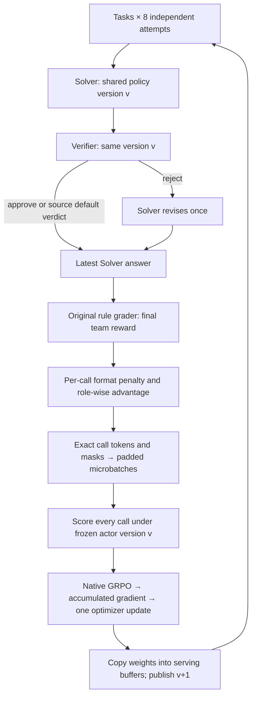

# Shared-policy Dr. MAS math on dist_rl

This is the first local-transport implementation of the
[swarm system design](../../docs/swarm_training_design.md). It runs the
Solver–Verifier workflow through the native `dist_rl` loss, batch assembler,
TrainerWorker, gradient accumulation, optimizer and checkpoint writer.

**Current acceptance:** CPU numerical comparisons, two real optimizer updates, a small random Qwen3 Transformer with native KV-cache sampling, a verified 2-step `Qwen/Qwen3-4B` bring-up on TPU `v5p-256` (`128` chips via Pathways with `64+64` rollout/train split using `vLLM` + `float32` XLA reference attention), and full 500-step Dr. MAS Paper Table 1 reproduction on TPU `v5p-256` (`1,547` questions × `16` samples: macro **`61.1 avg@16 / 78.2 pass@16`** at Step 475 and **`60.8 avg@16 / 77.8 pass@16`** at Step 500 vs. Paper Sharing target **`59.0 / 73.2`** and untrained base **`43.4 / 64.0`**). Distributed episode RPC/Raiden and multi-service recovery are not yet accepted. See the [validation record](../../docs/swarm_training_validation.md).

## Placement and extension boundary

Keep swarm training inside `dist_rl`, with its own subpackage. A separate
top-level training framework would duplicate transport, batching and optimizers.
Keep task prompts, scoring rules, datasets and model choices in the example.

```text
tunix/dist_rl/
  swarm/
    trace.py             immutable CallTrace and SwarmEpisode
    runtime.py           sampling and exact token provenance
    credit.py            role/episode normalization and payload compilation
    local_engine.py      in-process transport to the existing TrainerWorker
  orchestrator/
    swarm_program.py     variable call rows, scoring barrier, train/publish loop
examples/swarm_math/
  workflow.py            conditional Solver–Verifier recipe
  prompts.py             pinned original prompts
  drmas_math.py           pinned original math checker
  drmas_reward.py         pinned original environment reward
  prepare_data.py         pinned source data and deterministic train/dev split
  train.py               CPU/Qwen launch, evaluation, traces and checkpoints
  cpu_fixture.py         tiny trainable policy for local correctness tests
  configs/               CPU smoke and shared Qwen3-4B bring-up profiles
tests/dist_rl/swarm/      workflow, numerical, gradient and training tests
```

Later, add a worker-side episode collector and a distributed `SwarmEngine`
adapter using the same trace/credit contracts. `StandardRLProgram` retains its
ordinary one-trajectory path. Dynamic teams and different topologies belong in
workflow/runtime extensions. Independent or frozen policies require explicit
policy routing and per-policy update plans; V0 rejects mixed policy identities.

## Training flow



The runtime records each call's actual input IDs, generated IDs, logprobs,
semantic role and shared policy identity/version. Previous teammates' text is
prompt context. Only the current call's generated actions contribute to its
loss. EOS is retained, including immediate EOS; padding and observation tokens
have separate attention and loss masks. All calls finish before training starts.

For a call `c`, the score is the final team reward minus `0.1` for invalid action
format. Role normalization uses all call scores in the same `(task, role)`
group, including repeated Solver calls:

```text
A_c = (r_c - mean_task_role) / (sample_std_task_role + 1e-6)
```

Use the source's sample standard deviation (`ddof=1`). A singleton group uses
mean `0`, standard deviation `1`; a multi-call equal-reward group has zero
advantage. Broadcast the scalar only to that call's active generated tokens.
The episode baseline first averages penalized call rewards within each attempt,
then normalizes those attempt means within the task and broadcasts to its calls.

Both roles update **one model and one optimizer**. Native dual-clip GRPO uses
clip `0.2`, negative-advantage dual clip `3`, token-mean reduction, KL `0`, and no
entropy bonus. Actor logprobs are scored for every microbatch before any update;
disagreement with recorded sampler scores above `max_logprob_error` (`0.005` on
the float32 CPU smoke profile; `100.0` on the Qwen3-4B profile, where rare
single tokens in `bfloat16` TPU vLLM rollout can differ by 10–25 nats while the
step mean stays below `0.01`) aborts the round. When `sampler_is` is `null`
(CPU profile), the loss uses the recomputed actor `old_per_token_logps`; when
`sampler_is` is `"token"` (Qwen3-4B profile), `grpo_loss_fn` fuses detached
truncated importance weights `min(exp(logp_trainer - logp_vllm), 2.0)` on an
exact 1-epoch on-policy PPO ratio baseline (`is_ratio = 1.0`).
With `loss_reduction: global_token_mean` the native trainer divides the summed
gradient numerator by the total active-token denominator across all
microbatches, including a partial last one; with `microbatch_token_mean` each
group of `loss_microbatch_rows` calls contributes its token-mean with equal
weight, through per-call advantage weights.

## Reference fidelity and explicit differences

Reference commit: `c2f724e7358e7dc5bf2ea792ab07a3b5d90290c9`.
[Source provenance and licenses](THIRD_PARTY.md) records all copied material.

| Item | Implemented behavior |
| --- | --- |
| Topology | Solver → Verifier → optional Solver; no final Verifier |
| Prompts and grader | Original role prompts filled with the original multi-agent environment observation (`MATH_MULTIAGENT_TEMPLATE` around the question), original answer checker and environment reward, including `</think>` handling |
| Verifier projection | Source strips text inside the first tag pair; validity and control-flow decisions stay separate |
| Missing/unknown verdict | Source defaults to approval; missing tags incur a per-call format penalty. A tagged unknown verdict is valid under the source projection. Tests preserve these unusual semantics |
| Sharing | Explicitly enabled; the upstream launcher defaults to separate policies |
| Credit and objective | Executable upstream PyTorch functions are the offline test oracle |
| Accumulation | `loss_reduction: microbatch_token_mean` (Qwen profile) averages the token-mean of every group of `loss_microbatch_rows: 4` calls, as the pinned verl `dp_actor` does with `ppo_micro_batch_size_per_gpu=4`. Calls are assigned to groups by a permutation seeded by the round (verl's balanced data-parallel split also mixes tasks), and each call's advantage is scaled by `N / (G * N_g)`; every PPO-clip and dual-clip branch is linear in the advantage, so the native batch token-mean then equals the mean of group token-means for any device `micro_batch_size`. `global_token_mean` (CPU profile) divides the batch-wide token sum by the batch-wide token count. On Qwen3-4B the global mean let long, wrong or truncated calls dominate and the run collapsed within 50 steps (see the validation record) |
| Zero signal | Skip optimizer and policy-version advance, so AdamW does not decay parameters on a no-signal round |
| Constant decimal rewards | Explicitly return zero for equal-score multi-call groups and accumulate episode means in float64. Upstream float32 mean/std reductions can amplify rounding error for repeated `-0.1`/`0.9` into false advantages |
| Numerical guard | Native Tunix clamps log ratios to `[-20, 20]`; upstream exponentiates directly. Comparisons exercise finite unclamped ratios and all clipping branches |
| Backend | Supports `InprocessVllmSampler` (split mesh, `tpu_inference` JAX backend) and native Tunix `vanilla` sampler; local weight copies/reshards instead of SGLang/RPC/Raiden. `vllm_async_scheduling` and `vllm_enable_prefix_caching` default to `false`: with them on, rare sampler/actor logprob disagreements reached about 5 and 44 nats |
| Run length | The Qwen profile runs the source's 2 epochs: 772 steps over the 12,357-question deduplicated split (the source's 13,044 rows give 814) |
| Development and test data | 256 training-corpus questions are held out for development. The six source benchmarks are prepared at pinned revisions: `test.jsonl` (1,547 questions) and the source's 110-question validation subset `test_sampled.jsonl`. As in the source, test questions are not removed from training; the 7 verbatim overlaps are reported as `eval_training_overlap` |
| Evaluation | avg@k and pass@k per benchmark (task-ID prefix) and their unweighted mean over benchmarks, as in the source; validation runs every `val_every_steps` with `eval_attempts` samples |
| Recovery | Checkpoints at round boundaries every `checkpoint_every_steps` hold weights, optimizer state, program step, history and validations; `--resume` replays the same deterministic task window from the newest one |

## Run locally

Use Python 3.12+ and the repository's CPU-compatible dependencies. The test
oracle additionally requires PyTorch and pytest. No pretrained weights or
teacher service are needed for the CPU fixture.

```bash
JAX_PLATFORMS=cpu python -m examples.swarm_math.train \
  --backend cpu --output /tmp/swarm-cpu

JAX_PLATFORMS=cpu python -m pytest tests/dist_rl/swarm -q

# Same workflow and objective; change only the advantage baseline.
JAX_PLATFORMS=cpu python -m examples.swarm_math.train \
  --backend cpu --normalization episode --output /tmp/swarm-cpu-episode
```

Use a fresh output directory. Each run writes resolved config, exact training
traces (every `trace_every_steps`), `metrics.jsonl`, a JSON report, and native
model/optimizer checkpoints. The CPU run also saves initial/final parameters.
With `--resume`, a run continues from the newest checkpoint in
`--checkpoint-dir`; a test checks that a resumed CPU run ends with parameters
bit-identical to an uninterrupted one.

## Qwen3-4B Dr. MAS reproduction

The `configs/qwen3_4b.json` profile fixes `Qwen/Qwen3-4B` revision
`1cfa9a7208912126459214e8b04321603b3df60c`, with thinking disabled. It uses
32 tasks × 8 attempts, at most 2 Solver calls, prompt/response limits
8192/4096, `rollout_engine: vllm` (`rollout_split_fraction: 0.5`,
`rollout_batch_size: 64`), `tp_size: 8`, `micro_batch_size: 16`,
`remat_config: decoder`, `dtype: float32`, `load_dtype: float32`,
`use_flash_attention: false` (XLA reference attention; see below),
`logps_chunk_size: 1024`, `max_logprob_error: 100.0`, `sampler_is: token`,
`loss_reduction: microbatch_token_mean` (`loss_microbatch_rows: 4`), learning
rate `1e-6`,
AdamW weight decay `0.01`, and gradient clipping `1.0`. Training samples at
temperature/top-p `1.0/1.0`; evaluation uses `0.6/0.95`. It runs 772 steps
(2 epochs), checkpoints every 25 steps, validates every 50 steps with 4
samples per question, and writes traces every 50 steps.

`train.py` rejects `use_flash_attention: true` and `dtype != "float32"`. On
this recipe's batches
(prompts left-padded to 8192 tokens, responses right-padded to 4096, padding
masked through per-token segment IDs), the TPU splash-attention backward pass
returned wrong gradients even though its forward log-probs matched vLLM: on
32 real calls the production gradient had cosine similarity 0.16 with a
float32 reference and 4.9 times its norm. Layers 16–35 matched; below layer
15 the per-tensor cosine was mostly between −0.1 and +0.2 and the norm 2–23
times too large. Switching to XLA reference attention raised the global
bfloat16 cosine to 0.97, but early-layer `RMSNorm`, `q_norm`/`k_norm`, and
RoPE attention projections still dropped to cosine −0.09 to +0.52 on long
multi-turn contexts, while separate `fwd_only` vs. `fwd_bwd` bfloat16 XLA
graphs introduced single-token log-ratio spikes before any weight update.
Running the trainer in `dtype: float32` (with `bfloat16` vLLM rollout and
`sampler_is: token` truncated importance weights on an exact on-policy PPO
baseline) eliminates both sources of drift.

The data preparation script uses the source recipe's `aaabiao/dapo_filter`
corpus at a fixed revision. It removes the source instruction suffix, groups
duplicate questions before splitting, and reserves 256 questions for development.
Questions with conflicting reference answers are excluded as a whole and listed
by hash in the manifest, so no conflicting duplicate can cross the split.
It also writes the source's six benchmarks at pinned Hugging Face revisions:
`test.jsonl` (1,547 questions in source order, task IDs `<benchmark>/<index>`)
and `test_sampled.jsonl` (first 50 MATH500 questions, AIME'24 and AIME'25).
The manifest records retained counts, exclusions, test sources, verbatim
test/training overlaps and file hashes.

```bash
python -m examples.swarm_math.prepare_data --output /tmp/swarm-math-data

hf download Qwen/Qwen3-4B \
  --revision 1cfa9a7208912126459214e8b04321603b3df60c

# Pass the HF cache snapshot directory printed by hf download.
# On TPU/Pathways (128 chips / v5p-256), splits into 64 rollout + 64 train
# devices ((fsdp=8, tp=8) each) and writes Orbax checkpoints to --checkpoint-dir.
# Rerunning the same command with --resume continues from the newest checkpoint.
python -m examples.swarm_math.train --backend qwen \
  --model-path /path/to/snapshots/1cfa9a7208912126459214e8b04321603b3df60c \
  --train-data /tmp/swarm-math-data/train.jsonl \
  --eval-data /tmp/swarm-math-data/test_sampled.jsonl \
  --output /path/to/new-run \
  --checkpoint-dir gs://your-bucket/swarm-runs/qwen3-4b/checkpoints --resume

# Full test suite with 16 samples per question, from checkpoint 772. A --config
# with a larger vllm_max_num_seqs (e.g. 256) raises evaluation throughput.
python -m examples.swarm_math.train --backend qwen --mode eval \
  --model-path /path/to/snapshots/1cfa9a7208912126459214e8b04321603b3df60c \
  --train-data /tmp/swarm-math-data/train.jsonl \
  --eval-data /tmp/swarm-math-data/test.jsonl --eval-attempts 16 \
  --checkpoint-dir gs://your-bucket/swarm-runs/qwen3-4b/checkpoints \
  --restore-step 772 --output /path/to/new-eval
```

When `rollout_engine=vllm` and `rollout_split_fraction=0.5`, `train.py` builds
two `(fsdp, tp)` meshes sized by `--tp-size` and synchronizes actor `float32`
weights onto the `bfloat16` vLLM rollout engine. On `--backend cpu` or
`--rollout-engine vanilla`, local copies prevent optimizer buffer donation from
invalidating inference buffers. Recovery across separate rollout and trainer
services is not covered yet.

For user-provided data, each JSONL row is
`{"task_id":"unique-id","problem":"...","answer":"..."}`. Train and eval task
IDs must be disjoint; identical problem text is allowed and listed in the report
as `eval_training_overlap`. Evaluation records answer accuracy, generated tokens
and call counts, with team and single-Solver diagnostics. The single-Solver
diagnostic is not a matched-compute trained baseline.
