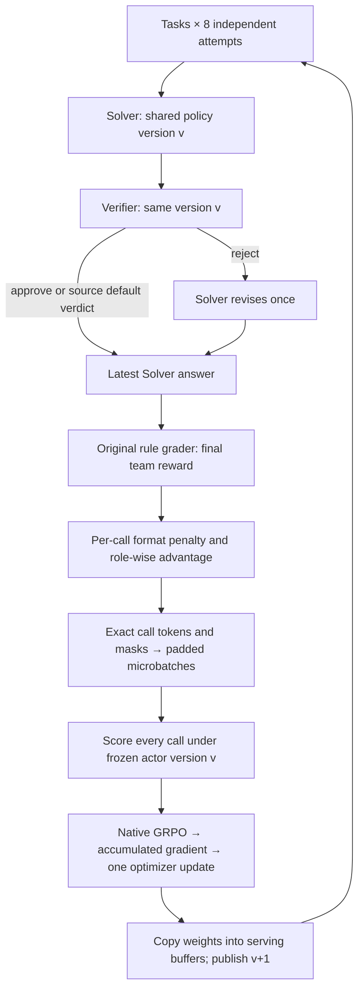

# Shared-policy Dr. MAS math on dist_rl

This is the first local-transport implementation of the
[swarm system design](../../docs/swarm_training_design.md). It runs the
Solver–Verifier workflow through the native `dist_rl` loss, batch assembler,
TrainerWorker, gradient accumulation, optimizer and checkpoint writer.

**Current acceptance:** CPU numerical comparisons, two real optimizer updates,
and a small random Qwen3 Transformer with native KV-cache sampling. Pretrained
Qwen3-4B accelerator training, distributed episode RPC/Raiden, recovery and
benchmark quality are not yet accepted. See the
[validation record](../../docs/swarm_training_validation.md).

## Placement and extension boundary

Keep swarm training inside `dist_rl`, with its own subpackage. A separate
top-level training framework would duplicate transport, batching and optimizers.
Keep task prompts, scoring rules, datasets and model choices in the example.

```text
tunix/dist_rl/
  swarm/
    trace.py             immutable CallTrace and SwarmEpisode
    runtime.py           sampling and exact token provenance
    credit.py            role/episode normalization and payload compilation
    local_engine.py      in-process transport to the existing TrainerWorker
  orchestrator/
    swarm_program.py     variable call rows, scoring barrier, train/publish loop
examples/swarm_math/
  workflow.py            conditional Solver–Verifier recipe
  prompts.py             pinned original prompts
  drmas_math.py           pinned original math checker
  drmas_reward.py         pinned original environment reward
  prepare_data.py         pinned source data and deterministic train/dev split
  train.py               CPU/Qwen launch, evaluation, traces and checkpoints
  cpu_fixture.py         tiny trainable policy for local correctness tests
  configs/               CPU smoke and shared Qwen3-4B bring-up profiles
tests/dist_rl/swarm/      workflow, numerical, gradient and training tests
```

Later, add a worker-side episode collector and a distributed `SwarmEngine`
adapter using the same trace/credit contracts. `StandardRLProgram` retains its
ordinary one-trajectory path. Dynamic teams and different topologies belong in
workflow/runtime extensions. Independent or frozen policies require explicit
policy routing and per-policy update plans; V0 rejects mixed policy identities.

## Training flow



The runtime records each call's actual input IDs, generated IDs, logprobs,
semantic role and shared policy identity/version. Previous teammates' text is
prompt context. Only the current call's generated actions contribute to its
loss. EOS is retained, including immediate EOS; padding and observation tokens
have separate attention and loss masks. All calls finish before training starts.

For a call `c`, the score is the final team reward minus `0.1` for invalid action
format. Role normalization uses all call scores in the same `(task, role)`
group, including repeated Solver calls:

```text
A_c = (r_c - mean_task_role) / (sample_std_task_role + 1e-6)
```

Use the source's sample standard deviation (`ddof=1`). A singleton group uses
mean `0`, standard deviation `1`; a multi-call equal-reward group has zero
advantage. Broadcast the scalar only to that call's active generated tokens.
The episode baseline first averages penalized call rewards within each attempt,
then normalizes those attempt means within the task and broadcasts to its calls.

Both roles update **one model and one optimizer**. Native dual-clip GRPO uses
clip `0.2`, negative-advantage dual clip `3`, token-mean reduction, KL `0`, and no
entropy bonus. Old actor logprobs are recomputed for every microbatch before any
update; disagreement with recorded sampler scores above `0.005` aborts the
round. The native trainer divides the summed gradient numerator by the total
active-token denominator across all microbatches, including a partial last one.

## Reference fidelity and explicit differences

Reference commit: `c2f724e7358e7dc5bf2ea792ab07a3b5d90290c9`.
[Source provenance and licenses](THIRD_PARTY.md) records all copied material.

| Item | Implemented behavior |
| --- | --- |
| Topology | Solver → Verifier → optional Solver; no final Verifier |
| Prompts and grader | Original role prompts, original answer checker and environment reward, including `</think>` handling |
| Verifier projection | Source strips text inside the first tag pair; validity and control-flow decisions stay separate |
| Missing/unknown verdict | Source defaults to approval; missing tags incur a per-call format penalty. A tagged unknown verdict is valid under the source projection. Tests preserve these unusual semantics |
| Sharing | Explicitly enabled; the upstream launcher defaults to separate policies |
| Credit and objective | Executable upstream PyTorch functions are the offline test oracle |
| Accumulation | One global active-token mean. Upstream microbatch means can differ when token counts differ; this is full-batch objective parity, not bitwise reproduction of every upstream distributed batching schedule |
| Zero signal | Skip optimizer and policy-version advance, so AdamW does not decay parameters on a no-signal round |
| Constant decimal rewards | Explicitly return zero for equal-score multi-call groups and accumulate episode means in float64. Upstream float32 mean/std reductions can amplify rounding error for repeated `-0.1`/`0.9` into false advantages |
| Numerical guard | Native Tunix clamps log ratios to `[-20, 20]`; upstream exponentiates directly. Comparisons exercise finite unclamped ratios and all clipping branches |
| Backend | Native Tunix sampler instead of SGLang; local weight copies instead of RPC/Raiden |
| Run length | Qwen profile starts with two rounds for bring-up; it is not the original two-epoch training run |
| Development data | Hold out training-corpus questions; reserve published test benchmarks for later locked evaluation |

## Run locally

Use Python 3.12+ and the repository's CPU-compatible dependencies. The test
oracle additionally requires PyTorch and pytest. No pretrained weights or
teacher service are needed for the CPU fixture.

```bash
JAX_PLATFORMS=cpu python -m examples.swarm_math.train \
  --backend cpu --output /tmp/swarm-cpu

JAX_PLATFORMS=cpu python -m pytest tests/dist_rl/swarm -q

# Same workflow and objective; change only the advantage baseline.
JAX_PLATFORMS=cpu python -m examples.swarm_math.train \
  --backend cpu --normalization episode --output /tmp/swarm-cpu-episode
```

Use a fresh output directory. Each run writes resolved config, exact training
traces, a JSON report, and a native model/optimizer checkpoint. The CPU run also
saves initial/final parameters. Checkpoint writing is covered; resuming a swarm
data cursor and policy publication after failure remains a later integration
gate. A failed run must be restarted from a known state, not retried in-place.

## Qwen3-4B bring-up

The profile fixes `Qwen/Qwen3-4B` revision
`1cfa9a7208912126459214e8b04321603b3df60c`, with thinking disabled. It uses
32 tasks × 8 attempts, at most 2 Solver calls, prompt/response limits
8192/4096, microbatch size 4, learning rate `1e-6`, AdamW weight decay `0.01`
and gradient clipping `1.0`. Training samples at temperature/top-p `1.0/1.0`;
evaluation uses `0.6/0.95`.

The data preparation script uses the source recipe's `aaabiao/dapo_filter`
corpus at a fixed revision. It removes the source instruction suffix, groups
duplicate questions before splitting, and reserves 256 questions for development.
Questions with conflicting reference answers are excluded as a whole and listed
by hash in the manifest, so no conflicting duplicate can cross the split.
The manifest records retained counts, exclusions and file hashes. The test set
is not loaded by this entry point.

```bash
python -m examples.swarm_math.prepare_data --output /tmp/swarm-math-data

hf download Qwen/Qwen3-4B \
  --revision 1cfa9a7208912126459214e8b04321603b3df60c

# Pass the HF cache snapshot directory printed by hf download.
python -m examples.swarm_math.train --backend qwen \
  --model-path /path/to/snapshots/1cfa9a7208912126459214e8b04321603b3df60c \
  --train-data /tmp/swarm-math-data/train.jsonl \
  --eval-data /tmp/swarm-math-data/dev.jsonl \
  --output /path/to/new-run
```

This launch currently uses one process with an `(fsdp, tp=1)` JAX mesh. Both
serving roles use the shared checkpoint. The local transport copies buffers
before serving so optimizer buffer donation cannot invalidate a rollout model.
Capacity, precision, rematerialization and throughput need accelerator profiling
before a full 4B run. No accelerator result is implied by the CPU tests.

For user-provided data, each JSONL row is
`{"task_id":"unique-id","problem":"...","answer":"..."}`. Train and eval
IDs and problem text must be disjoint. Evaluation records answer accuracy,
generated tokens and call counts, with team and single-Solver diagnostics.
The single-Solver diagnostic is not yet a matched-compute trained baseline.
Benchmark reporting still requires locked tests, multiple seeds and matched
training/inference budgets.
