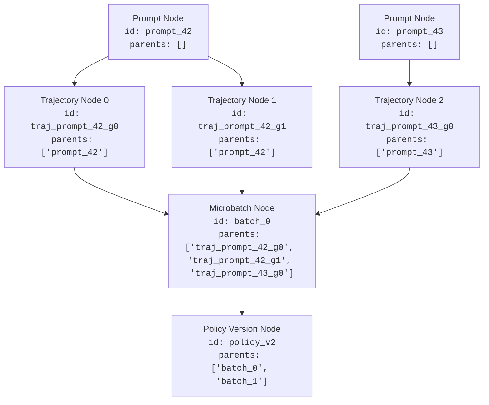

# Tunix Distributed RL Lineage Tracking System Design

This document details the design of a lineage tracking system for the Tunix
distributed RL workflow (`Orchestrator V2`). The system tracks the flow of data
(prompts -> trajectories -> scored payloads -> training batches -> model
versions) across process boundaries (Orchestrator <-> Workers) and provides
explicit injection points for metadata tracing.

## 1. System Architecture & Core Principles

RL environments form complex Directed Acyclic Graphs (DAGs) of data:

- **1-to-N**: 1 Prompt → N Generated Rollouts
- **1-to-1**: 1 Rollout → 1 Scored Trajectory (Critique)
- **N-to-1**: M Scored Trajectories → 1 Packed Batched Payload
- **M-to-1**: K Batches → 1 Model Policy Version

Standard linear tracing (like OpenTelemetry) falls short for aggregating batch
lineages. Therefore, we introduce a `LineageContext` that travels within the
`metadata` of our Data Transfer Objects (DTOs), capturing a tree of lineage
events.

### Core Architectural Principles

1. **Zero-Involvement for `RLProgram`:**
   The `RLProgram` layer (e.g. `StandardRLProgram`, custom user loops) focuses
   purely on the mathematical and control-flow aspects of the RL algorithm.
   **The `RLProgram` contains no lineage instantiation, propagation, or event
   logging code.**
2. **Pure Mathematical Payloads (`RLTrainerPayload` / `TrainExample`):**
   Tensor payloads passed into JAX kernels contain strictly numerical arrays
   (`token_ids`, `loss_mask`, `advantages`). They contain no strings,
   dictionary trees, or lineage objects.
3. **Wire Request Wrapping (`TrainRequest`):**
   `DistributedRLEngine` wraps the pure tensor payload in a
   `TrainRequest(Request)`, carrying `LineageContext` across the gRPC wire. The
   `TrainerWorker` strips the pure payload for JAX and echoes lineage inside the
   standard `datatypes.Response`.

```
+-------------------------------------------------------------------------------+
|                             RLProgram (User Loop)                             |
|  - Calls engine.dispatch_rollouts(prompts)                                    |
|  - Calls assembler.pack(scored_items)                                         |
|  - Calls engine.train_step(batch)                                             |
|  * ZERO Lineage Boilerplate *                                                 |
+-------------------------------------------------------------------------------+
                                     |
                                     v
+-------------------------------------------------------------------------------+
|                     Infrastructure & Middleware Layers                        |
|                                                                               |
|  1. DistributedRLEngine (Ingestion & Dispatch)                                |
|     --> Auto-stamps LineageContext(tracking_id, parent_ids=[prompt_id])       |
|     --> Wraps in RolloutRequest(Request)                                      |
|                                                                               |
|  2. RolloutWorker                                                             |
|     --> Appends worker generation metrics to RolloutResponse.metadata          |
|                                                                               |
|  3. BatchAssembler (Universal Packing)                                        |
|     --> Merges item lineages: LineageContext.merge(...)                       |
|     --> Produces pure tensor RLTrainerPayload + batch LineageContext          |
|                                                                               |
|  4. DistributedRLEngine (Training & Telemetry)                                 |
|     --> Wraps payload in TrainRequest(payload=batch, metadata={"lineage": ...})|
|     --> TrainerWorker executes JAX and returns generic datatypes.Response     |
|     --> Engine flushes completed lineage to AsyncTrajectoryLogger             |
+-------------------------------------------------------------------------------+
```

### The `LineageContext` Datastructure (Native Tracking ID Approach)

Instead of generating random UUIDs per event, we rely on native Orchestrator
tracking IDs (`prompt_id`, `traj_id` formatted as
`traj_{prompt_id}_g{group_index}`, or `batch_id`). This natively maps to flat
JSONL records and relational logs by ensuring node IDs correspond directly to
domain objects, preventing ID explosion and keeping keys human-interpretable.

```python
import dataclasses
import time
from typing import Any

@dataclasses.dataclass
class LineageEvent:
    component: str               # e.g., "engine.dispatch", "worker.rollout", "worker.trainer"
    operation: str               # e.g., "dispatch", "generate", "critique", "pack", "train_step"
    timestamp_s: float
    attributes: dict[str, Any]   # Custom metadata (worker_id, latency, metrics, etc.)

@dataclasses.dataclass
class LineageContext:
    tracking_id: str             # Native orchestrator ID (e.g. traj_p0_g0, batch_0)
    parent_tracking_ids: list[str] = dataclasses.field(default_factory=list)
    events: list[LineageEvent] = dataclasses.field(default_factory=list)

    def add_event(self, component: str, operation: str, attributes: dict[str, Any] = None):
        event = LineageEvent(
            component=component,
            operation=operation,
            timestamp_s=time.time(),
            attributes=attributes or {}
        )
        self.events.append(event)
        return event

    @classmethod
    def merge(
        cls,
        batch_id: str,
        contexts: list["LineageContext"],
        component: str,
        operation: str,
        attributes: dict[str, Any] = None,
    ) -> "LineageContext":
        """Used by Batch Assemblers to merge N trajectories into a single parent batch lineage."""
        parent_ids = [ctx.tracking_id for ctx in contexts if ctx is not None]
        
        new_ctx = cls(tracking_id=batch_id, parent_tracking_ids=parent_ids)
        new_ctx.add_event(component, operation, attributes)
        return new_ctx
```

## 2. Cross-Boundary Data Flow & Engine-Driven Injection

Data crosses boundaries using `cloudpickle` over gRPC in `remote_execution.py`.
All RPC interactions use typed `Request` envelopes carrying
`metadata["lineage"]` and generic `Response` returns.

### Stage 1: Auto-Stamping on Dispatch
**Component:** `DistributedRLEngine.dispatch_rollouts`

The program passes raw prompt dictionaries or objects. The Engine automatically
extracts `prompt_id`, expands groups, instantiates `LineageContext`, and
attaches it to `RolloutRequest.metadata["lineage"]`.

```python
# Inside DistributedRLEngine.dispatch_rollout_requests
for req in requests:
    prompt_id = str(req.prompt_id)
    traj_id = req.traj_id  # Formatted as f"traj_{prompt_id}_g{req.group_index}"

    lineage = req.metadata.get("lineage")
    if lineage is None:
        lineage = LineageContext(
            tracking_id=traj_id,
            parent_tracking_ids=[prompt_id]
        )
        lineage.add_event(
            component="engine.dispatch",
            operation="rollout",
            attributes={
                "policy_version": req.target_policy_version,
                "group_index": req.group_index,
            }
        )
        req.metadata["lineage"] = lineage
```

### Stage 2: Generation Telemetry
**Component:** `RolloutWorker`

The Rollout Worker extracts `lineage` from the incoming request, generates
tokens, and appends worker telemetry before returning `RolloutResponse`.

```python
# Inside RolloutWorker._stamp_worker_lineage
lineage = metadata.get("lineage")
if lineage is not None and hasattr(lineage, "add_event"):
    lineage.add_event(
        component="worker.rollout",
        operation="generate",
        attributes={
            "worker_id": getattr(self, "worker_id", "unknown_rollout_worker"),
        }
    )
```

### Stage 3: Polling & Critique Propagation
**Component:** `DistributedRLEngine.poll_rollouts` & `AlgorithmAdapter`

When the Engine receives worker responses, `_response_to_trajectory_item`
forwards `resp.metadata["lineage"]` to `TrajectoryItem.metadata["lineage"]`.
During scoring, `AlgorithmAdapter.create_trainer_payloads` passes the lineage
context forward into `RLTrainerPayload.metadata["lineage"]`.

```python
# Inside DistributedRLEngine._response_to_trajectory_item
metadata = dict(resp.metadata) if resp.metadata else {}
item = datatypes.TrajectoryItem(
    prompt_id=resp.prompt_id,
    group_index=resp.group_index,
    traj=traj,
    metadata=metadata,  # Preserves metadata["lineage"]
    ...
)
```

### Stage 4: Batch Assembly (N → 1 Merging)
**Component:** `BatchAssembler.pack()`

When padding/packing multiple `RLTrainerPayload`s into a single microbatch
matrix, the Assembler merges their lineages without any intervention from the
training program.

```python
class SequencePackedBatchAssembler:
    def pack(self, items: Sequence[RLTrainerPayload], batch_id_prefix: str | None = None) -> list[RLTrainerPayload]:
        # ... bin-packing algorithm ...
        
        for b_idx, b_items in enumerate(bins):
            # Create packed payload tensors ...
            
            # Merge input lineages
            batch_tracking_id = (
                f"{batch_id_prefix}_{b_idx}"
                if batch_id_prefix is not None
                else f"batch_{self._batch_counter}"
            )
            self._batch_counter += 1
            
            merged_lineage = _merge_batch_lineage(
                b_items,
                batch_id=batch_tracking_id,
                attributes={
                    "packing_type": "sequence_packed",
                    "bin_size": len(b_items),
                    "packed_len": self.max_packed_len,
                },
            )
            
            payload = RLTrainerPayload(..., metadata={"lineage": merged_lineage})
            payloads.append(payload)
```

### Stage 5: Training Execution via `TrainRequest` & Generic `Response`
**Component:** `DistributedRLEngine.train_step` & `TrainerWorker.fwd_bwd`

The `RLProgram` simply calls `await engine.train_step(batch)`.

1. **`DistributedRLEngine`** wraps the tensor payload and its lineage into a
   `TrainRequest(Request)`:

```python
# Inside DistributedRLEngine.train_step
async def train_step(
    self,
    payload: datatypes.RLTrainerPayload,
    role: datatypes.Role = datatypes.Role.ACTOR,
    accumulate_gradients: bool = False,
    apply_optimizer: bool = True,
    **kwargs: Any,
) -> Any:
    metadata = dict(getattr(payload, "metadata", {}) or {})
    lineage_ctx = metadata.get("lineage")
    if lineage_ctx is not None and hasattr(lineage_ctx, "add_event"):
        lineage_ctx.add_event(
            component="engine.train",
            operation="train_step",
            attributes={
                "accumulate_gradients": accumulate_gradients,
                "apply_optimizer": apply_optimizer,
                "train_step": self._policy_version,
            },
        )
        request_id = f"train_{lineage_ctx.tracking_id}"
    else:
        request_id = f"train_req_{uuid.uuid4().hex[:8]}"

    # 1. Wrap pure payload and lineage into wire TrainRequest
    request = datatypes.TrainRequest(
        request_id=request_id,
        payload=payload,
        metadata=metadata,
    )

    # 2. Invoke remote TrainerWorker (returns generic datatypes.Response)
    fwd_bwd_result = await self._invoke_worker(
        worker, "fwd_bwd", request=request, **kwargs
    )

    # 3. Flush updated lineage to AsyncTrajectoryLogger
    if self._trajectory_logger is not None and lineage_ctx is not None:
        flush_data = dataclasses.asdict(lineage_ctx)
        log_res = self._trajectory_logger.log_item_async(flush_data)
        if inspect.isawaitable(log_res):
            await log_res

    if not apply_optimizer:
        return fwd_bwd_result
    train_step = await self._invoke_worker(worker, "update")
    return {
        "fwd_bwd": fwd_bwd_result,
        "updated": True,
        "train_step": train_step,
        "accumulated": accumulate_gradients,
    }
```

2. **`TrainerWorker`** extracts the pure payload for JAX (zero PyTree strings)
   and returns the standard `datatypes.Response`:

```python
# Inside TrainerWorker.fwd_bwd (CPU Host)
def fwd_bwd(self, request: datatypes.TrainRequest, **kwargs: Any) -> datatypes.Response:
    # 1. Append worker execution event on CPU
    lineage_ctx = request.metadata.get("lineage")
    if lineage_ctx is not None and hasattr(lineage_ctx, "add_event"):
        lineage_ctx.add_event(
            component="worker.trainer",
            operation="fwd_bwd",
            attributes={
                "worker_id": getattr(self, "worker_id", "unknown_trainer_worker"),
                "policy_version": getattr(self, "policy_version", 0),
            },
        )

    # 2. Pure tensor payload passed to JAX (zero string metadata in JIT)
    result = self._trainer.fwd_bwd(request.payload)

    # 3. Return standard generic datatypes.Response
    return datatypes.Response(
        request_id=request.request_id,
        metadata={"loss": getattr(result, "loss", 0.0), "queued": True},
    )
```

---

## 3. How `parent_tracking_ids` Works

`parent_tracking_ids` represents the **directed causal edges** in the lineage
DAG. Instead of embedding entire recursive data structures inside downstream
objects, each entity acts as a standalone node identified by its `tracking_id`,
pointing to its direct upstream inputs via string foreign keys.



### Transformation Progression

1. **Root Prompts (0 → 1):**
   * `tracking_id = "prompt_42"`
   * `parent_tracking_ids = []` (Root node, originating from dataset).
2. **Rollout Trajectories (1 → N Fan-Out):**
   * A prompt expands into N rollout attempts (e.g. GRPO group size `G=4`).
   * `tracking_id = "traj_prompt_42_g0"`, `parent_tracking_ids = ["prompt_42"]`.
   * `tracking_id = "traj_prompt_42_g1"`, `parent_tracking_ids = ["prompt_42"]`.
3. **Critique & Scored Payloads (1 → 1 Enrichment):**
   * Reward scoring appends an event to the existing trajectory context
     in-place, maintaining the parent reference.
4. **Batch Assembly (N → 1 Fan-In):**
   * Multiple trajectories from various prompts are packed/padded into a single
     microbatch tensor.
   * `_merge_batch_lineage()` constructs a new batch node:
     `batch.parent_tracking_ids = ["traj_prompt_42_g0", "traj_prompt_42_g1",
     "traj_prompt_43_g0", ...]`.
5. **Model Checkpoint / Policy Version (M → 1 Step Aggregation):**
   * An optimizer update runs across M microbatches to produce a new policy
     version checkpoint.
   * `policy_lineage.parent_tracking_ids = ["batch_0", "batch_1"]`.

---

## 4. Storage Lifecycle: Zero In-Memory Registries

A critical architectural requirement is preventing memory explosion in the
Orchestrator while maintaining full end-to-end provenance.

### The Streaming Write-Ahead Pattern (Strictly Ephemeral RAM)

The Orchestrator does **NOT** maintain a registry or in-memory dictionary of
past lineages. Because lineage travels in-band with DTOs, contexts live only as
local variables during in-flight operations and are freed immediately after
logging.

```
                       [ ORCHESTRATOR RAM ]                     [ ASYNC TRAJECTORY LOGGER ]
                     (Strictly Ephemeral O(1))                   (log_dir/lineage.jsonl)
                     
[Stage 1: Rollout]    Holds current in-flight trajectories ───►  Writes: {"id": "traj_0", "parents": ["prompt_1"]}
                               │
                               ▼
[Stage 2: Batching]   Holds current microbatches          ───►  Writes: {"id": "batch_0", "parents": ["traj_0", ...]}
                               │
                               ▼
[Stage 3: Step End]   Computes step metrics & updates     ───►  Writes: {"id": "policy_v2", "parents": ["batch_0", ...]}
                               │
                               ▼
                      GARBAGE COLLECTION
               (Drops all objects from RAM immediately)
```

### Storage Layers Breakdown

1. **In-Flight Orchestrator Memory (Ephemeral RAM):**
   * The Orchestrator only holds lineage contexts for actively executing
     microbatches within the current training step (`O(mini_batch_size)`
     memory).
   * Once a global step finishes, the Orchestrator emits the lineage records to
     the trajectory logger and **immediately drops the local references** (`del
     microbatches`).
2. **Persistent Trajectory Logger (`log_dir/lineage.jsonl`):**
   * Tunix's `AsyncTrajectoryLogger` appends flat, independent JSON lines to
     disk/cloud storage. No nested structures are stored on disk.

   | Entity Type | `tracking_id` (Key) | `parent_tracking_ids` (Pointers) | Attributes & Metrics |
   | :--- | :--- | :--- | :--- |
   | **Prompt** | `prompt_42` | `[]` | `{"text": "Solve 2+2", "task": "gsm8k"}` |
   | **Trajectory** | `traj_prompt_42_g0` | `["prompt_42"]` | `{"reward": 1.0, "latency_ms": 42}` |
   | **Microbatch** | `batch_0` | `["traj_prompt_42_g0", ...]` | `{"bin_size": 16, "packed_len": 8192}` |
   | **Policy Version** | `policy_v2` | `["batch_0", ...]` | `{"global_step": 1, "loss": 0.342}` |

3. **Orbax Model Checkpoint Manifests:**
   * When saving a model checkpoint to disk/cloud storage
     (`/checkpoints/step_00001/`), Orbax writes a companion
     `lineage_manifest.json`:

     ```json
     {
       "checkpoint_step": 1,
       "policy_version": 2,
       "lineage_id": "policy_v2",
       "parent_batch_ids": ["batch_0", "batch_1"]
     }
     ```

---

## 5. Offline Analysis & Dataframe Ingestion

Because lineage is stored as flat append-only JSONL files with parent pointers,
analyzing the data lineage DAG offline is simple using standard Python data
tools (e.g. Pandas, Polars, DuckDB):

```python
import pandas as pd

# Load flat lineage logs
df = pd.read_json("log_dir/lineage.jsonl", lines=True)

# 1. Find all trajectories that contributed to a specific batch
batch_row = df[df["tracking_id"] == "batch_0"].iloc[0]
parent_traj_ids = batch_row["parent_tracking_ids"]
trajectories_df = df[df["tracking_id"].isin(parent_traj_ids)]

# 2. Trace root cause for high-loss batches
high_loss_batches = df[df["events"].apply(lambda evts: any(e.get("attributes", {}).get("loss", 0) > 2.0 for e in evts))]
```

---

## 6. Follow-Up Extensions

The core architecture prioritizes simplicity and native domain IDs. The
following designs can be layered on as follow-up capabilities:

### 6.1. Global UUID Layer for Multi-Run & SFT Dataset Flywheels

* **Problem:** In multi-run experiments, cross-cluster training, or when
  aggregating rollouts from thousands of jobs into shared offline SFT datasets,
  native IDs like `prompt_0` or `traj_prompt_0_g0` can collide across runs.
* **Follow-up Solution:** Introduce an optional global UUID or session prefix
  generator (e.g.
  `uuid = f"{run_id}_{task}_{prompt_id}_p{prompt_idx}_g{group_idx}"`) at
  export/sink time without cluttering inner-loop code with random UUID
  generation.

### 6.2. Multi-Turn Turn-Level Policy Versioning

* **Problem:** In multi-turn agentic environments with dynamic tool
  interactions, different turns in the same trajectory may be sampled under
  different policy weight versions.
* **Follow-up Solution:** Expand `LineageContext` to track
  `policy_versions: list[int]` per turn. This allows downstream loss functions
  to compute exact turn-by-turn policy lag
  ($$\Delta V_k = V_{\text{current}} - V_{\text{turn_k}}$$) for off-policy
  importance sampling corrections.

### 6.3. Retry & Preemption Provenance

* **Problem:** When rollout workers time out or get preempted, re-dispatching
  under the same ID could overwrite failure diagnostics.
* **Follow-up Solution:** Because `LineageContext` is instantiated and stamped
  on `RolloutRequest.metadata["lineage"]` by `DistributedRLEngine` *before*
  dispatching the RPC to the worker, the Orchestrator retains the in-flight
  request context in memory. If a rollout worker goes down or times out, the
  Orchestrator catches the RPC failure locally, appends a failure event
  (`operation="rollout_error"`) to the orchestrator-side `LineageContext`
  (flushing it to the sink for failure diagnostics), and re-dispatches the
  request with an incremented `attempt_idx` counter (e.g.
  `traj_prompt_0_g0_a1`), allowing failed and succeeded attempts to coexist in
  the DAG.

